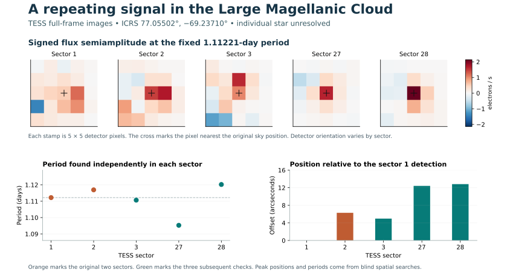

# Open-Space

**Open-Space looks again at public data from telescopes and spacecraft to find what was missed.**

[Visit the Open Space Observatory](https://dovvnloading.github.io/Open-Space/) to explore the research archive. [Launch a research flight](https://dovvnloading.github.io/Open-Space/#universe) to visit an investigation and inspect its source images and measurements.

Every night, observatories and space missions record far more than anyone has time to study. Open-Space downloads those public measurements, searches them with open code, and checks every lead against controls designed to catch false alarms. Each result comes with its data receipts, the scripts to replay it, and a plain statement of what it does *not* prove, so anyone can check our work.

Between 13 and 15 November 2026 the project merged 95 contributions. The catalog below has 227 entries: 99 new measurements, 45 candidate discoveries, 20 forecasts of specific events, 24 corrections to published catalogs and papers, and 38 carefully recorded null or inconclusive checks. The unclassified ACT real-pixel feasibility pilot below is separate from these classified scientific-result counts.

**Contents:** [Highlights](#highlights) · [Upcoming events](#upcoming-events-you-can-watch-for) · [How to read the results](#how-to-read-the-results) · [All results](#all-results-by-topic) · [How the results were made](#how-these-results-were-made) · [For researchers and developers](#for-researchers-and-developers) · [Credits and citation](#credits-and-citation)

## Highlights

**A catalog clock that was 69 seconds off.** A published catalog of magnetar bursts seen by NASA's NICER X-ray telescope lists times 69.184 seconds too early. That is exactly the gap between two time standards astronomers use (TT and UTC). Shifting the times recovers a stronger signal in 843 of 944 catalog windows. The same check showed that two famous "microsecond" bursts are only weakly tied to the magnetars they were credited to. [Details](results/nicer-magnetar-microbursts/README.md)

**A gamma-ray burst hiding in a solar-flare list.** Solar Orbiter's catalog lists entry 2112111310 as a small solar flare. Its hard X-ray pulse is GRB 211211A, a well-known cosmic explosion that arrived at the spacecraft exactly when the geometry predicts. [Details](results/grb-211211a-solar-orbiter/README.md)

**A lightning gamma-ray flash seen from two sides.** On 20 March 2016 NASA's Fermi and Italy's AGILE satellites recorded the same burst of gamma rays from a thunderstorm over Borneo, viewing it from directions 93° apart. [Details](results/fermi-agile-borneo-tgf/README.md)

**A star stream built on the wrong galaxy.** All 12 speed measurements used for the proposed stellar stream NGC 1261b belong to stars of a different galaxy, the dwarf galaxy Reticulum II. The stream's existence is now an open question. [Details](results/ngc1261b-reticulum-ii/README.md)

**Supernovae that switched on in radio years later.** Archival radio images show new emission at SN 2019njv about 3.5 and 6 years after its peak brightness, and at SN 2019bao after 6.7 years. Earlier images of both positions were much fainter. [Details](results/archival-radio-supernovae/README.md)

**An asteroid found again after 19 years (candidate).** Sightings filed as 2007 VE138 and 2026 VV15 fit a single orbit, as do 2017 RB15 and 2026 RG39 across nine years. Official confirmation rests with the Minor Planet Center. [Details](results/nea-pair-search/README.md)

**Signs of frozen carbon dioxide near the nebula MN39.** Brand-new SPHEREx infrared data show deep CO₂-ice absorption along two lines of sight, confirmed in four separate detector exposures. [Details](results/mn39-ice-absorption/README.md)

**Two white dwarfs racing back and forth.** Two dead stars change speed by about 250 km/s between observations, a sign that each may have an unseen companion. [Details](results/desi-white-dwarf-velocity-variables/README.md)

**A possible seven-month echo in a lensed quasar.** A correlation scan of J0826+7002 peaks at a delay of 210 days in ZTF data and 205 days in earlier Gaia data. The latest held-out ZTF interval slightly favors zero delay over exactly 210 days. [Details and model checks](results/j0826-lens-delay/README.md)

**"Planets" that are really eclipsing stars.** The planet candidates TOI-3143.01, KOI-7865.01, KOI-7866.01 and KOI-5275.01 trace to neighbouring stars that eclipse each other. [TOI-3143.01](results/tess-off-target-eclipse-sources/README.md) · [KOI-7865.01 and KOI-7866.01](results/koi-7865-eclipse-source/README.md) · [KOI-5275.01](results/koi-5275-eclipse-contamination/README.md)

**A survey's image index pointed to the wrong sky.** In a published MeerKAT radio survey, 649 of 693 image positions fell outside their own images, apparently because of a sign error. Corrected positions are provided. [Details](results/smgps-image-astrometry/README.md)

**A bright star that swapped its rhythm.** From 1976 to 2000, every second brightness peak of the giant star S Virginis was the brighter one. From 2002 to 2018 the pattern ran the other way. [Details](results/mira-alternating-maxima/README.md)

## Upcoming events you can watch for

These forecasts give a date and a geometry that anyone can test. Times and conditions are in each linked folder.

| When | What should happen | Details |
| --- | --- | --- |
| 24 Dec 2026 | During its Venus flyby, Solar Orbiter sees Venus hide Earth (22:55 UTC) and then Jupiter (22:57 UTC), each for about 19 seconds | [Link](results/solar-orbiter-venus-jovian-occultations/README.md) |
| 6 Feb 2027 | Venus passes in front of the radio pulsar PSR J1813−2113, as seen from the South Pole and New Zealand | [Link](results/venus-psr-j1813-2113/README.md) |
| Feb–Jun 2027 | The star magnified by the black-hole candidate OGLE-2026-BLG-0058 should be 2–5% fainter than a simple lensing curve predicts, if its measured parallax is real | [Link](results/ogle-dark-lenses/README.md) |
| 8, 9 and 11 Oct 2027 | Phobos casts its partial shadow on Mars's other moon, Deimos | [Link](results/deimos-penumbra-2027/README.md) |
| 25 Nov 2027 | ESA's JUICE spacecraft passes 49,751 km from asteroid (41013) 1999 UH22 | [Link](results/juice-41013/README.md) |
| About Sep 2028 | A new radio image could distinguish motion with WISE J0458+6434 from a source fixed at the low-frequency catalog position | [Link](results/wise-j0458-heldout/README.md) |
| 4 Jul 2029 | The planet Kepler-47 d crosses both of its suns during their eclipse | [Link](results/kepler-47-triple-eclipse/README.md) |
| 28 Nov 2030 | Saturn's A ring passes in front of the radio source RFC J0413+1903 for some radio observatories | [Link](results/saturn-rfc-j0413/README.md) |
| 1–3 Mar 2032 | Saturn's rings twice darken its moon Phoebe, around an 18-hour eclipse | [Link](results/phoebe-ring-shadow-2032/README.md) |
| 5 Feb 2035 | Seen from Mars on Curiosity's route, Phobos hides both Earth and the Moon for about 9 seconds | [Link](results/phobos-earth-moon/README.md) |
| 17–18 Oct 2037 | Jupiter eclipses its moon Sinope for about 9.5 hours | [Link](results/sinope-2037-jupiter-eclipse/README.md) |
| 12–13 Mar 2050 | Uranus's moon Umbriel covers and shadows Ariel three times in 22 hours | [Link](results/umbriel-ariel-2050/README.md) |
| 2 Mar 2054 | Venus covers the pulsar PSR J1944−1750 for radio telescopes in South Africa and India, if the pulsar's unmeasured motion is small | [Link](results/venus-pulsar-sightlines/README.md) |
| 2069–2071 | Asteroid 2025 UQ146 is temporarily captured by Jupiter again | [Link](results/jupiter-temporary-captures/README.md) |
| 2106 and 2118 | The black hole Gaia BH3 passes close to two background stars | [Link](results/gaia-bh3-lensing/README.md) |
| Jun 2109 | A star passes within 0.023 arcseconds of a distant quasar | [Link](results/star-quasar-alignments/README.md) |
| In about 205,000 years | The planetary systems HD 34445 and HD 37124 pass about 10,000 au apart | [Link](results/hd-34445-hd-37124/README.md) |
| In 2.6–3.5 million years | The star clusters UPK 90 and UPK 93 pass within about 8 parsecs | [Link](results/open-cluster-flybys/README.md) |

## How to read the results

Each finding below carries one label.

| Label | Meaning |
| --- | --- |
| **Measured** | A new measurement from public data. Anyone can reproduce it with the scripts in its folder. |
| **Candidate** | A promising signal that passed our checks but still needs independent confirmation. |
| **Prediction** | A forecast of a specific event, sometimes a past one that old images can test. |
| **Correction** | An error found in a published catalog, paper or data product, with the fix. |
| **Null result** | A careful search that found nothing. We publish these so others do not repeat the work, and to show what was ruled out. |

A few terms used below: an *eclipsing binary* is a pair of stars that pass in front of each other. A *pulsar* is a spinning neutron star that sends regular radio pulses. A *white dwarf* is the dense core left behind when a star like the Sun dies. An *occultation* happens when one body hides another. A *quasar* is the bright core of a distant galaxy, powered by a black hole. *Microlensing* is the brightening of a star when an unseen object passes in front of it.

## All results by topic

### The Sun, space weather and Earth's sky

- **Two satellites mapped a persistent deep Antarctic ozone core.** Below 180 Dobson units, 4.48 million km² of the early-November footprint still qualified on November 11–15, 2026. A separate daily check found 3.78 million km² below the threshold on all fifteen dates. *Measured* · [Details](results/antarctic-ozone-2026/README.md)
- **Public PDS ranges clip Voyager plasma observations.** The displayed coverage can omit the last Voyager 2 observation in the bundle and the last Voyager 1 observation in the collection. The two native product tables agree with their own labels. *Correction* · [Details](results/voyager-vlism-release/README.md)
- **A single magnetic timing shift did not transfer between SOLAR-1 and Wind.** On 7 November 2026, a phase-front direction fitted to earlier data gave weaker agreement than the best time-shift control. The two spacecraft were widely separated across the solar wind. *Null result* · [Details](results/solar1-wind-l1/README.md)
- **Continuum timing in Proba-3 solar images.** In one September orbit, all 63 flagged Fe XIV products used a different-cycle continuum exposure with a smaller representative-time lag than either same-cycle donor, despite similar exposure-start lags. A ten-image sensitivity test found small sign changes under a bracketing continuum substitution. *Measured* · [Details](results/proba3-aspiics-continuum-timing/README.md)
- **Two New Horizons calibration pointings share one label.** The listed short LYACAL exposure points 45.32° from the ten long integrations used to estimate scattered ultraviolet light. Matching the long exposures to the older template recovers the intended field, and the reported 1,135 Å contrast persists under alternate background reductions. *Measured* · [Details](results/new-horizons-alice-1135/README.md)

- **A magnetic "hole" in the solar wind reached Earth (6 Oct 2023).** Three spacecraft saw the magnetic field drop for about half an hour inside a known solar eruption, and the matching pressure pulse arrived at Earth on schedule. *Measured* · [Details](results/solar-wind-cavity-20231006/README.md)
- **A solar magnetic structure reached the inner spacecraft last (28–29 Sep 2023).** A structure seen by Wind has a candidate counterpart at STEREO-A that arrived hours later, even though STEREO-A was closer to the Sun. *Candidate* · [Details](results/stereo-20230929/README.md)
- **Opposite magnetic directions in the solar wind at the same time (31 Jan 2019).** ACE and DSCOVR measured a northward field for a full hour while Wind measured southward. Two probes near the Moon then sided with ACE and DSCOVR. *Measured* · [Details](results/l1-lunar-polarity-split/README.md)
- **Two solar eruptions short of carbon (June 2003).** Near Jupiter's distance from the Sun, Ulysses found two catalogued eruptions strongly depleted in fully ionized carbon and rich in helium. *Measured* · [Details](results/ulysses-carbon-depletion-200306/README.md)
- **A candidate source for the far-side solar eruption of 13 July 2021.** Of the numbered regions tested, NOAA 12849 lies closest to the observed X-ray direction. The above-limb centroid leaves the source longitude uncertain. *Candidate* · [Details](results/2021-july-13-farside-eruption/README.md)
- **The strongest oxygen-ion signal of 2011 in the solar wind.** Wind's measurement on 29 September 2011 stands. A link to debris from comet Elenin was tested and remains uncertain. *Measured* · [Details](results/comet-ion-tail-spacecraft-crossings/README.md)
- **Parker Solar Probe's radio data depend on an instrument setting.** Inside Venus's shadow, the probe's radio power rose with its antenna bias current, an effect users of these data need to correct for. *Measured* · [Details](results/parker-venus-radio-power/README.md)
- **Faster solar eruptions bring a storm's peak sooner.** Across 113 severe magnetic storms from 1996 to 2025, the storm peaked about 11 hours after the shock wave reached Earth when the eruption was fast, and about 23 hours after when it was slow. This is a pattern in past storms, not a forecasting tool. *Measured* · [Details](results/cme-speed-storm-latency/README.md)
- **Cosmic-ray dips alone do not forecast magnetic storms.** In 1963–2000, sudden drops in cosmic rays were followed by severe storms slightly more often than chance. The excess did not hold up in the 2001–2016 test period. The catalogue's event classes already record whether a shock arrived, which would contaminate any forecast built on them. *Null result* · [Details](results/forbush-storm-onset/README.md)
- **A lightning gamma-ray flash seen from two directions (20 Mar 2016).** Fermi and AGILE recorded the same thunderstorm flash over Borneo from directions 93° apart. *Measured* · [Details](results/fermi-agile-borneo-tgf/README.md)
- **Two fireballs 2.3 seconds apart over the Pacific (21 Nov 2023).** The lightning cameras on two GOES weather satellites resolve two separate fireballs about 315 km apart. *Measured* · [Details](results/goes-pacific-double-bolide/README.md)
- **Fireballs recorded by instruments on the ground.** The Sims Corner fireball (Washington, 14 Aug 2026) and an Interior Alaska fireball (1 Jan 2022) left matching signals in seismometers and pressure sensors. Satellites place Sims Corner's brightest flash about 32 km up. *Measured* · [Details](results/sims-corner-seismoacoustic/README.md)
- **Four meteors in under nine seconds (24 Aug 2026).** Four meteors over Germany and Denmark appeared to come from nearly the same point in the sky. A chance grouping is still possible. *Candidate* · [Details](results/gmn-meteor-clusters/README.md)

### Earth’s rivers, wetlands, sea ice and coastlines

- **Sentinel-6B CoastWatch exports apply an explicit latency edit.** All 67 checked 6B histories limit the processing latency used for sea-level anomaly. The 6A histories show no explicit latency limit. A Pacific coast comparison found no repeatable 1 cm near-shore excess on paired tracks. *Measured* · [Details](results/sentinel6-tandem-coastwatch/README.md)
- **A second reflectance offset darkened recent Sentinel-2 scenes at Ioto.** An original-pixel comparison confirmed the 0.1 reflectance error in six Earth Search scenes. The corrected optical shoreline test left the timing of attachment unresolved. *Correction* · [Details](results/ioto-okinahama-shoreline/README.md)
- **No Antarctic offshore opening passed the three-day AMSR3 screen.** A smaller patch persisted for three days in the sensitivity check. AMSR2 saw the low concentrations on both available days, while SSMIS estimated much more ice over the same cells. A smoothing test narrowed the gap. *Null result* · [Details](results/amsr3-antarctic-openings/README.md)
- **Mali’s Inner Niger Delta shows a delayed seasonal flood wave (2024–26).** On two same-track SWOT RiverSP D July–January comparisons, Diré stood 4.64 m and 3.55 m higher while Mopti changed by no more than 0.18 m. Independent gauges and a second altimeter corroborate the stage contrasts; a persistent change in discharge was not established. *Measured* · [Details](results/mission05-swot-rivers/inner-niger/README.md)
- **A one-day pulse of red-reflecting water in the northern Adriatic (6 Nov 2025).** NASA's PACE satellite, an offshore tower instrument and Europe's Sentinel-3 all saw the shelf water brighten in red light for a day and fade the next; PACE measured a 56% drop at 620 nm. Stirred-up or passing particles are plausible, the cause is unresolved, and similar events appear in earlier observations. *Measured* · [Details](results/pace-ocean-optical-transitions/README.md)

### The Moon and Mars

- **Restored Mars Express S-band files carry X-band field labels.** The carrier values identify the band in all six Deep Space Network passes. Three passes have no calibrated S-band residuals. The matched occultations near the March 2024 aurora yield a background-sensitive comparison. *Correction* · [Details](results/mex-mars-aurora/README.md)
- **The dawn strip west of Arsia Mons gives an alignment-sensitive result.** January and November Odyssey images share a narrow ground strip. After accounting for broad brightness changes, the two-band contrast fails the fixed cloud-brightening test at the archived alignment. *Null result* · [Details](results/themis-arsia-morning/README.md)
- **What Orion's camera recorded near two Artemis II lunar flash reports.** The downlink has frames around both speech cues. Around the second, substantial image changes occur about every 0.2002 seconds and the lunar disk is difficult to locate. The higher-cadence onboard clip starts after both cues. *Measured* · [Details](results/artemis2-saw3-observability/README.md)
- **Two Apollo 17 eclipse windows showed no compelling moonquake excess.** The event counts were compared with uneclipsed full Moons and adjacent windows. A separate test of deep moonquake sources found no unusual pairing. Recording coverage and detection efficiency limit both tests. *Null result* · [Details](results/apollo-lunar-seismicity/README.md)
- **One lunar crater counted twice.** Two catalogue entries describe the same 9-metre impact crater. Additional orbiter images halve the window in which it formed, to 177 days. *Correction* · [Details](results/lunar-impact-flash-associations/README.md)
- **Martian "repeat impacts" checked against spacecraft images.** One apparent repeat is a duplicated catalogue entry. Another is two real craters 2.26 km apart that formed at least 115 days apart. *Correction* · [Details](results/mars-impact-brackets/README.md)
- **Neighbouring Martian craters come in similar sizes.** Across 259 fresh impact fields, nearby craters are more alike in size than chance predicts. A model of meteors breaking up in the atmosphere explains only part of the pattern. *Measured* · [Details](results/mars-crater-size-correlation/README.md)
- **Two NASA gravity maps of Mars differ mostly in where they put zero longitude.** The 2020 and 2026 models use prime meridians about 100 metres apart on the ground (6.07 arcseconds). Rotating one to match the other removes about 99% of their apparent large-scale difference, which is not a change in Mars itself. *Measured* · [Details](results/mars-gravity-mro120g-2026/README.md)
- **Perseverance sensed Phobos passing beside the Sun.** Sky sensors on the rover dimmed by up to about 2% when the moon passed close to, but not across, the Sun. *Candidate* · [Details](results/jezero-transit-radiometry/README.md)
- **A candidate Mars Trojan and a possible temporary companion of Earth.** Asteroid 2026 RF64 appears to trail Mars along its orbit. A second object may briefly accompany Earth. *Candidate* · [Details](results/terrestrial-coorbitals/README.md)
- **Phobos's shadow will touch Deimos three times (8, 9 and 11 Oct 2027).** *Prediction* · [Details](results/deimos-penumbra-2027/README.md)
- **Energetic particles surged in Mars orbit (22–29 Aug 2025).** NASA's MAVEN orbiter recorded peak hourly median fluxes on 24 August, about 5,140 times the survey reference for ions and 24,450 times for electrons. Forecasts for two solar eruptions fit the timing. *Measured* · [Details](results/maven-2025-sep-events/README.md)
- **Phobos will hide Earth and the Moon together (5 Feb 2035).** Seen from a point on Curiosity's route, for about 9.4 seconds. *Prediction* · [Details](results/phobos-earth-moon/README.md)

### Asteroids and comets

- **An asteroid seen again after 19 years.** Sightings filed as 2007 VE138 and 2026 VV15 fit one orbit, and 2017 RB15 and 2026 RG39 connect across nine years. The 19-year orbit fits slightly better with a small outward push, but a later 59-position holdout favors gravity alone (2.506″ versus 3.103″ with the push). The two orbit programs use the same optical observations, so their agreement is not independent confirmation. Official identification rests with the Minor Planet Center. *Candidate* · [Details](results/nea-pair-search/README.md)
- **Asteroid 2024 XS16 photographed fading into Earth's shadow (11 Dec 2024).** A telescope in Sicily recorded the fade as the asteroid entered the shadow. The fade differs from a no-shadow prediction by only about 2.5 times its uncertainty. *Candidate* · [Details](results/2024-xs16-earth-shadow/README.md)
- **Two asteroids that may have split apart about 1,800 years ago.** The orbits of (863192) 2014 SD315 and 2025 UC18 converge in the past. *Candidate* · [Details](results/asteroid-863192/README.md)
- **Gaia's view of a spinning asteroid picks its shape.** The wobble of (664) Judith in Gaia's positions matches one of two published shape models. *Measured* · [Details](results/asteroid-664-judith/README.md)
- **An asteroid brushed past interstellar comet 2I/Borisov (28 Oct 2019).** (704021) 2007 XJ8 passed about 106,000 km from Borisov, confirmed in telescope images. *Measured* · [Details](results/borisov-704021/README.md)
- **The two pieces of comet 240P/NEAT are drifting apart.** The smaller fragment trails the larger by about 71 minutes of orbital motion. *Measured* · [Details](results/comet-240p-motion/README.md)
- **A comet and an asteroid passed within 31,000 km (22 Feb 2026).** Comet 407P/PANSTARRS–Fuls and asteroid (75547) 1999 XV257. *Measured* · [Details](results/comet-407p-asteroid-75547/README.md)
- **A comet lined up behind interstellar comet 3I/ATLAS (Oct 2025).** 383P/Christensen and 3I/ATLAS lay on the same line out from the Sun on dates about a week apart. Whether any material from 3I reached 383P is unresolved. *Measured* · [Details](results/3i-atlas-383p-radial-crossing/README.md)
- **Can 3I/ATLAS’s escaping gas account for its small nongravitational push?** An independent fit to 8,301 public positions detects a push; measured water, carbon dioxide, and carbon monoxide can provide its strength for some smaller-nucleus models, but not every Hubble-size/density choice. Changes with orbital phase, delayed activity and mismatched JPL observations leave its direction unresolved; no extra unknown force is established. *Measured* · [Details](results/3i-atlas-outgassing-recoil/README.md)
- **The two bright knots of comet C/2020 P4-B.** Their separation is measured at 38.5 arcseconds. The discoverers first showed both knots in 2020. *Measured* · [Details](results/2020-p4-condensations/README.md)
- **An unexplained infrared excess in comet C/2025 R2 (SWAN).** In single exposures from NASA's SPHEREx telescope the comet shows extra infrared light on 22 and 25 December 2025 and again on 2 January 2026. It is not a validated identification of any gas: calibration questions remain open, and a shape fitted to December failed to carry over to January. *Candidate* · [Details](results/spherex-dr1-moving-spectra/FINAL_STATUS.md)
- **No new sungrazing comets in 988 SOHO images.** A search for undiscovered members of the Kreutz comet family recovered only known comets. *Null result* · [Details](results/kreutz-companion-search/README.md)
- **No new interstellar body in a month of isolated survey tracklets.** No three-night high-speed link held up among 2,130 Pan-STARRS 1 tracklets. In a conditional synthetic-track test, 35 of 37 simulated paths near timed real sky detections linked correctly; detector footprints, brightness, encounter rate and 1,687 unresolved catalog entries remain unmeasured. *Null result* · [Details](results/inbound-hyperbolic-search/README.md)
- **Repeated dips in two asteroids, but no confirmed moons.** TESS saw regular dimming of (29489) 1997 WQ and (3177) Chillicothe in 2018. Later visits did not show a steady rhythm. *Candidate* · [Details](results/tess-asteroid-mutual-events/README.md)
- **Asteroid 2025 UQ146 keeps returning to Jupiter.** It was temporarily captured by Jupiter in 1984–1987 and should be again in 2069–2071. *Prediction* · [Details](results/jupiter-temporary-captures/README.md)
- **ESA's JUICE will fly past an asteroid (25 Nov 2027).** It should pass 49,751 km from (41013) 1999 UH22. *Prediction* · [Details](results/juice-41013/README.md)

### Planets, moons and rings in our Solar System

- **A drop in magnetic fluctuations recovers Mariner 5’s outbound Venus bow shock.** The restored encounter frames resolve a larger drop than any of the matched cruise windows. The strongest change in mean field magnitude falls earlier. *Measured* · [Details](results/mariner5-venus-fluctuations/README.md)
- **A short radiation dip did not appear at Juno’s closest approach to Thebe.** New archive data put one camera exposure 19 seconds before closest approach. The independent particle detector and the neighboring camera samples failed the fixed two-detector deficit test. *Null result* · [Details](results/juno-thebe-radiation/README.md)
- **Mixing two Cassini archive versions shifts the clocks for an Enceladus occultation.** The 2026 FUV labels and legacy HSP labels shorten the relative time by one second. Using a shared spacecraft clock changes the HSP count assigned to one exposure by about 658. *Correction* · [Details](results/cassini-uvis-enceladus-clock/README.md)
- **An infrared Planet Nine candidate did not reappear in public follow-up images.** A 2025 paper linked two far-infrared sources seen by IRAS in 1983 and AKARI in 2006. The old IRAS detector scans instead favour fixed sky emission, possibly from a nearby galaxy. DES and Euclid recovered 397/400 simulated dark planets (388/400 with perturbed historical positions), but uncertain AKARI timing and unmeasured regions prevent exclusion of the entire proposed orbit family. *Null result* · [Details](results/planet-nine-fir/README.md)
- **Io's record 2024 eruption brightened Jupiter's sulfur glow but barely its sodium cloud.** *Measured* · [Details](results/io-2024-eruption-sodium/README.md)
- **A 9.5-hour eclipse of Jupiter's moon Sinope (17–18 Oct 2037).** The moon will sit far enough from Jupiter in our sky to be observed during the eclipse. *Prediction* · [Details](results/sinope-2037-jupiter-eclipse/README.md)
- **Saturn's rings will shade its moon Phoebe (1–3 Mar 2032).** The B ring should twice remove about 98% of Phoebe's sunlight. *Prediction* · [Details](results/phoebe-ring-shadow-2032/README.md)
- **Saturn's A ring will pass in front of a radio source (28 Nov 2030).** Some radio observatories will see it, even though the view from Earth's centre misses the ring. *Prediction* · [Details](results/saturn-rfc-j0413/README.md)
- **Perdita appeared away from its predicted position in two JWST visits.** The known moon lay a median 0.50 and 1.17 arcseconds from the nominal JPL ephemeris. The observing team had previously reported a qualitative discrepancy; the two-visit circular fit has alternative orbit aliases. *Measured* · [Details](results/ice-giant-moon-search/README.md)
- **Saturn's moon S/2023 S 38 probably has a gentler orbit than listed.** The discovery measurements favour the moderately stretched orbit its discoverers proposed over the extreme public solution. *Measured* · [Details](results/saturn-s38-orbit-solutions/README.md)
- **Did Neptune's moon Nereid pass through Triton's shadow (31 Jan 2026)?** Current JPL orbits say yes, while an older independent orbit says no. Archive images taken at that time could settle it. *Prediction* · [Details](results/triton-nereid-eclipses/README.md)
- **Uranus's moons Umbriel and Ariel will eclipse three times in 22 hours (12–13 Mar 2050).** *Prediction* · [Details](results/umbriel-ariel-2050/README.md)
- **A 2006 crossing of the two moons of dwarf planet Haumea.** Orbit solutions place Hiʻiaka in front of Namaka on 13 Aug 2006, which archival images can test. *Prediction* · [Details](results/haumea-satellite-conjunctions/README.md)
- **Two distant objects that may move in step with Neptune.** 2017 DO171 is a candidate member of Neptune's 8:1 resonance, using new Rubin Observatory positions. A second object is also a candidate. *Candidate* · [Details](results/distant-neptune-resonators/README.md)
- **The distant double object 2014 JR80 seen turning.** Five Rubin Observatory exposures on three nights in 2026 show the pair's orientation turning 49.46° in 11.963 days. With older images they favour a 103.03-day mutual orbit. Proudfoot and colleagues discovered that the object is double; the new part is the motion. *Measured* · [Details](results/rubin-jr80-mutual-motion/README.md)
- **Solar Orbiter will see Venus hide Earth, then Jupiter (24 Dec 2026).** *Prediction* · [Details](results/solar-orbiter-venus-jovian-occultations/README.md)
- **Venus will pass in front of a pulsar (6 Feb 2027).** PSR J1813−2113, as seen from the South Pole and New Zealand. A detection with current telescopes is not assured. *Prediction* · [Details](results/venus-psr-j1813-2113/README.md)
- **Venus and the pulsar PSR J1944−1750 (2 Mar 2054).** Radio telescopes in South Africa and India could both see the occultation, if the pulsar's unmeasured motion is small. *Prediction* · [Details](results/venus-pulsar-sightlines/README.md)
- **A search for meteor flashes on Jupiter's night side found none.** Photon-by-photon data from the Juno spacecraft's ultraviolet instrument recover the flash published from 10 April 2020. A first frozen search of 2025 data found no trigger. Only three of the eight selected intervals held usable night-side photons, so this sets no impact rate. *Null result* · [Details](results/juno-uvs-impact-control/README.md)

### Planets around other stars

- **No new Earth-mass rogue planet in 10,971 public bulge light curves.** Several short or large-source brightenings survived screening, but blends and competing lens models prevent a confirmed planetary discovery. Without a monitored-star count, the search cannot measure how common rogue planets are. *Null result* · [Details](results/ultrashort-bulge/README.md)
- **A JWST search found no new wide planet around ten nearby stars.** Archive checks show that three apparent companions are previously recorded background sources. Contrast and injection tests describe only the searched parts of those images, not every possible companion. *Null result* · [Details](results/jwst-nearby-companions/README.md)
- **Five more nearby stars checked for hidden planets with JWST.** No new companion was confirmed. One bright source proved to be a known background object and other peaks failed repeat-image checks; two faint signals still need deeper observations in later years to settle what they are. *Null result* · [Details](results/jwst-five-field-followup/README.md)
- **Four "planets" that are really eclipsing stars.** TOI-3143.01's signal comes from the neighbouring binary TIC 384244835. A single eclipsing binary produced the two Kepler candidates KOI-7865.01 and KOI-7866.01. KOI-5275.01 is light from a binary 30 arcseconds away. *Correction* · [TOI-3143.01](results/tess-off-target-eclipse-sources/README.md) · [KOI-7865.01 and KOI-7866.01](results/koi-7865-eclipse-source/README.md) · [KOI-5275.01](results/koi-5275-eclipse-contamination/README.md)
- **A neighbouring eclipsing binary shifts KELT-8 b's measured transit times.** *Measured* · [Details](results/kelt-8-timing/README.md)
- **No sign of the proposed eighth TRAPPIST-1 planet.** JWST's dedicated observation shows no dip deeper than about 330 parts per million, while a transit at the shallow end of the proposal would usually have been detected. *Null result* · [Details](results/trappist-1-jwst-timing/README.md)
- **Kepler-47 d will cross both of its suns at once (4 Jul 2029).** For about 98 minutes the whole planet will sit inside both stellar disks. *Prediction* · [Details](results/kepler-47-triple-eclipse/README.md)
- **Do the planets Kepler-18 c and d ever eclipse each other?** Five transits in which both planets crossed their star test the planets' orbital orientation. *Measured* · [Details](results/kepler-planet-crossings/README.md)
- **Kepler-359's apparent three-planet rhythm is not locked.** Most orbit solutions drift through all angles instead of staying locked in resonance. *Measured* · [Details](results/kepler-three-planet-frequency-locks/README.md)
- **Two Doppler signals at the nearby star HD 32564.** Signals at 2.56 and 11.06 days, fitted to older HARPS data, were recovered in new ESPRESSO velocities, making the star a low-mass companion candidate. *Candidate* · [Details](results/hd-32564/README.md)
- **A "new" JWST source near ε Eridani was already in 2001 Keck images.** The positions match. The brightness comparison is in tension. *Measured* · [Details](results/epsilon-eridani-keck-jwst/README.md)
- **No additional transit candidate passed follow-up around 90 TESS hosts.** Three peaks survived the initial screen of 393 sector light curves. Stellar variability explained two, and the third reversed sign in a second photometric extraction. *Null result* · [Details](results/tess-additional-transits/README.md)
- **Six planets listed more than four times too far from their stars.** The Open Exoplanet Catalogue's orbit sizes for the Kepler-445 and Kepler-446 planets were computed with the Sun's radius instead of each small star's own. Three more entries carry misplaced or mis-copied values, and the published orbit sizes of the four K2-285 planets do not fit a single star's mass. *Correction* · [Details](results/oec-orbital-scale-audit/README.md)
- **A transit-like dip that flips sign.** On the flaring red dwarf TIC 257433294, a reported dip reappears in new TESS data but changes sign between two TESS data products, so its origin is uncertain. *Measured* · [Details](results/tess-sector108/README.md)

### Stars, binaries and multiple-star systems

- **No complete PISN-style chemical fingerprint in the well-measured GALAH DR4 subset.** All 917,588 stars were screened; of 5,189 quality-selected metal-poor stars, only 196 have all five key unflagged elemental measurements, and none passes the frozen abundance cuts. Just 14 also have usable strontium and barium. No very metal-poor ([Fe/H] ≤ −2.5) star has the full five-element set, so this does not rule out primordial supernova descendants; yield-model and independent survey tests remain unfinished. *Null result (coverage-limited screen)* · [Methods, source hash, catalogue rows and sensitivity](results/galah-dr4-pisn-fingerprint/README.md)
- **The star HD 25673 keeps changing speed along our line of sight.** The newly public CORALIE spectra extend the previously reported HARPS drift through 2024. Its annual median velocity fell by 216.1 m/s in the modern CORALIE series, and astrometry also shows excess motion. A companion orbit is unresolved. *Measured* · [Details](results/coralie-rv-acceleration/README.md)
- **A search for circularly polarised radio signals found known stars, not a new planet signal.** GJ 1151 and COCONUTS-2 A match previously published radio detections. Eleven nearby objects checked in available VLASS images showed no strong new signal; although many planet hosts lie within other surveys' image footprints, their individual radio limits are not yet measured. *Null result* · [Details](results/stellar-stokes-v/README.md)

- **No new unexplained deep dimmers in a TESS sector.** A search of 384 stars in Sector 105 (June–July 2026) found no validated irregular eclipses. A striking dimming toward TIC 316937197 repeats every 18.767 days, but which star in the close blend eclipses remains unknown. Recovery tests found 56% of 2%-deep, 12-hour dips; this single-sector search weakly constrains rare, multi-day events. *Null result* · [Details](results/tess-asymmetric-dips/README.md)

- **Gaia and LAMOST confirm a long binary orbit, not a dark companion.** Eighteen nights of independent spectra follow HD 264291 through its 1,007-day orbit. The inferred companion is 1.77 solar masses only under a no-companion-light model; two normal dwarfs are still possible. Another giant's inferred minimum crosses three solar masses when its stellar mass model changes. Neither case is an identified black hole or neutron star. *Measured* · [Data and limits](results/gaia-nss-dark-companions/README.md)

- **A high-speed star may escape the Milky Way.** DESI DR1 and Gaia DR3 give source 1717410430709663616 a Galactocentric speed of 697 km/s. All 4,096 draws escape in two reference Galactic potentials but remain bound in a heavier halo. The DESI velocity has only one epoch (binary motion untested), the modeled trajectory crosses the disk, but its origin remains open, and discovery priority remains open. *Candidate* · [Details](results/dr1-dr19-unbound-stars/README.md)

- **No verified laser-like emission in a targeted DESI DR1 stellar search.** All 10 persistent narrow residuals in 190 audited repeat-observed stars match the stellar Li I doublet; five independent-field stars reproduced a template false positive on separate nights. Per-star conditional laser-power limits are provided. This does not constrain unsearched fields or intermittent emitters. *Null result* · [Details](results/desi_dr1_optical_seti/README.md)
- **No verified stellar waste heat in a small infrared sky survey.** SPHEREx and WISE found no qualifying excess around 404 nearby stars across 12.6 square degrees; published candidates remain affected by dusty galaxies, blends or unresolved mid-infrared emission. SPHEREx recovered none of the injected 100 K or 300 K excesses at 1% of stellar luminosity in its controls, so this is a limited null, not a Galaxy-wide constraint. *Null result* · [Details](results/spherex-waste-heat/README.md)
- **No new kind of infrared spectrum confirmed in two SPHEREx sky patches.** A search ranked 107 sources and flagged 57 for closer checks. Later observations could test 29 of those, and none retained an unexplained fitted feature; the other 28 lack complete comparisons. One bright spike did not repeat, and a real galaxy emission band matches a known type. These two patches cannot set an all-sky limit. *Null result* · [Details](results/spherex-dr1-unclassified-spectra/README.md)

**Eclipsing binaries and star systems**

- **A candidate compact triple star.** In TIC 96100077 an eight-hour eclipsing pair sits at the position of a star with a 273-day Gaia orbit. Three ground surveys recover the predicted timing shifts. *Candidate* · [Timing](results/tic-96100077/validation/README.md) · [Velocity test](results/tic-96100077/velocity-test/README.md)
- **Two eclipsing binaries drifting in opposite directions.** In TIC 140241924 one pair ran 42 minutes early and the other 51 minutes late in 2025, which supports their orbiting each other. *Measured* · [Details](results/tic-140241924/README.md)
- **Both eclipses of binary A in TIC 43472931 arrived 9–11 minutes early.** *Measured* · [Details](results/tic-43472931/README.md)
- **An orbit that is slowly turning.** The secondary eclipse of TIC 35481236 moved 36 minutes within its orbit between 2018 and 2026. *Measured* · [Details](results/tic-35481236-apsidal-motion/README.md)
- **A 20.27-hour rhythm and drifting eclipses in TIC 196989952.** The gap between its two eclipses grew by 3.24 hours over 16.7 years. *Measured* · [Details](results/tic-196989952-stellar-clocks/README.md)
- **An ordinary eclipsing binary where a white-dwarf pair was proposed.** TIC 252468415 shows deep stellar eclipses every 3.166 days. *Correction* · [Details](results/tic-252468415/README.md)
- **Two "double-double" star candidates.** Two pairs of eclipsing binaries share distances and motions on the sky. *Candidate* · [Details](results/resolved-double-eclipsing-systems/README.md)
- **CD−27 2812 may be a four-star system with a white dwarf.** *Candidate* · [Details](results/cd-27-2812/README.md)
- **A cool star that changed speed by 367 km/s.** In STSP J153415.59+363616.8 a compact white-dwarf binary sits inside a group of four sources, making a candidate five-star system. *Candidate* · [Details](results/stsp-j153415/README.md)
- **An asteroid's shadow split a star in two.** A 2022 occultation of HD 154615 revealed a close companion candidate to this eclipsing binary, whose eclipse timing is also changing. *Candidate* · [Details](results/hd-154615-occultation/README.md)
- **A likely hidden third star in TYC 557-1335-1.** An asteroid occultation resolved two sources too far apart to share the star's known 59-day orbit. *Candidate* · [Details](results/tyc-557-1335-1/README.md)
- **A proposed dormant black hole with two visible stars.** TYC 2290-902-1 shows two sets of stellar lines and a 12.85-hour brightness cycle, a simpler explanation than a hidden black hole. *Measured* · [Details](results/tyc-2290-902-1/README.md)
- **The published orbits of the triple star HD 73712 cannot all be right.** *Correction* · [Details](results/hd-73712-orbits/README.md)
- **An eclipse gap that grew by 6.96 hours.** The time between the two eclipses of OGLE-SMC-ECL-04602 widened over 25 years. *Measured* · [Details](results/smc-04602/README.md)
- **An eclipse gap that changed direction.** In OGLE-SMC-ECL-06090 a slowly turning orbit predicted later eclipse times within three minutes. *Measured* · [Report](docs/SMC_06090_ECLIPSE_TIMING.md) · [Data](results/smc-06090/README.md)
- **Eclipses that faded away and eclipses that deepened.** Both eclipses of OGLE-SMC-ECL-07730 faded while both eclipses of OGLE-SMC-ECL-06703 deepened. *Measured* · [Details](docs/SMC_ECLIPSE_DEPTHS.md) · [Data](results/smc-eclipse-depths/)
- **A second dimming rhythm in OGLE-SMC-ECL-05439.** A 1.165-day cycle with alternating dips runs alongside the known binary. *Candidate* · [Details](results/smc-05439/README.md)
- **Extra brightness signals near three Small Magellanic Cloud binaries.** Variations of 4.886 hours (toward 2dFS 757) and 4.252 hours (OGLE-SMC-ECL-01947), and a 12.72-hour dimming (OGLE-SMC-ECL-01293). The stars producing them are unresolved. *Measured* · [2dFS 757](results/smc-01844/README.md) · [OGLE-SMC-ECL-01947](results/smc-01947/README.md) · [OGLE-SMC-ECL-01293](results/smc-01293/README.md)

**Pulsating, erupting and variable stars**

- **A steady 3.83-hour rhythm in the 2017 nova V612 Scuti.** *Measured* · [Details](results/v612-sct-clock/README.md)
- **A red giant that switched its pulsation from 137 days to 264 days.** In two other Mira stars, the dominant cycle shortened by 13% and 18%. *Measured* · [Details](results/bulge-giant-pulsation/README.md)
- **A Cepheid whose secondary pulsation comes and goes every 4.7 years.** OGLE-SMC-CEP-2332. *Measured* · [Details](results/magellanic-cepheid-mode-changes/README.md)
- **An RR Lyrae star that switched its main pulsation.** The new pulsation's period also grew by 44 seconds. *Measured* · [Details](results/magellanic-rr-lyrae-mode-transitions/README.md)
- **S Virginis swapped its bright and faint cycles around 2001.** A survey of 52,377 peaks in 510 Mira stars also dated a long alternating sequence in V Delphini. Earlier reports of alternation are credited. *Measured* · [Details](results/mira-alternating-maxima/README.md)
- **β Pictoris's pulsations swapped strength between two TESS visits.** *Measured* · [Details](results/beta-pictoris-pulsations/README.md)
- **Gaia19dyr went through a temporary phase of deep dips every 9 days.** *Measured* · [Details](results/gaia19dyr/README.md)
- **A star thought to be irregular dims roughly every 600 days.** NGC 1893 V22. *Measured* · [Details](results/gaia23bop/README.md)
- **A large flare on UX Arietis missing from flare catalogs (22 Oct 2021).** It was seen in visible light by TESS and in X-rays by MAXI. *Measured* · [Details](results/maxi-tess-stellar-flares/README.md)
- **Clocks of 88 and 127 minutes in two X-ray-selected cataclysmic-variable candidates.** *Measured* · [Details](results/erass-cv-optical-clocks/README.md)
- **A 79-minute rhythm that persisted through a 2023 stellar outburst.** MASTER OT J055845.55+391533.4. *Measured* · [Details](results/ultracompact-helium-clocks/README.md)
- **Two helium emission lines that disagree in speed.** In SDSS J0903−0133 they differ by 67 km/s. *Measured* · [Details](results/j0903-helium-cores/README.md)
- **A repeating infrared signal toward the Wolf–Rayet star WR 117-2.** *Measured* · [Details](results/wr-117-2/README.md)
- **A proposed one-day binary that is a sampling artifact.** The clock reported in the planetary nebula Al 2-R comes from the nightly observing pattern. *Correction* · [Details](results/pn-al-2-r-alias/README.md)
- **A "microlensing" source that keeps erupting.** K2C9-R-0367 (OGLE-2013-BLG-0769) brightened in at least six seasons, favouring a recurring stellar eruption over a one-time lens. *Measured* · [Six eruptions](results/recurrent-bulge-transient/README.md) · [First repeat](results/ogle-2013-blg-0769/README.md)
- **Another microlensing-sample star brightened again 399 days later.** BLG515.30.119116 (OGLE-BLG-DN-0513). *Measured* · [Details](results/ogle-dn-0513/README.md)
- **A long 2020 outburst of PTF11fzx among shorter repeats.** *Measured* · [Details](results/ptf11fzx-recurrence/README.md)
- **Two more bright states of nova ASASSN-23hd before it erupted.** *Measured* · [Details](results/asassn-23hd-pre-eruption/README.md)
- **Radio counterparts to two exploding stars in our Galaxy.** Archival images show radio sources at the novae V1708 Sco and AT 2022sfe. *Candidate* · [Details](results/galactic-nova-radio-counterparts/README.md)
- **A methanol maser's 111-day cycle found in older data.** G28.011−0.426, recovered in 2009–2013 observations. *Measured* · [Details](results/methanol-maser-monitoring/README.md)

**Nebulae and interstellar material**

- **Frozen carbon dioxide along two sightlines near the nebula MN39.** SPHEREx sees deep CO₂-ice absorption, with absorption near water and carbon-monoxide ice as well. Foreground material is a plausible source. *Measured* · [Details](results/mn39-ice-absorption/README.md)
- **A MeerKAT radio shell is a known planetary nebula.** G276.229+00.419 matches PHR J0942−5220 in shape and position. *Correction* · [Details](results/smgps-planetary-nebula/README.md)
- **Nineteen "galaxies" that are clouds in the Milky Way.** Nineteen entries in the FAST FASHI catalog of distant hydrogen sources come from four nebulae in our own Galaxy. *Correction* · [Details](results/fashi-recombination-lines/README.md)

**Stars on a collision course (forecast encounters)**

- **Two star clusters will pass within about 8 parsecs.** UPK 90 and UPK 93, in 2.6–3.5 million years. *Prediction* · [Details](results/open-cluster-flybys/README.md)
- **Two planetary systems will pass about 10,000 au apart.** HD 34445 and HD 37124, in about 205,000 years. *Prediction* · [Details](results/hd-34445-hd-37124/README.md)
- **A cold brown dwarf that could be weighed by its gravity.** WISE J2000+3629 will pass close to two background stars. *Prediction* · [Details](results/t8-dwarf-background-encounters/README.md)
- **A star will nearly cover a quasar in June 2109.** *Prediction* · [Details](results/star-quasar-alignments/README.md)
- **The black hole Gaia BH3 passed a star in 1928 and will pass two more.** *Prediction* · [Details](results/gaia-bh3-lensing/README.md)

### White dwarfs

- **No new planet or debris transit confirmed around 42 bright white dwarfs.** In 39 uncrowded TESS targets, injections place a 95% upper limit of 11.13% on the fraction with a transiting companion 11.2 Earth radii in size on a 1.40794-day orbit. The fraction with planets at other orbital tilts, and the occurrence of irregular debris, remain unmeasured. *Null result* · [Details](results/tess-white-dwarf-occultations/README.md)
- **No faster supernova survivor found in the surveyed star catalogues.** None of 67,433 Gaia stars with well-measured parallaxes in four white-dwarf-oriented spectral catalogues had a measured sideways speed above 1,000 km/s. The all-sky speed cut missed 8 of 11 already known D⁶ white dwarfs, so this is a weak limit; one blended-looking fast star still needs follow-up. *Null result* · [Details](results/gaia-dr3-supernova-survivors/README.md)
- **Two white dwarfs with speed swings of about 250 km/s.** WD J0238+2733 and WD J0421−1325 are strong candidates for hidden companions. *Candidate* · [Details](results/desi-white-dwarf-velocity-variables/README.md)
- **Revised gravitational-wave clocks for eclipsing white-dwarf pairs.** Using the published parameters, ZTF J0720+6439's eclipses should drift about 13 seconds in 10 years rather than the 0.6 seconds stated in a preprint. Older survey data extend the eclipse record of seven pairs. *Prediction* · [Details](results/eclipsing-dwd-gr-chirps/README.md)
- **Calcium gas around WD J2307−0002 was already there 11 years earlier.** *Measured* · [Details](results/wd-j2307-calcium-emission/README.md)
- **A 16.35-hour period in the magnetic white dwarf WD 0140+130.** An earlier tentative 9.7-hour period is likely an alias of it. *Measured* · [Details](results/wd-0140-130-photometric-period/README.md)
- **Old images break a proposed regular cycle in WD J0923+7326.** Pan-STARRS shows bright states in 2010–2013 at the wrong times for the proposed recurrence. *Measured* · [Details](results/wd-j0923-7326-historical-bright-states/README.md)
- **A possible white dwarf that polluted the barium star HD 72223.** A faint companion 2,427 au away shares the system's distance and motion. *Candidate* · [Details](results/barium-dwarf-wide-remnant/README.md)
- **Wrong star IDs in a white-dwarf triples table.** Eleven Gaia identifiers in a published table point to the wrong member of ten systems. *Correction* · [Details](results/wide-white-dwarf-triples/README.md)
- **A database listed titanium as nickel.** The fix changes which white dwarfs a published study selects. Debris at WD J2236−5548 is also measured as sodium-poor. *Correction* · [Details](results/polluted-white-dwarf-composition-audit/README.md)
- **A proposed pair of polluted white dwarfs is not established.** The two spectra attributed to J1539+3855 share the same noise pattern. *Null result* · [Details](results/wide-polluted-white-dwarf-pairs/README.md)
- **Two exploratory searches of Rubin's first public alerts.** A search for fast-varying blue stars found one tentative five-minute signal, and a screen of nearby white dwarfs found deep dips that trace to detector edges and dimming in neighbouring stars at the same moment. Neither establishes a new object. *Null result* · [Details](results/rubin-alerce-2026/README.md)

### Neutron stars, black holes and cosmic explosions

**Cosmic rays**

- **New catalogues narrow—but do not identify—the engines of LHAASO's most extreme gamma rays.** Of 25 sources without an originally listed TeV counterpart in a 90-source transcription, 19 lie near a Fermi gamma-ray catalogue object, versus about 9.5 in latitude-matched shifted skies. The 2026 HAWC catalogue overlaps 13. Crowding and incomplete X-ray and radio coverage prevent a firm accelerator identification. *Measured (catalogue screen only)* · [Details](results/lhaaso-dark-counterparts/README.md)
- **A six-event cosmic-ray line did not point to a proven source.** In a reconstructed 10% sample of Auger events, 999 scrambled skies found similarly sized energy-ordered chains about 23% of the time. Centaurus A and nearby starbursts showed hints but no source-catalogue signal survived all 39 tested trials. Two major catalogue searches remain undone. *Inconclusive pilot* · [Details](results/auger-open-uhcr-source-search/README.md)

**Pulsars and magnetars**

- **An eROSITA search recovered seven known isolated neutron-star controls but confirmed no new one.** A fixed screen of 930,203 eRASS1 sources retained 1,330 very soft leads; 1,056 have high-probability published optical/infrared associations. Optical depth, X-ray spectral and timing checks are incomplete, so the remaining sources are not discoveries or a calibrated all-sky null. *Null result* (bounded screen) · [Details](results/erass1-xdins-search/README.md)
- **Six already-known neutron stars hide among 35 eROSITA sources without secure optical matches.** Direct infrared images, limited optical images and a radio-pulsar check identify four familiar X-ray-dim neutron stars and two ordinary known pulsars. The other 29 remain unclassified: even with archival X-ray matches, no new neutron star passes the optical-depth, spectrum, variability and prior-discovery tests. *Null result* (inconclusive follow-up) · [Details](results/erass1-xdins-35-referee/README.md)
- **A magnetar catalog's clock was 69.184 seconds early.** The two famous microsecond bursts are also only weakly tied to their magnetars. *Correction* · [Details](results/nicer-magnetar-microbursts/README.md)
- **Neutron star 4U 1538−522 is slowing down faster.** Its spin period grew by 0.485 seconds between April and November 2026. *Measured* · [Details](results/4u-1538-522/README.md)
- **GX 1+4 resumed spinning down after a reported standstill.** *Measured* · [Details](results/gx-1p4/README.md)
- **A 2010 flare of RX J0440.9+4431 found in three spacecraft archives.** *Measured* · [Details](results/rxj0440-archival-outbursts/README.md)
- **EXO 2030+375 did flare on two orbits listed as "missing" outbursts.** *Measured* · [Details](results/be-pulsar-orbital-outbursts/README.md)
- **SMC X-1's long X-ray cycle briefly shortened.** It fell from about 55 days to about 38 days in 2025. *Measured* · [Details](results/smc-x1-short-cycle/README.md)
- **Pulsars whose radio delays change with brightness.** PSR B1822−09 and PSR J1840−0815. *Measured* · [Details](results/pulsar-brightness-delays/README.md)
- **A glitch forecast for PSR J1341−6220 beats a simple average.** *Measured* · [Details](results/pulsar-glitch-forecast/README.md)
- **A "new" pulsar is likely a known one.** J2000+22 from a 2024 survey matches PSR J1958+2214. *Correction* · [Details](results/radio-pulsar-identities/README.md)
- **Electron gas thins from west to east across the star cluster NGC 6517.** Four pulsars predict the radio delays of ten others. *Measured* · [Details](results/ngc-6517-dispersion-gradient/README.md)
- **A shared trend in MeerKAT pulsar rotation measures.** It is linked to the choice of ionospheric corrections. Its physical cause is not identified. *Measured* · [Signal](results/meerkat-shared-faraday-rotation/README.md) · [Origin tests](results/meerkat-common-mode-origin/README.md)
- **The slow radio source GLEAM-X J1627's pulse parts move closer at higher frequency.** *Measured* · [Details](results/gleamx-j1627-pulse-separation/README.md)
- **An ASKAP search found 149 strongly variable compact radio sources, but no confirmed new slow pulses.** Fourteen shortlisted light curves have bright and faint episodes; three match already-known pulsars, while the rest still need image and timing checks. *Measured (catalogue screen only)* · [Details](results/askap-lpt-vast-dr1/README.md)
- **An ASKAP follow-up examined 693 original radio images from 60 unusually variable sources.** Fifteen are known pulsars, two have plausible stellar counterparts, and 43 remain unexplained; circular polarisation and rapid pulses still need checking, so no new slow radio transient is confirmed. *Measured* (bounded image audit) · [Details](results/askap-lpt-vast-dr1-vetting/README.md)
- **Tracing 120 pulsars back to supernova remnants.** The search recovered two known birthplaces and established no new ones. *Null result* · [Details](results/pulsar-shell-backtraces/README.md)

**Fast radio bursts**

- **A repeating radio burst source showed the same pattern at two telescopes.** In FRB 20220912A, the middle of three pulses peaked at a higher frequency. *Candidate* · [Details](results/frb-20220912a-spectral-reversals/README.md)
- **Two radio bursts 565 days apart may share a source.** *Candidate* · [Details](results/chime-high-dm-pair/README.md)
- **Earlier bursts from two radio-burst sources.** *Candidate* · [Details](results/frb-kko-associations/README.md)

**Gamma-ray bursts and gravitational waves**

- **The 220-PeV KM3NeT neutrino still has no identified source.** All 17 published blazar candidates reproduce within its 3° region. A separate screen of 2,938 public TNS transients and six longer-window TDEs found none in that region near February 2023, and CHIME/FRB Catalog 2 lists no burst within a day. Optical survey gaps, other high-energy alerts and untested monitoring limit the conclusion. *Null result (bounded catalogues)* · [Details](results/km3-230213a-counterparts/README.md)
- **No new neutrino source in a frozen transient crossmatch.** Thirteen archival infrared flare pairs span ten IceCube alerts and are consistent with the registered chance models; incomplete coverage and weak time shuffles limit the inference. *Null result* · [Details](results/neutrino-transient-crossmatch/README.md)
- **A proposed gamma-ray oscillation screen failed its synthetic calibration.** The two-burst pilot provides descriptive data, but does not support a physical oscillation test. *Null result* · [Details](results/gbm-conditional-screen/README.md)

- **A gamma-ray burst listed as a solar flare.** GRB 211211A in Solar Orbiter's flare catalog. *Correction* · [Details](results/grb-211211a-solar-orbiter/README.md)
- **Gamma-ray bursts and a solar flare hidden in a neutron-star burst catalog.** *Correction* · [Details](results/minbar-external-bursts/README.md)
- **Timing from Mars Odyssey places GRB 250902A on a sky ring.** The ring passes 3.9° from the reported position, if the same pulse was identified at Mars and at Fermi. *Candidate* · [Details](results/mars-odyssey-grb-timing/README.md)
- **GRB 260127A kept glowing in soft X-rays.** Hours after the burst, its soft X-ray output added up to about two-thirds of the energy in the original gamma-ray burst. *Measured* · [Details](results/grb-260127a-late-fluence/README.md)
- **No detached pulse passed a Fermi screen of GRB 261115A.** The known prompt gamma-ray burst was recovered. No excess met the two-detector threshold in 2,381 tested windows between 32 and 3 seconds before or 8 and 40 seconds after the trigger. *Null result* · [Details](results/gbm-grb261115a-separated-emission/README.md)
- **An expanding X-ray ring around GRB 180728A.** The ring is likely an echo from a dust layer about 158 parsecs away. *Candidate* · [Details](results/swift-grb-dust-echoes/README.md)
- **An X-ray transient reconnected with its gamma-ray counterpart.** FXT 981217. *Correction* · [Details](results/fxt-981217-batse/README.md)
- **A search for repeat black-hole mergers found no unusual pair in GWTC-5.0.** Across 5,356 eligible pairs, randomly rotating the sky maps produced a match at least as strong as the leading pair in 11,181 of 20,000 trials. *Null result* · [Details](results/gwtc-successive-mergers/README.md)
- **No convincing lensed pair passed a first gravitational-wave catalogue screen.** Among 141 black-hole merger events in GWTC-2.1, GWTC-3 and GWTC-4.0, all 9,870 pairs were screened for similar masses, spins and plausible lensing delays. The highest score was equalled or beaten in 956 of 1,500 shuffled controls (false-alarm fraction 0.637575); a full posterior search and phase, strain and lens-galaxy checks remain unfinished. *Null result* · [Details](results/gwtc-lensed-pair-census/README.md)
- **No short 150 Hz gravitational-wave bursts in a sample of public LIGO data.** A search of 539,386 seconds of Hanford and Livingston data from the O4b run found nothing above its fixed threshold. For one specified kind of burst this limits the rate to 0.601 per day at the 90% level. *Null result* · [Details](results/mission04-o4b-bursts/README.md)

**Black holes, outbursts and supernovae**

- **An ACT DR6-era depth-1 inventory now has a bounded, inconclusive real-pixel field pilot.** From 27,512 frozen 90/150/220 GHz catalog rows, a pre-fixed PA4/150 GHz September 2018 field yielded 2 filterable test maps and 7 other-night references. Nine formal white-SNR peaks are **not calibrated detections** (independent jackknife MAD ~12; published control unrecovered; counterpart vetoes incomplete); no discovery, rate limit or full-survey null. *Real-FITS feasibility test, not a validated transient result* · [Details](results/act-dr6-mm-transients/README.md)
- **No new trail behind a runaway supermassive black hole confirmed.** In 344 Euclid image cutouts (272 usable, covering 0.056445 square degrees), a search of nearly 30 million catalogue objects, and Hubble/JWST deep images, no line met the discovery tests. Thirty-two faint or confused segments remain unresolved, and the test missed the host of a known control; this search cannot say how common such trails are. *Null result* · [Details](results/runaway-smbh-wakes/README.md)
- **No fast cosmic explosion confirmed in Rubin and ZTF public alerts.** A screen of observations from 1–16 November 2026 found 32 rapidly changing objects, but no validated explosion outside our Galaxy. Most coincide with older point sources, stars or flagged image residuals; two remain unresolved. Two of the alerts were the same asteroid. *Null result* · [Details](results/fast-extragalactic-alerts-2026/README.md)
- **A candidate lone black hole bending a star's light.** Since 2025 an unseen object has magnified a star near the centre of our Galaxy (OGLE-2026-BLG-0058). Its slow, steady passage points to a dark object of about 11 solar masses, most likely a black hole, though a slow-moving ordinary star or white dwarf is not ruled out. Only one lone black hole has been confirmed so far. *Candidate* · [Details](results/ogle-dark-lenses/README.md)
- **Infrared light from a black-hole candidate 3.3 days before its X-ray outburst was detected.** Swift J1745−26. *Measured* · [Details](results/swift-j1745-infrared/README.md)
- **AT 2021aeuk entered a second bright-ultraviolet, faint-X-ray state.** *Measured* · [Details](results/at-2021aeuk/README.md)
- **A recurring optical source beside an X-ray source that faded tenfold.** Gaia24dbq. *Candidate* · [Details](results/gaia24dbq/README.md)
- **A galaxy core dimmed for years before a star was torn apart.** The host of the tidal disruption event AT 2023ugy faded in infrared and visible light before the 2023 outburst. The cause of the fading is open. *Measured* · [Details](results/at2023ugy-preflare-fading/README.md)
- **Seven galaxy cores that flared in infrared light with no reported outburst.** In NASA's NEOWISE survey of 43,916 nearby galaxies, seven nuclei brightened suddenly and then faded for years without anyone reporting them. The largest, in CGCG 539-025, became seven times brighter in 2017. SPHEREx shows another, UGC 2653, still glowing in 2025–26, and its core brightened in radio after the flare began. They may be stars torn apart by central black holes and hidden by dust, though a dust-buried supernova or a waking active nucleus is not excluded. *Candidate* · [Details](results/neowise-nuclear-flares/README.md)
- **A second brightening at the core of galaxy CGCG 476-019.** *Measured* · [Details](results/cgcg-476-019-nuclear-rebrightening/README.md)
- **An X-ray source in M51 kept its clock but skipped an eclipse.** Two rises of M51 ULX-1 fit a 6.3-day cycle, but the source stayed bright when an eclipse was expected. *Measured* · [Details](results/m51-ulx-eclipse-aliases/README.md)
- **An X-ray flare in M83 with a red counterpart, likely a foreground star.** *Candidate* · [Details](results/m83-x039-flare/README.md)
- **A very soft, optically faint X-ray source worth a second observation.** 5XMM J085618.5+380711 has the ultrasoft X-ray spectrum and faint optical light expected of a lone cooling neutron star. Its spectrum and optical limits leave several other explanations open, and no new neutron star is established. *Candidate* · [Details](results/mission03-dr15-thermal-ins/README.md)
- **Late radio emission from SN 2019njv and SN 2019bao.** *Candidate* · [Details](results/archival-radio-supernovae/README.md)
- **SN 2023alo brightened again about two years after its peak.** *Measured* · [Details](results/sn-2023alo-late-brightening/README.md)
- **A faint X-ray source at SN 2009ib about seven years after the explosion.** *Candidate* · [Details](results/sn-2009ib-chandra/README.md)
- **A "second explosion" of SN 2019bns is a different supernova 3.6 arcseconds away.** *Correction* · [Details](results/ztf-supernova-projection/README.md)
- **Radio peaks near the predicted path of a pair of cold brown dwarfs.** Three VLASS images show a peak near WISE J0458+6434. A fourth visit gave a nondetection. Two stationary sources with changing brightness could also produce the pattern. *Candidate* · [Radio detection](results/wise-j0458-radio/README.md) · [Follow-up tests](results/wise-j0458-heldout/README.md) · [Survey](results/vlass4-ultracool-dwarfs/README.md)
- **No lasting infrared fade passed the screen for 9,551 red supergiant candidates.** These candidates had enough NEOWISE visits to test a sustained drop in brightness. A previously reported M31 candidate fell outside the input catalog. *Null result* · [Details](results/neowise-nuclear-flares/README.md#no-vanishing-supergiant)

### Galaxies and the distant universe

- **Where Euclid's new images overlap clouds of hydrogen gas.** The frozen 191,367-row HI inventory contains 1,375 Euclid beam/tile overlaps (117 ALFALFA, 1,258 FASHI, 0 WALLABY). An all-beam Euclid S3/HATS pixel, DESI DR1 and Legacy DR10 photo-z follow-up is checkpointing on the research branch; its early results do not establish any validated starless galaxy or stellar-mass limit. *Measured (footprint only; physical validation pending)* · [Results and referee](results/euclid-hi-dark-census/README.md)

- **One known early quasar recovered, but no new record from the fresh Euclid release.** A limited search of new Euclid DR1 infrared data found 290 objects with quasar-like colour *cuts*, including 41 with unusually extreme colours. The known z≈7.69 quasar reappeared, but dwarf stars, image artefacts and unexamined follow-up data prevent classifying any new object as a quasar; this was not a search of the whole release. *Measured, inconclusive* · [Details](results/euclid-dr1-highz-quasars/README.md)

- **One wavelength bin drives an apparent Euclid emission line.** Removing a single usable bin turns a strong positive line fit negative in a source whose Euclid and DESI redshifts disagree. An agreement control retains its line after the same test. *Measured* · [Details](results/euclid-desi-line-disagreements/README.md)
- **Two galaxies brightened at their centers in JWST images (2026).** One in COSMOS brightened in eight infrared filters; another in GOODS-S brightened in five. Independent exposures confirm the changes, but neither is a classified supernova or black-hole flare. A spectrum during activity and another JWST visit are needed to determine what happened. A separate search found no confirmed event at the tested positions of galaxies beyond redshift five. *Measured* · [Details](results/jwst-repeat-imaging-transients/README.md)
- **Correlation peaks near seven months between the two images of J0826+7002.** ZTF and Gaia light curves yield similar peaks on a five-day grid. A later ZTF holdout favors zero delay slightly over 210 days, leaving the physical delay uncertain. *Measured* · [Details](results/j0826-lens-delay/README.md)
- **No invisible lensing galaxy confirmed in a Euclid Q1 search.** All 312 published strong-lens candidates with usable fitted radii retain central visible light after subtracting the modelled lensed source. A separate search of 0.083374 square degrees found no confirmed dark lens; injection tests show limited sensitivity to open arcs. One unusually high mass-to-light candidate depends on uncertain redshifts and competing image interpretations. *Null result* · [Details](results/euclid_q1_dark_lenses/README.md)
- **Three quasars behind the same foreground gas.** Strong magnesium absorption at nearly the same distance appears across 2.5 million parsecs. *Candidate* · [Details](results/mgii-j0108-environment/README.md)
- **A compact trio of quasars, J1013−0148.** *Candidate* · [Details](results/independent-archive-coronal-transients/SEARCH.md)
- **Four quasars within one million parsecs in the XMM-LSS field.** *Candidate* · [Details](results/xmm-lss-quasar-quartet/README.md)
- **A low-frequency turnover in the radio source NVSS J100005+812702.** Independent 23, 74 and 144–150 MHz measurements show a curved spectrum that peaks near 180 MHz; a second source has weaker low-frequency evidence. *Measured* · [Details](results/lodess-dr1-extreme-spectra/README.md)
- **A newly measured giant radio galaxy.** RGZ J000314.9+111544 spans 1.13 million parsecs. A second galaxy confirms a 2014 volunteer estimate. *Candidate* · [Details](results/rgz-desi-giant-radio-galaxies/README.md)
- **Two possible distant "space masers" mistaken for nearby galaxies.** FAST sources toward WISEA J044309.47−064913.0 and IRAS F15496+0740 may be OH megamasers. Each candidate has only one detected line. *Candidate* · [Details](results/fashi-oh-j0443/README.md)
- **The quasar 4C +49.29 flared again in gamma rays and visible light (Feb 2026).** *Measured* · [Details](results/4c-49-29-recurrent-flares/README.md)
- **A reported iron line in SDSS J151158.42+344735.8 is a detector hit.** *Correction* · [Details](results/class-j151158-detector-hit/README.md)
- **Thirty-six corrected planetary-nebula identifications in Fornax3D.** *Correction* · [Details](results/fornax3d-nebula-identifications/README.md)
- **An apparent link between planetary nebulae and star clusters does not hold up.** *Null result* · [Details](results/phangs-planetary-nebula-cluster-tests/README.md)
- **No galaxy in the SPARC sample needs its dark-matter mass to shrink with distance.** A consistency check of 175 galaxies found no such case. *Null result* · [Details](results/sparc-shell-feasibility/README.md)
- **A galaxy spectrum with two redshifts, predicted and then verified.** A blind search of 2,502 SDSS galaxy spectra predicted a second, overlapping galaxy that independent DESI spectra confirmed. *Measured* · [Details](docs/SDSS_SUPERPOSITION.md)

**Novae and variables in nearby galaxies**

- **Two candidate X-ray counterparts of novae in Andromeda (M31).** *Candidate* · [Details](results/m31-nova-xrays/README.md)
- **A candidate optical eruption for an Andromeda X-ray source.** *Candidate* · [Details](results/m31-optical-supersoft/README.md)
- **Two red variable stars near historical nova positions in M31.** *Measured* · [Details](results/m31-nova-field-variables/README.md)
- **A 544-day pulsating star at the site of the "nova" M33N 1996-12a.** *Candidate* · [Details](results/m33n-1996-12a/README.md)
- **A candidate recurrent nova in M81, erupting 19.6 years apart.** *Candidate* · [Details](results/m81-nova-eruptions/README.md)
- **M87 nova 66 brightened twice in 2017 Hubble images.** *Measured* · [Details](results/m87-nova-66-pulse/README.md)
- **Three M87 nova positions are misplaced in a published map.** *Correction* · [Details](results/m87-nova-astrometry/README.md)

### The project's first campaigns: galaxy spectra and survey methods

- **Unexplained lines in three galaxies are ionized calcium.** The first investigation traced features near 3934 Å to a known calcium transition. *Measured* · [Investigation](docs/FIRST_INVESTIGATION.md) · [Skeptical review](docs/INDEPENDENT_REVIEW.md)
- **Candidate lines retested on new galaxies.** Seven of eight discovery wavelengths reappeared in 24 new galaxies, but none survived subtracting the survey's fitted galaxy spectrum. *Measured* · [Holdout results](docs/HOLDOUT_RESULTS.md) · [Repeat observation](docs/REPEAT_OBSERVATION.md) · [Redshift control](docs/NULL_EXPERIMENT.md) · [Blind residual search](docs/RESIDUAL_SEARCH.md)
- **A completed spectroscopy campaign.** A full plate visit of 12 galaxies, with every feature count and source hash published. *Measured* · [Campaign results](results/README.md)
- **Star and image surveys of the Magellanic Clouds.** The surveys include two cases where a telescope aperture assigned a real periodic signal to the wrong star. *Measured* · [Survey results](docs/DISCOVERY_RESULTS.md) · [LMC-4 localization](docs/LMC4_LOCALIZATION.md) · [Follow-up controls](docs/ARCHIVAL_FOLLOWUP_CONTROLS.md) · [Control data](results/archival-followup-controls/)
- **Provisional:** an [LMC east image-grid follow-up](docs/LMC_EAST_PRELIMINARY.md) still needs a public, independently replayable data deposit. It is not counted among the results above.

Some multi-part investigations also keep index pages and search logs: [15 Nov archive set](results/independent-archive-20261115b/README.md) · [extragalactic set](results/extragalactic-discovery-20261115/README.md) · [birth sites and sightlines](results/independent-archive-birth-sites-and-sightlines/README.md).

## How these results were made

- **Public data only.** Every result re-analyses openly available archives, including TESS, Kepler, Gaia, ZTF, OGLE, DESI, SDSS, Pan-STARRS, WISE, SPHEREx, JWST, Hubble, Chandra, XMM-Newton, Swift, NICER, Fermi, MeerKAT, the VLA, CHIME, FAST, Parker Solar Probe, Solar Orbiter, Ulysses, Wind, ACE, the Mars rovers and orbiters, the Lunar Reconnaissance Orbiter and the Apollo seismometers.
- **Reproducible.** Each results folder contains the measurements, the scripts that replay them, source checksums and the controls used to test for false alarms.
- **Checked by machine.** One command, `python -m open_space.verify`, re-checks the repository against itself: that recorded checksums match the committed files, that the numbers printed in each README exist in its deposited data, that declared key numbers recompute independently, and that the catalog counts and links hold. It says how often a mistyped number would have been caught, and it does not judge whether an interpretation is right. [How the checks work](docs/VERIFICATION.md)
- **AI research agents.** Most investigations were carried out by autonomous AI research agents following the project's written protocol, directed by Matthew Wesney. Each contribution was reviewed in a separate pass before it was merged. [Agent operating instructions](AGENTS.md) · [Scientific protocol](docs/SCIENCE.md)
- **Honest limits.** These results have not been peer reviewed. "No earlier report found" means our literature search found none, not that priority is guaranteed. Candidates need independent confirmation. Corrections, confirmations and refutations are all welcome.

## For researchers and developers

- **A JWST most-distant-galaxy search is prepared but not yet tested on the telescope pixels.** The [DJA/MAST NIRSpec preflight](results/jwst-dja-nirspec-highz-screen/README.md) records the public spectrum-release inventory and reproducible test scripts; raw downloads, independent redshift fits, 2D and photometric checks remain pending. **No new galaxy and no survey-wide null result are claimed.** *Provisional; excluded from the completed-results count.*

The [DR20 AGN pilot methods and calibration checks](results/dr20-clagn-pilot/README.md) document a bounded multi-epoch spectroscopy experiment.

The [cold-neighbour search methods and reproduction evidence](results/cold-neighbours-motion-selected/README.md) document bounded catalogue and image tests.

- [SPHEREx stellar infrared screen and reproduction evidence](results/spherex-waste-heat/README.md)
- [Euclid DR1 repeat-visit development screen and failure-mode evidence](results/euclid-foundation-eligibility/README.md)
- [XRISM count-comparison methods and offline replay](results/xrism-ngc7172/README.md), documenting the calibration limits of the observed-count test.
- [IXPE Mrk 501 conditional repeatability methods and evidence](results/ixpe-mrk501-repeat/README.md).
- [MMS four-spacecraft planar-screen methods and bounded negative result](results/mms-planar-screen/README.md).
- [PUNCH two-image angular comparison methods and development evidence](results/punch-front-feasibility/README.md).
- [NuSTAR clock-version calibration comparison](results/nustar-clock-version-comparison/README.md), using independent sampled and continuous-extrema calculations.
- [Legacy Surveys DR11 resolved-satellite control recovery and injection tests](results/halo-satellite-dr11/README.md).
- [GOES-19 group decoding and stereo direction calibration](results/goes19-stereo-screen/README.md).
- [IMAP magnetic-depletion screen and proton-test protocol](results/imap-mag-swapi-screen/README.md).
- [SO/PHI-FDT magnetic-proxy persistence screen and evidence](results/solar-phi-fdt-pilot/README.md).
- [VAST TDE-candidate conditional repeatability and offline replay](results/vast-tde-repeatability/README.md). Its frozen stages document the [initial metadata pilot](results/vast-tde-metadata/README.md), [expanded cohort and development](results/vast-tde-expanded/README.md), and [holdout protocol](results/vast-tde-holdout/README.md).

### Run the survey workers

The optical survey screened 152 exploratory stars and a separate known-planet control. A coordinate-only image search also scanned fields in the Large Magellanic Cloud. The infrared survey assessed 644 well-sampled tracks in its exploration fields. [Investigation and results](docs/DISCOVERY_RESULTS.md) · [How the workers operate](docs/DISCOVERY.md)



To scan images without supplying a star list, use the [coordinate-grid search and follow-up commands](docs/DISCOVERY.md#run-a-blind-image-survey-on-your-compute).

The next unexamined rank in the published TESS target sequence is **152**. Run this from a checkout. The driver advances through new archive observations and resumes from disk after interruption. Configure the optional analyst and critic to use your own inference endpoint when you want model-selected investigations.

```sh
python -m venv .venv
. .venv/bin/activate
python -m pip install -e '.[archive]'
python -m open_space.survey --root runs/next-survey --sectors 1 2 \
  --start 152 --page-size 32 --pages 1 --workers 4
```

[Attach models or distribute work across machines](docs/DISCOVERY.md) · [Transit search](docs/TESS.md) · [Pixel localization](docs/PIXELS.md) · [Blind full-frame imaging](docs/FFI.md) · [Stellar catalogs and harmonics](docs/STELLAR_CATALOGS.md) · [Infrared motion](docs/WISE.md)

### Run a real observation

From a checkout with Python 3.10 or later, run the bundled SDSS starburst-galaxy observation. The first command runs offline with the Python standard library. It prints the complete evidence packet as JSON and stores the result in a local ledger.

```sh
git clone https://github.com/dovvnloading/Open-Space.git
cd Open-Space
python -m open_space pilot
python -m open_space status
```

Of 4,624 input pixels, 4,277 pass the quality checks and 3,289 positions have enough clean continuum coverage for the detector. All 12 detected emission features have at least one wavelength match in the bundled table. For a direct check, the survey redshift predicts the bright [O III] line at 5437.29 Å. The measured peak pixel is at 5437.51 Å. [Input and provenance](docs/DATA.md)

### Put agents on a research campaign

Install the archive reader in a virtual environment and start a bounded campaign. The coordinator selects the next galaxies from the public catalog, freezes their identifiers, retrieves and verifies the spectra, queues the work, executes it and exports evidence. At each completed page it ranks features recurring across distinct galaxies and repeats the comparison in the observer frame to expose possible instrumental patterns. Running the same command continues the campaign from its saved position. Each campaign follows one plate visit.

```sh
python -m venv .venv
. .venv/bin/activate
python -m pip install -e '.[archive]'
python -m open_space.campaign --root runs/first-visit --limit 3 --pages 1
```

For **model-led investigation**, point the two research roles at a Chat Completions-compatible server. A self-hosted server on your GPUs can supply both roles. Set the model identifier to the name your server actually serves. For a hosted endpoint requiring authentication, supply its bearer credential through `OPEN_SPACE_API_KEY`.

```sh
export OPEN_SPACE_MODEL_BASE_URL=http://127.0.0.1:8000/v1
export OPEN_SPACE_ANALYST_MODEL=your-served-model-id
export OPEN_SPACE_MAX_TOKENS=1600
python -m open_space.campaign --models --root runs/model-visit --limit 3 --pages 1 --max-calls 6
```

The analyst proposes testable explanations and chooses which features need a mask inspection, an alternative continuum fit or a new detection pass with stricter exposure flags. Python executes the requested measurements against the source pixels. The reviewer receives those results, challenges the proposed interpretation and records a discriminating next test. Set `OPEN_SPACE_REVIEWER_MODEL` to use a second model. The ledger keeps the validated decisions, exact prompts, model identifiers, usage when supplied, code fingerprint and source hashes. [Campaign operation and unattended execution](docs/CAMPAIGNS.md) · [Models and budgets](docs/MODELS.md)

| Research task | What runs today | Output |
| --- | --- | --- |
| Select and ingest | Bounded DR17 catalog query by plate and visit, FITS checks, quality-mask preservation | Frozen target list, source and CSV digests, observation manifests |
| Screen | Local continuum fits, signed narrow-feature detection, rest-frame and observer-frame line checks | Pixel indices, wavelengths, scores, coverage, candidate matches |
| Investigate | Analyst, three executable pixel checks and a skeptical reviewer | Hypotheses, measured follow-ups and proposed tests |
| Compare galaxies | Same-sign features at similar rest wavelengths across distinct targets | Ranked recurring features, observing visits and observer-frame spread |
| Validate | Synthetic null and injection controls, followed by paired injections into a real coadd | Recovery by sign and amplitude, coverage and confounded-trial counts |

### What the experiment can establish

A catalog miss means the measured wavelength falls outside the tolerance of a small reference table. A literature search, a broader atomic or molecular line comparison and independent observations are additional research steps. The worker records a screening result, including when usable coverage is insufficient. A telescope spectrum alone cannot establish a new atomic number. [Scientific protocol and discovery criteria](docs/SCIENCE.md) · [Cross-spectrum search](docs/RECURRENCE.md)

In the first real-background calibration, the pipeline recovered 20 of 24 emission injections and 19 of 24 absorption injections at six times the quoted local pixel noise. At ten times that noise, recovery rose to 24 of 24 and 23 of 24, respectively. These are measurements on one spectrum. The protocol sets out how to test other plates, independent nights, blank-sky controls and false alarms before drawing survey-wide conclusions. [Experiment, denominators and exact reproduction command](docs/CALIBRATION.md)

### Contribute

Run the checks from the repository root. CI exercises the pilot, software tests and synthetic benchmark. The archive extra enables the FITS conversion tests.

```sh
python -m unittest discover -s tests -v
python -m open_space benchmark --seeds 12
python -m open_space.verify --worktree
```

The last command verifies your uncommitted work as it would be committed. A false checksum, a broken link, a wrong catalog count or a declared number that no longer recomputes fails the test run. [Verification guide](docs/VERIFICATION.md)

Observational work, calibration experiments, data adapters and negative results are welcome. [Contributor guide and first research projects](CONTRIBUTING.md) · [Agent operating instructions](AGENTS.md)

## Credits and citation

Open-Space was created by **Matthew Wesney**, who directs the project and its research campaigns.

If you use Open-Space results, code or data, please cite:

> Wesney, M. (2026). *Open-Space: open, reproducible searches of public astronomical archives* [Software and research archive]. GitHub. https://github.com/dovvnloading/Open-Space

```bibtex
@misc{wesney2026openspace,
  author       = {Wesney, Matthew},
  title        = {Open-Space: open, reproducible searches of public astronomical archives},
  year         = {2026},
  publisher    = {GitHub},
  howpublished = {\url{https://github.com/dovvnloading/Open-Space}}
}
```

The same citation is in [CITATION.cff](CITATION.cff), which powers GitHub's **Cite this repository** button.

Please also credit the observatories and surveys whose public data each result uses. Each results folder lists its sources. Cite the SDSS survey and its public data policy when using SDSS measurements.

Project software is MIT licensed. [License](LICENSE) · [Data references and credit](docs/DATA.md#credit)

© 2026 Matthew Wesney and Open-Space contributors.
