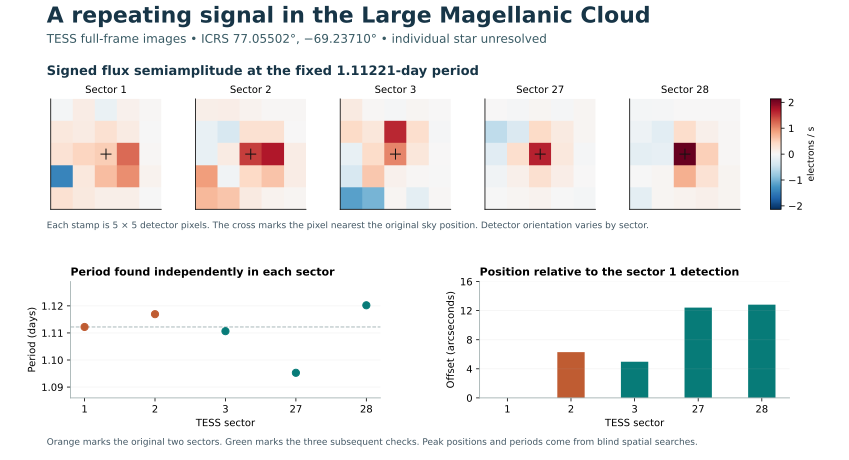

# Open-Space

Open-Space is an open-source astronomical research initiative that searches existing public observations for overlooked planets, variable stars and moving objects. Autonomous workers download real NASA archive products, search the measurements, request follow-up images and compare results against published objects. Every run retains rejected signals, input hashes and evidence that another researcher can inspect.

**The eclipse interval in OGLE-SMC-ECL-06090 changed direction.** The primary-to-secondary interval in this known binary grew by 2.21 hours between the early and late OGLE-IV observations. TESS and Swift independently measured widening in optical and ultraviolet light. An orbit that precesses in about 28 years predicted both later TESS timings within three minutes. A one-time change in spacing is still consistent with the observations. [Research report](docs/SMC_06090_ECLIPSE_TIMING.md) · [Reproducible evidence and observing windows](results/smc-06090/README.md)

**November 2026 archive investigation.** In Small Magellanic Cloud fields, both eclipses of OGLE-SMC-ECL-07730 faded to the limits of the recent OGLE data, while both eclipses of OGLE-SMC-ECL-06703 deepened. A separate blind search of 2,502 SDSS galaxy spectra predicted a second redshift that independent DESI spectra verified. The investigation also traces the earlier 9228.74 Å residual to a plate-wide component, tests a TESS transit-like signal against the underlying pixels, and narrows the location of the LMC-4 variable. [Eclipse measurements](docs/SMC_ECLIPSE_DEPTHS.md) · [Galaxy superposition and plate controls](docs/SDSS_SUPERPOSITION.md) · [TESS Sector 108](results/tess-sector108/README.md) · [LMC-4 localization](docs/LMC4_LOCALIZATION.md)

**Start with the measured results.** The optical survey screened 152 exploratory stars and a separate known-planet control. A coordinate-only image search also scanned fields in the Large Magellanic Cloud. The infrared survey assessed 644 well-sampled tracks in its exploration fields. The evidence includes two cases where a telescope aperture assigned a real periodic signal to the wrong star. [Investigation and results](docs/DISCOVERY_RESULTS.md) · [How the workers operate](docs/DISCOVERY.md)



To scan images without supplying a star list, use the [coordinate-grid search and follow-up commands](docs/DISCOVERY.md#run-a-blind-image-survey-on-your-compute).

**Provisional next-field investigation:** [LMC east grid and source-attribution follow-up](docs/LMC_EAST_PRELIMINARY.md). The reported extension includes detector controls and later-sector checks, but the external FITS and detailed evidence still need a public, independently replayable deposit; it is **not** included among the published results above.

The next unexamined rank in the published TESS target sequence is **152**. Run this from a checkout. The driver advances through new archive observations and resumes from disk after interruption. Configure the optional analyst and critic to use your own inference endpoint when you want model-selected investigations.

```sh
python -m venv .venv
. .venv/bin/activate
python -m pip install -e '.[archive]'
python -m open_space.survey --root runs/next-survey --sectors 1 2 \
  --start 152 --page-size 32 --pages 1 --workers 4
```

[Attach models or distribute work across machines](docs/DISCOVERY.md) · [Transit search](docs/TESS.md) · [Pixel localization](docs/PIXELS.md) · [Blind full-frame imaging](docs/FFI.md) · [Stellar catalogs and harmonics](docs/STELLAR_CATALOGS.md) · [Infrared motion](docs/WISE.md)

## Galaxy spectroscopy

**Independent-field test.** Seven of the eight best-supported discovery wavelengths reappeared in a frozen test of 24 new galaxies across three observing visits. All 65 primary detections fell below the search threshold after subtraction of SDSS's fitted galaxy spectrum. A new blind search of the residuals found a single pair confined to one plate visit. The release includes covered misses, alternative mask and continuum tests, a same-target repeat and a redshift permutation experiment. [Holdout measurements and figure](docs/HOLDOUT_RESULTS.md) · [Repeat observation](docs/REPEAT_OBSERVATION.md) · [Redshift control](docs/NULL_EXPERIMENT.md) · [Blind residual search](docs/RESIDUAL_SEARCH.md)

**First investigation.** In three galaxies, the search flagged absorption near 3934–3935 Å that its bundled line table did not explain. After correcting for the galaxies' different redshifts, each feature landed within 1 Å of a known transition of singly ionized calcium. The companion region overlaps a hydrogen line. The report includes the spectra, predictions, measurements, competing explanation and independent analysis of the quality flags. [Read the investigation](docs/FIRST_INVESTIGATION.md) · [Read the skeptical review](docs/INDEPENDENT_REVIEW.md)

**Completed campaign.** The first full plate visit contained 12 galaxies meeting the selection criteria. The detector measured 333 features, of which 241 fell outside its small reference table. The cross-target search found 47 recurring rest-frame groups among these features at a tolerance of 150 km/s. A separate observer-frame comparison produced 36 groups. Each count depends on coverage, detector thresholds and the references searched. The published record includes every source hash and per-spectrum count. [Campaign results and reproduction](results/README.md)

## Run a real observation

From a checkout with Python 3.10 or later, run the bundled SDSS starburst-galaxy observation. The first command runs offline with the Python standard library. It prints the complete evidence packet as JSON and stores the result in a local ledger.

```sh
git clone https://github.com/dovvnloading/Open-Space.git
cd Open-Space
python -m open_space pilot
python -m open_space status
```

Of 4,624 input pixels, 4,277 pass the quality checks and 3,289 positions have enough clean continuum coverage for the detector. All 12 detected emission features have at least one wavelength match in the bundled table. For a direct check, the survey redshift predicts the bright [O III] line at 5437.29 Å. The measured peak pixel is at 5437.51 Å. [Input and provenance](docs/DATA.md)

## Put agents on a research campaign

Install the archive reader in a virtual environment and start a bounded campaign. The coordinator selects the next galaxies from the public catalog, freezes their identifiers, retrieves and verifies the spectra, queues the work, executes it and exports evidence. At each completed page it ranks features recurring across distinct galaxies and repeats the comparison in the observer frame to expose possible instrumental patterns. Running the same command continues the campaign from its saved position. Each campaign follows one plate visit.

```sh
python -m venv .venv
. .venv/bin/activate
python -m pip install -e '.[archive]'
python -m open_space.campaign --root runs/first-visit --limit 3 --pages 1
```

For **model-led investigation**, point the two research roles at a Chat Completions-compatible server. A self-hosted server on your GPUs can supply both roles. Set the model identifier to the name your server actually serves. For a hosted endpoint requiring authentication, supply its bearer credential through `OPEN_SPACE_API_KEY`.

```sh
export OPEN_SPACE_MODEL_BASE_URL=http://127.0.0.1:8000/v1
export OPEN_SPACE_ANALYST_MODEL=your-served-model-id
export OPEN_SPACE_MAX_TOKENS=1600
python -m open_space.campaign --models --root runs/model-visit --limit 3 --pages 1 --max-calls 6
```

The analyst proposes testable explanations and chooses which features need a mask inspection, an alternative continuum fit or a new detection pass with stricter exposure flags. Python executes the requested measurements against the source pixels. The reviewer receives those results, challenges the proposed interpretation and records a discriminating next test. Set `OPEN_SPACE_REVIEWER_MODEL` to use a second model. The ledger keeps the validated decisions, exact prompts, model identifiers, usage when supplied, code fingerprint and source hashes. [Campaign operation and unattended execution](docs/CAMPAIGNS.md) · [Models and budgets](docs/MODELS.md)

| Research task | What runs today | Output |
| --- | --- | --- |
| Select and ingest | Bounded DR17 catalog query by plate and visit, FITS checks, quality-mask preservation | Frozen target list, source and CSV digests, observation manifests |
| Screen | Local continuum fits, signed narrow-feature detection, rest-frame and observer-frame line checks | Pixel indices, wavelengths, scores, coverage, candidate matches |
| Investigate | Analyst, three executable pixel checks and a skeptical reviewer | Hypotheses, measured follow-ups and proposed tests |
| Compare galaxies | Same-sign features at similar rest wavelengths across distinct targets | Ranked recurring features, observing visits and observer-frame spread |
| Validate | Synthetic null and injection controls, followed by paired injections into a real coadd | Recovery by sign and amplitude, coverage and confounded-trial counts |

## What the experiment can establish

A catalog miss means the measured wavelength falls outside the tolerance of a small reference table. A literature search, a broader atomic or molecular line comparison and independent observations are additional research steps. The worker records a screening result, including when usable coverage is insufficient. A telescope spectrum alone cannot establish a new atomic number. [Scientific protocol and discovery criteria](docs/SCIENCE.md) · [Cross-spectrum search](docs/RECURRENCE.md)

In the first real-background calibration, the pipeline recovered 20 of 24 emission injections and 19 of 24 absorption injections at six times the quoted local pixel noise. At ten times that noise, recovery rose to 24 of 24 and 23 of 24, respectively. These are measurements on one spectrum. The protocol sets out how to test other plates, independent nights, blank-sky controls and false alarms before drawing survey-wide conclusions. [Experiment, denominators and exact reproduction command](docs/CALIBRATION.md)

## Contribute

Run the checks from the repository root. CI exercises the pilot, software tests and synthetic benchmark. The archive extra enables the FITS conversion tests.

```sh
python -m unittest discover -s tests -v
python -m open_space benchmark --seeds 12
```

Observational work, calibration experiments, data adapters and negative results are welcome. [Contributor guide and first research projects](CONTRIBUTING.md) · [Agent operating instructions](AGENTS.md)

Project software is MIT licensed. Cite the survey and its public data policy when using SDSS measurements. [License](LICENSE) · [Data references and credit](docs/DATA.md#credit)
