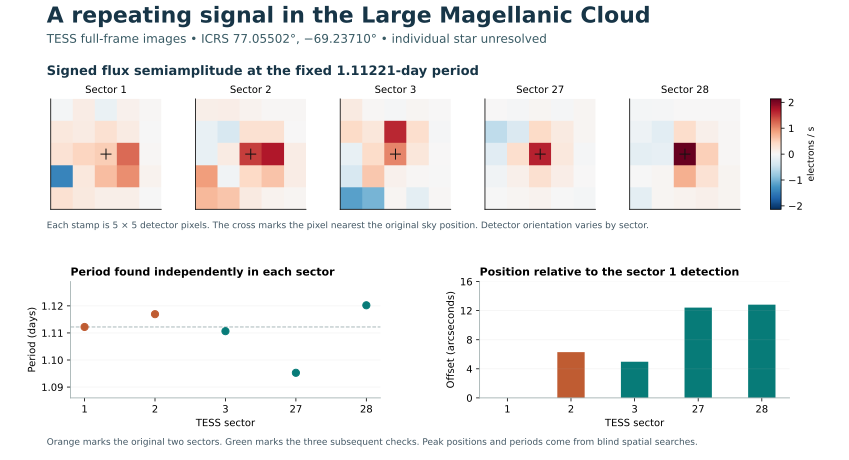

# Public-archive discovery campaign

A coordinate-only search in six fields toward the Large Magellanic Cloud recovered **13 locations with recurring variability** in TESS sectors 1 and 2. Twelve have an OGLE variable within 5.6 arcseconds whose period agrees directly or through a half/double-period comparison. The thirteenth field signal recurs near **1.11 days** in five TESS sectors spanning approximately two years. Its source identification requires resolving several stars inside a single TESS pixel. This release records a recurring measurement and the evidence for competing associations. [Blind results](../results/ffi-lmc-grid.json) · [OGLE crossmatch, including alternatives](../results/ffi-ogle.json) · [Five-sector follow-up](../results/ffi-source-revisit.json)

## Source dossier at ICRS 77.05502°, −69.23710°

The detector received sky coordinates, cutout dimensions and sector numbers. It searched every usable interior pixel for periodic variation, grouped neighboring pixels exhibiting a spatial peak, and repeated that search independently in the second sector. Each cutout contained 21 × 21 pixels, of which 289 interior positions were eligible. The six-field grid produced 19 first-sector spatial peaks. Thirteen met the two-sector rule, four triggered image-artifact vetoes and two lacked a second-sector match. A separate BB Tuc field helped develop the nuisance correction. The six-field geometry and final detector were frozen before opening the grid images. These directions sample a crowded, variable-rich region. [Selection, artifact controls and sensitivity](FFI.md) · [Pinned field products](../data/ffi-lmc-grid.json)

| TESS sector | Role | Best period found nearby (days) | Offset from first detection (arcsec) | Variance fraction at frozen frequency in nearest pixel |
| ---: | --- | ---: | ---: | ---: |
| 1 | Discovery | 1.11221 | 0.00 | 0.014 |
| 2 | First independent search | 1.11694 | 6.30 | 0.469 |
| 3 | Follow-up | 1.11065 | 4.97 | 0.376 |
| 27 | Follow-up | 1.09528 | 12.41 | 0.325 |
| 28 | Follow-up | 1.12022 | 12.82 | 0.434 |

The blind peak and the pixel nearest its measured sky centroid can lie on different parts of the stellar image. The nearest pixel in sector 1 gives a weak fixed-frequency result and a strong association with the pointing correction. The other four sectors retain 33–47% of that pixel's variance at the frozen frequency. The two late positions shift by about 12–13 arcseconds, while a nearby known Cepheid shifts by about 2.5 arcseconds in those same checks. The figure uses the same color scale for each sector. Neither a unique emitter nor a phase-connected orbital period follows from these measurements. [Measurement arrays and cadence-window tests](../results/ffi-source-revisit.json) · [Figure generator](../examples/plot_ffi_revisit.py)

### Which star is emitting?

There are 238 Gaia catalog positions within 30 arcseconds of the first centroid. OGLE-LMC-LPV-20399 lies about 2.2 arcseconds away, but its 756 OGLE I-band observations recover its known 19.96-day cycle and contain little power at the two TESS periods. A second star 5.8 arcseconds away has Gaia epoch photometry with a stronger 4.355-day peak. Across the 13 grid detections, the independent Gaia search found six resolved sources with a directly matching period. [Gaia source-level results](../results/ffi-independent.json) · [Archive methods and thresholds](FFI_FOLLOWUP.md)

The candidate Be star **UCAC2 1797921** lies 9.7 arcseconds from the sector 1 detection and 4.1 arcseconds from the sector 2 detection. Its 270 OGLE-II measurements produce a 1.1228-day peak after detrending. That peak explains only 8.3% of the variance and fails to lead both halves of the data. More than 1,200 measurements in each of the MACHO red and blue bands fail to reproduce a consistent peak near this period. Epoch-dependent variability remains possible. Its association remains open. [Resolved OGLE and MACHO photometry](../results/ffi-independent-ground.json)

A separate EROS-2 search retrieved **62,748 paired red/blue measurements for 115 neighboring catalog sources**, observed between 1996 and 2002. Seventy-six sources had adequate training and held-out coverage. None passed a two-band replication test at the training period. On those 76 real backgrounds, paired injections at 1.11457 days were recovered in 7 cases at 0.01 mag semiamplitude, 24 at 0.03 mag and 68 at 0.10 mag. These data constrain strong persistent modulation in well-measured neighbors. Weaker signals and activity confined to the later TESS epoch remain viable. The next discriminating observation is spatially resolved time-series photometry at these coordinates across several 1.11-day cycles, with a second site or suitable cadence to distinguish daily aliases. [EROS-2 methods and coverage](EROS_FOLLOWUP.md) · [Ground-survey measurements and injection trial results](../results/ffi-ground-followup.json)

## What the other searches recovered

| Search | Observations and results | Interpretation |
| --- | --- | --- |
| TESS transit search | 152 exploratory stars and WASP-18 b as a separate control. The combined two-sector searches used 306 light curves, 618,618,240 bytes and 5,513,228 retained two-minute measurements. Of the 152 field targets, 141 fell below threshold, five triggered a veto and six passed the first photometric screen. | WASP-18 b was recovered blind at 0.94156 days. The field signals include known eclipsing and variable systems. No planet is established by the search. |
| Stellar modulation | 15 of 152 exploration targets passed the two-sector sinusoidal checks, plus the separate control. The first 11 had prior evidence in one or more catalogs. All four on the continuation page had a published TESS variability period consistent with the measured frequency within the resolution or published uncertainty. | Several light curves favored a harmonic of a published period. A period attached to a target catalog ID can belong to a neighbor. |
| Independent TESS images | 24 primary-dip pixel jobs and 32 stellar-phase pixel jobs ran automatically across the two campaigns. Separate targeted analyses tested secondary eclipses. | Off-target centroids identify BB Tuc and a first-overtone Cepheid in different apertures. The bright HD 53921 system illustrates how saturation can displace a centroid along a CCD column. |
| NEOWISE astrometry | 315,878 exposure-level source detections in 24 three-arcminute exploration fields. After quality checks, 644 tracks met the multi-year sampling rule. Two passed the motion screen, at 497 and 190 mas/year. | Both have Gaia DR3 counterparts. The faster source has a 73 mas/year WISE–Gaia vector discrepancy. The separate known brown-dwarf control also recovered the expected motion. |

The optical target sequence used a deterministic hash ordering of the two-minute SPOC inventory intersection. Ranks 0–23 formed the pilot, ranks 24–119 the first extension, and ranks 120–151 the unattended continuation. The control was selected separately. The continuation rediscovered a sharp 4.81827-day dip in TIC 300871545. NASA's TOI table lists it as **TOI-184.01, false positive**, with a reported 4.81707-day period. The two other continuation dip signals land near integer multiples of previously published stellar periods. [Transit methods and pilot](TESS.md) · [Continuation measurements](../results/tess-continuation.json) · [NASA catalog snapshot for that page](../data/tess-continuation-planets.json) · [Stellar periods and later-epoch checks](STELLAR_CATALOGS.md)

Two source attributions changed after examining the detector pixels. In TIC 425975034 the light loss fell about 38 arcseconds from the intended target and within 3.3 arcseconds of **BB Tuc** in each sector. A separate search of 44 resolved Gaia epochs recovered 0.371501 days. In TIC 55527074 the variability lay about 44 arcseconds from the intended star and within 3.1 arcseconds of **OGLE LMC-CEP-3421**. A search of 72 Gaia epochs recovered 2.294749 days, consistent with its published first-overtone Cepheid period. The TESS localization of the latter source alone had large resampling uncertainty. [TESS difference images, Gaia curves and source-level tests](PIXELS.md)

## Sensitivity and audit

- **Transit injections.** Eight hash-selected real stellar backgrounds received three periods at three depths. The detector recovered 19/24 at 0.1%, 24/24 at 0.5% and 23/24 at 1%, using the original detrending, period, phase and two-sector rules. These injections use corrected photometry, fixed dates and box-shaped signals. They do not measure survey completeness for planetary radii, orbital inclinations or long periods. [72 injection trials](../results/transit-injections.json)
- **Infrared injections.** Each of the 24 fields supplied a real, well-sampled background. All 24 motions at each of 250, 500 and 1,000 mas/year were recovered. None of the 24 stationary or 24 below-threshold 100 mas/year injections passed. These results condition on the source being detected and adequately sampled in the first place. [120 experiments](../results/wise-controls.json) · [Astrometric selection and uncertainties](WISE.md)
- **Blind image controls.** Three artificial variable sources at distinct periods and amplitudes were recovered on real backgrounds, and a time shuffle yielded zero spatial peaks. The small control set provides an engineering calibration. The chance of a false identification in a crowded field also depends on source density, bright-variable leakage, period coincidences, and which aliases were searched. [Image controls](../results/ffi-controls.json)

The two published queues completed **482 tasks** and exported **971 measurement rows** from their original numerical runs. Rows include positive controls, suppressed signals and multiple measurements of the same physical object. Each task carries its payload, ancestors, archive evidence and checksums. Model-call reservations were zero for these runs. The optional analyst and critic path has an HTTP integration test using a scripted endpoint. Independent reanalysis and the manually selected later-sector and catalog follow-ups have their own evidence files. [Browse the register](../results/discovery-registry.csv) · [Download the complete queue evidence](../results/discovery-evidence.zip) · [Run metadata and checksums](../results/discovery-run.json) · [Run the next search](DISCOVERY.md)
