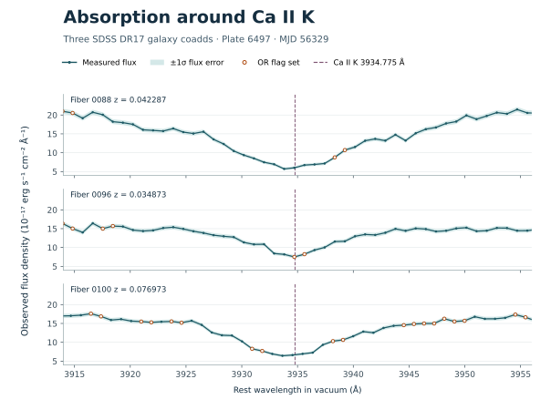

# Three galaxy absorption features consistent with Ca II K

The initial three-target DR17 search found an absorption feature near rest 3934–3935 Å in every galaxy. All three centroids lie within 1 Å of the known Ca II K transition at the cataloged galaxy redshifts. They received an *unidentified* label because the first-pass catalog covers common emission lines and omits Ca II K. We would close these three K features as likely known-line counterparts. The spectra leave the relative contributions of calcium and hydrogen around the companion line unresolved.

## Test against the laboratory wavelengths

The NIST handbook gives Ca II K at 3933.6614 Å and Ca II H at 3968.4673 Å in air. Inverting the SDSS conversion gives vacuum rest wavelengths of 3934.7751 and 3969.5901 Å. For each galaxy we predicted the observed wavelength as the vacuum value times `1 + z`, using its recorded SDSS redshift. The detector centroids came from a blind search across the spectrum. We selected this K interpretation after seeing the recurring rest wavelengths, so it is an exploratory identification. [NIST calcium lines](https://physics.nist.gov/PhysRefData/Handbook/Tables/calciumtable4.htm) · [NIST handbook wavelength convention](https://www.nist.gov/pml/handbook-basic-atomic-spectroscopic-data/basic-atomic-spectroscopic-data-handbook) · [SDSS wavelength conversion](https://www.sdss4.org/dr17/spectro/spectro_basics/)

| Fiber / feature | Galaxy redshift | K predicted, observed frame (Å) | K measured, observed frame (Å) | K measured, rest frame (Å) | Measured minus reference, rest frame (Å) | K contrast, two continua |
| --- | ---: | ---: | ---: | ---: | ---: | ---: |
| 0088 / F0015 | 0.042287 | 4101.165 | 4100.179 | 3933.829 | −0.946 | −8.05 / −10.55 |
| 0096 / F0005 | 0.034873 | 4071.992 | 4071.925 | 3934.710 | −0.065 | −5.67 / −6.86 |
| 0100 / F0011 | 0.076973 | 4237.648 | 4238.359 | 3935.435 | +0.660 | −6.24 / −8.63 |



*Figure 1.* Each point is a measured coadd pixel. Wavelengths are divided by the catalog `1 + z`. Flux density remains in observed-frame units, and the shaded band gives the quoted per-pixel flux error. The default AND mask and positive inverse variance determine which pixels appear. Open circles mark an OR flag in at least one contributing exposure. With Matplotlib installed, regenerate the figure after fetching the three spectra below.

```sh
python -m examples.plot_calcium runs/calcium-inputs --output docs/figures/calcium-k.svg
```

The local continuum test used the same three core pixels with sidebands at offsets of 5–12 and 9–20 pixels. Both fits give absorption in every spectrum. Contrast is flux density in units of 10⁻¹⁷ erg cm⁻² s⁻¹ Å⁻¹. Each 41-pixel neighborhood had positive inverse variance and clear AND masks. On fiber 96, two of the three K-core pixels carry a nonzero OR flag, indicating a problem in at least one exposure. Formal uncertainties on the feature centroids have yet to be calibrated. [SDSS quality flags](https://www.sdss4.org/dr17/spectro/quality/)

## Companion-line test

A calcium interpretation predicts absorption near Ca II H. Hydrogen Hε lies 1.605 Å to the red in the rest frame and can blend with calcium in integrated galaxy spectra. We measured flux contrast at the nearest pixel to the predicted calcium position, including the galaxy where the blind detector found no companion. An absorption signal in this window supports a trough in the region, while a separate Ca II H identification requires a model for the blend. [SDSS Hε wavelength, Table 2](https://www.sdss4.org/dr17/manga/manga-analysis-pipeline/) · [Observed Ca II H and Hε blending in galaxies](https://doi.org/10.1093/mnras/stz2549)

| Fiber | H predicted, observed frame (Å) | Contrast at H, two continua | Blind absorption centroid in the H / Hε region, rest frame (Å) |
| --- | ---: | ---: | --- |
| 0088 | 4137.452 | −8.32 / −12.78 | 3972.029 |
| 0096 | 4108.021 | −3.26 / −5.74 | None above the detector threshold |
| 0100 | 4275.143 | −6.07 / −8.79 | 3972.760 |

Both blind companion centroids are closer to Hε at 3971.1951 Å than to Ca II H. A subsequent test could fit a broadened stellar-population template to the full Balmer series and predict the H-region profile with that region held out. Estimating the redshift with both calcium windows masked would also test whether the original template fit relied on these same lines.

## Instrumental alternative and scope

The three K features span 166.43 Å in the observed frame. A single fixed observer-frame wavelength fitted to all three has a root-mean-square residual of 72.72 Å. The published K wavelength shifted by each measured galaxy redshift gives 0.70 Å with no fitted wavelength. This pattern weighs against a single stationary skyline or detector defect. All three galaxies share plate 6497 and MJD 56329. Shared reduction effects, separate defects and galaxy-template biases remain possible. A repeat observation on another plate or instrument would directly test persistence in the same galaxy. This exploratory sample cannot estimate the frequency of calcium absorption in a population. [Independent review and mask-sensitivity checks](INDEPENDENT_REVIEW.md)

## Reproduce the measurements

Use the pinned target list from the checkout, with Astropy installed for the FITS conversion. The last command uses only the standard library and reads the three normalized spectra. It reports every quantity in the tables and the two observed-frame residual statistics.

```sh
python -m open_space.cohort plan --plate 6497 --mjd 56329 --limit 3 \
  --input-csv data/cohort-6497-56329.csv --output runs/calcium-plan.json
python -m open_space.cohort fetch --plan runs/calcium-plan.json --output runs/calcium-inputs
python -m examples.calcium_doublet runs/calcium-inputs
```

The analysis was performed by a research agent working directly with the retrieved spectra and the local measurement functions. The archived results do not depend on a hosted model endpoint. [Three targets and source hashes](../data/cohort-6497-56329.csv) · [Reproduction code](../examples/calcium_doublet.py)
