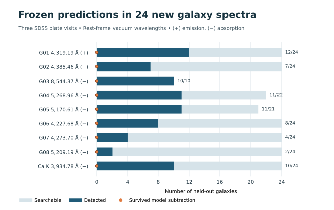

# Seven of eight predictions recur in a three-visit holdout

We froze the wavelengths and signs of the eight best-supported groups from the first 12 galaxies and added a separate known calcium control. We then tested 24 new galaxies spanning three previously unseen sky fields and observing nights. Seven of the eight discovery predictions met the predeclared rule of detections in at least three galaxies on at least two visits. The eighth appeared twice on one visit. All 65 primary detections fell below the original threshold after subtracting the survey's fitted spectrum. [Protocol commit](https://github.com/dovvnloading/Open-Space/commit/5351126175173182e68c9dcf4794529a299704c8) · [Frozen sample and exposure audit](HOLDOUT_DATA.md)



| Prediction | Sign | Rest wavelength (vacuum Å) | Detected / searchable galaxies | Visits with detections | Strict mask, detected / searchable | Median model / measured contrast |
| --- | --- | ---: | ---: | ---: | ---: | ---: |
| G01 | Emission | 4319.19 | 12 / 24 | 3 | 6 / 11 | 0.87 |
| G02 | Absorption | 4385.46 | 7 / 24 | 2 | 2 / 11 | 0.70 |
| G03 | Absorption | 8544.37 | 10 / 10 | 3 | 0 / 0 | 0.89 |
| G04 | Absorption | 5268.96 | 11 / 22 | 3 | 0 / 0 | 0.85 |
| G05 | Absorption | 5170.61 | 11 / 21 | 3 | 0 / 0 | 0.82 |
| G06 | Absorption | 4227.68 | 8 / 24 | 3 | 1 / 11 | 0.71 |
| G07 | Absorption | 4273.70 | 4 / 24 | 2 | 1 / 12 | 0.64 |
| G08 | Absorption | 5209.19 | 2 / 24 | 1 | 0 / 0 | 0.67 |
| Ca II K control | Absorption | 3934.78 | 10 / 24 | 3 | 4 / 14 | 0.87 |

**Coverage changes the answer.** Only ten galaxies provided a clean search window at 8544.37 Å with the baseline mask. All ten showed absorption. Requiring a clear OR mask across the continuum and line left zero searchable galaxies at that wavelength. The fraction on the original ten supplies no sensitivity estimate for the other fourteen. A zero denominator in the strict column marks a missing measurement. The FITS source and normalized data hashes, pixel indices, scores, flags, signed contrasts, offsets and every covered miss are included in the evidence. [Per-window evidence](../results/holdout.json)

**Control windows.** Across the eight primary wavelengths, 65 of 173 searchable galaxy–prediction pairs produced detections of the specified sign. The identically scored windows shifted by −1200 and +1200 km/s produced zero same-sign hits in 172 and 175 searchable pairs, respectively. These control positions were fixed in advance. They use the same galaxies and can differ in spectral structure and sensitivity. The pooled counts cannot estimate a false-discovery rate. A wider continuum could be measured for 62 of the 65 primary hits and preserved the sign in all 62. Ten additional detections of the Ca II K control were analyzed separately. [Measurement definitions](../protocols/HOLDOUT_V1.md)

## Does the fitted galaxy spectrum reproduce the signals?

After the primary readout, we kept the positions fixed and tested whether the SDSS spectral fit already reproduced the local contrast. We verified the raw FITS hash and measured the same three-pixel core and continuum sidebands in the observed flux and in the archive's `COADD.model`. Then we subtracted that model from the observed flux and ran the original full-spectrum detector again with the original inverse variance and masks. A residual needed the original sign, a score of at least 6, and a centroid inside the frozen ±150 km/s window. The residual and modeled contrasts refer to the same observed-flux units.

All **65 primary hits** had the same contrast sign in the fitted model. The per-wavelength median ratios of modeled to measured contrast ranged from 0.64 to 0.89. All 65 windows retained usable data after subtraction, and **zero** had a qualifying same-sign residual. The calcium control also had zero qualifying residuals across ten original detections. A positive local contrast in the original search can arise from the shape of a galaxy spectrum relative to its neighboring continuum bands. At present there is no evidence here for an additional narrow component above the search threshold in these windows. [Full residual measurements](../results/template-residuals.json)

The survey fit uses the spectrum being tested. It can absorb genuine features, and the search treats the survey's measurement weights as fixed without propagating model uncertainty. This check establishes whether the fitted spectrum can account for the measured pattern at the detector's sensitivity. It cannot assign a specific ion or exclude a weaker component. These targets also share the SDSS reduction and instrument family. A stronger test would predict an excluded wavelength region using a fit trained on other pixels, then evaluate independent spectra with a measured sensitivity to the hypothesized residual. [SDSS redshift fitting](https://www.sdss4.org/dr17/algorithms/redshifts/) · [SDSS coadd caveats](https://www.sdss4.org/dr17/spectro/caveats/)

## Reproduce the readouts

From the repository root, fetch the digest-pinned observations and run the evaluator. Every target must match the fixed roster. The evaluator verifies the sidecar metadata, source and CSV hashes, unique target positions and detector fingerprint. The model check verifies the underlying FITS bytes and reproduces every original local contrast before examining its residual.

```sh
python -m pip install -e '.[archive]'
python -m examples.fetch_holdout fetch --output runs/holdout
python -m open_space.holdout runs/holdout > runs/holdout.json
python -m examples.template_residuals runs/holdout runs/holdout.json > runs/template-residuals.json
```

To recreate the figure, install Matplotlib and run `python -m examples.plot_holdout runs/holdout.json runs/template-residuals.json runs/holdout.svg`. The published evidence can also be plotted offline. [Holdout evaluator](../open_space/holdout.py) · [Model subtraction](../examples/template_residuals.py)
