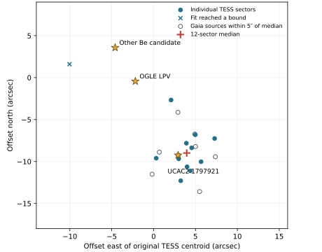

# A 1.1055-day TESS signal close to UCAC2 1797921

The previously unresolved LMC-4 signal can now be placed near **UCAC2 1797921**, a previously reported Be-star candidate also known as MACHO 1.4532.22. Across 12 prime-mission sectors, the median location of the periodic change in flux lies **1.06 arcseconds** from the SIMBAD position of this star. Two other previously proposed counterparts lie 10.53 and 15.19 arcseconds away. A Gaia star of G=19.42 lies 1.31 arcseconds from the median. Selection among these close stars still requires resolved time-series observations. [Original image and catalog investigation](FFI_FOLLOWUP.md) · [Numerical measurements, all sectors and source hashes](../results/lmc4-localization.json)



### Timing and position

We downloaded 13 × 13-pixel NASA TESS full-frame cutouts centered on (77.0550166°, −69.2370982°), the original discovery centroid. Twelve of the first 13 sectors passed detector coverage checks, yielding 13,397 usable images between July 2018 and July 2019. Sector 8 lacked sufficient detector coverage under the centered cutout criterion. [MAST TESScut](https://mast.stsci.edu/tesscut/)

| Observing interval | Usable sectors | Highest periodogram peak within 0.60–1.30 cycles/day | Fitted variance |
| --- | ---: | ---: | ---: |
| S1–6 | 6 | 1.105484 d | 5.18% |
| S7–13 | 6 | 1.105464 d | 5.03% |
| S1–13 combined | 12 | 1.105456 d | 5.05% |

The frequency interval follows the roughly 1.11-day lead. The two time intervals selected their peaks independently. Their agreement to about two seconds describes the numerical grid maxima. The six-sector frequency resolutions are approximately 0.0061 and 0.0052 cycles/day, and these measurements do not establish a two-second period precision. Sector-by-sector amplitudes and phases can vary.

We froze the S1–6 frequency for all sky-position measurements. We fitted a cosine and sine to every pixel, projected the two coefficient images along the locally measured phase, and fitted an elliptical Gaussian plus a constant to the resulting flux-change image. The detector model removes spatial background, reference-image gradients and common illumination using faint pixels outside the central four-pixel radius. The fits use a 1.2-pixel amplitude aperture, slow trend removal within individual continuous observing segments, and a radius of 2.55 pixels for the spatial profile. The code retains fit-boundary flags. [Executable analysis](../examples/lmc4_localization.py)

The median position is 3.96″ east and 8.99″ south of the original blind-search centroid. The middle half of the measurements spans 2.77–4.65″ east and 7.14–10.17″ south. One 13-pixel-image fit (S4) hit its parameter bounds and fell 16.9″ from UCAC2 1797921. The median keeps this sector. Across all 12 sectors, the median individual offset from UCAC2 1797921 was 2.74″. The catalog comparisons use full catalog coordinates, so offsets can differ from distances calculated from rounded sexagesimal source names.

### Checks against crowding and detector-dependent errors

A second reduction used 21 × 21-pixel cutouts in nine sectors, with two additional observing intervals about two years after the original detection. The median fitted position was 0.96″ from UCAC2 1797921. The same-field eclipsing binary OGLE-LMC-ECL-08126 supplies an astrometric control at its known twice-orbital frequency. Its median individual offset was 1.15″, with a maximum of 4.24″. Subtracting the control's per-sector displacement from each target displacement moved the median to 0.75″ from UCAC2 1797921. The two 2020 target measurements landed 0.57″ and 4.14″ from this source. The wider S3 and S28 target fits hit bounds, and S3 was a clear outlier. Overlapping smaller and larger cutouts share photons. The measured offset distribution includes systematic errors that a formal fit covariance would miss.

Gaia DR3 lists 238 sources within 30″ of the original location and eight within 5″ of the new median. UCAC2 1797921 corresponds to Gaia DR3 4661228328748943488 (G=14.59), 1.04″ from the median Gaia comparison. Another catalog source is 1.31″ away (G=19.42), and a G=16.37 source is 3.44″ away. Each TESS pixel spans roughly 21″. UCAC2 1797921 is a priority for follow-up among the previously proposed stars. Its identity as the emitter and the physical mechanism both remain open. [Gaia cone and all eight neighbors](../results/lmc4-localization.json)

At the frozen TESS frequency, 270 resolved OGLE-II I-band epochs of UCAC2 1797921 explain 1.44% of variance after a centered 24-day median subtraction. The equivalent measurements in 1,212 MACHO red and 1,214 MACHO blue epochs are 0.34% and 0.08%. Each of these historical series supplies little power at this frequency. Resolved coverage through several 1.1055-day cycles would directly test source attribution and whether the signal is present now. [Ground photometry archive receipts](../results/ffi-independent-ground.json)

### Reproduction

From a checkout with the archive dependencies installed, the following command downloads public cutouts and ground photometry and enforces the released science digests. The first optical frequency search uses a later time range for its separate test. The widened spatial fits, Gaia comparison and alternative spatial fitting radii are exploratory checks. This experiment has no survey-wide false-alarm calibration.

```sh
OPENBLAS_NUM_THREADS=1 python -m examples.lmc4_localization runs/lmc4/cache \
  runs/lmc4/result.json --verify results/lmc4-localization.json
```
