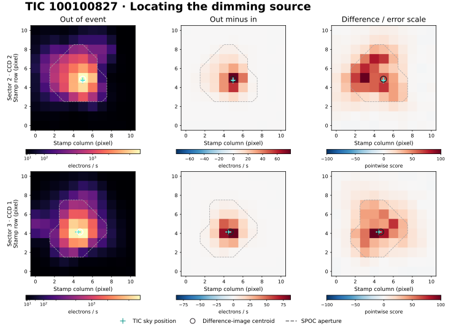
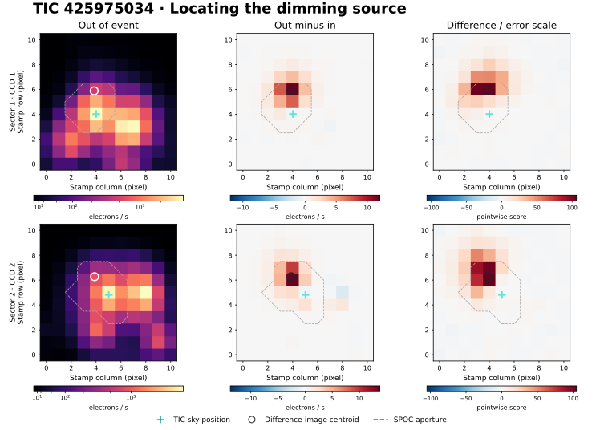
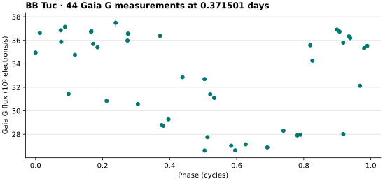
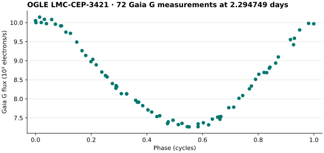

# TESS difference imaging for periodic dimming

A dip in aperture-summed brightness can come from another star in the aperture. This follow-up uses **the recorded detector pixels** to locate the loss of light at a fixed ephemeris. A calibrated TESS SPOC target pixel file contains a time series of small images, pixel flux uncertainties, quality flags, the photometric aperture, and a stamp-to-sky coordinate transformation. The images below are calculated directly from those data. [NASA TESS pixel-file guide](https://heasarc.gsfc.nasa.gov/docs/tess/Target-Pixel-File-Tutorial.html) · [MAST science product definitions](https://archive.stsci.edu/missions-and-data/tess/data-products)

## Positive control on two detectors

We used the TESS team's published period and epoch of WASP-18 b (TIC 100100827), 0.941449 days and BTJD 1354.458014, with an analysis duration of 0.09 days. We kept the same prediction for sectors 2 and 3. The target fell on camera 2, CCD 2 in one visit and camera 2, CCD 1 in the other. The tabulated depth is the aperture-summed loss of light divided by the reference flux, before any crowding correction. [Published ephemeris](https://archive.stsci.edu/prepds/tess-data-alerts/) · [Product hashes and inputs](../data/pixels-wasp18.json) · [Measurements and image arrays](../results/pixels-wasp18.json)

| Sector | Quality-zero cadences / total | Complete events | Aperture dimming (ppm) | Centroid distance to TIC (pixel / arcsec) | Event-bootstrap 95% radius (pixel) |
| --- | ---: | ---: | ---: | ---: | ---: |
| 2 | 18,299 / 19,737 | 27 | 10,154 | 0.120 / 2.39 | 0.020 |
| 3 | 12,855 / 19,692 | 19 | 10,184 | 0.210 / 4.21 | 0.021 |



The largest measured deficits occur near the target on both detectors. The concentration of light in the stamp also changes with detector orientation. The empirical scatter of the measured center is smaller than the offset from the catalog target; asymmetry of the instrument response, pixel discretization, pointing and the world coordinate solution contribute additional positional uncertainty. A subpixel companion remains possible from the image measurements alone.

## Two field signals with a second dip

The transit search independently selected these two periodic signals in its metadata-only field sample. Both crossed the strength threshold and had a substantial half-orbit dip in both sectors. We used the discovery-sector period, epoch and duration unchanged in the second sector. For a second run on the exact same pixels we shifted each epoch by half its period. No refitting to the pixel light occurred. [Light-curve campaign](TESS.md) · [Primary pixel tasks](../data/pixels-field.json) · [Half-orbit tasks](../data/pixels-secondary.json)

| TIC | Sector | Primary / half-orbit dimming (ppm) | Primary distance to TIC (pixel) | Distance between dimming centroids (pixel) |
| --- | ---: | ---: | ---: | ---: |
| 234495456 | 1 | 25,359 / 25,340 | 0.146 | 0.008 |
| 234495456 | 2 | 22,253 / 22,389 | 0.161 | 0.014 |
| 234338669 | 1 | 10,799 / 10,953 | 0.154 | 0.033 |
| 234338669 | 2 | 9,624 / 9,920 | 0.125 | 0.038 |

The source of each primary dip falls near the TIC position, and the half-orbit dimming falls in the same neighborhood. The large near-equal depths and repeated spatial alignment warrant investigating eclipsing or blended stellar variability, aliases and a shorter true period. This measurement uses a centroider coarser than a fitted instrument response and cannot assign a particular unresolved star or a physical system type. Follow-up photometry at higher angular resolution and a period check using individual eclipse timings could distinguish the alternatives. [Primary images, uncertainty and event counts](../results/pixels-field.json) · [Half-orbit images and measurements](../results/pixels-secondary.json)

Both fits use a 4-hour analysis duration. For these larger duty fractions, removing the actual event cadences left insufficient clean reference coverage for the quarter-period controls. Those checks are recorded as **insufficient events** and the artificial-source experiment as **insufficient coverage**. The positive-control injection results above apply to WASP-18 b only. These exploratory targets retain their photometric vetting flags; locating dimming in the target pixel provides no planetary classification.

A 42-arcsec Gaia DR3 search around each target provided a second crowding check. The closest catalogued neighbor to TIC 234495456's optical counterpart is 15.12 arcsec away and 4.62 RP magnitudes fainter. Even a full eclipse of that neighbor would remove only 1.4% of the two stars' combined RP flux, assuming equal aperture throughput. The observed TESS aperture dip reaches 2.5%. A brighter neighbor at 29.03 arcsec is plausible by flux alone, but the primary and secondary dimming both localize within 0.17 TESS pixel of the target. For TIC 234338669 the nearest catalogued neighbor is 17.55 arcsec away and 6.01 RP magnitudes fainter, while another at 22.11 arcsec is 3.42 RP magnitudes fainter. These positions and fluxes favor variability in the target vicinity. Gaia and TESS have different passbands and apertures, and either target could have an unresolved companion. Neither target has a published G epoch series in Gaia DR3. [Cone search rows and queries](../data/pixels-gaia-provenance.json)

## The expanded transit search

All six threshold-crossing field targets in the expansion received two-sector pixel follow-up at their discovery ephemerides. These and the two field targets above account for all eight exploratory signals that crossed the transit strength threshold. [Product hashes and ephemerides](../data/pixels-expansion.json) · [All twelve expanded-search image measurements](../results/pixels-expansion.json)

| TIC | S1 / S2 dimming (ppm) | S1 / S2 distance to TIC (pixel) | Interpretation |
| --- | ---: | ---: | --- |
| 31780319 | 2,285 / 3,156 | 0.194 / 0.136 | Dimming near the TIC. A smooth periodic model predicted the second light curve better than a box. |
| 50380257 | 5,696 / 5,699 | 0.178 / 0.191 | Nineteen events per sector. The public TESS eclipsing-binary catalog gives the same TIC and a 1.348285-day period. |
| 238194430 | 25,095 / 23,426 | 0.117 / 0.036 | Dimming near the target. Both quarter-phase aperture measurements strongly brighten. |
| 279511712 | 2,443 / 4,169 | 1.542 / 1.822 | Bright target. The displacement follows the CCD column in both sectors. Saturation and charge bleeding confound source assignment. |
| 279570232 | 16,316 / 10,016 | 0.105 / 0.199 | Dimming near the TIC, with substantial depth variation. The phase controls had insufficient coverage. |
| 425975034 | 2,518 / 2,495 | 1.871 / 1.865 | Both detectors locate the dimming next to the eclipsing variable BB Tuc. |

TIC 50380257's two-sector uncorrected depths agree within 3 ppm and its quarter-phase pixel scores are all below 0.63. Its independently identified binary counterpart illustrates the importance of a catalog period check even when image vetting succeeds. TIC 279511712 has TESS magnitude 5.796 and a peak scene flux of about 108,000 and 101,000 electrons per second. With 1.98-second elementary integrations, bright-target charge redistribution along columns is a competing explanation for its centroid shifts. The pixel code records this caution when a TESS magnitude at or brighter than 7 coincides with at least one pixel of row displacement and at most half a pixel of column displacement. This diagnostic threshold was added after examining this case. [Catalog match](../results/tess-eb-check.json) · [Light-curve shape comparisons](../results/tess-shapes.json) · [NASA TESS detector saturation](https://heasarc.gsfc.nasa.gov/docs/tess/telescope_information.html)

### Resolving BB Tuc in the aperture of TIC 425975034

The dimming source lies 38.18 and 38.29 arcsec from the aperture target in sectors 1 and 2. Its centroid lies 3.24 and 3.01 arcsec from BB Tuc, a catalogued eclipsing variable. AAVSO VSX lists type EA/SD: and a photographic magnitude range of 13.5–15.0. The VSX and GCVS entries consulted have empty period and epoch fields. [VSX object 37031](https://vsx.aavso.org/index.php?view=detail.top&oid=37031) · [GAIA and catalog query receipts](../data/pixels-gaia-provenance.json)



Gaia resolves BB Tuc as DR3 source 4902935692165069056. A weighted Lomb–Scargle search across periods of 0.15–8 days on its 44 accepted G-band observations over 968.48 days gives a global peak at 0.371501 days. Gaia's published short-timescale variability table reports 2.691860 cycles per day, or 0.371490 days. TESS independently measured 0.371215 days in the target aperture. Its 1.114752-day box-search period is close to three times this recurrence. The agreement between missions and the two spatial offsets strongly favors BB Tuc as the contaminating source. The binary's orbital period remains undetermined here. [ESA Gaia epoch product](https://gea.esac.esa.int/data-server/data?RETRIEVAL_TYPE=EPOCH_PHOTOMETRY&ID=4902935692165069056&FORMAT=CSV&BAND=G&RELEASE=Gaia+DR3) · [Gaia light curve](../data/pixels-gaia-bbtuc.csv) · [Independent period search](../results/pixels-gaia-bbtuc.json)



## Coherent stellar variability

The stellar worker passes its first-sector sinusoid period and minimum-light epoch unchanged to the pixel worker. Each cycle contributes a faint interval at phases −0.10 to +0.10 and reference intervals at phases −0.50 to −0.40 and +0.40 to +0.50. The half-width reference intervals keep adjacent cycles from sharing cadences. These sinusoidal phase predictions are independent of pixel selection. Cadence completeness, event stacking, uncertainty, controls, centroids, bootstraps and detector checks use the same implementation as the transit follow-up. Large nonperiodic changes or sampling gaps can leave a strong stacked image with an uncertain source position. [Stellar pixel tasks](../data/pixels-stellar.json) · [Images and individual cycle coverage](../results/pixels-stellar.json)

| Stellar-only TIC | Sector 1 | Sector 2 | Measured outcome |
| --- | --- | --- | --- |
| 33881153 | 3 complete cycles | 4 complete cycles | Pointwise peak scores of 1.91 and 1.97 leave the source unresolved. |
| 55527074 | 7 cycles, 2.12-pixel offset | 10 cycles, 2.10-pixel offset | Difference peaks coincide with the known Cepheid OGLE LMC-CEP-3421. Whole-cycle bootstrap radii of 2.34 and 1.59 pixels leave the pixel-only determination unstable. |
| 382256692 | 151 cycles, 0.135 pixel | 170 cycles, 0.224 pixel | Bright-to-faint aperture changes of 10.42% and 7.92% lie near the catalogued cataclysmic variable BB Dor. |
| 426029868 | 1 complete cycle | 4 complete cycles | Insufficient sampling in sector 1 and a weak difference image in sector 2. |

For BB Dor, the discovery sinusoid's 0.148970-day period agrees with the published TESS signal at 0.1489422 days. Prior literature associates this signal with a negative superhump, a periodic variation in the accretion disk. Spectroscopy gives an orbital period of 0.154095 days. These measurements provide an independent classification check on the stellar worker. [Bruch, TESS photometric periods](https://academic.oup.com/mnras/article/519/1/352/6855266) · [Rodríguez-Gil et al., spectroscopic period](https://academic.oup.com/mnras/article/422/3/2332/1045205)

The measured centers for TIC 55527074 lie 44.04 and 43.61 arcsec from the target and 3.09 and 1.66 arcsec from the known Cepheid. Gaia DR3 resolves the Cepheid as source 4663164538667755008 and identifies a first-overtone classical Cepheid with a 2.294800-day period and 0.351 magnitude G-band peak-to-peak amplitude. Our unconstrained 0.15–8 day search of 72 accepted Gaia G-band epochs over 992.67 days recovers 2.294749 days. The TESS discovery aperture period of 2.280485 days differs by 0.62%, within one trial-frequency step for that sector. Together the Gaia light curve and detector coordinates support contamination of the TIC aperture by this known variable. [ESA Gaia epoch product](https://gea.esac.esa.int/data-server/data?RETRIEVAL_TYPE=EPOCH_PHOTOMETRY&ID=4663164538667755008&FORMAT=CSV&BAND=G&RELEASE=Gaia+DR3) · [Gaia light curve](../data/pixels-gaia-cepheid.csv) · [Independent period search](../results/pixels-gaia-cepheid.json) · [Catalog and sky separations](../data/pixels-gaia-provenance.json)



## How the image follow-up works

1. Take the TIC, sector, ephemeris, event duration and canonical SPOC product name from a research task. Derive the matching pixel product from the light-curve basename. Check the file's TIC, sector, TDB time convention and BJD reference. Verify the pinned SHA-256 when supplied. The stamp coordinates are zero-based, increasing in detector column and row from the lower left.
2. Keep finite times and quality word zero. Use central phase offsets within ±0.4 event durations and two reference intervals 0.8–1.8 durations before and after the event. Each interval needs three cadences and at least 55% of its nominal sampling. Each pixel needs usable flux and positive finite errors on at least 75% of the retained interval cadences. Interpolate the left/right reference means to the in-event mean time to account for local linear trends.
3. Subtract the in-event image from its reference and propagate the reported pixel variances. Combine event images with inverse-variance weighting, requiring at least half the accepted events per pixel. Scale the image score by the larger of propagated error and an event-scatter standard error. These scores are descriptive and have no correction for searches across pixels, ephemerides or stars. The reference image in the figure is the per-pixel median of interpolated out-of-event images.
4. Find the largest positive deficit on the stamp. Estimate the centroid from positive, pedestal-subtracted flux in the surrounding 3 × 3 pixels. Bootstrap whole events 128 times with a fixed seed and allow the peak position to change. The 95th percentile radius measures repeatability, excluding pointing, WCS and response-model systematics. The scientific aperture affects the fractional depth; the source search includes pixels outside it.
5. With at least three complete events, use a peak score of six and bootstrap radius ≤0.75 pixel for coarse localization. Report sources within one pixel of the TIC as lying in its vicinity. Flag an offset when the measured separation minus the bootstrap radius is at least one pixel. Flag a stamp-edge peak separately. Low signal, missing coverage and ambiguous positions have their own outcomes. A full PRF fit, higher angular resolution or independent observations are necessary to distinguish close blends.

Two quarter-period shifts measure other phases using the same estimator. Cadences inside the predicted transit are excluded from their windows. The known control's four phase-shift peak scores ranged from 0.25 to 1.86. Separately, in the positive-quarter-period windows we simulated a 1%-of-aperture-flux box deficit at a displaced position. A Gaussian stamp profile with width 0.65 pixel was added to each event's difference image; this is algebraically equivalent to subtracting that profile from its in-event mean with the weights held fixed. The measured backgrounds, noise and flags were preserved. The off-target injection was recovered within 0.027 and 0.064 pixel, and both sectors flagged the offset. This one bright injection per sector tests the measurement path, without establishing completeness at fainter levels.

## Reproduce or run an agent-selected follow-up

Run from a checkout with the archive extra installed. The JSON task may contain a single object or a list. `epoch_btjd` is in BJD TDB minus 2,457,000. Period and duration are in days. Without an input pixel-product digest, the first run returns the digest for pinning in follow-up work.

```sh
python -m pip install -e '.[archive]'
python -m open_space.pixels data/pixels-wasp18.json --cache runs/tess-pixels > runs-wasp18.json
python -m open_space.pixels data/pixels-field.json --cache runs/tess-pixels > runs-field.json
python -m open_space.pixels data/pixels-secondary.json --cache runs/tess-pixels > runs-secondary.json
python -m open_space.pixels data/pixels-expansion.json --cache runs/tess-pixels > runs-expansion.json
python -m open_space.pixels --stellar data/pixels-stellar.json --cache runs/tess-pixels > runs-stellar.json
python -m examples.plot_pixels_gaia data/pixels-gaia-bbtuc.csv
python -m examples.plot_pixels_gaia data/pixels-gaia-cepheid.csv
```

For distributed workers, call `open_space.pixels.followup(task, cache_path)` on individual tasks. The function retrieves at most one archived stamp per task, permits a cached replay, and returns JSON-compatible records containing TIC/sector, sky coordinates, source URI and digest, ephemeris, cadence counts, event-by-event coverage, centroid, phase controls, artificial-source test and the measured arrays. The companion product must use the calibrated two-minute SPOC naming convention. Multiple workers can safely populate one local cache; completed products are immutable. Register each result with its ephemeris and data identifier. Different trials on the same exposure series share the same photons.

To recreate the figure from the published image arrays without archive access, install NumPy and Matplotlib and run `python -m examples.plot_pixels results/pixels-wasp18.json docs/figures/pixels-wasp18.svg`. [Measurement implementation](../open_space/pixels.py) · [Plotting code](../examples/plot_pixels.py)

For stellar variability, call `open_space.pixels.variable_followup(task, cache_path)` with the TIC ID, sector, product name, period in days and `epoch_min_btjd`. The discovery photometry supplies this minimum-light epoch. Each worker can include the pixel product checksum and an analysis role. Use `--tic 425975034` with the expanded-search image plotter to regenerate the offset figure. The Gaia plotting command accepts `--figure output.svg --name "BB Tuc"` and checks the source ID is unique before calculating a weighted periodogram. [Gaia analysis code](../examples/plot_pixels_gaia.py)
