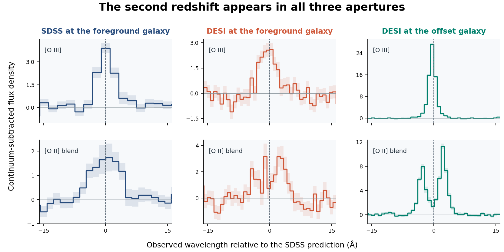

# Two redshifts along the line of sight to SDSS J223410.34+322643.4

A search of 2,502 galaxy spectra on four SDSS plate visits returned one object with an extra set of oxygen emission lines. The spectrum assigned to the foreground galaxy at redshift 0.42179 contains a second signal at 0.84168. In an independent DESI observation of the same sky position, the background oxygen lines repeat. A DESI fiber pointed 3.86 arcsec northwest measured a galaxy at redshift 0.841615, within 11.2 km/s of the blind SDSS prediction. This identifies a spectroscopic superposition and a target for spatially resolved lens follow-up. The individual galaxies and their principal redshifts already appear in DESI DR1. [Measurements](../results/sdss-superposition.json) · [Extracted spectral windows](../results/sdss-superposition-windows.csv) · [DESI query rows](../data/sdss-superposition-desi.csv)



The dashed line marks the wavelength predicted from the blind SDSS estimate. The shading shows the diagonal pixel errors. Each panel removes a linear local continuum estimated from the outer portions of the plotted window. The numeric fits below use a jointly fitted continuum and narrower windows.

## Independent aperture measurements

The SDSS identifier is **6509-56486-0788**, at ICRS 338.543107°, +32.445390°. DESI observed the central and offset positions on 2021 November 11 in successive exposures 108404 and 108405, using the same repositioned fiber 3291. The central DESI aperture is 0.14 arcsec from the SDSS position. Both DESI pipeline redshifts have zero warning flags. The background signal is stronger in the offset aperture.

| Observation | Catalog redshift | [O III] 5008 | [O III] 4960 | Hβ | [O II] blend |
| --- | ---: | ---: | ---: | ---: | ---: |
| SDSS foreground position | 0.421795 | 12.8 | 4.2 | 4.0 | 6.5 |
| DESI foreground, 39628534716566366 | 0.421496 | 13.6 | 4.2 | 4.8 | 6.1 |
| DESI offset, 39628534716566336 | 0.841615 | 64.3 | 36.8 | 31.7 | 28.8 |

Table entries in the four line columns are forced signal-to-noise ratios. Each fit is centered at the SDSS second-redshift prediction. From the SDSS foreground, DESI foreground and DESI offset spectra the fitted [O III] 5008 fluxes are 21.34, 17.57 and 45.84, in units of 10⁻¹⁷ erg s⁻¹ cm⁻². All four individual SDSS exposures at the central position recover the stronger [O III] line with signal-to-noise ratios from 7.1 to 9.2 and positive amplitudes for the weaker component. Applying the single-exposure pixel masks prevents a usable [O II] fit in each SDSS exposure. The [O II] row uses the coadd AND mask. [Instrument and data release](https://data.desi.lbl.gov/doc/releases/dr1/) · [SDSS spectral products](https://www.sdss4.org/dr17/spectro/)

The narrow model uses a fixed Gaussian with velocity dispersion 83 km/s and a fitted linear continuum within ±15 Å, using positive inverse variance and zero mask. For the SDSS coadd we first subtract the survey's galaxy spectrum model. Individual SDSS exposures and DESI use calibrated flux directly. The blended [O II] doublet is represented by one profile, so its fitted flux depends on the doublet ratio and spectral resolution. DESI resolves its two peaks in the offset aperture. The Hβ wavelength is close to foreground [O I] 6302 Å. It carries less identification weight. The quoted errors omit pixel covariance, sky-model uncertainty, and selection effects. The brighter [O III] line falls 5 Å from the separate shared residual discussed below. Its large amplitude and replication across both surveys are important.

## Search and controls

We expanded the prior campaign's four plate visits to all non-sky fibers with SDSS CLASS=GALAXY, ZWARNING=0 and z>0.01. The plate counts were 663 (6497), 616 (6498), 635 (6503) and 588 (6509). We subtracted the best-fitting SDSS model and a local 41-pixel running median. An inverse-variance-weighted Gaussian filter of width 1.4 pixels selected peaks at ≥4.8. Interpreting each as [O III] 5008 required a second redshift at least 0.03 above the foreground, up to z=1, with positive weight at all four line centers. The [O III] 4960 companion had to score ≥2.7, and Hβ or [O II] ≥3.2. Only fiber 788 passed. Its discovery-filter scores were 13.9, 3.7, 4.0 and 7.2 in the table's line order. These exploratory cutoffs and selection on a positive maximum preclude interpreting the discovery scores as false-alarm probabilities. DESI was queried after this single SDSS hit was found.

On plate 6509 the two neighboring detector fibers do not provide a comparable four-line pattern. Fiber 789 gives [O III] 5008 at 0.2 in the forced fit. Fiber 787 fails its coverage requirement. A post-selection fit allowing [O III] 5008 to shift and change width gives aligned centers: the foreground and offset DESI apertures differ by 0.08 ± 0.21 Å. Their observed Gaussian widths differ, 2.22 ± 0.24 and 0.880 ± 0.009 Å, respectively. Integrated line fluxes for this freer fit are 16.1 ± 1.7 and 55.2 ± 0.6. The fixed-width filter tends to underestimate flux in the sharper offset profile. Both positions used the same DESI fiber, in different exposures and programs. These observed widths include instrumental broadening and omit spectral covariance. This comparison disfavors simple scaled copies of exactly the same observed profile and motivates a spatially resolved test.

The foreground galaxy's SDSS stellar velocity dispersion is 363 ± 41 km/s, and the four exposures report median seeing of 1.20–1.28 arcsec. This galaxy is a plausible lens, but the two aperture positions alone cannot distinguish magnification, an extended background source, and light redistributed by the point-spread function. A map of the 9224 Å [O III] emission at subarcsecond resolution would test for an inner counterimage or connected extended emission. No lens geometry has been demonstrated.

## Prior catalog checks

An exact spherical search around the SDSS position found no system within 15 arcsec in the 1,551-row SDSS SILO catalog, the 4,089-object DESI single-fiber lens catalog, the 2,176-row DESI DR1 targeted strong-lensing catalog, the 9,971-entry DESI DR2 spectroscopic outlier catalog, or the Hsu et al. DESI pair-selection catalog. For the last, we checked both the 2,306-row Zenodo table and the author site's 2,364 rows covering grades A/B/C and dimple candidates. The smallest distance among these searches was 26.6 arcminutes. These checks establish absence from the named releases. This coordinate could have been inspected and rejected by an earlier search. Other candidate lists, unpublished work and alternate imaging identifications remain possible. [SDSS SILO](https://doi.org/10.1093/mnras/stab267) · [DESI single-fiber catalog](https://zenodo.org/records/20616755) · [DESI targeted catalog](https://data.desi.lbl.gov/doc/releases/dr1/vac/strong-lensing/) · [DESI outliers](https://zenodo.org/records/19666700) · [Hsu et al. tables](https://sites.google.com/usfca.edu/neuralens/publications/lens-candidates-hsu-et-al-2025)

## A different result for the earlier 9228.74 Å residual

The repository's earlier blind residual search reported the same emission-like feature in two galaxies on this visit. We withheld all three previously implicated fibers (128, 311 and 813) and tested unrelated objects with good coverage at each published wavelength. We measured median flux minus SDSS model within ±2.3 Å and subtracted the mean of the sideband medians at 10–21 Å on each side. Coverage requires the entire core and at least two usable pixels per side. A bright control has fitted sideband continuum above 5 in SDSS flux-density units.

At 9228.74 Å **82 of 82** bright galaxy controls showed a positive feature. Its median amplitude was **10.58%** of continuum. Fiber 128 measured 10.58% and fiber 813 measured 17.83%. The amplitude correlates with continuum across all 548 covered controls (Spearman ρ=0.570). The corresponding bright-control medians on the three other plates were 1.85%, 1.68% and 1.26%. Only six sky fibers on 6509 passed the same strict coverage window, giving a median amplitude of 0.10 in the original flux-density units. Calibration-star spectra also carry the feature, with median amplitude 1.04 across 20 standards. All four original red-camera integrations in each candidate fiber have positive local core excesses when measured on unflagged pixels against the interpolated coadd model and local sidebands. Repetition within the visit alone would have passed this artifact. This establishes a shared, brightness-dependent component consistent with a calibration residual. An additional intrinsic contribution in either galaxy and the precise reduction step responsible remain unmeasured. The other two published observer-frame groups also show shared excursions on 6509. [Previous residual search](RESIDUAL_SEARCH.md) · [SDSS flux calibration](https://www.sdss4.org/dr16/algorithms/spectrophotometry/)

## Replay

Run the following commands from the repository root. The script verifies the exact bytes of every cache entry and downloads missing observations and catalogs (about 1.17 GiB). The frozen DESI query response is included, and its live ADQL request is recorded in the manifest. The output contains all screening hits, both adjacent fiber controls, all four visits' control summaries, individual SDSS exposure fits, DESI pixel fits, and catalog distances. Public author-site CSV exports can change. A checksum mismatch identifies such a change. [Pinned URLs and SHA-256 digests](../data/sdss-superposition-inputs.json) · [Analysis](../examples/sdss_superposition.py)

```sh
python -m pip install astropy scipy
python examples/sdss_superposition.py --cache runs/sdss-superposition-inputs --output runs/sdss-superposition
```

## Data credits

The extracted windows, continuum estimates and line fits are derived from SDSS DR17 and DESI DR1 measurements. DESI DR1 is licensed under CC BY 4.0. [DESI Collaboration et al. 2026](https://doi.org/10.3847/1538-3881/ae4c43) · [License and required acknowledgment](https://data.desi.lbl.gov/doc/acknowledgments/) · [SDSS credits](https://www.sdss4.org/collaboration/credits/)

> This research used data obtained with the Dark Energy Spectroscopic Instrument (DESI). DESI construction and operations is managed by the Lawrence Berkeley National Laboratory. This material is based upon work supported by the U.S. Department of Energy, Office of Science, Office of High-Energy Physics, under Contract No. DE–AC02–05CH11231, and by the National Energy Research Scientific Computing Center, a DOE Office of Science User Facility under the same contract. Additional support for DESI was provided by the U.S. National Science Foundation (NSF), Division of Astronomical Sciences under Contract No. AST-0950945 to the NSF’s National Optical-Infrared Astronomy Research Laboratory; the Science and Technology Facilities Council of the United Kingdom; the Gordon and Betty Moore Foundation; the Heising-Simons Foundation; the French Alternative Energies and Atomic Energy Commission (CEA); the National Council of Humanities, Science and Technology of Mexico (CONAHCYT); the Ministry of Science and Innovation of Spain (MICINN), and by the DESI Member Institutions: www.desi.lbl.gov/collaborating-institutions. The DESI collaboration is honored to be permitted to conduct scientific research on I’oligam Du’ag (Kitt Peak), a mountain with particular significance to the Tohono O’odham Nation. Any opinions, findings, and conclusions or recommendations expressed in this material are those of the author(s) and do not necessarily reflect the views of the U.S. National Science Foundation, the U.S. Department of Energy, or any of the listed funding agencies.
