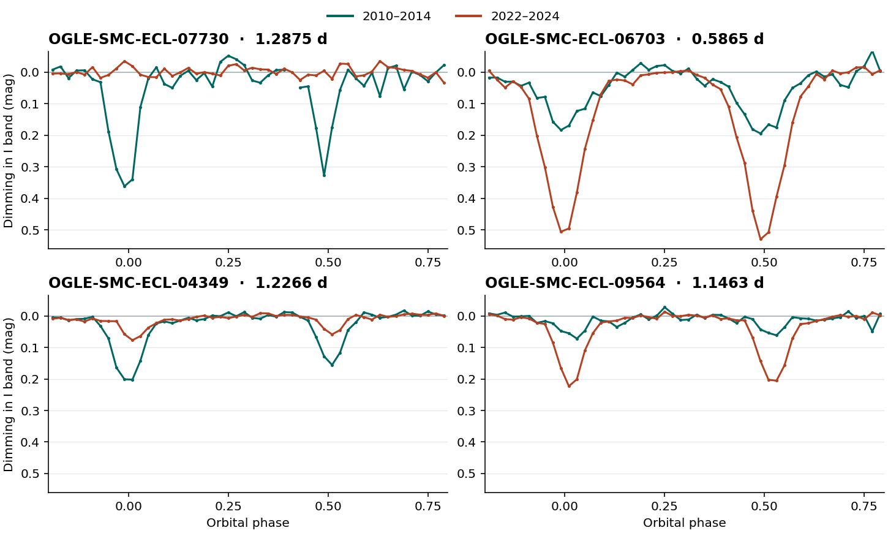

# Eclipses that weakened or deepened in Small Magellanic Cloud fields

OGLE-SMC-ECL-07730 lost nearly all of its previously prominent eclipses during the OGLE-IV baseline. In 2010–2014 the 1.2875386-day system dimmed by 0.347 mag near primary eclipse, about 27% of the out-of-eclipse light. In 2022–2024 the same measurement was 0.008 mag, compatible with zero. Both eclipse windows changed while the out-of-eclipse brightness changed by only 0.006 mag. OGLE had already catalogued the binary. Our search concerns the history of its eclipse depths.



The points are median observed Cousins I magnitudes in 0.02-cycle bins, relative to the median at quadrature in each era. Lines join bins containing at least three measurements. Downward excursions represent dimming. The table below weights each observing night once per phase window, unlike the illustrative plot. [Numerical results](../results/smc-eclipse-depths/followup.json) · [Source photometry and SHA-256 hashes](../results/smc-eclipse-depths/inputs.json)

| OGLE-SMC-ECL | Period (days) | Primary, early → late (mag) | Secondary, early → late (mag) | Independent earlier evidence |
|---|---:|---:|---:|---|
| **07730** | 1.2875386 | 0.347 → 0.008 | 0.246 → 0.021 | OGLE-II and EROS-2 suggest shallow eclipses before the deep OGLE-IV state |
| **06703** | 0.5864720 | 0.172 → 0.494 | 0.180 → 0.499 | OGLE-II gave 0.035 / 0.060 mag at the extrapolated phases |
| **09564** | 1.1463427 | 0.055 → 0.190 | 0.043 → 0.171 | The nearest EROS-2 record shows weak dimming at those phases in both bands |
| **04349** | 1.2266481 | 0.202 → 0.062 | 0.129 → 0.047 | OGLE-III independently gave 0.300 / 0.197 mag in 2001–2009 |

### Can the later observations of 07730 still detect an eclipse?

The early primary depth has a night-bootstrap 95% interval of 0.294–0.380 mag. The late interval spans −0.043 to +0.033 mag. The secondary intervals are 0.176–0.326 and −0.010 to +0.046 mag. There are 25 and 24 distinct primary-core nights in the early and late samples. Robust fits that allowed each eclipse's phase, width and amplitude to move gave early depths of 0.383 / 0.326 mag and late depths of 0.019 / 0.015 mag. Raising the tolerated single-measurement error from 0.10 to 0.30 mag reproduced the depth change.

A box search allowed the period to move ±2% around half the orbital period, with unrestricted phase and three durations. In 1,634 usable late measurements its strongest dip was 0.039 mag. Adding the fitted early eclipse profile to the *actual late data at the actual observation times* recovered 0.267 mag at 0.6437693 d, exactly half the catalogue period. A box averages over part of the eclipse, so its depth can differ from the core depth. This one injection tests sensitivity to the observed early profile. It does not calibrate detection efficiency for other profiles or exclude period changes outside that range.

Ten other non-contact binaries on the same OGLE field and chip, within 0.75 mag and a factor of two in period, had adequate phase coverage for a pooled eclipse test. Their median change was +0.008 mag, range −0.067 to +0.168. The target changed by −0.272 mag using that estimator. Target-specific crowding, seeing and blending remain possible. This small comparison population does not estimate the survey false-alarm rate. [All ten comparisons and historical measurements](../results/smc-eclipse-depths/controls.json)

### Earlier photons

The OGLE-II DIA database supplies 258 usable I-band measurements of 07730 in 1997–2000. Applying the OGLE-IV ephemeris gives primary and secondary core contrasts of 0.035 and 0.036 mag, with broad 95% intervals reaching 0.110 mag for both. Two EROS-2 pointings show weak blue-band dimming at the same predicted phases. Different filters, different amounts of blended light, and a decades-long ephemeris extrapolation limit the comparison. The data support an interval of deep eclipses between shallower observations. The gaps leave a cycle length unconstrained. [EROS measurements, independent time splits and checked time convention](SMC_EROS.md) · [OGLE-II database and credit](https://ogledb.astrouw.edu.pl/~ogle/photdb/overview.html)

For 04349, the OGLE-III primary depth was 0.300 mag (95% interval 0.287–0.326), compared with 0.202 and 0.062 mag in the subsequent OGLE-IV intervals. SIMBAD lists other objects within 3 arcseconds of the OGLE position, strengthening the case for spatially resolved follow-up. For 06703 the out-of-eclipse median changed by 0.031 mag, appreciably less than its roughly 0.32-mag change in both eclipse depths. The older EROS record at 1.84 arcseconds is inconclusive for this star. OGLE-IV V-band eclipse cores were too sparsely sampled for the same per-eclipse estimator on the four leads. [OGLE-III SMC observations and credit](https://ogle.astrouw.edu.pl/cont/4_main/var/ogleiii/ebssmc/)

### Search scope and interpretation

We started with all 10,799 entries in the March 2025 OGLE-IV SMC eclipsing-binary parameter file. We retained 7,569 non-contact systems with a period of 0.5–12 d, a finite ephemeris, and a primary eclipse at least 0.12 mag deep in the catalogue. Of those, 7,516 had I-band files and 5,213 had usable phase coverage in both eclipses in both comparison windows. The published compressed table preserves all 5,213, including opposite-sign changes. The screen tests phase 0 and 0.5 and favors short periods and systems with two well-sampled eclipses. Eccentric binaries and faint or low-duty-cycle events can be missed. [Full ranking](../results/smc-eclipse-depths/screen.csv.gz) · [Survey release and catalogue paper](https://doi.org/10.32023/0001-5237/74.4.1)

The screen compared HJD < 2457000 with HJD ≥ 2458300. In each observing season it subtracted the median at quadrature. Up to four matched 0.02-cycle bins contributed to each eclipse. We ranked same-sign changes by the smaller of the two nominal depth-to-error ratios. We inspected the top 16 curves, then selected ranks 3 (04349), 4 (06703), 7 (09564) and 14 (07730) for their behavior, coverage and prior-report checks. The top-ranked 00863 is in Juryšek et al. Table 3, and ranks 2, 10 and 16 have OGLE transient-eclipsing flags. Those recoveries provide positive controls. The four selected cases are exploratory. The intervals quantify measurement variability conditional on selection and do not incorporate the search over thousands of stars.

For detailed measurements we compared the core within 0.025 orbital cycle of each eclipse against quadrature at absolute phase 0.16–0.34. Each night gets one median magnitude per window. We resampled nights jointly 1,800 times. The figure and table use a 2022–2024 late window (HJD ≥ 2459700), a subset of the original screening window. The middle epochs and individual night counts are in the JSON. A deeper or shallower eclipse can arise if the orbital plane changes its angle to us. These time series alone do not measure a third star or establish precession. Resolved difference images and new multicolor photometry covering both predicted minima would test crowding and the current state directly.

### Prior-report check

On 2026-11-13 (US Eastern), we compared the four identifiers and field aliases to the OGLE release's complete remarks file and the 21 SMC entries in the earlier inclination-change search. None of the four has an OGLE transient-eclipsing flag or an identified counterpart in that paper's Table 3. We also searched the web for the OGLE IDs with and without leading zeros, the OGLE-II and III field identifiers recorded in ident.dat, and coordinates combined with eclipse depth, precession and disappearance. SIMBAD had two references on the 07730 entry and three on the 04349 eclipsing-binary entry. They concern the discovery catalogues and a morphology classification. Within 3 arcseconds SIMBAD returned no identification for 06703 or 09564. An exact-classification review of other catalogues, unpublished work or privately held observations could change the priority assessment. [Prior inclination survey](https://arxiv.org/abs/1709.08087) · [Earlier OGLE catalogue](https://arxiv.org/abs/1612.06394) · [Morphology study](https://arxiv.org/abs/2106.01039) · [SIMBAD and VSX query results](../results/smc-eclipse-depths/catalog-checks.json)

### Reproduce

Run from the repository root. The full OGLE-IV archive is roughly 150 MB compressed. The manifest pins the source bytes. The historical script retrieves the two OGLE-II light curves by field and star number and the OGLE-III light curve by catalogue ID. Source times are heliocentric Julian days. The OGLE-III table needs 2,450,000 added to its recorded times. The tested versions were Python 3.12, NumPy 2.3.5, SciPy 1.17.0, Astropy 8.0.2 and Matplotlib 3.10.8.

```sh
python -m pip install numpy scipy astropy matplotlib
mkdir -p runs/smc/raw
base=https://www.astrouw.edu.pl/ogle/ogle4/OCVS/smc/ecl
for file in README ecl.dat ident.dat remarks.txt phot.tar.gz; do
  curl -fLsS "$base/$file" -o "runs/smc/raw/$file" || exit 1
done
sha256sum runs/smc/raw/phot.tar.gz
# 3cd9478f5fb9b70d9fdd687a8c589cebb83ba45506cad74f3f28741f0a26c3bd
tar -xzf runs/smc/raw/phot.tar.gz -C runs/smc/raw
python examples/smc_depths/screen.py runs/smc/raw runs/smc/screen.csv
python examples/smc_depths/followup.py runs/smc/raw runs/smc/followup.json
python examples/smc_depths/controls.py runs/smc/raw runs/smc/historical runs/smc/controls.json
python examples/smc_depths/figure.py runs/smc/raw runs/smc/figure.png
```

Credit for the time series belongs to the OGLE and EROS collaborations. The comparison and its interpretation were carried out for Open-Space. The OGLE archive also provides the original finding charts for follow-up. [OGLE-IV SMC archive](https://www.astrouw.edu.pl/ogle/ogle4/OCVS/smc/ecl/) · [EROS release](https://doi.org/10.1051/0004-6361/202557321)
