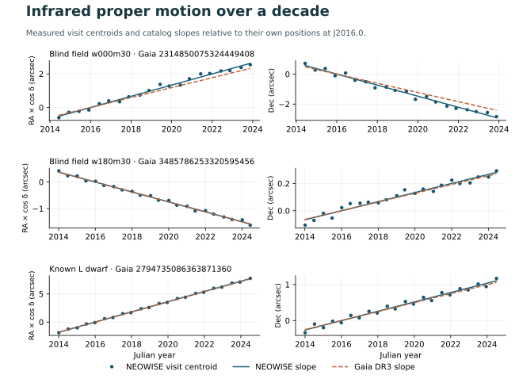

# A blind infrared proper-motion search

Can an archive worker link individual NASA NEOWISE detections over a decade and find motion before consulting a stellar catalog? It did so for **two objects in 24 exploration fields**. Both have moving Gaia DR3 counterparts. A separately selected L-dwarf control shows the expected motion in both coordinates. These are successful recoveries of known moving sources. The exploration produced zero unmatched motion leads under the published thresholds.



| Source | Visits / contributing exposures | WISE motion in RA*, Dec (mas/year) | Gaia DR3 motion in RA*, Dec (mas/year) | Median late-visit position error, motion / stationary (arcsec) |
| --- | ---: | ---: | ---: | ---: |
| Field 000°, −30°, Gaia 2314850075324449408 | 20 / 187 | +333.0, −369.1 | +295.1, −306.6 | 0.223 / 2.547 |
| Field 180°, −30°, Gaia 3485786253320595456 | 22 / 238 | −187.3, +33.3 | −187.3, +32.1 | 0.052 / 1.046 |
| LSPM J0036+1821, Gaia 2794735086363871360 (control) | 22 / 243 | +908.0, +129.7 | +901.6, +124.4 | 0.111 / 5.250 |

RA* is the eastward angular component with the cosine of declination included. The first object's WISE vector differs from Gaia by 73 mas/year. Its positional match is 0.61 arcsec. The motion direction and broad matching tolerance support identification with a known moving source, while the discrepancy exceeds four times the larger WISE axis error. Its `gaia_precision_check` records that discrepancy for pixel-level inspection. The control is the previously documented brown dwarf 2MASS J00361617+1821104. Its WISE astrometry used only the blind association algorithm. [Complete source measurements and input hashes](../results/wise-motion.json) · [Brown dwarf identifier](https://simbad.cds.unistra.fr/simbad/sim-id?Ident=2MASS+J00361617%2B1821104) · [Gaia DR3 data definitions](https://irsa.ipac.caltech.edu/data/Gaia/dr3/gaia_dr3_source_colDescriptions.html)

## Sample and input measurements

The pilot used four fixed three-arcminute cones at (150°, +30°), (210°, +30°), (30°, −30°), and (330°, −30°). The expansion covered every multiple of 30° in RA at both −30° and +30° declination, including those four original fields. All 24 exploration fields were retained. Together they cover approximately **0.1885 square degrees**. A separate 0.75-arcminute cone covers the known control. This is a small geometrically chosen pilot. Its field density, extinction, cadence, sensitivity and confusion vary greatly.

The archive returned **315,878 single-exposure detection rows** after a W1 signal-to-noise and frame-quality prefilter. Further flags retained 144,416. The data contain 13,005 within-visit source groups; blind association started 908 tracks, of which 644 met the multi-year sampling rule. These denominators exclude the control. Gaia returned 19,043 catalog positions within slightly enlarged reference cones, including positional-only sources without proper motions. A single exposure can detect multiple sources; detection rows must not be interpreted as an equal number of images or stars. [Pinned field registry](../data/wise-fields.json) · [NEOWISE single-exposure database](https://irsa.ipac.caltech.edu/data/WISE/docs/release/NEOWISE/expsup/sec2_1a.html)

## Measurement and vetoes

1. Query IRSA Gator for `neowiser_p1bs_psd`, retaining W1 signal-to-noise ≥8 and `qual_frame>0`. Fetch Gaia DR3 in a cone 15 arcsec wider for crossmatching after the motion fit. The client rejects oversized or truncated fields. Each successful input has a deterministic SHA-256 of sorted selected scientific columns and a separate cached digest for the original IPAC response, which embeds retrieval-specific timestamps.
2. Require W1 brighter than magnitude 15, positive quoted uncertainty, a positive image-quality factor and SAA separation, a clear W1 moon and contamination flag, no flagged Solar System match, no W1 saturation, positive positional uncertainties, a single un-deblended component and `0 < w1rchi2 < 10`. The public documentation describes additional caveats, including residual image artifacts and faint-source bias. [IRSA reliability guidance](https://irsa.ipac.caltech.edu/data/WISE/docs/release/NEOWISE/expsup/sec2_3.html)
3. Use IRSA mid-exposure MJD and ICRS sky coordinates. Break observing visits at gaps greater than 20 days. Within each visit, group positions within 1.6 arcsec of the highest-S/N seed. A visit needs four distinct scan/frame detections. Form median x, y, time and W1 magnitude. Ambiguous within-visit assignments are discarded. Work in a small-angle local plane with RA wrapping. The supported field centers are within ±85° declination.
4. Link visits chronologically using a constant-velocity extrapolation over at most six recent visits. The search radius in arcsec is the lesser of 5 and `1.1 + 2.4 × gap_in_years`, with a maximum gap of 760 days. Reject ambiguous links on both ends. This has finite sensitivity to rapid, accelerating, crowded and edge-crossing tracks. Each retained track requires at least eight visits and four years of coverage.
5. Fit each axis against Julian years at reference MJD 57388.5 (J2016.0); give each visit equal weight. Remove extreme radial residuals above the larger of 0.55 arcsec or the median plus 4.5 robust scatter estimates and refit. The motion gate requires ≥150 mas/year, a motion-to-error proxy ≥6, retention of ≥80% of initially linked epochs, and consistent slopes in two annual observing-phase subsets. The subsets provide a check for seasonal effects; exact spacecraft scan angle and parallax remain unmodeled. Approximate slope errors use the larger of measured visit scatter and 0.1 arcsec per axis. They do not model inter-visit calibration covariance.
6. Separately fit the earliest 60% of linked visits before any all-track residual clipping. Forecast the remaining visits, requiring median positional error ≤0.8 arcsec and below 60% of the stationary training-position error. This is a time-split diagnostic conditional on successful track association. Objects at the survey detection limit, especially those selected only during bright excursions, are underrepresented.
7. Compare the fitted position at J2016.0 with Gaia DR3 within 2 arcsec. Preserve the count of matches, source ID, RUWE, vector discrepancy and the WISE positional/fit history. A unique counterpart with vector difference within `max(80 mas/year, 4 × largest WISE axis error)` is a broad motion recovery. An unresolved match, missing match or different vector is eligible for follow-up with epoch images, additional catalogs and literature. Multiple photons and an absent Gaia entry alone cannot establish a new object. AllWISE single-exposure associations are retained as supplementary hints and do not drive the blind linking. [NEOWISE astrometric cautionary notes](https://irsa.ipac.caltech.edu/data/WISE/docs/release/NEOWISE/expsup/sec1_4.html)

## Sensitivity on the observed fields

We chose one well-sampled, persistently detected source per exploration field by number of visits and contributing exposures. For each of five speeds, we replaced the fitted proper motion by a seeded random-direction vector and resampled the measured seasonal positional offsets with replacement, keeping within-visit residuals, frame times, and field neighbors. The experiment replayed the entire within-visit and inter-visit association and screening. A recovery must be within 1 arcsec of the known reference position, pass all motion checks and recover the vector within the larger of 80 mas/year and 25% of its speed. No injected object enters the observed candidate register.

| Injected speed (mas/year) | Reassociated at reference position | Passed motion gate | Median vector error among reassociations (mas/year) |
| ---: | ---: | ---: | ---: |
| 0 | 24/24 | 0/24 | 4.75 |
| 100 | 24/24 | 0/24 | 4.17 |
| 250 | 24/24 | 24/24 | 4.74 |
| 500 | 24/24 | 24/24 | 3.89 |
| 1000 | 24/24 | 24/24 | 3.58 |

All 72 passing trajectories satisfied the vector-recovery tolerance. The 100 mas/year condition lies below the 150 mas/year operating threshold. These injections condition on source extraction and high cadence, preserve blending imperfectly, and reuse a source at five speeds. Their results cannot estimate all-sky completeness, false-discovery rate, or sensitivity to objects missing from the single-exposure catalog. A deeper campaign would inject moving PSFs into calibrated epoch images before extraction and measure recovery versus magnitude, background, crowding and scan geometry. [Individual trials](../results/wise-controls.json)

## Reproduce or scale

The astrometric implementation uses Python's standard library. From the checkout, run:

```sh
mkdir -p runs/wise
python -m open_space.wise --cache runs/wise/cache --compact > runs/wise/motion.json
python -m open_space.wise_controls --cache runs/wise/cache > runs/wise/controls.json
```

Use `--field w180m30` to run a single tile. Supply a plan with the same fields schema through `--plan path/to/fields.json` to choose further fields. A new tile's first fetch records its scientific digests. Add them to `input_sha256` when freezing that dataset. Each field is a bounded independent queue job via `open_space.wise.run_field(field, cache_dir)`. Parallelize distinct fields while respecting the archive's capacity. The 60,000-row cap and 50 MB response cap guard against silent truncation; subdivide crowded fields. Neighboring or overlapping tiles need boundary-level association before summing unique source counts. For this release the 24 exploration cones are disjoint.

To regenerate the figure, install Matplotlib and run `python -m examples.plot_wise_motion results/wise-motion.json runs/wise/motion.svg`. Every data point represents an actual visit median. The Gaia dashed lines show catalog slopes after aligning the reference origins; the positional match distance is reported separately. [IRSA data access and acknowledgment](https://irsa.ipac.caltech.edu/ack.html)
