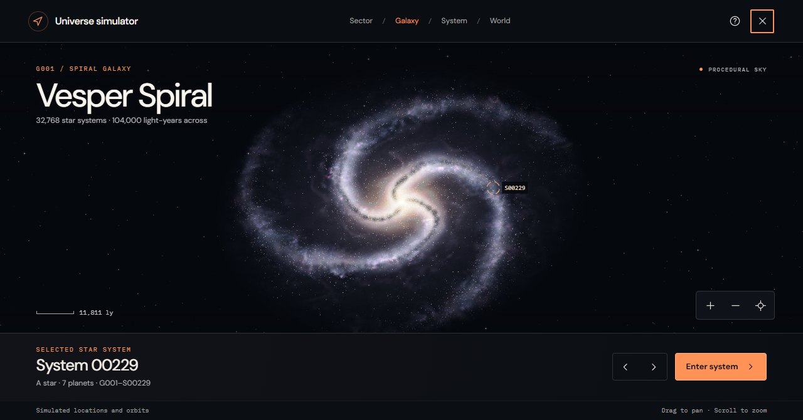

# Open Space Observatory

The [public observatory](https://dovvnloading.github.io/Open-Space/) pairs an evidence archive with a procedural universe. The four featured dossiers include figures, measurements, open questions and permanent links to the underlying research. The archive retains the dispositions assigned by the repository catalog. Additional result directories appear as research records.

## Run locally

From a checkout, serve the bundled snapshot with the Python standard library.

```sh
python -m http.server 8000 --bind 127.0.0.1 --directory observatory
```

Open [the local observatory](http://127.0.0.1:8000/). Rebuild the catalog after committing research changes with `python observatory/build_catalog.py`. For a fork, pass `--repository owner/repo`. The generator reads committed Git blobs. A full clone supplies first-parent publication dates for the archive’s recent activity list.

## Evidence and publication

The [Pages workflow](../.github/workflows/observatory.yml) builds a new snapshot on relevant pushes to main. It indexes the README catalog and top-level result directories, copies the four dossier figures, exercises the built site under a project URL in Chromium, and deploys the verified artifact. Pull requests build and test a preview artifact. The committed snapshot allows a fresh checkout to run offline once served on localhost.

The curated target descriptions and figure sources live in [spotlights.json](data/spotlights.json). The MAVEN and STIX plots embed their source CSV digests. If the underlying tables change, inspect the new measurements, regenerate the plots using [render_figures.py](data/render_figures.py) with Matplotlib installed, and review the dossier text before publishing.

## Universe simulator

[](https://dovvnloading.github.io/Open-Space/#universe)

The simulator generates 128 galaxies, each with 32,768 addressable systems. Enter a galaxy, system or world using the scale controls. The navigation panel also supports travel to a system by address. Drag or use the arrow keys to pan and use the zoom controls, wheel or pinch to change scale. Orbital distances are compressed for display. The seeded worlds and their evolving orbits are illustrative. Observational evidence opens in a separate dossier with its archive source.

## Checks

```sh
python -m unittest discover -s tests -p test_observatory_catalog.py -v
python -m pip install playwright==1.58.0
python -m playwright install chromium
python observatory/check_browser.py --directory observatory
```

The site ships its artwork, fonts and code locally. [Illustration credits](assets/CREDITS.md) · [DM Sans license](assets/fonts/dm-sans-LICENSE.txt) · [IBM Plex Mono license](assets/fonts/plex-mono-LICENSE.txt).
