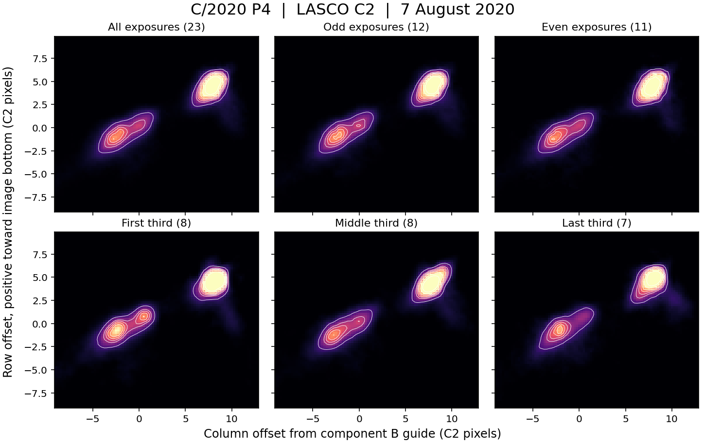

# Two brightness peaks in the B component of C/2020 P4

SOHO/LASCO C2 recorded two brightness peaks near component B on 2020 August 7. Across 23 individual exposures from 12:36 to 17:36 UTC, the fitted median separation was **3.24 C2 pixels (38.5 arcseconds)**. The middle half of the fitted separations spans 3.09–3.30 pixels. The track crossed 283 detector pixels. This analysis supplies per-exposure astrometry and a test of whether a single asymmetric head accounts for the light distribution. The physical nature of the peaks remains open.

**Prior discovery credit.** Worachate Boonplod reported the possible additional component at 12:00, 12:12 and 12:24 UTC, with its reported column west of the known B component. Michal Biesiada corroborated the report. Karl Battams explained in September that its proximity to B precluded a separate measurement. In November 2020 Trygve Prestgard explicitly illustrated the two B condensations. These precede our fit. The MPC circular identifies A, B and C. A new nucleus, a fourth orbit and discovery priority cannot be inferred from these data. [Original reports](https://sungrazer.nrl.navy.mil/sites/sungrazer.local/files/html/legacy_reports/comets202008_arch.html) · [September correction](https://sungrazer.nrl.navy.mil/sites/sungrazer.local/files/html/legacy_reports/comets202009_arch.html) · [Prestgard, Figure 2](https://skyhuntblog.wordpress.com/2020/11/01/comet-c-2020-p4-soho-a-fragmented-sunskirter/) · [MPEC 2020-Q231](https://minorplanetcenter.net/mpec/K20/K20QN1.html)

Columns and rows follow the upper-left convention of Boonplod’s report. The left complex is B and its extra peak. The right complex contains the named A and C, whose separate reference tracks are both over nine pixels from the B track at the median epoch. The archive’s current position-file numbers differ from numbers in the contemporary corrections. The files ending in `4046`, `4047`, and `4049` here guide A, B, and C respectively. Observation times and reported coordinates establish the correspondence. The coordinates used for every new measurement come from the original detector exposures. [Archive guide and caveats for positional files](https://sungrazer.nrl.navy.mil/soho-discoveries)

## What the pixels support

* The first fitted exposure is 12 minutes after the last of Boonplod’s three quoted positions. It gives upper-left coordinates (729.70, 17.82) and (732.61, 19.22). Its fitted light maxima follow the ordering in the original report. The separation quartiles describe frame-to-frame scatter. Shared instrument response and model choice contribute additional uncertainty.
* A two-peak Gaussian model predicts reserved native pixels more accurately than a single rotated, skewed Gaussian in **18 of 23 frames**. The median clipped prediction RMS drops from 0.975 to 0.866 exposure-normalized detector units. Checkerboard validation fits alternate detector samples and predicts the complement, then reverses the split. Nearby detector pixels sample the same optics. These outcomes do not define a formal probability for separate nuclei.
* The combined stack shows two western maxima with either bilinear or cubic alignment. The two cubic maxima recur in both alternating-frame stacks and each of three consecutive time blocks. Bilinear interpolation merges them in the last third. Four independently drifting, star-like comparison sources in the same frame area each show one peak above 45% of their maximum after alignment. A fixed detector defect or ubiquitous double image would have to explain both that behavior and the comet’s long detector track.
* A bright knot in the dust coma can travel with a nucleus and give the same two-peak morphology. Single-epoch two-component fits are unstable in some exposures. There is no separate orbit or second-view astrometry here. Resolving both peaks from another viewing angle or following independently separating photocenters for a longer arc would distinguish more of these possibilities.

## Reproduction

From this directory run `python reproduce.py --cache /path/to/lasco-cache --output /path/to/output` with Python, NumPy, SciPy and Matplotlib. The script verifies the SHA-256 values in `inputs.csv`, uses 56 full-resolution Orange/Clear Level 0.5 exposures from 09:12 to 20:48 UTC for a temporal median background and fits the 23 post-report frames in the stated window. The three guide tables supply quadratic center tracks and an A/C confusion check. The native fits use signed detector values divided by the exposure time in the FITS header. The local background has a nine-pixel Gaussian smoothing scale. A plane is fit with each source model. The western-complex fit excludes the bright A/C side of the image. The outputs are `astrometry.csv`, `morphology.json` and the figure above. The original FITS plate scale is 11.9 arcseconds per pixel. All nominally independent image splits use the same instrument and background estimate.

The camera orientation follows the original FITS roll (approximately −176°). Reflection in column aligns the corresponding Level 0.5 array with the original upper-left report. The field controls were selected from a stack aligned at the sky background’s common drift and were then centered and fit individually. They constrain the camera response to isolated images, without reproducing the comet’s dust distribution or its motion during each exposure. SOHO is a project of international cooperation between ESA and NASA. LASCO data are credited to the Naval Research Laboratory and the LASCO consortium. [FITS archive for the date](https://lasco-www.nrl.navy.mil/lz/level_05/200807/c2/)
