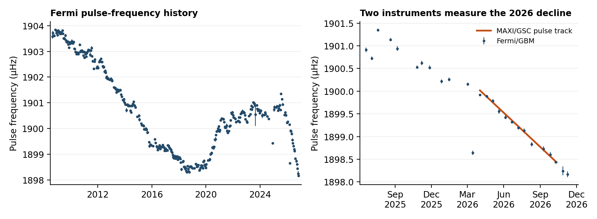

# Two X-ray instruments measure accelerated spin-down in 4U 1538−522

The eclipsing neutron star 4U 1538−522 took **0.485 seconds longer to turn** in November 2026 than in April. Fourteen consecutive Fermi/GBM frequency measurements decreased over 220.57 days. This is the longest strictly decreasing sequence in its 18-year GBM history. An independent search of **58,097 source-aperture MAXI/GSC photons** recovered a pulse-frequency slope of **−3.000 µHz/year**, close to GBM's **−2.968 µHz/year**. The long-baseline GBM slope in the previously reported 2009–19 spin-down was −0.592 µHz/year.



## Which change is new

The star has reversed torque several times. The papers published in 2023 and 2024 measured a transition near 2019 into a multi-year spin-up. Months-long departures from that trend were already known. An October 2026 paper used an August 2024 XMM-Newton/NuSTAR observation; its measurement precedes the interval examined here. An Astronomical Society of India 2026 report discusses the earlier MJD 58800 reversal. The new result is the 2025–26 return to a sustained decline, its exceptional 2026 rate in this monitor, and the independent MAXI timing measurement. Searches of the object names 4U 1538−522, 4U 1538−52 and QV Nor with “2025”, “2026”, “spin-down”, “torque reversal” and “ATel” found the monitor and these publications. Literature priority remains open. [Sharma et al.](https://doi.org/10.1093/mnras/stad1285) · [Tamang et al.](https://doi.org/10.1093/mnras/stad2907) · [Historical months-long episodes](https://doi.org/10.1051/0004-6361/202555112) · [2026 conference abstract](https://astron-soc.in/asi2026/abstractdetails/ASI2026_1047) · [October 2026 publication](https://doi.org/10.1051/0004-6361/202661853)

| GBM interval (MJD, upper bound excluded) | Interpretation | Pulse frequency slope (µHz/year) |
| --- | --- | ---: |
| 55000–58600 | Earlier spin-down era | −0.592 |
| 58620–60860 | Subsequent multi-year spin-up | +0.383 |
| 60900–61354 | August 2025 to November 2026 | −2.260 |
| 61131–61354 | Fourteen successive measurements, April–November 2026 | −2.968 |

The endpoints of the 14-point run are 526.3390 and 526.8237 seconds, a frequency loss of 1.7481 ± 0.0699 µHz. That uncertainty propagates the two reported endpoint errors. Theil–Sen regression gives −2.956 µHz/year, while alternating seven-point subsets give −2.962 and −2.991. In the longer interval a March 2026 measurement lies far below its neighbors and then rebounds. We retain it. Theil–Sen regression on all 23 observations from August 2025 gives −2.369 µHz/year. The data allow torque fluctuations and do not determine a unique instantaneous reversal date.

The screen inspected nine public GBM pulsar histories, recorded in the [campaign input manifest](../gx-1p4/sources.json). A single repeated GBM row at MJD 58940.674582 is retained in [gbm.csv](gbm.csv) and counted once in fits, leaving 345 unique epochs. For each pre-2025 epoch we started a 221-day comparison window and required six measurements covering at least 70% of its duration. The steepest historical slope was −1.609 µHz/year. The adjacent-window counts share data. The run length and rates are descriptive comparisons after an exploratory selection.

## Orbit, cadence and instrument controls

GBM corrects this source using a 3.7283749-day binary orbit. Each integration in the final sequence spans 2.19–4.28 binary cycles. Repeating the slope fit in thirds of orbital phase at the integration's barycentric epoch gives −2.920, −2.904 and −2.976 µHz/year (3, 3 and 8 epochs). The monitor's trial-frequency center changed by −0.229 µHz over the sequence, and every peak lies at least 3.05 µHz inside the nearer search boundary. [GBM source and binary parameters](https://gammaray.nsstc.nasa.gov/gbm/science/pulsars/lightcurves/4u1538.html)

MAXI/GSC on the International Space Station records different photons with a different instrument from Fermi. We extracted the public low-bit-rate events from sky tile 699 in 193 daily archives at MJD 61132–61324 inclusive. We used a 1.5° radius around the target, a 2.5°–4° comparison annulus restricted to the same tile, 3–15 keV, and valid energy, position and detector flags as specified in the extraction script. Source and comparison samples contain 58,097 and 146,775 photons in the timing interval. We apply the Earth light-travel correction and the GBM binary orbit before binning at 16 s. The spacecraft's geocentric light-time amplitude is about 0.023 s against a 526 s pulse. Both instruments share the adopted binary ephemeris.

We searched 801 frequencies from 1,890 to 1,910 µHz and 73 frequency derivatives from −6 to +3 µHz/year. The statistic at the fundamental measures the squared difference of the normalized complex Fourier amplitudes in the source aperture and annulus. This attenuates shared scan-window structure. The best fundamental is **1,899.225 µHz at MJD 61228.5 with slope −3.000 µHz/year**. Fundamental power is 143.64, versus 47.69 for the best constant-frequency model. The GBM line predicts 1,899.196 µHz at this epoch. Separate constant-frequency searches of the disjoint first and second halves give 1,899.750 and 1,898.975 µHz.

We also evaluated MAXI at the exact frequency and slope fitted from GBM, with no adjustment to the MAXI photons. The fundamental power there is 55.20. We rotated each calendar day's entire complex phase sum by an independent random angle, preserving its photon-count fluctuation and relative phases within that day while removing multi-day phase coherence. **Two of 100,000 randomizations** produced power at least as high. This tests coherence of a track fixed by the other telescope under this daily-phase null. It does not assign a chance probability to the original nine-source selection or to the grid maximum.

MAXI's scan cadence leaves strong aliases. An unrestricted sum of power at the fundamental and second harmonic peaks at the 1,890 µHz search boundary, driven almost entirely by the second harmonic. Requiring power at both harmonics by taking their geometric mean recovers 1,899.225 µHz and −2.875 µHz/year. The agreement between the MAXI fundamental and the GBM frequency trend is the evidence for the declining spin. Fourier powers support method comparisons. They are not calibrated false-alarm probabilities, and grid spacings are not statistical errors. [MAXI archive and event extraction](https://heasarc.gsfc.nasa.gov/docs/maxi/analysis/maxi_software_usage_20250915.pdf)

## Reproduce

From this directory, run the GBM calculation with Python's standard library. The MAXI search uses NumPy and its checked-in sparse timing bins. The bundled [GBM results](gbm_results.json) and [MAXI results](maxi_results.json) include the fitted alternatives and controls. The helper for reproducing the plot needs Matplotlib.

```sh
python gbm.py > /tmp/gbm-1538.json
diff gbm_results.json /tmp/gbm-1538.json
OPENBLAS_NUM_THREADS=3 python maxi_period.py > /tmp/maxi-1538.json
python plot.py
```

To reconstruct [maxi_bins.csv.gz](maxi_bins.csv.gz) from primary photons, install Astropy, NumPy and SciPy and run the following. The 193 inputs total approximately 56 MiB. Every input is checked against its SHA-256 digest. Emitted bins identify seconds since MJD 61132 in units of 16 s, with an integer photon count for each aperture. Floating-point implementations may differ in the final Fourier power digits.

```sh
python maxi_extract.py /tmp/maxi-1538-tiles /tmp/maxi-1538-bins.csv.gz --download
```

For the GBM input, [sources.json](sources.json) identifies the source file, snapshot digest and all MAXI products. The GBM CSV consists of the 11 named columns from the FITS PSR_HIST extension in mission units, including frequency in Hz, with no removed rows. We acknowledge the Fermi GBM Pulsar Project, HEASARC, and the MAXI team at RIKEN and JAXA.
