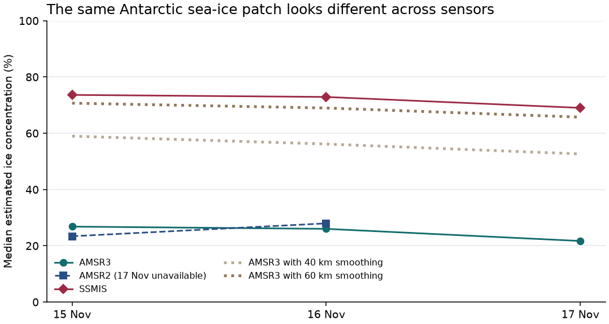

# November Antarctic sea-ice openings did not pass the three-day screen

**Status · Null result.** The first 17 daily Southern Hemisphere maps of November 2026 from AMSR3 yielded four offshore, pack-enclosed low-concentration footprints. The longest consecutive chain under the frozen five-cell rule lasted **two days**. A smaller three-day footprint near 71.7°S, 146.4°W passed a prespecified sensitivity test. AMSR2 supported it on both available comparison days, while SSMIS gave much higher concentrations in the same cells. Optical and radar browse checks did not settle whether the patch contained open water.

AMSR3 flies on GOSAT-GW. Its daily OSI SAF sea-ice concentration product switched to operational status on 1 September 2026. We screened all 17 AMSR3 days and compared the same 10 km grid cells against 16 AMSR2 and 17 SSMIS daily products. The frozen window has no AMSR2 file for 17 November. [Operational release](https://osi-saf.eumetsat.int/community/list-of-service-messages/operational-release-amsr3-based-sea-ice-products-1st-september) · [Frozen protocol](PROTOCOL.md) · [Exact inputs](sources.json)

## Screen and counterfactuals

| Screen | Daily qualifying footprints | Longest consecutive chain |
| --- | ---: | ---: |
| 70% enclosure and five core cells | 4 | 2 days |
| 60% enclosure and five core cells | 14 | 2 days |
| 80% enclosure and five core cells | 2 | 1 day |
| 70% enclosure and three core cells | 6 | 3 days |

The daily footprint counts include repeat observations of a patch. The primary rule rejected another 49 components touching a grid edge and 436 with an open or obscured ring, after the minimum core-size gate. A qualifying core had sea-ice concentration at or below 30% over at least five cells, approximately 500 projected km². All four primary footprints had valid SSMIS coverage in their cores. Three had same-day AMSR2 data and all three passed the cross-sensor coverage and concentration checks. SSMIS contradicted all four under the same checks. The first primary chain was near 64.4°S, 112°E on 2–3 November. [Daily evidence and grid footprints](screen-results.json)

The screen found a six-cell depression injected into compact ice. Connecting it to the grid edge, removing an adjacent ring measurement, restoring high concentration from a screening flag, and placing it near a coast mask each prevented detection. For a historical comparison, the ASI workflow detected the known Maud Rise opening near the published location on five staged dates in September and October 2017. On 14 September it found 892 low-concentration cells on the native 6.25 km grid. That run uses a different algorithm and a finer grid without the equivalent OSI SAF flags. It checks that the enclosure logic can recover a documented event, with the expected area depending on cutoff and grid. [Maud Rise observations](https://doi.org/10.1029/2018GL081482) · [University of Bremen ASI data](https://doi.org/10.1594/PANGAEA.898400)

## The 15–17 November patch

The linked footprints had 6, 4 and 10 low-concentration cells on successive dates. The four-cell middle day breaks the primary chain. These are the core medians in the cells selected by AMSR3. The quoted AMSR3 uncertainty had a median of about 13.7 percentage points on all three days.

| Date (UTC) | AMSR3 | AMSR2 | SSMIS | AMSR3 after 60 km smoothing |
| --- | ---: | ---: | ---: | ---: |
| 15 Nov | 26.8% | 23.4% | 73.6% | 70.7% |
| 16 Nov | 26.0% | 28.0% | 72.9% | 69.0% |
| 17 Nov | 21.7% | Unavailable | 69.0% | 65.7% |



Although the daily products use the same 10 km grid, the contributing sensors have different footprints. An exploratory calculation smoothed the AMSR3 maps with circular Gaussian kernels of 25, 40 and 60 km full width at half maximum. The 60 km calculation reduced an AMSR3–SSMIS difference of about 47 percentage points to about 3–4 points on each day. This illustrates how spatial averaging can attenuate a narrow depression. The kernel is an approximation and was applied after the screen. Instrument response, retrieval differences and sampling times remain possible contributors. [OSI SAF product specifications](https://osi-saf.eumetsat.int/products/sea-ice-products) · [Footprint and smearing analysis](https://osi-saf.eumetsat.int/sites/osi-saf.eumetsat.int/files/inline-files/OSI_VS19_04_DMI_VS_final_report_castro.pdf) · [Scale calculations](scale-results.json)

Same-day Copernicus catalogue queries returned zero Sentinel-1 products at the approximate 15–17 November centers. The NASA GIBS VIIRS and MODIS browse images were covered by cloud-like features or returned transparent frames at those locations. The queries had limited spatial and temporal support, and the imagery has no per-pixel acquisition time or cloud mask in the checked browse. Near the two-day November patch, the catalogue returned one 3 November Sentinel-1C acquisition with multiple product representations at the queried point. Its public quicklook was retrieved but no calibrated, geolocated ice retrieval was made from it. [SAR catalogue receipts](sar-catalog.json) · [Optical browse receipts](optical-browse.json)

This is a limited search over one 17-day window. Smaller patches, ice-connected features, coastal openings, and features interrupted by screening or missing pixels can be missed. The selected comparison footprints were defined in AMSR3. AMSR2 and SSMIS therefore measure conditional agreement on those footprints, and all three products share OSI SAF processing. SSMIS global metadata identifies the instrument family and does not resolve the contributing platforms by day or cell. The evidence supports a scale-sensitive low-concentration patch for follow-up. A physical opening and a novel polynya both remain unconfirmed. [OSI SAF on SSMIS availability](https://osi-saf.eumetsat.int/community/stories/implications-end-ssmis-data-osi-saf-products)

## Reproduce

The [input manifest](sources.json) preserves 55 exact downloads, including the historical comparison. Preserve the listed bytes if a near-real-time feed later changes the file or drops it. The replay validates each local file digest and rejects a changed grid or observing interval. The JSON retains the source-grid row and column for every qualifying core and immediate ring. It also records daily coverage, rejected component counts, comparisons, and links between dates.

From this directory, with Python 3.14 and NumPy 2.5.5, SciPy 1.17.1 and netCDF4 1.7.5.1.post1, run the commands below. Matplotlib 3.11.0 is used only for the optional plot. Use a dedicated external data directory such as a directory on D. Omit the download flag when the sources are staged.

```text
python screen.py --data DATA_ROOT --download --output replay.json
python check_scale.py --data DATA_ROOT --screen replay.json --output replay-scale.json --plot replay-scale.png
```

The core screen and exploratory smoothing results are [screen-results.json](screen-results.json) and [scale-results.json](scale-results.json). The catalogue and browse receipts document the separate imaging queries. The current NetCDF files are from EUMETSAT OSI SAF, and the historical ASI sea-ice concentration data are credited to the University of Bremen. [OSI SAF products](https://osi-saf.eumetsat.int/products/sea-ice-products) · [ASI dataset and license](https://doi.org/10.1594/PANGAEA.898400)
