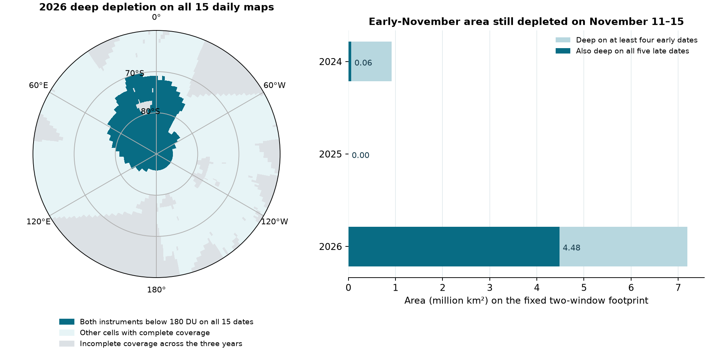

# Both satellites mapped a persistent deep Antarctic ozone core in November 2026

**Noteworthy measurement · Measured.** Aura OMI and NOAA-20 OMPS agree that **4.48 million km²** south of 60°S was below 180 Dobson units (DU) in both early and later November windows. This preserved **62.27%** of the early footprint, compared with **6.26%** in 2024. There was no qualifying early footprint in 2025. A stricter follow-up found **3.78 million km²** in which both instruments mapped values below 180 DU on every date from November 1 through 15, 2026. Neither of the two comparison years had any qualifying cells under that daily rule. [Native grid receipts](sources.json) · [All results](summary.json)

NASA and NOAA already reported the unusually large 2026 ozone hole, and the British Antarctic Survey (BAS) reported that it still covered about 17 million km² in mid-November. The measurement here quantifies the deep column-ozone footprint that remained at the same geographic locations on a documented set of two-instrument daily maps. It uses 180 DU as an operational depth threshold. NASA's area definition uses 220 DU. [NASA and NOAA seasonal report](https://www.noaa.gov/news-release/noaa-nasa-release-measurements-of-2026-ozone-hole) · [BAS November 16 update](https://legacy.bas.ac.uk/met/jds/ozone/) · [NASA Ozone Watch method](https://ozonewatch.gsfc.nasa.gov/meteorology/SH.html)

## One footprint for the three seasons

We selected the same grid cells visited by both instruments on all ten primary dates of all three years. That intersection covers **30.075 million km²** or **88.02%** of the cap south of 60°S. We weighted each cell by its spherical area. A cell counts as early deep depletion when both instruments give less than 180 DU on at least four of November 1–5. It counts as retained if both also give less than 180 DU on each of November 11–15. The thresholds, footprint and date windows were fixed before scoring. The summary splits the retained area into 5° latitude bands, starting at the pole, and 60° longitude sectors, starting at 180°W. [Frozen protocol](PROTOCOL.md) · [Coverage by latitude and longitude](summary.json)

| Year | Deep early area (million km²) | Deep area on all later dates (million km²) | Early area retained (million km²) | Early area retained (%) |
| --- | ---: | ---: | ---: | ---: |
| 2024 | 0.919 | 0.638 | 0.058 | 6.26 |
| 2025 | 0.000 | 0.000 | 0.000 | Undefined |
| 2026 | 7.194 | 4.605 | 4.479 | 62.27 |

On the 2026-only complete footprint, 4.59 million km² remained, or 62.77% of the early qualifying area. A relaxed coverage screen gives the same retained area. Restricting the 2026-only footprint to south of 70°S gives 4.43 million km², or 69.33%. On the fixed three-year footprint, tightening to 170 DU gives **2.43 million km²** retained in 2026 and raising the threshold to 190 DU gives **6.25 million km²**. The earlier-year figures remain below the 2026 figures at both thresholds. These are two reference years, with no estimate of a historical return period or long-term trend. [Sensitivity results](summary.json)

## A check of every sampled date

The all-date check was added after the primary analysis. It uses a stricter footprint with paired valid data on every one of the 15 November dates in each of the three years. That footprint covers **26.20 million km²** or **76.69%** of the cap. Tightening the threshold to 170 DU leaves **2.17 million km²** in 2026 under the all-date rule. Values could change between the daily overpasses. The study follows fixed geographic cells as ozone moves through them. It cannot track the same air mass or identify the process responsible for the persistence. [All-date check](summary.json)

## Agreement and gaps at the standard threshold

On November 15, the single-sensor observed areas below 220 DU south of 40°S were **17.94 million km²** for OMI and **17.99 million km²** for OMPS. The area classified low by both was **17.54 million km²**. Allowing cells with one or both values missing to qualify where no available value rules out joint depletion raises that bound to **17.74 million km²**. The bounds apply to the low classification of both daily products, given the available grid values. They are not uncertainty intervals for the true atmospheric column. The November 2026 topology screen finds no second consensus component meeting the 0.5 million km² minimum. That is a result for the gridded columns and covered days, independent of the dynamical definition of a vortex split. [Daily coverage, disagreement and components](summary.json)

At the published September 18 peak, the raw observed areas south of 40°S were 23.26 million km² in OMI and 25.04 million km² in OMPS, with incomplete coverage. They are below the published full-area estimate of 27.1 million km². The release estimate and this direct grid sum use different treatments of coverage. We retained native zeros and used zero as an unavailable measurement for the analysis. Positive values can still share cloud, geometry and ultraviolet retrieval effects. The older OMI cross-track anomaly limits coverage, and Collection 4 improves its flagging. The ASCII products contain gridded columns and lack individual observation times and flags for each cell. As an example, the November 5, 2026 headers give nominal ascending local crossing times of 14:56 for Aura and 13:23 for NOAA-20. [OMI Collection 4 release details](https://docserver.gesdisc.eosdis.nasa.gov/public/project/OMI/OMTO3_ReleaseDetails_V004.pdf) · [September peak and NASA coverage context](https://science.nasa.gov/earth/2026-ozone-hole/) · [Header receipts](polar-metadata.json)

## Ground observations near the core

BAS reported ozone around 160 DU over Halley in its November 16 bulletin. Its provisional Halley SAOZ and Vernadsky Dobson series cover November 1–15. They sample individual sites with their own observing geometry and timing. The Halley Dobson series had no data for this season in the bulletin. These ground observations give local context for the satellite map. The area calculation uses the paired daily grids. [BAS bulletin and station records](https://legacy.bas.ac.uk/met/jds/ozone/)

## Reproduce

From this folder, run the analysis with Python 3.10 or newer and NumPy.

~~~text
python analyze.py --output summary.json
~~~

The [polar bundle](polar-grids.zip) preserves exact values and zeros for the southern grid rows of all 92 products. Every member has a digest in the [metadata](polar-metadata.json), and the [source manifest](sources.json) records the original names, full-file hashes, sizes and retrieval URLs. To regenerate the polar bundle from the native sources staged on D, run `python prepare.py --data-root NATIVE_DIRECTORY --output replay-polar.zip --metadata replay-metadata.json`. Matplotlib is needed to recreate the figure with `python plot.py --output replay-figure.png`. A second implementation computed the primary and all-day areas directly from native ASCII files.
