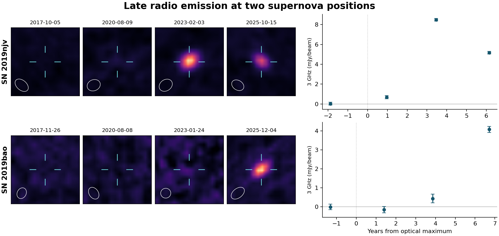

# Late 3 GHz emission at SN 2019njv and SN 2019bao

Two previously classified supernovae developed compact radio sources years after optical maximum. SN 2019njv appears in two independent late VLA visits at the position of its Type IIn explosion. SN 2019bao has one bright late visit, at the position of a Type IIb explosion far outside the host nucleus. These are new archival radio identifications in this investigation. The evidence for their association differs.



Each image spans 16 arcseconds. Cyan ticks mark the optical position. The white ellipse is the restoring beam. Within each row, every image has the same brightness scale. The right panels show amplitudes fitted at the optical coordinates with empirical field scatter. The dotted vertical line marks the measured ZTF optical maximum.

| Object | Epoch 1 | Epoch 2 | Epoch 3 | Epoch 4 |
|---|---:|---:|---:|---:|
| SN 2019njv, days from optical maximum | −685 | +354 | +1,262 | +2,247 |
| 3 GHz, mJy/beam | 0.03 ± 0.13 | 0.69 ± 0.16 | **8.48 ± 0.13** | **5.17 ± 0.14** |
| SN 2019bao, days from optical maximum | −476 | +511 | +1,409 | +2,454 |
| 3 GHz, mJy/beam | 0.00 ± 0.14 | −0.15 ± 0.17 | 0.44 ± 0.23 | **4.07 ± 0.15** |

**SN 2019njv.** On 3 February 2023 and 15 October 2025 the radio centroids landed within 0.08″ of the independent optical position reported by Bruch et al. The pre-explosion measurement is consistent with zero. The earlier optical spectrum, taken about a day after explosion, identified a Type IIn. At the host redshift of 0.01458, the 2023 radio brightness corresponds to approximately 3.9 × 10²⁸ erg s⁻¹ Hz⁻¹, using the low-redshift distance cz/H₀ with H₀ = 70 km s⁻¹ Mpc⁻¹. Shock interaction with circumstellar material is a plausible explanation. These measurements alone do not determine the density or radius of that material. [Bruch et al., Table 8](https://doi.org/10.3847/1538-4357/acd8be)

The 2MASS center of CGCG 424-001 lies 2.08″ from the bright radio centroid. Pan-STARRS resolves several overlapping components near the supernova. The tight optical match and appearance after explosion favor association with the supernova, although separating a variable compact host source requires better angular resolution. Two lower-resolution ASKAP RACS components have peak brightnesses of 1.19 and 2.49 mJy/beam. Their roughly 10–19″ beams blend the optical site and the host center. We retain both rows as regional radio detections. [2MASS extended-source archive](https://irsa.ipac.caltech.edu/cgi-bin/Gator/nph-query?catalog=fp_xsc&spatial=Cone&objstr=304.98829+15.37745&radius=3&radunits=arcmin&outfmt=1) · [RACS](https://research.csiro.au/racs/) · [RACS-mid record](external/njv_racs_mid_components_v01.csv) · [RACS-low2 record](external/njv_racs_low2_v02.csv)

**SN 2019bao.** On 4 December 2025 the fitted centroid lay 0.11″ from the rounded BTS position and about 49″ from the 2MASS center of UGC 5687. The bright measurement was 2,454 observer-frame days after optical maximum, or 6.72 years. It corresponds to approximately 1.25 × 10²⁸ erg s⁻¹ Hz⁻¹ at z = 0.01188 using the same distance convention. The earlier +1,409-day measurement was only 1.9 times local field scatter. The data establish a late radio appearance while leaving its onset and maximum undetermined. The earliest optical spectrum was classified as peculiar Type II with possible helium. BTS and Gaia list Type IIb. [Optical classification report](https://www.wis-tns.org/object/2019bao/classification-cert) · [Gaia19blr](https://gsaweb.ast.cam.ac.uk/alerts/alert/Gaia19blr/) · [Host and optical coordinates](https://blast.scimma.org/transients/2019bao/)

A separately rendered continuum product gives 0.09 ± 0.16 and 0.50 ± 0.24 mJy/beam on the second and third visits. These reductions share their visibilities with the quick-look products. The fourth visit is the only bright detection available here. Eleven earlier public ASKAP VAST DR1 component tables covering this field returned no component within 54″. Eight later 887.491 MHz VAST visits span June 2025 to September 2026. Their archived metadata are public, but the pixel and component downloads required authentication. Measuring those visits would test whether the low-frequency source appeared and at what time. The metadata supply no flux limits. [VAST DR1](https://doi.org/10.25919/7597-df49) · [Later pointing identifiers and quality flags](external/bao-vast-visits.csv) · [Continuum fits and archive URLs](continuum.csv)

## Search and competing identifications

The 15 November 2026 ZTF Bright Transient Survey query returned 4,886 supernovae, with reported redshifts from 0.010 to 0.050. We kept the returned Type II, Ib and Ic families through z = 0.015 and the catalog types IIn, Ibn, Icn, Ia-CSM and Ic-BL through z = 0.050. This yielded 387 distinct positions. The frozen search contains measurements in the first three VLASS visits for all 387, and a fourth visit for 198. Of the 387, 329 have visits on both sides of optical maximum. This selection is incomplete for nearby supernovae, and the cadence and detection threshold strongly favor luminous, long-lived sources. [BTS catalog and release description](https://sites.astro.caltech.edu/ztf/bts/bts.php) · [BTS field conventions](https://sites.astro.caltech.edu/ztf/bts/explorer_info.html) · [Full 1,359-row ledger](screen.csv.gz)

The first pass sampled the brightness at each optical position by bilinear interpolation. A local annulus from 8″ to 30″ supplies the background median and 1.4826 times its median absolute deviation (MAD). As an exploratory summary, seven objects had a brightest fixed pixel above six local noise units with a maximum-to-minimum change above five times the quadrature sum of the two pixel noise estimates. We chose these summary thresholds after inspecting some light curves. They do not constitute a blind significance calculation. We followed up all seven plus two lower-significance IIb sources with a restoring-beam fit. [All nine follow-up histories](beam-fits.csv)

| Other object | Outcome |
|---|---|
| SN 2019wqq | A real 3.31 ± 0.13 mJy/beam brightening is 0.19″ from the BTS position. An SDSS photometric quasar candidate predates the explosion and lies 0.37″ from the bright radio centroid. Gaia favors a galaxy. Two spectra target the offset host center. The independent continuum reduction recovers the source from the same visibilities. Its origin remains ambiguous. [Primary optical evidence and image](external/README.md) |
| SN 2020aqe | A Type II site reaches 1.90 ± 0.16 mJy/beam at +269 days, then gives 0.58 ± 0.16 and 0.31 ± 0.18 mJy/beam. The bright radio centroid is 0.37″ from the optical position. A possible earlier-time counterpart with one strong detection. [Host coordinates](https://blast.scimma.org/transients/2020aqe/) |
| SN 2025shf | A broad-lined Ic site reaches 1.36 ± 0.16 mJy/beam at +73 days after three pre-maximum visits consistent with zero. The optical transient is within an arcsecond of its catalogued host center. A variable nucleus remains a serious alternative. [TNS spectroscopy](https://www.wis-tns.org/object/2025shf) |
| SN 2020ywx and SN 2021bmf | Positive controls. Both have published late radio detections, including a previous BTS–VLASS identification of SN 2021bmf. [SN 2020ywx](https://prints.iiap.res.in/jspui/bitstream/2248/8701/1/A%20multiwavelength%20autopsy%20of%20the%20interacting%20type%20IIn%20supernova%202020ywx%20%20tracing%20its%20progenitor%20mass-loss%20history%20for%20100%20yr%20before%20death.pdf) · [SN 2021bmf](https://lss.fnal.gov/archive/2025/pub/fermilab-pub-25-0913-ppd.pdf) |
| SN 2019aur and SN 2019pqo | Two weaker IIb leads. One has a single 0.93 ± 0.13 mJy/beam measurement at +115 days, the other 0.79 ± 0.13 at +1,732 days. Their screen contrasts fell below the exploratory cut. |

## Instrumental and sky tests

The headline fluxes fit the local restoring beam and a tilted sky background in a 17-pixel square. The fit is linear at the optical coordinate. A second fit frees the radio centroid. The archived small cutouts reproduce all 31 fixed-position measurements. A 0.065°-radius cutout from the same original image supplies up to 3,712 translated sky positions, sampled on a 6″ grid and excluding the inner 12″. Each control uses the same pair of sky coordinates across epochs. For both SN 2019njv and SN 2019bao, zero of 3,712 local controls changed as much as the pre-explosion to brightest-visit pair. These are field ranks after source selection. Blank-sky controls test additive artifacts and noise. They do not calibrate multiplicative flux changes. Quoted uncertainties in the table are the empirical single-visit field MADs, excluding systematic flux-scale and distance errors. [Translated-sky differences](field-differences.csv) · [NRAO quick-look limitations](https://science.nrao.edu/vlass/data-access/vlass-epoch-1-quick-look-users-guide)

Four compact field sources detected above ten local noise units in both late SN 2019njv visits have fourth-to-third peak ratios of 0.95–1.09 (median 0.978). The supernova ratio is 0.610, a 39% decline on the native scale. Thus a field-wide gain shift is too small to explain the decline. One comparable source in the SN 2019bao field has a fourth-to-first ratio of 0.978. We required two matched compact peaks for each selected comparison, positional agreement within 2″, and a peak-to-beam-area shape test. This small selected ensemble is a local consistency check. [Flux ratios and selection code](compare_flux_scales.py) · [Comparison measurements](compact-field-sources.csv)

## Literature scope and reproduction

On 15 November 2026 we searched indexed papers, the Transient Name Server, Astronomer’s Telegrams, and survey releases using the IAU names and ZTF aliases with “radio”, “GHz”, “VLA”, “VLASS” and “late-time”. The SN 2019bao search included ATLAS19dli and Gaia19blr. We found earlier optical work on both headline objects, and earlier VLASS and ASKAP radio-supernova searches. The named searches yielded no previous report identifying the radio histories measured here. Unindexed reports and anonymously catalogued radio sources remain possible. Late ZTF direct images contain pre-existing sources. No independently distinguishable late optical transient or X-ray catalog counterpart was established for the two headline objects. [Earlier VLASS search](https://par.nsf.gov/servlets/purl/10351661) · [Earlier ASKAP search](https://doi.org/10.1093/mnras/stae2289) · [Earlier SN 2019njv precursor search](https://doi.org/10.3847/1538-4357/abd032)

Run in this directory with Python 3, NumPy, pandas, SciPy, Astropy, and Matplotlib. Coordinates are ICRS degrees. Times are observer-frame UTC MJDs, measured from the BTS peak time (JD − 2458000). VLASS Stokes I covers 2–4 GHz. The uncorrected native amplitudes are reported in mJy/beam.

```sh
python replay.py
python figure.py
python replay.py --fields cache/fields --output cache/recomputed
python compare_flux_scales.py followup-visits.csv cache/large cache/recomputed
python screen.py cache/screen
python select_visits.py cache/catalogs
```

The first two commands use only the archived pixels and tables. The next two reload the large comparison fields. The last two replay the frozen screening positions and rebuild the initial target selection from the public archive inventories. Six edge cutouts required an overlapping VLASS subtile. Three more completed on retry. The committed screening ledger fixes the final URI, position, observing date, and input SHA-256 for every image. The live BTS and CADC inventories can change. [Archive inventory checksums](selection-digests.json) · [First and final cutout identifiers](retry-visits.csv) · [CADC public VLASS collection](https://www.cadc-ccda.hia-iha.nrc-cnrc.gc.ca/en/vlass/) · [NRAO survey](https://science.nrao.edu/vlass)
