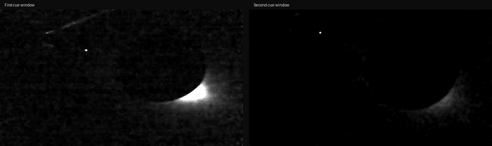

# Artemis II lunar-flash observability in the Orion camera archive

**Noteworthy coverage finding.** The Orion downlink archive supplies **1,798** decoded frames in the 30-second window around the second timed crew report. Only **150** frame-to-frame steps meet the interior image-change criterion, at a median spacing of **0.2002 seconds**. The lunar disk is difficult to localize in this window. The separate onboard recording starts **1,678 seconds** after that report. These measurements document which camera records can be used to examine the crew's timed observations and how much image information the downlink preserves. [Video results](video-results.json) · [NASA report](https://science.nasa.gov/feature/artemis-ii-preliminary-lunar-science-report/) · [Archive guide](https://pds-geosciences.wustl.edu/artemis2/urn-nasa-pds-artemis2_mission/document/artemis2_data_user_guide.pdf)

## Time and spatial information

NASA's preliminary report gives speech cues at 00:41:01 and 00:51:15 UTC on 7 April 2026. The PDS channel-1 container spans 23:38:11 UTC on 6 April to 01:37:57 UTC on 7 April. In each window, the nominal UTC refers to the PDS start plus the movie presentation timestamp. The video stream duration differs from the whole-second label span by about 0.205 seconds. This comparison does not independently synchronize the video to the crew recorder. [Protocol](PROTOCOL.md) · [Native downlink label](art002m1010962338_saw3_raw_v01.xml)

| Decoder interval | Presented frames | Steps with substantial interior change | Maximum of the per-frame interior 99th percentiles |
| --- | ---: | ---: | ---: |
| First speech cue, ±15 seconds | 1,799 | 116 | 44 |
| Second speech cue, ±15 seconds | 1,798 | 150 | 8 |
| First 30 seconds of onboard interval, downlink | 1,798 | 145 | 140 |
| Onboard recording, labelled 130 seconds | 3,897 | 3,896 | 32 |

For each adjacent pair, an update requires more than 0.1% of the central rectangle's pixels to change by more than 2 decoded luma codes. The rectangle spans the central 80% of each axis. The downlink container presents about 59.94 frames per second and its product-level label lists an intermediate frame rate of 30. The guide documents a change to a 5 fps encoder before the windows. The measured spacing around the second cue agrees with 5 fps scene updates at the chosen threshold. Decoding and recompression can change pixels between repeated source frames, so the update count is a diagnostic of the video product. [Frame ledger for the first cue](first-cue.csv) · [Frame ledger for the second cue](second-cue.csv)

The first frames show part of a bright arc in the first window and a faint partial arc in the second after the same display stretch. In every frame within the second interval, at least 99% of the interior is at or below luma code 8. These are values in the delivered video. A calibrated limiting brightness for lunar impact flashes would require the camera response, a registered lunar footprint and the flash duration relative to sampling. [Per-frame data](second-cue.csv)



The display maps luma codes 1 through 46 linearly to black through white in both frames. The measurements use the native decoded pixel values.

## Independent timing and scene checks

The crew recorder's assigned UTC and reconstructed UTC differ by **2.786 seconds** at the first speech cue and **0.519 seconds** at the second. Reconstructed UTC adds the elapsed-time field to the archived start timestamp. Across the transcript, **7** of **412** rows differ by more than one second under this comparison. These are two time representations of the same transcript. The audio clock and time from sighting to speech remain unknown. [Transcript timings and source receipts](transcript-timing.json)

The 5-second Orion still starting at 00:40:54 UTC shows a clear lunar outline. Assuming the label's start marks the integration start, that exposure ends nominally two seconds before the rounded speech cue. The transcript discrepancy is larger than that gap. Around the second cue, the archived Orion still inventory has no overlap among stills with known durations. Durations are unavailable for 653 entries, and none of those entries starts within the two cue windows. [Orion still audit](still-coverage-timeline.json) · [Native still receipt](still-control.json)

The separate onboard recording starts at 01:19:13 UTC, **2,292 seconds** after the first rounded cue and **1,678 seconds** after the second. The mission team previously searched this clip for impacts. It supplies a higher-cadence image-content comparison for the later interval. The timed crew sightings remain unverified by these camera measurements. [Onboard label](art002m1200970119_saw3_raw_v01.xml) · [Onboard frame ledger](onboard.csv)

## Replay

The two MP4 source products were verified against PDS checksums. The repository includes their exact labels, per-frame summaries and timing results. The full downloaded recordings remain on a data volume. The initial downlink check used selected source byte ranges, and the full-file replay reproduced the per-frame summaries. Dependencies are Python, NumPy and PyAV. Fetch upstream inputs from the video and transcript receipts into separate data directories.

```sh
python check_video.py sources.json <native-video-dir> <video-output-dir>
python check_transcript.py <pcd-csv> <pcd-label> <timing-output.json>
```

The video script's `--ranges` option also accepts a data directory for a cache of requested byte ranges. It records the exact returned ranges and their digests. [Video sources](sources.json) · [Byte ranges used in the first check](range-receipt.json) · [Study checksums](SHA256SUMS)
