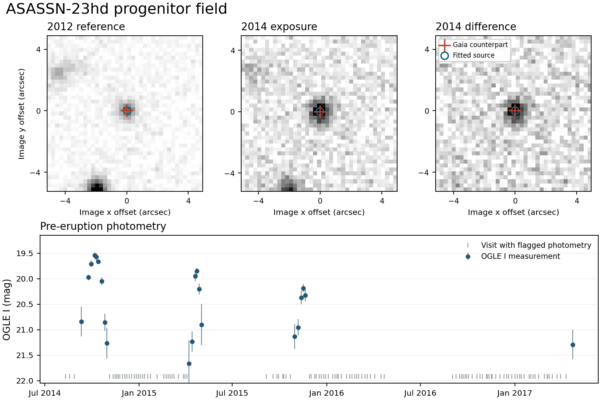

# Three optical brightenings of the likely progenitor of LMC nova ASASSN-23hd

SIMBAD already identifies the OGLE transient with ASASSN-23hd. This branch preserves an image-level verification. The light that brightened on 6 October 2014 in the OGLE difference image falls on Gaia DR3 4662989888116855808, the likely progenitor independently identified by SOAR astrometry during the 2023 classical-nova eruption. The fitted separation is **0.004 arcsec**, within the **0.033 arcsec** radial registration scatter of 30 field stars. The original science frame gives a separation of **0.024 arcsec** on a separately fitted plate. The OGLE archive and a VLT Survey Telescope (VST) follow-up document three brightenings at this location, 7.9 to 9.0 years before the nova. [OGLE discovery](https://www.astronomerstelegram.org/?read=6573) · [GRAWITA VST follow-up, Figure 6 and Table 4](https://doi.org/10.1093/mnras/stx2730) · [SOAR astrometry and classification](https://www.astronomerstelegram.org/?read=16294)

The 2018 GRAWITA paper discussed OGLE-2014-SN-094 as a possible active galactic nucleus on the basis of repeated optical activity and a GALEX ultraviolet source. The 2023 SOAR team identified a classical nova from its spectrum and linked its position to the Gaia star. Shafter's 2026 LMC census discusses the 2023 eruption and its 1.8 ± 0.2 day decline by two magnitudes. SIMBAD already cross-identifies OGLE 2014-SN-94, ASASSN -23hd, AT 2023uwa, LMCN 2023-10a, the Gaia source and the VST transient under one main identifier. AAVSO VSX also lists the nova at the OGLE/Gaia position. Gaia DR3’s variability classifier assigned the source to the CV class (score 0.649) using data obtained before the 2023 eruption. The individual brightenings and the source association both have prior records. This contribution independently verifies the catalog link with a difference image, quantifies its uncertainty and measures the pre-eruption history. It is a validation. [SIMBAD object](https://simbad.cfa.harvard.edu/simbad/sim-id?Ident=OGLE+2014-SN-94) · [Frozen SIMBAD alias query](inputs/simbad_aliases.csv) · [Nova census, section II.1.61](https://arxiv.org/abs/2607.23849) · [VSX record](https://www.aavso.org/vsx/index.php?view=detail.top&oid=2388229)



All three images use a 10-arcsec field centered on the Gaia counterpart with separate intensity scaling. Gray marks below the light curve give the observing cadence for flagged visits. Running `python plot.py` with Matplotlib regenerates the figure.

## Photometry

The OGLE archive identifies the source as LMC541.27.577. The archived I-band file contains 131 visits through April 2017. Of the 21 entries with positive reported errors, 20 fall into the three episodes below. The remaining isolated point in April 2017 is I = 21.291 ± 0.287. Grouping uses a gap of more than 45 days between detections and requires at least two detections per episode. The original file marks 110 rows with error −1. The intervening two intervals contain 30 and eight such visits respectively. The table gives brightest **sampled** values. Timespans describe coverage between detections, and the invalid rows carry no measured magnitudes in our analysis. [OGLE light curve and finding charts](https://ogle.astrouw.edu.pl/ogle4/transients/2017a/transients.html#OGLE-2014-SN-094)

| Brightest sampled date | OGLE I (mag) | Detections | First-to-last detection |
| --- | ---: | ---: | ---: |
| 2014-10-06 | 19.545 ± 0.054 | 9 | 49.9 d |
| 2015-04-22 | 19.852 ± 0.064 | 6 | 23.9 d |
| 2015-11-16 | 20.184 ± 0.082 | 5 | 21.0 d |

VST independently observed the third episode on 11 November 2015, measuring approximately r = 19.5. Its published position is 0.36 arcsec from the Gaia source. The first and last OGLE brightest observations precede the 2023 eruption by 3,294 and 2,888 days respectively. The 2023 event reached g ≈ 10.4. Different passbands and incomplete sampling preclude a direct peak-to-peak flux ratio. No spectra of these faint episodes establish a mechanism. Accretion variability is a possible explanation. A thermonuclear recurrence, a recurrence period, or a causal trigger for the 2023 eruption would each require additional evidence.

## Astrometric checks

We fitted separate six-parameter linear plate solutions to the 2012 reference image and the 2014 science image. The October 2014 difference image is on the reference grid. Each solution uses Gaia stars brighter than G = 20, excludes the central three arcseconds, propagates available proper motions to the frame epoch, and clips progressively to a final 0.8 pixel residual. Thirty reference stars remain in each fit. The Gaia counterpart itself played no part in fitting either plate. The plate scale is about 0.26 arcsec/pixel. The code fits an elliptical Gaussian plus a tilted local background to the target. Coordinates and radii are available in [measurements.json](measurements.json).

| Measurement | Field registration radial RMS | Separation from Gaia star |
| --- | ---: | ---: |
| 2014 difference flux on reference grid | 0.033″ | 0.004″ |
| 2014 source in original science exposure | 0.043″ | 0.024″ |
| Quiescent source in 2012 reference image | 0.033″ | 0.034″ |

The science and difference images use the same October 2014 exposure. Their agreement checks the reference-grid assignment and blending sensitivity. The difference centroid stays within 0.011 arcsec of the predicted position when changing the fit radius from five through nine pixels. The radial RMS describes field registration. The data do not establish milliarcsecond absolute precision for a single faint source.

The next Gaia source is 5.45″ away. Forty other Gaia stars lie within 60″. A uniform-density area estimate gives 40 × (0.1/60)² ≈ 0.00011 other Gaia stars per 0.1″ circle at this position. This diagnostic omits Gaia-incomplete sources, unresolved blends, spatial clustering and the number of records searched. It cannot serve as a global false-alarm probability. The raw ASAS-SN alert position has a roughly 0.9″ offset from the OGLE alert. The 2023 tie used here is specifically the SOAR team's image-based Gaia association. Their raw astrometric frames were not reprocessed.

## Reproduction

Run from this directory with Python 3, NumPy and SciPy.

```sh
python fetch_images.py
python analyze.py > reproduced.json
```

[provenance.json](provenance.json) gives public archive URLs, SHA-256 digests for the frozen inputs and the Gaia ADQL query. The script checks the digests before fitting. OGLE released multiple annual versions of the cutouts. The photometry uses the 2017a snapshot for its longer coverage. All three registered FITS files come from the 2014 snapshot, with the observation epoch checked in the original header.

The lead emerged in an exploratory all-sky comparison of David Bishop's annual Bright Supernovae name lists for 2005–2026. After deduplication by label and coordinates, 228,099 dated entries parsed, yielding 895 distinct close pairs after the exploratory cuts of ≤2″ separation, ≥0.65 years between dates and the M31/M81 exclusions. These rows and pairs include alternate designations and catalog date errors. The original reports, observations and image controls above determine the status of this particular pair. [Annual catalog example](https://www.rochesterastronomy.org/sn2023/snname.html)
