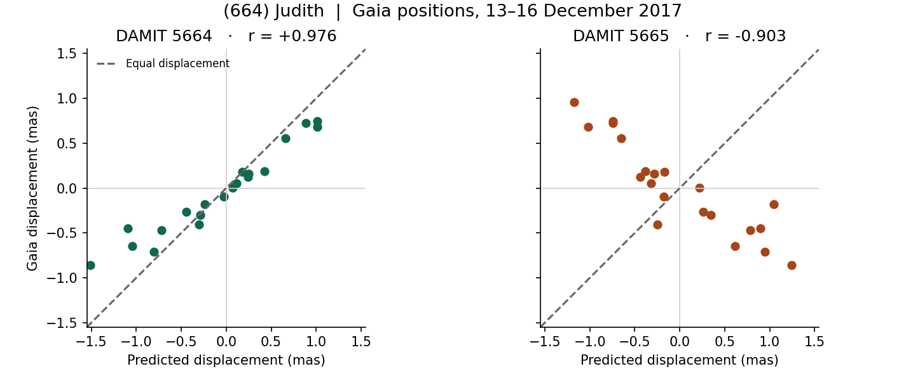

# The rotating surface of (664) Judith predicts its Gaia wobble

Two published shapes of the same asteroid make opposite predictions for where its sunlight should appear on the sky. From 13–16 December 2017, Gaia measured 21 positions through 3.7 asteroid rotations. The illuminated surface of DAMIT model **5664**, with ecliptic spin pole **(140°, +54°)**, predicts the direction and phase of the displacement with correlation **+0.976**. The other ATLAS model, **5665**, with pole **(343°, +68°)**, gives **−0.903**. The periods, phases, axes and triangular shapes in this comparison all come from the ground-based ATLAS photometry published in 2020. An earlier set of Gaia positions, ending 587 days before the 2017 sequence, independently favors the same pole. [Published shapes](https://doi.org/10.1051/0004-6361/202037729) · [Model 5664](https://damit.cuni.cz/projects/damit/asteroid_models/view/5664) · [Model 5665](https://damit.cuni.cz/projects/damit/asteroid_models/view/5665) · [Individual measurements](measurements/transits.csv)

Liberato and colleagues included Judith in their 2026 catalog of candidate binary asteroids. They measured a **9.720 ± 0.070 h** astrometric period and a **0.62 ± 0.08 mas** semiamplitude and identified large, irregular asteroids as a source of false positives. Judith's 19.30 h spin produces two opportunities per revolution for its illuminated surface to shift the photocenter. The present result tests the *signed position at each transit*. The two candidates for the orientation of the same rotating body give distinct predictions even though both reproduce changes in brightness. A satellite could still be present. The waveform has a quantitatively supported single-body explanation, with an unresolved discrepancy in its absolute amplitude. [Candidate catalog and methods](https://doi.org/10.1051/0004-6361/202659515) · [Judith catalog row](data/gaia_candidate.csv)



## What the observed positions distinguish

| Quantity | DAMIT 5664 | DAMIT 5665 |
| --- | ---: | ---: |
| Earlier Gaia G magnitudes, correlation in 33 visits | +0.964 | +0.978 |
| Earlier Gaia position residuals, correlation in 24 visits | +0.820 | −0.461 |
| Earlier position RMS after fixed-size prediction, from 0.555 mas | 0.359 mas | 0.949 mas |
| December 2017 signed position correlation, 21 visits | +0.976 | −0.903 |
| December 2017 RMS after fixed-size prediction, from 0.504 mas | 0.300 mas | 1.170 mas |
| December 2017 fitted displacement multiplier | 0.638 | −0.655 |

The absolute scale matters. Fitting a sinusoid at the published 9.7203 h period to our independent reduction gives **0.588 mas** semiamplitude. At the catalog diameter of 63.4 ± 0.9 km, model 5664 predicts **0.907 mas**. Subtracting the unscaled prediction leaves **0.320 mas** at this period. Allowing one positive scale factor for the calculated photocenter leaves **0.110 mas RMS** across all 21 positions and **0.015 mas** at this frequency. Calibrating the scale on the *earlier* positions alone gives 0.731 and leaves **0.131 mas RMS in December**. A negative multiplier for 5665 would reverse the physical direction of its displacement. [Fit results and sensitivity tests](measurements/results.json)

JPL SBDB lists another thermal diameter, 85.214 ± 0.588 km, from NEOWISE. With this diameter the first model leaves **0.555 mas RMS**, above the 0.504 mas starting value. Both models have uncertain local shape, and a light-curve-derived surface with uniform albedo and density need not predict the physical displacement scale exactly. An inferred scale cannot by itself distinguish diameter, surface reflectivity, density heterogeneity, shape error, or an additional signal. [JPL diameter and original data reference](data/jpl_sbdb.json)

## Measurement and checks

- **Measured unit.** Each of 179 accepted focal-plane CCD positions enters the December analysis once. Use the median per Gaia transit, producing 21 distinct observations. The starting epochs and spacecraft positions come from Gaia FPR. JPL Horizons gives the asteroid's ICRF barycentric position and velocity once per transit. We propagate locally to each CCD time and retard to emission using the Gaia spacecraft position. We project observed minus calculated coordinates along the published scan angle, measured from celestial north towards increasing right ascension. The orbit fit underlying Horizons can use Gaia data. Local orbit, light-deflection and calibration offsets can enter the resulting residuals. We remove the same quadratic in time from measurements and predictions. [Gaia column definitions](https://gea.esac.esa.int/archive/documentation/FPR/chap_datamodel/sec_dm_focused_product_release/ssec_dm_sso_observation.html) · [All source requests and hashes](data/sources.json)
- **Prediction.** Scale each convex mesh to an equal-volume sphere of the adopted diameter. Center it on the uniform-density volume centroid, rotate using the archived IAU spin rates and prime meridians at the light-emission times, and compute each illuminated, visible facet's flux. Weight its projected centroid by the flux. The nominal scattering law is Lommel–Seeliger plus 0.1 times Lambert, as in the archived models. Separate pure Lommel–Seeliger and pure Lambert calculations and constant, linear and quadratic baseline fits preserve the sign difference in every combination. Across those nine choices the correlations range from +0.801 to +0.976 for model 5664 and −0.911 to −0.711 for 5665. No phase offset is fitted. [Calculation](replay.py) · [Nine alternatives per shape](measurements/results.json)
- **Disjoint data.** Gaia DR2 supplies orbital-fit residuals for 26 earlier transits from November 2014 through May 2016. We take the median of accepted CCDs for each transit and remove the mean of each group separated by gaps over five days. Two isolated transits have no within-group information, leaving 24 transits in nine groups. None shares a transit identifier with the December 2017 sequence. Separately, differences in Gaia DR3 brightness within observing groups agree with both shapes. These are independent exposures from the same mission. They share instrument and some orbit systematics. [Gaia orbital residual documentation](https://gea.esac.esa.int/archive/documentation/GDR2/Gaia_archive/chap_datamodel/sec_dm_auxiliary_tables/ssec_dm_aux_sso_orbit_residuals.html)
- **Selection.** We intersected the published Gaia DR3 and FPR wobble candidates with Pál et al.'s TESS asteroid release and inspected all 79 overlapping asteroids (109 catalog rows). Exploratory searches for repeated dimmings did not establish mutual eclipses. We then explored eight asteroids with available shapes, including clear matches between spin and wobble harmonics and the complex rotator Letaba. Judith provided the strongest signed agreement in that screen. The other results and target choices remain visible. The candidate selection was exploratory and a survey-wide false-alarm probability has not been estimated. The earlier Gaia comparison was inspected during exploration. Its observations are disjoint in time but it is not a blind test. [Target intersection](measurements/exploratory-screen.csv) · [Exploratory shape results](measurements/shape-screen.csv) · [Selection input receipts](data/selection-sources.json) · [TESS photometry](https://arxiv.org/abs/2001.05822)

## Earlier work and scope

The 19.3 h spin was already known. Earlier Gaia brightness analyses also constrain the pole. Ďurech and Hanuš (2023) list approximately (140°, +60°) and (340°, +79°) for Judith. Cellino et al. (2024) list (101.46°, +78.41°). A 2026 inversion gives (123.8°, +73.2°) for an ellipsoid and (97.2°, +76.0°) for a convex shape. The precise pole is therefore model dependent. Our result discriminates between the two specific ATLAS shapes using the direction of the measured position shift. [2023 catalog](https://vizier.cfa.harvard.edu/viz-bin/asu-tsv?-source=J/A%2bA/675/A24&Number=664) · [2024 catalog](https://vizier.cfa.harvard.edu/viz-bin/asu-tsv?-source=J/A%2bA/687/A277&Name=664) · [2026 catalog](https://vizier.cfa.harvard.edu/viz-bin/asu-tsv?-source=J/A%2bA/707/A131&Number=664)

ATLAS published both possible shapes and orientations. Gaia's candidate catalog explicitly flags Judith's size range as susceptible to irregular-shape effects. Kaasalainen and Tanga proposed using measured photocenter positions to distinguish mirror poles in 2004. Model-based photocenter corrections have been demonstrated for other asteroids, including Lutetia and Davida. Here the object-specific additions are the predictions from both archived Judith shapes at the actual Gaia times, their opposite agreement with the observed positions, and a second comparison on disjoint epochs. Searches on 14 November 2026 using the name, number, wobble period, “photocentre”, “pole”, and “satellite” located no earlier report of this particular comparison. Published orbit and spin catalogs are not exhaustive priority checks. [Ground-based period](https://mpbulletin.org/issues/MPB_48-4.pdf) · [Mirror-pole test](https://doi.org/10.1051/0004-6361:20031711) · [Photocenter modeling on other asteroids](https://doi.org/10.5194/epsc-dps2025-1351) · [Gaia DR3 asteroid analysis](https://doi.org/10.1051/0004-6361/202243796)

## Replay and credit

Run from this directory with NumPy and pandas. Matplotlib is required only for the figure.

```sh
python replay.py
python plot.py
```

The replay verifies SHA-256 hashes of all physical-model inputs, reconstructs the spacecraft geometry and two photocenter predictions, and writes the per-transit table and summary. The exploratory tables provide the selection context. Their preliminary screening used a locally smooth scan-direction baseline and a barycentric approximation to the direction of the Sun. The reported Judith calculation uses the actual solar ephemeris and a time-polynomial baseline. [Inputs](data/sources.json) · [Replay](replay.py)

Gaia measurements are from ESA and the Gaia Data Processing and Analysis Consortium (DPAC), funded by national institutions participating in the Gaia Multilateral Agreement. ESA publishes the Gaia data under CC BY-NC 3.0 IGO. Ďurech, Tonry, Erasmus, Denneau, Heinze, Flewelling and Vančo produced the ATLAS shape models, served by DAMIT under CC BY 4.0. The files here retain their original facet coordinates and spins. Liberato and colleagues provided the Gaia wobble and diameter estimates. NASA/JPL Solar System Dynamics provided Horizons states and the SBDB physical parameters. Pál et al. provided TSSYS-DR1 asteroid light curves and periods. The original sources' terms apply to the archived inputs. [Gaia acknowledgment](https://www.cosmos.esa.int/web/gaia-users/credits) · [Gaia data license](https://gaia.aip.de/metadata/gaiafpr/sso_observation/) · [DAMIT](https://damit.cuni.cz/) · [Liberato data](https://doi.org/10.5281/zenodo.18675577) · [Horizons](https://ssd.jpl.nasa.gov/horizons/) · [TESS release](https://archive.konkoly.hu/pub/tssys/dr1/)
