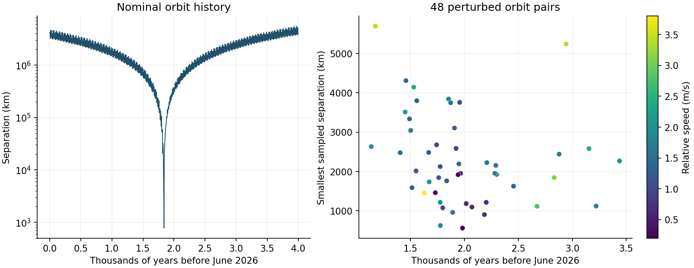

# A candidate young asteroid pair, (863192) 2014 SD315 and 2025 UC18

Two separately observed main-belt asteroids have orbits that converge in a backward integration. Adding the gravity of Ceres, Pallas, Vesta and Hygiea to the planetary model puts a nominal passage **about 860 km apart at 0.22 m/s, roughly 1,775 years before June 2026**. The planets-only fit yields about 1,100 km at 0.21 m/s roughly 1,834 years ago. The telescope measurements establish two distinct bodies. Their similar orbits and slow modeled encounter make a shared origin plausible. The evidence does not date a breakup or distinguish fission, impact and chance alignment.

## What the telescopes measured

The Minor Planet Center supplied 199 sky positions of 2014 SD315 from 1992–2025, and 34 of 2025 UC18 from 2003–2025. At six identical timestamps on three nights in October 2025, the Wide Field Survey Telescope at Lenghu (O18) recorded positions for both asteroids. Their angular separations were 1.9272°–1.9611°. This directly tests the possibility that two catalog names describe the same object. Each entry in the paired table carries the original observation IDs. [Paired timestamps and sky separations](measurements/same-time.csv) · [233 positions, sites and times](data/astrometry.csv) · [MPC Observations API](https://docs.minorplanetcenter.net/mpc-ops-docs/apis/get-obs/)

Separate robust fits give median sky residuals of **0.158 and 0.160 arcsec**. The six oldest positions of 2025 UC18 matter because its JPL solution available on November 14 used a 23-day discovery arc. We refitted the longer MPC series twice, omitting whole apparitions. An orbit fitted to 2014 and 2025 predicts the two October 2003 positions to **0.56 and 0.57 arcsec**. Removing all four 2014 positions and fitting only 2003 and 2025 predicts them to **0.43–1.26 arcsec**. These exclusions test the link between apparitions after selection of the pair. JPL's shorter-arc fit is inadequate to constrain this past encounter on its own. [Fits and withheld predictions](measurements/summary.json) · [Per-position residuals](measurements/residuals.csv) · [JPL orbit solution and source receipts](data/sources.json)

## How the pair was selected

The November 14, 2026 MPCORB search included all **1,323,625** entries at epoch K2669 (2026 June 9), with at least two observed oppositions and semimajor axis strictly between 2 and 5.6 au. A five-dimensional neighbor search retained 687 orbital pairs. The candidate ranked **seventh** by the adopted metric at 0.349 m/s. This number measures orbit similarity. Physical encounter speed comes from the integration. The closest match recovered the published pair 2010 UM26 / 2010 RN221. We explored several promising matches, giving preference to tight, previously unreported candidates with distinct measured positions. The complete shortlist preserves these choices and the other matches. [Full pair table](data/screen.csv) · [Positive-control discovery](https://doi.org/10.1051/0004-6361/202244589) · [MPCORB field format](https://docs.minorplanetcenter.net/tutorials/notebooks/mpc_tutorial_orbit_plotting/)

For semimajor axis $a$ in au, eccentricity $e$, inclination $i$, node $\Omega$ and longitude of perihelion $\varpi$, the search uses Euclidean distances over $\sqrt{1.25}\ln a$, the two components of $\sqrt{2}e(\cos\varpi,\sin\varpi)$, and the two components of $2\sqrt{2}\sin(i/2)(\cos\Omega,\sin\Omega)$. All pairs inside radius 0.0014 are retained, then ranked by distance times $29{,}785/\sqrt{\bar a}$ m/s. Mean anomaly is excluded from this screen. The release contains all 687 pairs and both selected input lines. The bulk catalog changes daily. Repeating the exact population search requires the historical gzip identified by its SHA-256. The fitted astrometry and dynamical results can be replayed without it. [Search implementation](screen.py) · [Selected MPCORB records](data/selected.mpc)

## What the past encounter can establish

| Test | Result |
| --- | --- |
| Gravity-only nominal fit | A 4,000-year search with a two-day integrator step places the closest sampled passage about 1,834 years ago. Daily sampling of that encounter with a 0.125-day step gives about 1,100 km and 0.21 m/s. |
| Integration accuracy | In the daily-sampled window, halving the step from 0.5 to 0.25 to 0.125 days gives approximately 1,144, 1,108 and 1,100 km. A coarser four-day survey selects a neighboring passage about five years earlier. |
| 48 perturbed orbit pairs | With one arcsecond of positional information per coordinate per station-night, the middle 80% of sampled closest approaches fall about 1,480–2,850 years ago. The middle 80% of sampled distances span 1,090–3,810 km and of speeds 0.64–2.52 m/s. These are sensitivity samples under that error model. |
| Four massive asteroid perturbers | Adding their barycentric JPL Horizons states and published gravitational parameters shifts the nominal passage by 59 years. The finer 0.25-day integration gives 860 km at 0.22 m/s. |
| Imposed semimajor-axis drift | With only the secondary drifting between −0.0003 and +0.0003 au per million years, the nominal closest sampled passages fall 1,749–1,946 years ago and 1,230–2,290 km apart. The astrometry supplies no measurement of either asteroid's thermal drift. |
| Change only orbital phase | Moving the secondary through −5°, −1°, +1° and +5° of mean anomaly gives sampled minima 39,589, 4,265, 5,844 and 4,625 km. This tests sensitivity to orbital phase. Four alternatives cannot give a survey false-alarm probability. |



The fit uses barycentric positions in equatorial ICRF axes, UTC topocentric measurement times converted to TDB, light-travel time and separate Earth and Moon perturbations from DE440s. The initial guesses are heliocentric J2000 ecliptic elements. Positions have equal nominal weight in a soft-L1 fit with a 0.6 arcsec scale. The raw Jacobian, a one-arcsecond error scale and equal total information per station-night define the perturbations. We drew 48 independent Gaussian state perturbations for each object using seed 26609 and paired them by index. The historical integrations treat the candidate pair as massless particles under the Sun and eight planetary-system barycenters. A separate integration includes four massive main-belt asteroids as mutually interacting perturbers. The four-day ensemble samples positions about every 0.1 years. The plot shows the nominal history at about five-year intervals. [Orbit fits](orbits.py) · [Integration and controls](encounter.py) · [Perturbed orbits](measurements/clones.csv) · [Refined encounter](measurements/refined.csv) · [Thermal-drift sensitivity](measurements/drift.csv) · [Massive-asteroid control](measurements/massive-asteroids.csv) · [JPL perturber states and mass sources](data/perturbers.json)

The modeled separation is much greater than asteroid dimensions. The integrations omit mutual gravity between the candidate fragments, smaller asteroid perturbers and relativity. Shared astrometric catalog biases and changing thermal recoil can shift the inferred encounter. Another opposition with well-calibrated astrometry of the fainter 2025 UC18 would narrow its orbit. Propagating that independent solution should preserve a slow past convergence if the association holds. Rotation, size and surface spectra would provide additional tests of a common origin. [Dynamical criteria for asteroid pairs](https://doi.org/10.1088/0004-6256/136/1/280)

## Prior work and data credit

On November 14, 2026 we searched English-language scholarly and general web results for the full designations separately and together, asteroid number 863192, packed designation K25U18C, WFST and asteroid pair, family and fission terms. The September 2026 Johnston compilation has 414 reported pairings. We found no entry for either of these identifiers. The 50-pair inner-belt survey presented at EPSC 2026 is also described in Kyrylenko’s thesis deposited in June 2025. A search of all 185 thesis pages found the published 469759 / 2016 QZ123 comparison pair and no matching identifiers for our pair. The Nesvorný family search covers related populations. The latter required at least three members. We located no report pairing these two designations in the sources checked. Unindexed papers, predesignation observations and unpublished identifications remain possible. The asteroid discoveries and the original astrometry belong to the contributing observers. [Pair compilation](https://johnstonsarchive.net/astro/asteroidpairs.html) · [Inner-belt survey](https://doi.org/10.1051/0004-6361/202450725) · [50-pair thesis](https://ekhnuir.karazin.ua/items/6e8bce18-fb75-435a-b6ca-7ecc1648a966) · [EPSC 2026 abstract](https://meetingorganizer.copernicus.org/EPSC2026/EPSC2026-975.html) · [Young family search](https://doi.org/10.1016/j.icarus.2025.116768) · [MPC observing sites](https://www.minorplanetcenter.net/iau/lists/ObsCodes.html)

## Reproduce

Run from this directory with Python 3.12. The SHA-256 guard pins the planetary ephemeris. All selected sky positions, site coordinates and starting orbits are bundled. The JSON and CSV outputs record the results above. Machine rounding and integrator versions can change the final digits.

```sh
python -m pip install numpy==2.3.5 scipy==1.17.0 pandas astropy==8.0.2 jplephem==2.24 rebound==4.6.0 matplotlib
curl -fLO https://ssd.jpl.nasa.gov/ftp/eph/planets/bsp/de440s.bsp
python replay.py de440s.bsp replay-output
python drift.py de440s.bsp replay-output
```

`python plot.py` renders the figure from the included measurements. With the frozen full MPCORB gzip, `python screen.py MPCORB.DAT.gz screen.csv` reproduces the complete shortlist. We acknowledge the original observers, the IAU Minor Planet Center, NASA/JPL Solar System Dynamics and the developers of REBOUND. [JPL planetary ephemerides](https://ssd.jpl.nasa.gov/planets/eph_export.html) · [REBOUND](https://doi.org/10.1051/0004-6361/201118085)
