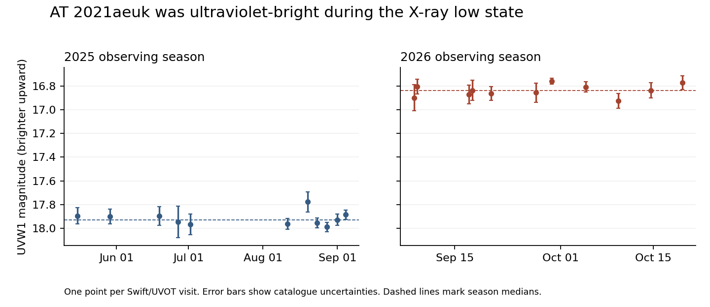

# AT 2021aeuk entered a second ultraviolet-bright, X-ray-weak state

In September–October 2026 the galaxy hosting AT 2021aeuk was 2.73 times as bright in Swift's UVW1 filter as in the 2025 observing season. Swift/XRT observed the galaxy in the 0.3–10 keV band on 11 visits that season. Each visit yielded an individual nondetection. Across those visits, the telescope recorded 14 counts with 9.56 expected from background. Even treating all 14 as source counts gives a conservative 95% lower bound of **3.88** on the decline from 2025.

Sun et al. discovered the earlier optical flares and measured an X-ray collapse during the 2023 flare. Wang et al. discovered the third optical brightening with WFST in May 2026 and confirmed it with ATLAS. The new archival measurement is the return of the ultraviolet-bright, X-ray-weak state in that third episode. The last 2025 and first 2026 visits in the Swift/XRT light curve were 369 days apart. That gap leaves the onset of the decline and its timing relative to the optical flare unresolved. [Sun et al.](https://doi.org/10.3847/1538-4357/adb724) · [Wang et al., TNS AstroNote 2026-154](https://www.wis-tns.org/astronotes/astronote/2026-154)

| Swift measurement | May 15–Sep 4, 2025 | Sep 8–Oct 19, 2026 |
| --- | ---: | ---: |
| XRT visits in LSXPS light curve | 12 | 11 |
| 0.3–10 keV source-region counts | 125 | 14 |
| Expected background counts | 6.55 | 9.56 |
| Effective exposure | 11.82 ks | 11.06 ks |
| Net rate estimate, counts/s | 0.01002 | 0.000401 |
| Median UVW1 magnitude (usable visits) | 17.927 (11) | 16.838 (11) |
| Median UVM2 magnitude (usable visits) | 18.278 (5) | 17.333 (10) |
| Median UVW2 magnitude (usable visits) | 18.489 (5) | 17.690 (10) |

Even the faintest usable 2026 visit was brighter than the brightest usable 2025 visit in each ultraviolet filter. Median flux ratios were 2.73, 2.39 and 2.09 for UVW1, UVM2 and UVW2. These measurements include host-galaxy light. Fifteen UVW1 field sources selected by position, initial magnitude and repeat coverage brightened by a median 0.047 mag between seasons. Their largest change was 0.121 mag, versus 1.090 mag at the nucleus. [Source photometry, controls, event-list measurements and product hashes](swift-products.json)



## Photon statistics and instrumental checks

The LSXPS catalogue position, 243.25004°, +42.32772°, lies about 1.9 arcsec from the optical position. We extracted all four bands and all observation-binned detection categories for LSXPS source 1248139. Each visit contributes once per band, including visits classified as nondetections. The deposited 404 rows cover 101 visits in the returned light curve. The seasonal comparison uses all 23 returned XRT visits in calendar years 2025 and 2026 up to the data cutoff. The last six visits in 2025 form a lower-baseline sensitivity test. They yield a 95% lower bound of 2.28 on the decline. The earlier published low state also appears in the catalogue, with 58 counts against 22.55 background in 39 visits between MJD 59924 and 60045. [Catalogue source](https://www.swift.ac.uk/LSXPS/LSXPS%20J161300.0%2B421939) · [Catalogue methods](https://doi.org/10.1093/mnras/stac2937) · [Observation rows](lsxps.csv)

For each interval we sum counts and expected background. Effective exposure is the sum of exposure divided by the per-observation correction. The reported rates are exposure-weighted season estimates. For the headline bound we use an exact one-sided 97.5% Poisson lower bound on the early total minus the early expected background, and a 97.5% upper bound on the late total allowing zero late background. Dividing the two rate bounds gives at least 95% simultaneous coverage conditional on the effective exposures and early background. Keeping the late background estimate instead, a flat prior on the nonnegative source rate gives a 95% upper limit of 0.00113 counts/s. The background-only probability of at least 14 counts is 0.106. The nominal ratio of the net estimates, about 25, has an unstable denominator. [Calculation](measure.py) · [Numerical results](result.json)

We also recounted all 23 cleaned photon-counting event lists at the fixed optical position, 243.24934167°, +42.32784722° (J2000). We kept grades 0–12 and PI channels 30–1000. Circular apertures of 10, 15 and 20 sky pixels returned 120/13, 137/18 and 150/27 counts in 2025/2026. A local 30–60 pixel annulus recorded 119/145 counts. Scaling that annulus by area and dividing by elapsed live exposure gives a decline at every aperture. Restricting to images whose target-center exposure exceeds 80% of the event-list exposure leaves seven early and nine late visits. The area-subtracted 10-pixel rates are then 0.00838 and 0.000407 counts/s. These aperture tests reuse the XRT photons and check sensitivity to position, aperture size, background choice and exposure loss. [Swift/XRT data guide](https://www.swift.ac.uk/analysis/xrt/) · [Primary file URLs and SHA-256 digests](swift-products.json)

For the UV test, the closest catalogue source within two arcseconds had to have FLAGS = 0 and magnitude uncertainty <0.2. The 15 field controls were drawn from the first 2025 UVW1 catalogue at radii 20–420 arcsec, with initial magnitude between 16 and 19. Each had a unique match within 1.5 arcsec, FLAGS = 0 and uncertainty <0.15 in at least six visits per season. The reference catalogue and thresholds were selected during analysis. Corrected UVOT source rates and magnitudes are retained. [Swift/UVOT data guide](https://www.swift.ac.uk/analysis/uvot/)

## Physical interpretation and next test

This is a targeted comparison of one previously reported repeating nuclear transient, selected because its 2023 X-ray suppression and its third optical flare gave a specific test. An exploratory search for separated optical alert clusters prompted the literature review. For example, the later detections of AT 2024mvz were consistent with continued fading. Event selection supplies no population rate or survey-wide discovery significance.

The repeated state constrains mechanisms for the flare. A change in the inner accretion flow or X-ray corona, increased absorption, or another change intrinsic to the active galactic nucleus can produce a weak X-ray source. These data establish neither a second complete disruption nor the return of a specific star. They also do not resolve a decline and recovery in 2026. A return of the XRT count rate toward the 2025 level as the UV fades would reproduce the recovery observed after the 2023 event. Energy-resolved spectra could help distinguish changing absorption from intrinsic dimming. A September 5 XMM-Newton visit (0991802801) is listed with a March 2027 public release. [XMM-Newton observation and release record](https://xmm-tools.cosmos.esa.int/external/xmm_mission_plan/odf_pps/catstrip_ra_16.shtml)

On November 14, 2026 (US Eastern), searches using AT2021aeuk, SDSS J161259.83+421940.3 and ZTF18aanlzzf with “third flare”, “X-ray”, “suppression”, and “2026” located the optical discovery notice, the earlier multiwavelength paper and follow-up observation records. We found no prior quantitative report of this 2025/2026 Swift comparison in the records checked. Priority remains open to unindexed work. The Swift pointings were obtained by the original observing teams. [Swift observing requests](https://www.swift.psu.edu/toop/summary.php)

## Replay

From the repository root, run the following with Python, NumPy, SciPy, Astropy and Matplotlib available.

```sh
python results/at-2021aeuk/measure.py
python results/at-2021aeuk/archive.py
python results/at-2021aeuk/plot.py
```

The first command reproduces the numerical packet offline. The second checks every deposited LSXPS band row against the live API, then recalculates fixed-position aperture counts, exposure-map statistics, UV photometry and the field-control selection from 69 public FITS products. Reprocessing by the archive can change file hashes. The normalized LSXPS CSV has SHA-256 7f1b4bed8a4fa4ffcf3cb26f606034c60651a821b8998ddef008fadf3c3ade5b. All dates for observations are UTC, catalogue times are MJD, and UVOT magnitudes use the native Vega system.

This work made use of data supplied by the UK Swift Science Data Centre at the University of Leicester and public NASA HEASARC Swift/XRT and UVOT products. We credit the Neil Gehrels Swift Observatory, instrument teams, archive staff, original investigators and the WFST collaboration. [Archive](https://heasarc.gsfc.nasa.gov/docs/swift/archive/) · [UKSSDC](https://www.swift.ac.uk/)
