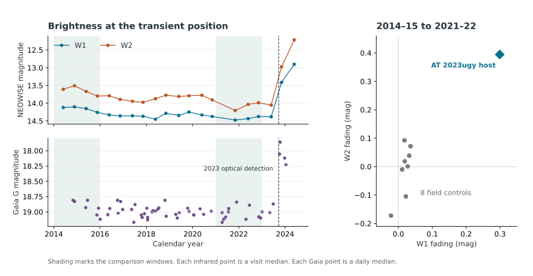

# Infrared and optical dimming at the position of AT 2023ugy before its optical outburst

At the position of the host of the spectroscopically classified tidal disruption event AT 2023ugy, SDSS J214044.01+210058.4 at redshift 0.106, the infrared source was fainter in 2021–22 than in 2014–15, before its September 2023 optical outburst. The difference is 0.299 mag in W1 and 0.395 mag in W2, corresponding to 24% and 30% lower total observed flux density. Gaia G also shows 0.20 mag of optical dimming between these windows. The earlier high state was already present in the first NEOWISE season. **The physical cause of the fading remains open.** The two comparison windows do not prove a continuous decline, establish when the earlier high state began, or demonstrate a preceding tidal disruption.

| Archive band | 2014–15 | 2021–22 | Fading | Observing units in the two windows |
| --- | ---: | ---: | ---: | --- |
| NEOWISE W1 (3.4 μm) | 14.136 | 14.435 | 0.299 mag | 4 and 3 visits |
| NEOWISE W2 (4.6 μm) | 13.639 | 14.033 | 0.395 mag | The same 4 and 3 visits |
| Gaia G | 18.88 | 19.08 | 0.20 mag | 6 and 11 observing dates |

The first season of the 2023 optical outburst reverses the multi-year decline. In May 2023, the infrared source was at W1 = 14.383 and W2 = 14.053. In May 2024 it reached 12.902 and 12.216. Langis et al. already identify the later infrared flare. The new measurement concerns the host's behavior **before** the optical discovery.



## Search and checks

An exploratory screen used all 134 host light curves from TDECat, with 75 meeting the coverage cuts. For each band we retained NEOWISE measurements with positive magnitudes and reported errors between 0 and 0.5 mag. We took visit medians after grouping exposures separated by at most 30 days and required five exposures per band, paired visits within five days, eight paired visits over 1,000 days and a 180-day guard interval before catalog discovery. We corrected each band for a median offset between the two halves of the annual scan cycle. For each pair of adjacent-visit averages, the excursion was the smaller of the two signed band changes. We maximized over both temporal directions. Consecutive visits can bridge a seasonal gap. The score measures coherent amplitude, without assuming periodicity or a flare shape.

AT 2023ugy ranks first by this measure at 0.372 mag, close to the known repeater AT 2022agi. The third-ranked source, AT 2022fpx, has about half the excursion. The ordering of the two leaders depends on the statistic. The population-wide rank comparison between hosts with and without a published later IR flare gives a one-sided Mann–Whitney p of 0.40. The screen establishes a comparison set and gives no basis for forecasting which TDEs have subsequent dust echoes. Ranking choices and the two calendar windows were exploratory. Fixed windows were applied identically to the target and local controls.

The independent extraction from NASA/IPAC uses the final NEOWISE-R single-exposure source table. Of 9,580 catalog detections and 43 AllWISE positions inside 96 arcsec of the optical coordinates, nine sources met both epoch-window coverage cuts. Exposures require A or B quality in both bands, zero contamination and moon flags in both bands, frame quality 10, SAA distance above 5 degrees and a unique AllWISE position within 2.5 arcsec. We took the median of visit medians, requiring at least five retained exposures per visit and two visits per window. The target contributes 62 and 22 simultaneous clean exposures. The Gaia measurement gives each integer MJD (TCB) equal weight by first taking the median of that date's transits.

- The target AllWISE position is 0.255 arcsec from the optical transient. Every retained NEOWISE visit centroid is within 0.34 arcsec of the AllWISE position. The next AllWISE entry is 11.86 arcsec from the optical position.
- For eight field controls, the largest positive W1 and W2 differences were 0.036 and 0.093 mag, respectively. Across the two seasonal scan directions separately, W1 faded by 0.299 and 0.244 mag and W2 faded by 0.395 and 0.444 mag.
- Gaia's early measurement uses eight transits across six dates. Its late measurement uses 18 transits across 11 dates. The independent optical change has the same sign, with considerably smaller amplitude. The TDECat and IRSA infrared extractions use the **same** spacecraft exposures.
- The Jan–Dec 2010 cryogenic WISE observations are excluded throughout. Survey exposure sensitivity and source blending can change catalog photometry. A fluctuating or declining pre-existing accretion flow, an old dust echo, and an unresolved variable neighbor remain viable explanations. Confirming a prior tidal disruption would require additional evidence.

## Localization in detector images

We also checked the original NASA/IPAC single-exposure intensity images. These are a separate reduction of the same infrared observations. Within each of the eight spring/fall visits in the two windows, we selected four frames at evenly spaced indices through the time-sorted detections inside a 3-arcsec host cone with clean contamination/moon flags, frame quality 10 and SAA separation above 5 degrees. Both bands of each frame were retained. This selection is independent of measured brightness. The manifest freezes all 64 selected band-images. Five images failed the field-edge coverage cut. Every spring and fall comparison still uses both years in each window.

We transformed each exposure with its FITS distortion-aware WCS, linearly resampled on 1-arcsec pixels, subtracted a local median and scaled counts to a common zero point of 20. We required at least 98% geometric coverage of the 121 × 121 pixel stamp. We took medians within each visit, averaged the two annual visit medians in each window, then subtracted late from early. In each difference we fit a circular Gaussian (fixed σ of 2.85 arcsec) plus a sloping background inside an 8-arcsec aperture. We applied the same fixed-position fit to the optical host, the nearest AllWISE neighbor, and a 12-arcsec grid of 26 blank positions at least 12 arcsec from any AllWISE source. We separately allowed the Gaussian center to move by up to 4 arcsec in each coordinate to estimate the position. The resampled pixels are correlated.

| Band and season | Images used | Host peak | Largest absolute blank peak | Nearest neighbor peak | Offset of fitted peak from optical host |
| --- | ---: | ---: | ---: | ---: | ---: |
| W1 spring | 15 | 5.46 | 1.79 | −0.59 | 1.34″ |
| W1 fall | 14 | 3.65 | 1.29 | −1.13 | 0.77″ |
| W2 spring | 15 | 8.16 | 4.61 | −0.04 | 2.02″ |
| W2 fall | 15 | 14.73 | 5.51 | −4.38 | 1.47″ |

Peak amplitudes are in rescaled detector counts per pixel and are comparable within a row. All four differences peak close to the host and show no positive residual at the neighboring catalogued source 11.86 arcsec away. The four reductions share two observing windows and the N=26 blank positions provide a descriptive background control. A free-width Gaussian in the noisier W2 fall image reaches the fit bounds, so a subarcsecond nuclear location would exceed these data. Before interpreting the fading as an earlier disruption, obtain pre-outburst spectroscopy or locate an earlier optical/X-ray high state with a measurable onset and decay. Persistent narrow-line or stochastic accretion activity would favor an active galaxy interpretation.

## Reproduction

From this directory run the following commands with Python 3.10 or later. The catalog and field measurements use the standard library. The figure uses Matplotlib. The image check uses NumPy, SciPy and Astropy and downloads about 255 MiB. Its manifest pins each original FITS digest (SHA-256). Input caches can live outside the repository.

```sh
python screen.py --cache /tmp/at2023ugy-tdecat --out /tmp/at2023ugy-results
python measure.py --cache /tmp/at2023ugy-archives --out /tmp/at2023ugy-results
python plot.py --cache /tmp/at2023ugy-archives --out /tmp/at2023ugy-results
python pixels.py --cache /tmp/at2023ugy-archives --out /tmp/at2023ugy-results
```

`screen.csv` retains every target and its eligibility. The input manifest pins the 134 Git blobs to TDECat commit `bca013a266cd5d2a120aa4c6b34a2dc54bee1e5e`. `field.csv` and `visits.csv` are the direct measurements, with magnitudes on their native Vega systems. IRSA MJD and sky coordinates use the native NEOWISE time column and J2000 equatorial position. `measurement.json` contains the Gaia values and input URLs, byte counts and SHA-256 checksums from the 2026-11-15 run. Gator writes request timestamps and temporary log paths into its headers, so subsequent file digests may differ even if the data rows agree. Data providers include NASA/JPL-Caltech/IRSA, the Gaia Science Alerts team and collaborators, and the TDECat authors.

## Prior reports and search

On 2026-11-15 we searched indexed publications and TNS for “AT2023ugy infrared before”, “AT 2023ugy pre-flare WISE”, the aliases “ZTF23abgcesw” and “Gaia23ctp”, and the host identifier “SDSS J214044.01+210058.4”. The following primary reports cover the 2023 optical event, its polarimetry and its infrared echo. We found no discussion of the quantified 2014–22 decline in these reports. This bounded check leaves priority open.

- Yao, Margutti and Qin (2023), optical classification, [TNS AstroNote 2023-273](https://www.wis-tns.org/astronotes/astronote/2023-273).
- [Polarimetric diversity in tidal disruption events](https://doi.org/10.1051/0004-6361/202555626).
- Langis et al., [TDECat paper](https://doi.org/10.1051/0004-6361/202554882) and [frozen photometry](https://github.com/dlangis/TDECat/tree/bca013a266cd5d2a120aa4c6b34a2dc54bee1e5e).
- [NEOWISE-R single-exposure source database](https://irsa.ipac.caltech.edu/Missions/wise.html) and [Gaia23ctp](https://gsaweb.ast.cam.ac.uk/alerts/alert/Gaia23ctp/).
