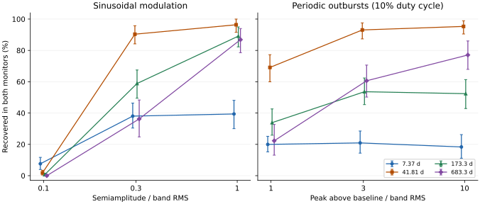

# A blind period survey with Swift/BAT and MAXI/GSC

**No unpublished period survived.** We searched 1,056 Swift/BAT sources and could test 335 of them independently with MAXI/GSC. Twenty-two signals passed both instruments’ blind searches. Twenty-one, from 17 sources, also repeated in both time halves of each instrument. The published ephemerides and faster-cadence observations account for all 21 signals. Sensitivity was highest around 42 days among the four periods tested with injections.

| Monitor | Daily product | Coverage |
|---|---|---|
| Swift/BAT | 15–50 keV count rate, counts cm⁻² s⁻¹ | The official roster contained 1,056 sources. The earliest retained day was 2005-02-13 and the latest was 2026-09-29. |
| MAXI/GSC | 2–20 keV flux, photons cm⁻² s⁻¹ | The public roster contained 457 positions. We identified 335 unique BAT counterparts. Their retained observations run from 2009-08-08 to 2026-11-22. |

Dates describe the union of the source light curves. Each source has its own start, stop, gaps, uncertainty distribution and searchable period range. All 1,056 BAT light curves and all 335 matched MAXI light curves were scanned. The other 721 BAT sources could supply single-instrument leads only. The survey uses daily averages and requires four full cycles in a band. The nominal grid is 2.05–2,000 days. Searches for shorter periods in orbit products were follow-up alias checks on the daily survivors. [Source census](evidence/sources.csv) · [Input audit](evidence/ingest-audit.json) · [BAT monitor](https://swift.gsfc.nasa.gov/results/transients/) · [MAXI roster](https://maxi.riken.jp/top/slist.html)

## Which periods survived

Fifteen signals recover previously published orbital, outburst-recurrence or superorbital clocks. Two are consistent with harmonics of published orbits. The 7.184-day signal in 1E 1145.1−6141 is close to half its 14.365-day orbit. The 49.787-day signal in GRO J1008−57 is close to one fifth of its approximately 249-day orbit. For GRO J1008−57, allowing the longer orbital waveform reduced prediction error on the opposite time half in all four comparisons, by 11–17% in BAT and 15–26% in MAXI. For 1E 1145.1−6141, three comparisons improved slightly and one worsened by 0.5%. [All 21 decisions, measurements and citations](evidence/review/period-decisions.md) · [Orbital harmonics](evidence/review/orbital-harmonics.csv)

Four more signals tracked known orbits reflected by daily sampling. These peaks passed the red-noise thresholds, independently appeared in both daily monitors and kept phase across both halves. In the orbit-level light curves, the published orbits fit better than the apparent daily periods in both monitors, across each full baseline and in all four half-baselines. The faster light curves reuse the underlying observations and distinguish the competing periods through their sampling. [Native-cadence comparisons](evidence/review/prior-aliases.md)

| Source | Apparent period in daily data | Published orbit | Frequency reflected by daily sampling |
|---|---:|---:|---|
| Her X-1 | 2.42823 d | 1.70017 d | Orbital frequency |
| LMC X-4 | 3.44882 d | 1.40838 d | Orbital frequency |
| 4U 1538−522 | 2.15720 d | 3.72831 d | Twice the orbital frequency |
| SMC X-1 | 2.05723 d | 3.89192 d | Twice the orbital frequency |

The remaining independent pair was near 55 days in SMC X-1. Its two BAT halves preferred 55.95 and 54.03 days. The later maximum lay two frequency-resolution elements away from the full-span frequency, outside the allowed one. MAXI passed its half tests. [All 22 independent pairs](evidence/review/independent-pairs.csv) · [Failed stability test and fold](evidence/review/folds/index.md) · [Numerical half-test record](evidence/review/failed-half-tests.json)

The peak tables retain separate BAT and MAXI periods, one-standard-error uncertainties, sinusoidal semiamplitudes in each instrument’s units, simulated source-wide false-alarm probabilities and model-conditional survey bounds. Each plot puts the two halves of each instrument at the same BAT ephemeris. [Measurements](evidence/stable-periods.csv) · [Phase folds](evidence/review/folds/index.md) · [Published-period comparisons](evidence/review/index.md) · [Nearby-source checks](evidence/validation/confusion.jsonl)

## What the search could recover

At a sinusoidal semiamplitude of 0.30 times each instrument’s measured RMS, the recovery rate ranged from 36% to 90% across the four injected periods. The source-cluster bootstrap interval at 41.81 days was 84.2–95.8%. The median injected semiamplitudes in that cell were 0.000559 counts cm⁻² s⁻¹ in BAT and 0.00639 photons cm⁻² s⁻¹ in MAXI. The 7.37-day injections fall close to a lunar harmonic and illustrate the cost of the window veto.

| Injected period | Paired sources | Trials per amplitude | Recovered at 0.10 × RMS | Recovered at 0.30 × RMS | Recovered at 1.0 × RMS |
|---:|---:|---:|---:|---:|---:|
| 7.37 d | 92 | 736 | 56 | 280 | 290 |
| 41.81 d | 83 | 664 | 12 | 600 | 640 |
| 173.3 d | 100 | 800 | 5 | 471 | 713 |
| 683.3 d | 60 | 480 | 0 | 174 | 417 |

Periodic outbursts were easier to recover at some periods than at others. At 41.81 days, outbursts lasting 10% of each cycle and peaking at three times the measured RMS passed in 618 of 664 trials (93.1%). At 7.37 days, the same outbursts passed in 154 of 736 trials (20.9%). Stronger outbursts could shift the highest peak to a harmonic, so larger peak rates did not guarantee a higher fundamental recovery rate. The table records all tested heights, including these decreases. [Outburst recovery by period and peak rate](evidence/review/pulses/pulse-sensitivity.csv)



Injected sinusoidal semiamplitudes are expressed as multiples of the observed weighted RMS for each instrument. For an injected outburst, amplitude is the peak above baseline in the same units and the event lasts one tenth of a cycle. Eight random phases per source sample the effect of gaps. A joint recovery requires the fundamental to pass both independent searches and the stability checks. These are conditional recovery rates in the observed light curves with their fitted continua held fixed. Fast, incoherent, intermittent or single-band signals are outside the resulting bound. [Sinusoidal injections](evidence/sensitivity.csv) · [Periodic outburst injections](evidence/review/pulses/pulse-sensitivity.csv) · [Per-source injected amplitudes](evidence/injections.csv)

## How the decision was made

The first pass used the quoted errors directly. In 6,598 days of Vela X-1 data, a single BAT observation carried 43.9% of the total formal weight. In Her X-1, one day carried 62.5% across 7,045 days. A few high-leverage observations made some decade-long BAT series behave like fewer than twenty observations under inverse-variance weighting. The first pass left 368 BAT light curves below its sampling threshold. The second pass placed a ceiling on the weight of any one day using the distributions of quoted errors in the two halves, before looking at frequencies. The period search accounts for the two analysis passes. [Initial detections and prior publications](first-pass-periods.md) · [Weight audit](evidence/weight-audit.csv) · [Pass comparison](evidence/pass-comparison.json)

Each instrument had its own frequency grid, noise fit, simulations and peak selection. The simulations used its actual observation dates and errors. Sixty-four source-specific realizations normalized the frequency-dependent power, and 255 independent realizations calibrated the largest peak in a full scan. The additional survey correction used the analytic tail under the fitted Gaussian red-noise model. We report the two significances separately. Telescope systematics, heavy-tailed or evolving source noise, and misattributed photons are possible beyond that model. [Search methods](METHODS.md) · [Blind peaks and rejections](evidence/threshold-peaks.csv) · [Published control sources](evidence/validation/controls.md)

Four of six published control periods passed the full blind gates. The BAT window veto excluded the Vela X-1 orbit, and MAXI excluded the approximately 35-day Her X-1 cycle. The frozen Cen X-3 control used 2.08714 days. The cited eclipse solution gives 2.08704106(3) days, within the control’s prespecified tolerance. [Control outcomes](evidence/validation/controls.md)

Nearby-source fits flagged eight of the 21 periods for spatial review, even after adding the two missing MAXI-only neighbours. For example, the MAXI light curve at EXO 1846−031, 0.265° from IGR J18483−0311, shows 2.28 times the target’s 18.55-day semiamplitude on their common baseline. These monitors alone cannot localize all the flux in that field. [Neighbour input products](evidence/review/fields/field-products.json) · [Field-by-field measurements](evidence/review/fields/confusion-completed.jsonl)

**Two days contained the most heavily weighted observation for 807 of 1,055 eligible BAT sources.** The weight audit required at least 40 observations over at least 60 days. On March 29–30, 2019 (MJD 58571–58572), 946 of these sources were observed and 807 reached their smallest quoted daily error on at least one of the two days. Among those 807, the two dates contributed a median 24.85% of the entire source’s formal inverse-variance weight. Applying the error floor reduced that median to 0.050%. Across the 335 matched MAXI curves, 246 were observed on those dates and none placed its maximum weight there. These counts measure concentration in the published error bars. The observations here cannot identify its instrumental or processing cause. [All dates, counts and definitions](evidence/review/weight-dates/weight-date-summary.json)

The bibliography check used SIMBAD, Ritter–Kolb, the Fortin and Neumann high- and low-mass X-ray binary catalogues, Corbet’s timing papers and source-specific papers. The Neumann HMXB table contained 169 catalogue entries and produced matches for 15 of the 21 signals. A separate SIMBAD identity check distinguished 4U 1820−30 from its host cluster NGC 6624, and 1E 1145.1−6141 from HD 102567. [Initial search records](evidence/literature/triage.jsonl) · [Neumann HMXB rows](evidence/review/neumann/candidates.jsonl) · [SIMBAD resolutions](evidence/review/simbad/summary.json)

**The two LMXB catalogue period columns disagree by about a factor of 24 for 87 of 98 comparable binaries.** Both VizieR fields declare days. We found 241 unique name-and-position matches and 98 with numerical orbital periods in both tables. Of those, 87 Fortin-to-Avakyan ratios were within 5% of 24, one was within 5% of one and ten were outside both intervals. The Fortin manuscript labels the orbital-period column in hours on pages 5 and 22–29. Even among the 27 rows for which both catalogues cite the same period reference, 26 show the factor of 24. The mismatch is between the table’s machine-readable unit and the author manuscript. The other ratios warrant individual review. [Catalogue comparison and source rows](evidence/review/catalogue-units/README.md) · [Author manuscript](https://arxiv.org/abs/2401.11931)

## Frozen inputs and reproduction

The sixteen curve archives contain the exact time, rate and error arrays used by the blind searches. Raw-product URLs and SHA-256 values are in the corresponding ingestion receipts. The evidence manifest hashes the committed snapshots and derived products. MAXI timestamps are ISS-frame daily-bin centers. The daily products and their time conventions set the precision of any physical ephemeris. [Checksums](evidence/SHA256SUMS) · [Roster and match decisions](evidence/inventory.json) · [BAT FITS units](evidence/bat-product-metadata.json) · [MAXI column definitions](evidence/maxi-lc-readme.txt)

From the repository root, check the snapshot and replay the first shard with Python 3.12. The numbered shards run from 0 to 15. An independent replay of shard 0 reproduced all numerical fields for its 66 sources within the recorded tolerances. [Replay receipt](evidence/review/replay-check.json) The workflow gives the complete command sequence, including the catalogue checks.

```sh
(cd results/bat-maxi-blind-periods/evidence && sha256sum -c SHA256SUMS)
python -m pip install -r results/bat-maxi-blind-periods/requirements.txt
OPENBLAS_NUM_THREADS=1 OMP_NUM_THREADS=1 python results/bat-maxi-blind-periods/replay.py 0 /tmp/bat-maxi-replay --verify
```

For the full Actions run, choose `frozen` to repeat the search on the committed arrays or `fresh` to fetch the latest published products. The archives can change between releases. [Survey workflow](../../.github/workflows/bat-maxi-blind-periods.yml)
