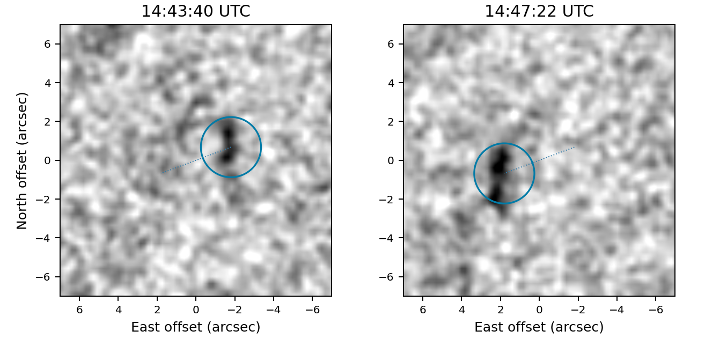

# A main-belt asteroid passed 106,164 km from interstellar comet 2I/Borisov

On 2019 October 28, asteroid **(704021) 2007 XJ8** passed **106,164 km** from Borisov at **34.764 km/s**. A separate integration of the asteroid orbit fitted by ESA gives **106,081 km**, a difference of 82 km. Four 180-second exposures taken with the Canada–France–Hawaii Telescope recover the asteroid on both sides of the event, roughly 13 hours before and 11½ hours after closest approach. The exposures targeted Borisov.

## Flyby

| Reconstruction | Closest approach, 2019 Oct 28 TDB | Three-dimensional separation | Relative speed |
| --- | --- | ---: | ---: |
| JPL Horizons for both objects | 03:18:46.329 | 106,163.55 km | 34.763822 km/s |
| ESA asteroid orbit propagated against DE440s, same JPL comet | 03:18:47.339 | 106,081.47 km | 34.763825 km/s |

These are geometric center-to-center distances. The quoted times are model outputs. The nominal event was at approximately 03:17:37 UTC. Borisov’s trajectory is JPL solution 54, based on 964 astrometric measurements between February 2019 and September 2020. The JPL asteroid solution 20 uses 139 observations from 1995–2022. ESA and JPL fit overlapping observations, and both reconstructions share the comet solution. [Orbit data and numerical measurements](data/measurements.json)

The nearest hourly geocentric Horizons uncertainty record gives formal three-sigma range uncertainties of 2,426 km for Borisov and 139 km for 704021. Their plane-of-sky ellipse RSS values correspond to 306 and 170 km, respectively. These set the scale of uncertainty in the reconstructed positions. A joint confidence interval for minimum distance would require correlated position and velocity uncertainties, a common physical epoch, and the comet’s outgassing systematics. The evidence establishes a close passage. Dust, gas, an impact or material transfer at the asteroid have no observational detection in this analysis. [Observer quantities](data/jpl-observer.csv)

## Recovering the asteroid in the telescope images

The Canadian Astronomy Data Centre’s Solar System Object Image Search returned 88 footprint hits from Oct 27–30 UTC across five instruments. The four deep red-filter exposures below were taken in consecutive pairs on two nights. Each pair was pointed at Borisov and had midpoint times 222 seconds apart. We used a new Horizons observer ephemeris for the CFHT site (MPC 568) at each midpoint. The footprint search supplies approximate coordinates useful for finding the detector. The independent topocentric predictions set the photometry apertures before measuring their pixels. [Exposure list](data/archive-images.tsv) · [Measurement code](images.py)

| CFHT exposure | UTC midpoint | Forced flux / local noise | Centroid minus prediction, east / north |
| --- | --- | ---: | --- |
| 2453292p | Oct 27 14:30:09 | 2.46 | +0.17″ / +0.06″ |
| 2453293p | Oct 27 14:33:51 | 3.49 | +0.28″ / +0.08″ |
| 2453634p | Oct 28 14:43:40 | 4.23 | +0.09″ / +0.14″ |
| 2453635p | Oct 28 14:47:22 | 5.58 | +0.25″ / −0.09″ |

On October 27 the measured displacement was 3.75″ east and 1.34″ south, compared with a forecast of 3.63″ east and 1.36″ south. On October 28 the observed source moved 3.77″ east and 1.58″ south. The orbit predicted 3.61″ east and 1.35″ south. Aperture flux was measured at the fixed predicted pixel in each image, with a six-pixel aperture and a local annulus from nine to fourteen pixels. The noise estimate is the scaled median absolute deviation of measurements at displaced apertures. On each night, none of the 396 displaced tracks matched that night’s observed mean score. These nearby control apertures overlap and do not give 396 independent trials. The residuals use the original image astrometry and an unweighted-background, flux-weighted centroid. The four image stamps preserve linear detector counts and their WCS. The asteroid is about 14 arcminutes from the comet on October 27 and 11.5 arcminutes on October 28. [Photometry and positions](data/image-measurements.json) · [Predictions](data/imaging-ephemeris.csv)



Both panels use the same sky coordinates. The circles mark the asteroid predictions, and the dotted segment connects the predicted positions. The figure uses a one-pixel Gaussian smoothing for display. Photometry uses the original counts.

The retrieved MPC 141-observation file has no entry from any of these four CFHT exposures. Its nearest listed observations are 2020 January 3 from site T09. MPC's present catalogue orbit incorporates later observations as well. The detection recovers an already numbered asteroid, and the frames measure its sky-plane position. The orbits supply the depth of the encounter. Busarev et al. independently record multiband photometry of Borisov on October 28.069 UTC, about 1.6 hours before the reconstructed passage. Their paper measures the comet. [MPC astrometry checked](data/704021.mpc) · [Busarev et al. (2021), Table 1](https://academic.oup.com/mnras/article/502/2/1882/6129807)

## How this pair surfaced

The JPL numbered and unnumbered downloads contained 895,910 and 684,603 asteroid records. At two-day intervals between September 2018 and December 2020 we screened elliptic asteroid orbits against the three-dimensional Borisov ephemeris while its heliocentric distance was below 6 au. The screening code checks orbital-plane and radial bounds, solves Kepler’s equation and estimates closest approach within each time step using the relative position and velocity. There were 12,989 nominal candidates within 0.25 au. The permissive screen placed 704021 second at 0.003659 au. JPL’s perturbed trajectories moved it closer by a factor of five. The top Keplerian candidate, 2020 DG6, moved outward from 0.000325 au to 0.07147 au on its independent Horizons check. A coarse extrapolation can misrank or miss objects, especially short-arc asteroids. We claim the individual encounter, with no global nearest-neighbor or completeness claim. [Top 30 screen rows](data/shortlist.csv) · [Search implementation](search.py)

We searched the asteroid number and provisional designation with both comet names for a prior report of this physical encounter. We found no matching report in those searches. The published 2026 asteroid encounter survey by Pomazan et al. concerns a different interstellar object, 3I/ATLAS. Its prominent encounters are already reported. [Pomazan et al. (2026)](https://doi.org/10.3847/1538-3881/ae2ea6)

## Reproduce

From this directory, run the following with NumPy, SciPy and Astropy installed.

```sh
python measure.py
python images.py
```

The frozen 15-minute geometric JPL state vectors have heliocentric J2000 ecliptic coordinates in au and au/day. The script interpolates positions and velocities consistently with cubic Hermite polynomials and solves for the zero of relative position dotted with relative velocity. The ESA check integrates the heliocentric asteroid state from epoch MJD 61200 with the eight planetary barycenters, solar gravity and its leading relativistic correction. DE440s sampling is every half day. It treats planets as point masses and omits massive-asteroid perturbations. JPL's full-precision model provides a check on that integration.

The archive receipt contains the exact service queries and SHA-256 hashes. It also identifies the full calibrated CFHT mosaics from which the stamps were extracted. For a fresh ESA orbit replay, install jplephem as well. The orbit catalogues change over time. Using the frozen extracted vectors and FITS stamps reproduces the reported close approach and photometry directly. [Query URLs and input digests](data/provenance.json)

```sh
python propagate.py /path/to/de440s.bsp
python measure.py
python extract.py /path/to/2453634p.fits.fz
OPENBLAS_NUM_THREADS=1 python search.py ELEMENTS.NUMBR.gz ELEMENTS.UNNUM.gz > survey.csv
```
