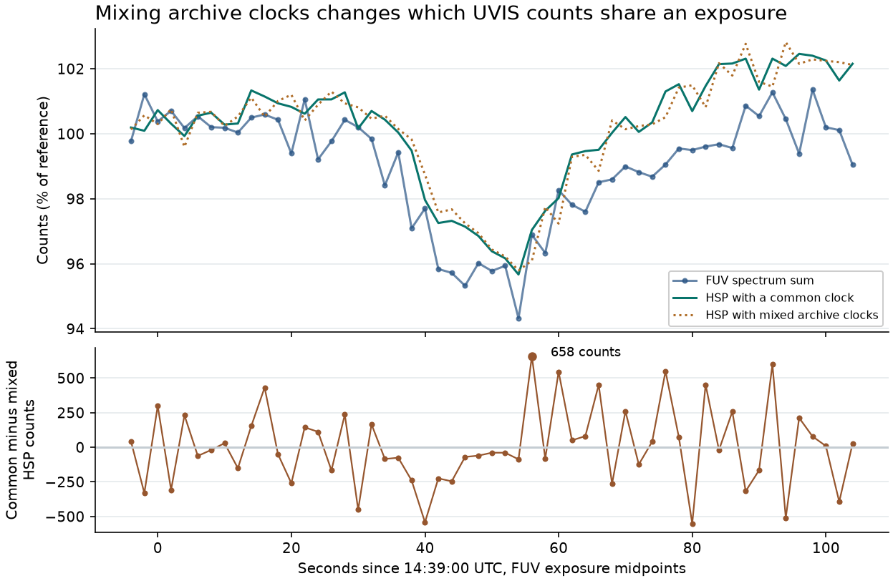

# Mixing Cassini UVIS archive clocks shifts an Enceladus occultation by one second

**Noteworthy correction · Correction.** The migrated Cassini far-ultraviolet (FUV) label and the legacy high-speed photometer (HSP) label put the same 27 March 2017 occultation on different clocks. Reading them literally shortens the first-integration endpoint separation from about 2.125 s to 1.125 s. Converting both spacecraft clock counters with the same NAIF kernel restores the 2.125 s separation. For one two-second FUV exposure in the encounter window, the mix changes the assigned HSP total by **658 counts**, approximately 0.94% of the reference. This measures an archive-pairing pitfall in an already studied occultation. [October 2026 PDS release](https://pds.nasa.gov/datasearch/subscription-service/SS-20261031.shtml) · [NASA observation](https://science.nasa.gov/missions/cassini/cassini-significant-events-3221732817/) · [Source file receipts](archive/stage-receipt.json)

## Same FUV bytes, different time labels

The old and migrated FUV count files are byte-identical. Both contain 465 records of 64 spatial rows by 1,024 spectral columns. All unmeasured FUV rows are encoded as 65,535 in the original. The five active rows each retain 1,024 columns, consistent with their BAND_BIN=1 field. We use the 2 s duration reported by this product. The label's narrative describes spectral binning by two, and a later overview describes 1 s FUV data. Those descriptions differ from the support and duration of the audited record. HSP stores 466,032 samples at 2 ms cadence. [Original PDS3 FUV label](archive/FUV2017_086_14_30.LBL) · [PDS4 FUV label](archive/fuv2017_086_14_30.lblx) · [HSP label](archive/HSP2017_086_14_30.LBL) · [UVIS data guide](https://cassini-uvis.github.io/users_guide/pds-data-structure/)

The leading clock counter is the end of the first integration. Exposure midpoints are half an integration earlier, which is a separate adjustment from the archive UTC change. The PDS4 migration documentation specifies how it converted the counters using NAIF's cas00171 and naif0012 kernels. Replaying that conversion gives FUV 14:30:11.028410 and HSP 14:30:08.903424 UTC. The FUV PDS4 label agrees at its printed precision. Each PDS3 UTC stamp is about 1.000 s later than that replay. Replaying the final NAIF cas00172 kernel makes both times another 43 ms earlier at this event. [Migration documentation](archive/migration_modifications.txt) · [Clock kernels and hashes](clock-kernels.json) · [Clock results](clock-results.json)

| UTC source | FUV first endpoint | HSP first endpoint | FUV minus HSP (s) |
| --- | --- | --- | ---: |
| Both PDS3 labels | 14:30:12.028 | 14:30:09.903 | 2.125 |
| PDS4 FUV and PDS3 HSP labels | 14:30:11.028 | 14:30:09.903 | 1.125 |
| Both counters with final cas00172 | 14:30:10.985439 | 14:30:08.860452 | 2.124986 |

The legacy pairing retains the correct relative spacing to the precision needed here, even though the absolute UTC differs from the kernel replay. Two 2016 ε Orionis controls have matching PDS3 and PDS4 FUV starts to the millisecond and no analogous mixing shift. These comparisons favor using one kernel for both counters and keeping an explicit exposure convention. They do not justify applying a uniform correction to other Cassini epochs. [Earlier label receipts](archive/receipt.json) · [Exact clock comparisons](clock-results.json)

## What the shift changes in the detector record

We treated an HSP sample as an integrated count over its individual interval and assigned fractional overlap to each FUV exposure. A planted impulse recovered all counts, half its counts, and zero counts in the expected windows. Across the **47** fixed encounter frames the mixed and consistent HSP totals differ by a median **167 counts** and at most **658 counts**. In that maximum-change frame the assigned totals are about 67,447 and 66,790. The quiet control also exhibits count changes when the bins move. Rebinning changes which times contribute counts, without modifying the original counts. [Frozen protocol](PROTOCOL.md) · [Light curves and scores](science-results.json) · [Exposure series](curve.csv)



The common-kernel light curve had slightly lower error on fast changes in four of six held-out encounter blocks. The result is weak. Using only the FUV stellar core rows made the held-out fits identical, and the quiet window did not favor the same-kernel conversion. The detectors share the star and geometry and sample different wavelength responses. The data are insufficient to choose the clock convention independently of the labels and kernels.

Using reconstructed Cassini and Saturn satellite trajectories and a spherical Enceladus, the ray reached its minimum sampled altitude of **57.72 km** at 14:39:37 UTC. Moving a timestamp by one second changes some modeled altitudes by as much as **5.64 km** in the frozen window. This is a spherical geometry sensitivity, with terrain, pointing, body shape and stellar astrometric uncertainties outside the calculation. It does not assign any attenuation feature to a particular jet. [Trajectory sources](geometry-sources.json) · [Replay and geometry values](star-ray-geometry.json)

## A separate check of the known water absorption

On the fixed encounter interval, including the water-vapor template improved the gray-plus-color model on 24 held-out spectral blocks. The improvement in held-out deviance was **25.10** when treating the observed reference spectrum as fixed. A separate conditional fit that includes counting noise in the reference reduces it to **10.60**. The same conditional comparison using only the three central stellar rows gives an improvement of 11.90. On the quiet control, the fitted water coefficient was at or near zero and did not improve prediction. [Spectral evidence](science-results.json) · [Finite-reference sensitivity](spectral-sensitivity.json)

The laboratory spectrum is for 298 K, and the fit uses archive wavelength centers with block-averaged cross sections. The exact line-spread function and detailed calibration of the SQRT_9 count compression are outside the model. The fitted coefficient is an effective template amplitude. The bands share the same exposures and reference, and spectral blocks may be correlated. The deviance differences are descriptive comparisons without a calibrated detection significance. Prior work already measured water and modeled this exact plume crossing. [Laboratory cross sections](https://doi.org/10.1016/j.cplett.2005.09.073) · [Archive calibration receipt](calibration/receipt.json) · [Published plume analysis](https://arxiv.org/abs/2004.02663)

## Reproduce

The [detector bundle](detector-replay.zip) preserves the exact active FUV rows and the entire HSP series. The [subset receipt](detector-subset-receipt.json) records its relationship to the full source. The same script also accepts a directory of the two original FUV data files and the HSP data file listed in the [source receipt](archive/stage-receipt.json). For that path it verifies the full byte hashes and checks every excluded FUV cell. The raw sources and trajectory kernels were staged on D. Python 3.14 with NumPy, SciPy and SpiceyPy reproduces the calculations. Matplotlib is needed only for the plot. Use a data directory outside the checkout for replay outputs and full inputs.

```text
python -m zipfile -e detector-replay.zip DATA_ROOT
python check_clocks.py replay-clocks.json
python analyze.py DATA_ROOT replay-science.json --curve replay-curve.csv
python spectral_sensitivity.py DATA_ROOT replay-spectral.json
python star-ray-geometry.py SPICE_DATA_ROOT replay-geometry.json
python plot.py replay-clock.png
```

SPICE_DATA_ROOT contains the kernel files in [geometry-sources.json](geometry-sources.json). The figure uses the committed [exposure series](curve.csv). Cassini UVIS counts and labels come from NASA's Planetary Data System, with instrument calibration from the Cassini UVIS team. Clock and trajectory data are from NASA JPL NAIF.
