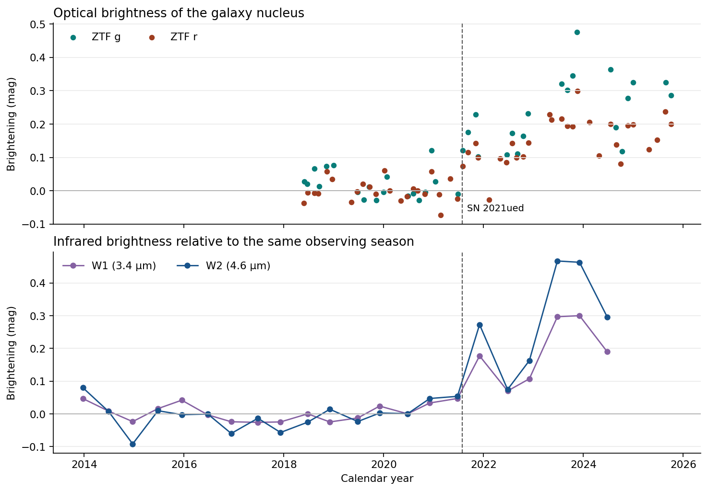

# A second optical and mid-infrared brightening at the nucleus of CGCG 476-019

In 2023 the inner region of CGCG 476-019 became brighter than it had been during the 2021 event reported as SN 2021ued. Its 4.6 μm flux rose **53–54% above its pre-2021 seasonal baseline** in two observing visits six months apart. Between the 2021 and 2023 bright phases, the June 2022 flux had returned to within 7% of baseline. The ZTF optical measurements also brighten again in 2023. This establishes a multi-season nuclear light curve at a known supernova position. The cause of the additional emission remains open.

The upper panel shows median ZTF direct-image PSF photometry in 45-day bins with at least four measurements, separately for each filter in field 647. Zero is the filter's 2018–2020 median. The lower panel shows visit medians relative to earlier visits in the same annual observing season. The vertical line marks the discovery of SN 2021ued. Positive values mean brighter in both panels. Lines connect infrared visits separated by about six months. The true maxima and the time lag between bands are unresolved. [ZTF light curves at IRSA](https://irsa.ipac.caltech.edu/docs/program_interface/ztf_lightcurve_api.html) · [NEOWISE single exposures](https://irsa.ipac.caltech.edu/Missions/wise.html)

## What the instruments measured

| Median visit date, UTC | Exposures | W1 (3.4 μm), Vega mag | W2 (4.6 μm), Vega mag | W1 brightening, mag | W2 brightening, mag |
|---|---:|---:|---:|---:|---:|
| 2021 Dec 2 | 13 | 12.285 | 12.070 | 0.177 | 0.273 |
| 2022 Jun 25 | 13 | 12.406 | 12.328 | 0.070 | 0.075 |
| 2022 Dec 1 | 22 | 12.355 | 12.180 | 0.107 | 0.163 |
| 2023 Jun 24 | 12 | 12.179 | 11.935 | 0.297 | 0.468 |
| 2023 Dec 3 | 12 | 12.162 | 11.880 | 0.300 | 0.463 |
| 2024 Jun 23 | 11 | 12.286 | 12.106 | 0.190 | 0.296 |

The analysis retained 309 of 323 NEOWISE single exposures within 3 arcsec of the nucleus. We required high-quality detections in both filters, zero contamination and moon flags, and frame quality factor ≥0.5. A gap exceeding 45 days starts a new visit. Of 22 visits, 16 precede SN 2021ued. Eight in each observing season form separate baselines to accommodate the different apparent brightness of an extended galaxy in the two scanning directions. Each baseline visit gets equal weight. The robust scatter (1.4826 × median absolute deviation) of the pre-event W2 visit medians was 0.017 mag for the June comparison and 0.077 mag for December. Brightening is the baseline magnitude minus the measured magnitude.

The two 2023 visits give a nominal W2 excess of 1.01 and 1.06 mJy. For a luminosity distance of 134.8 Mpc (z = 0.030748, flat ΛCDM with H₀ = 70 km s⁻¹ Mpc⁻¹ and Ωₘ = 0.3), the corresponding excess νLν is about **1.4–1.5 × 10⁴² erg s⁻¹**. This is an isotropic, single-band estimate at the emitted wavelength corresponding to observed 4.6 μm. We used the Vega W2 zero point of 171.787 Jy, with no color or extinction correction. [WISE flux calibration](https://doi.org/10.1088/0004-637X/735/2/112)

Two ZTF reductions support the optical part of the result. The IRSA direct-image series contains 2,724 quality measurements in two detector fields. In the better-sampled field 647, the annual median total brightness rose from **g = 17.746, r = 16.811 in 2022** to **g = 17.576, r = 16.710 in 2023**. The pre-event 2020 medians were g = 17.911 and r = 16.921. Field 1691 also brightened from 2022 to 2023 in both filters. The galaxy contributes to all direct-image magnitudes. ZTF difference photometry from ALeRCE independently reduces the same survey imaging and gives positive detections in every observing year from 2021 through June 2026. The two ZTF reductions share exposures. NEOWISE supplies the independent telescope and wavelength range. [ZTF alert measurements](https://api.alerce.online/ztf/v1/objects/ZTF21abouxex/detections) · [Annual photometry](ztf-annual.csv)

## Localization and controls

A direct fit to pixels in 19 ZTF difference images places the 2023 source a median of 0.12 arcsec from the Pan-STARRS galaxy centre and 1.68 arcsec from the reported position of SN 2025aghl. The underlying cutouts, sky coordinates, measurement code and per-exposure offsets are included. [Difference-image localization](image-localization/README.md)

The 2023 r-band difference detections have median position (350.4224323°, +26.4859824°) and median radial scatter 0.096 arcsec across 131 measurements. The position is within 0.06 arcsec of the catalog centers of the extended galaxy in Pan-STARRS and SDSS. Both catalogs derive their own galaxy centers. These offsets indicate nuclear-scale coincidence within ground-based astrometric systematics. They cannot distinguish a supernova projected on the nucleus from variable accretion. In the 2023 data, the flux had already risen and faded again before the 2025 transient. TNS places SN 2025aghl about 1.75 arcsec north of SN 2021ued. Its catalog position and date are both relevant when interpreting any subsequent measurements. The 2023 conclusion uses data acquired before 2025. [Catalog centers](inputs/centers.csv) · [SN 2021ued](https://www.wis-tns.org/object/2021ued) · [SN 2025aghl](https://www.wis-tns.org/object/2025aghl)

The nearest other AllWISE source is 15.29 arcsec away and 2.17 mag fainter in W2. For a local control, we selected the six clean point sources within 3 arcmin and beyond 12 arcsec with W2 < 13.5 closest in brightness to W2 = 12.4. Five returned NEOWISE data inside their 3 arcsec cones. Across nine 2023 comparison visits with at least five valid exposures, their largest absolute baseline changes were **0.030 mag in W1 and 0.021 mag in W2**. The faintest comparison's additional three-exposure June visit gives 0.041 mag in W1 and 0.006 mag in W2. Sources inside the mid-infrared beam remain unresolved. [AllWISE field](inputs/allwise-field.csv) · [Individual source visits](infrared-visits.csv)

## Discovery search and prior reports

We examined a snapshot of 110,422 Open Supernova Catalog entries. A separate targeted search selected 298 entries named SN with 2024–2026 designations and classifications containing IIn, Ibn, Icn, SLSN or IIb. We checked all 268 at declination ≥−36° for ALeRCE objects within 3 arcsec. We required RB ≥0.55, DRB ≥0.5 where supplied, and σ(mag) <0.3 for these detections. Candidate histories had to start at least 80 days before the catalog discovery date and contain positive, high-quality detections on two distinct UTC MJD days at least 60 days before discovery. Two records survived. For SN 2024gzk the earlier source matches the known SN 2019lqo. Near SN 2025aghl the search recovered the history of ZTF21abouxex, SN 2021ued. That known association led to the independent infrared and direct optical measurements in this report. The [object-by-object screen](screen.csv) records every selection and exclusion. Sample selection and heterogeneous alert coverage preclude incidence estimates. [Open Supernova Catalog](https://sne.space/astrocats/astrocats/supernovae/output/catalog.min.json) · [ALeRCE](https://alerce.online/object/ZTF21abouxex)

A Pan-STARRS detection designated AT 2013lj/PS21ojq was previously reported within about 0.25 arcsec of SN 2021ued. Its single reported discovery epoch cannot establish an earlier episode of the same phenomenon. WISeREP already groups the spectra associated with the 2021 and 2025 reports, and the Bright Supernova Pages list both names for this galaxy. The measurement advanced here is the intermediate optical and infrared rebrightening. [AT 2013lj](https://www.wis-tns.org/object/2013lj) · [WISeREP](https://www.wiserep.org/object/18987) · [Host listings](https://www.rochesterastronomy.org/snimages/sndupe.html)

The closest of the 823 published Flaires entries is 1.069° away. The closest of the 137 MIRONG entries is 4.820° away. The latter catalog predates the measured brightening. The 27,076-entry Gaia alerts download has no alert at the site (nearest about 18.6 arcmin). The ASAS-SN variable-star catalog II/366 (15 arcsec) and Milliquas v8 (60 arcsec) yielded no entries in those cones. Of 4,476 position-bearing OSC rows carrying a CRTS or Catalina discovery/alias tag or a CSS/MLS/SSS identifier, the closest was SNhunt424 at 0.587°. That last check covers the OSC subset of CRTS. Searches under SN 2021ued, ZTF21abouxex, CGCG 476-019, 2MASX J23214137+2629096, LEDA 169940, AGC 330280, and the WISE position did not locate a publication quantifying these 2023 optical/infrared measurements. Surveys have different sky, time and host-selection coverage. These checks bound the priority claim. [Flaires](https://doi.org/10.1051/0004-6361/202451340) · [MIRONG](https://doi.org/10.3847/1538-4365/abd1dc) · [Gaia alerts](https://gsaweb.ast.cam.ac.uk/alerts/alertsindex) · [ASAS-SN catalog](https://cdsarc.cds.unistra.fr/viz-bin/cat/II/366) · [Milliquas](https://cdsarc.cds.unistra.fr/viz-bin/cat/VII/294)

## Reproduction

From this directory, run `python verify.py` with NumPy and pandas. It reconstructs the visit and annual tables, measures angular separations, checks the comparison-star amplitudes, and verifies the published counts. `python plot.py` additionally requires Matplotlib and regenerates the figure. The compressed CSV inputs include the individual survey exposures, the retained alert-packet columns, the local AllWISE field, and the coordinate lists for both published infrared catalogs. Exact retrieval URLs and SHA-256 digests are in [provenance.json](provenance.json). We fitted no black-hole, tidal-disruption, dust, or supernova-interaction model.
