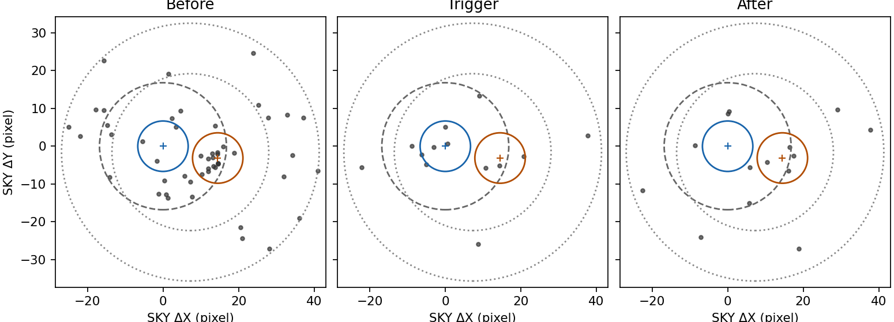

# Two-aperture photometry in ObsID 23779

During the registered trial, the equal disjoint cores contained 3 photons at the extraction center and 3 at 2CXO J125704.0+275119. Of the 9 original trial photons, 2 landed in the CSC core and 4 fell outside both cores.

The CSC center is 7.295 arcsec from the extraction center and inside the original aperture. Its separation from the reported X-ray localization is 6.707 arcsec. The 2.681-arcsec X-ray error circle does not intersect the CSC positional ellipse (1.6653732604254394 × 0.9349722806963588 arcsec). The CSC ellipse overlaps the original extraction aperture in the local tangent plane. The named observation target was NSA103757. The CSC same-ObsID stack match type and broad-band variability index are u / 7. Code u denotes a unique CSC stack association.

The core radius is 6.672 event SKY pixels. Each core uses the same local background annulus around the midpoint. Scaling divides nominal sky areas. Edge or dither effects can change the effective areas.

| Phase | CCD live s | Original aperture | Trial / CSC core | Shared annulus | Expected background / core | Trial share (exact 95%) | Common supported s |
|---|---:|---:|---:|---:|---:|---:|---:|
| before | 21375.81 | 31 | 3 / 16 | 21 | 1.28 | 3/19 (0.03–0.40) | 4440.96 |
| trigger | 592.16 | 9 | 3 / 3 | 3 | 0.18 | 3/6 (0.12–0.88) | 0.00 |
| after | 2360.56 | 7 | 0 / 4 | 5 | 0.30 | 0/4 (0.00–0.60) | 649.15 |

The two-sided Fisher comparison of the trial with the pooled flanks gives p = 0.08285.
The table conditions on photons in the two cores. Both centers were selected after inspection, and the flare center was determined using the discovery data. Sparse counts, diffuse emission, PSF wings, astrometric offsets and incomplete geometry limit source attribution. The geometry column gives times supported by independent detector witnesses around the entire construction. The analysis uses no PSF model or exposure map. Its count test has no discovery false-alarm interpretation.

Blue marks the blind extraction core, orange the CSC core, the dashed line the original aperture, and dotted lines the background annulus. Points are individual selected event rows.

[Counts, associations, detector support and input receipts](measurement.json) · [Tagged EVT2 rows and both offsets](photons.json.gz) · [CSC position and error ellipse definitions](https://cxc.cfa.harvard.edu/csc2.2/columns/positions.html)
