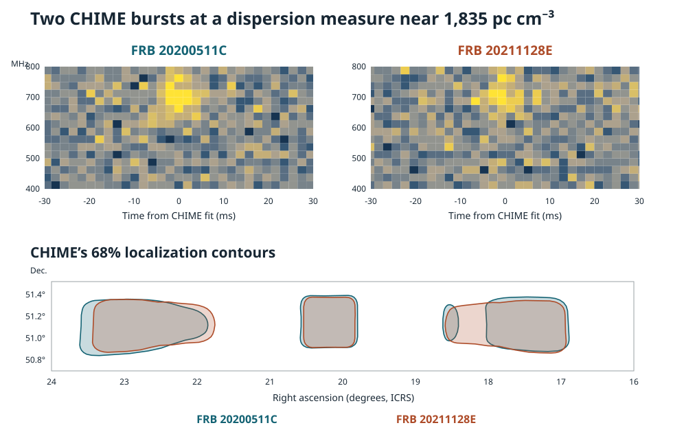

# A high-dispersion candidate repeating fast radio burst

CHIME detected FRB 20200511C and FRB 20211128E **565.454 days apart**. The bursts have nearly the same dispersion, pulse width and peak frequency. Their 68% sky regions overlap over **0.897 square degrees**, covering 86% of either region. Both detections are credited to CHIME/FRB. The proposed association is the result of this search.

If one source produced both bursts, its measured dispersion of about 1,835 pc cm⁻³ exceeds that of every source labelled as a repeater in this catalog. The largest per-source median among those repeaters is 1,703.12 pc cm⁻³ for FRB 20200809E. Dispersion measures electron column along the line of sight. The distance, host and contribution from the source's own environment are undetermined.

| CHIME measurement | FRB 20200511C | FRB 20211128E |
| --- | ---: | ---: |
| Event ID | 83893193 | 199832669 |
| Main-lobe RA, Dec (degrees) | 20.1878, +51.1516 | 20.1827, +51.1458 |
| Fitted dispersion (pc cm⁻³) | 1,835.040 ± 0.327 | 1,834.864 ± 0.379 |
| Fitted intrinsic Gaussian width (ms) | 2.885 ± 0.270 | 3.135 ± 0.374 |
| Fitted spectral peak (MHz) | 707.43 | 720.42 |
| Real-time detection S/N | 10.68 | 11.60 |
| Post-processing fit S/N | 15.67 | 14.90 |

The main-lobe centers are 23.86 arcseconds apart. CHIME's beam response permits multiple positions separated by degrees. Each full 68% region spans about 1.04 square degrees. At 95% confidence the common area is 1.877 square degrees. The dispersion difference is 0.177 pc cm⁻³ against a combined formal uncertainty of 0.500 pc cm⁻³.



The images show measured, dedispersed Stokes I in 25 MHz by 1.97 ms bins, with each band scaled by its off-pulse scatter. Colors run from dark blue at −2.5 to yellow at +4 off-pulse standard deviations. The lower panel uses the collaboration’s published 68% contours. A separate sum over 600–800 MHz in the instrument data places the pulses 11.0 and 6.5 off-pulse window standard deviations above the background. At 400–600 MHz the same calculation yields 0.41 and 2.39. Each estimate uses ten nonoverlapping off-pulse windows. These are signal checks from the original observations. They reuse the catalog's dedispersion and fitted arrival time.

## Search and controls

An initial search compared nearby burst directions and fitted dispersion. It also surfaced several unlabelled events near the known active repeater FRB 20220912A. The high-dispersion pair stood out, which prompted the pulse-shape, sky-map and permutation checks below. A separate secular-trend screen on labelled repeaters recovered previously reported dispersion evolution in FRB 20190117A.

The released comparison starts with all 4,539 unique catalog events. It takes the first component of each event, requires a blank repeater field and finite measurements, and drops events with the catalog's excluded, sidelobe or citizen-science flags. Of 3,147 eligible events, 1,796 distinct pairs have centers within one degree. The two high-dispersion bursts rank first. The complete rules and ten leading pairs are in [analyze.py](analyze.py) and [screen.json](screen.json).

The exploratory score multiplies four terms. The position term is the squared separation in degrees plus 0.25², which limits the weight of near-identical centroids. The remaining terms are one plus the absolute dispersion difference in pc cm⁻³, one plus the absolute peak-frequency difference divided by 25 MHz, and one plus the absolute log-width difference divided by 0.25. The pair also ranks first with the pulse-shape terms removed or the position floor increased to one degree.

We held the measured sky positions fixed and permuted each burst's dispersion, width and spectrum together. Each trial searched all 1,796 pairs and retained the smallest score. Restricted permutations preserve some telescope and sky selection effects. Table entries count trials in which any pair scored as well as the observed pair.

| Permutation strata | Trials | Position, dispersion and shape | Position and dispersion | Shape score with 1° floor |
| --- | ---: | ---: | ---: | ---: |
| 10° declination | 10,000 | 4 | 70 | 12 |
| Also 20° absolute Galactic latitude | 10,000 | 0 | 69 | 7 |
| Also 500-day epoch | 10,000 | 6 | 92 | 6 |

The score and cuts were explored after seeing the catalog. These conditional simulation frequencies describe rarity under the stated shuffles. They cannot supply a probability that the source repeats. Events at similar beam positions can have similar observed spectra. The simulations do not model the complete beam response or unknown source population.

## Prior work and the deciding observation

CHIME/FRB lists both events individually as one-offs. Cook and colleagues searched this same survey for repeaters using position and dispersion and accounted for ambiguity in localization. Neither identifier appears in their published gold or silver tables or in the earlier 2023 repeater tables. Their search could already have grouped this pair among its other input clusters. The distinguishing measurements here are the joint pulse-shape ranking, the original intensity comparison and the explicit sky-map intersection. [CHIME catalog and paper](https://arxiv.org/abs/2601.09399) · [2026 repeater analysis](https://arxiv.org/abs/2605.08410) · [2023 repeater analysis](https://arxiv.org/abs/2301.08762)

A secondary check over the full event table, including flagged and labelled events, found only these two with measured coordinates within five degrees of the first event and dispersion within 15 pc cm⁻³ of their mean. The public evidence therefore supports a **candidate common source**. Conservatively, either burst could come from a different source along neighboring sightlines. A third burst with compatible dispersion and an interferometric position inside the shared contours, or two compatible voltage-data localizations of the original events, would directly test the association. The upper-band spectral similarity alone does not distinguish intrinsic repetition from propagation effects.

## Replay

From this directory, Python with NumPy and SciPy can reproduce the ranking and all 30,000 catalog simulations offline.

```sh
python analyze.py > replay-screen.json
diff -u screen.json replay-screen.json
```

The archive-verification option downloads the versioned four-megabyte catalog and checks both its SHA-256 and the complete extracted event snapshot. The HDF5 check requires h5py, retrieves about 30 MB from CANFAR, verifies all four hashes, reads the measured intensity and quality flags, and intersects unique equal-area HEALPix cells at the original NSIDE. A local directory holding the four original files can be supplied with `--input-dir`.

```sh
python analyze.py --verify-archive > replay-screen.json
python check_observations.py > replay-observations.json
```

The figure can be regenerated with `python plot.py INPUT_DIR frb-pair.svg` using those same four observations.

The reduced table includes all 4,539 unique events and retains the measurements and flags needed to rerun selection. Source URLs and SHA-256 receipts accompany the [event snapshot](chime-events.csv) and [original HDF5 measurements](observations.json). [Archive receipts](sources.json) · [Original data release, DOI 10.11570/25.0066](https://doi.org/10.11570/25.0066) · [First burst](https://chime-frb.ca/catalogs/catalog2/FRB20200511C) · [Second burst](https://chime-frb.ca/catalogs/catalog2/FRB20211128E)
