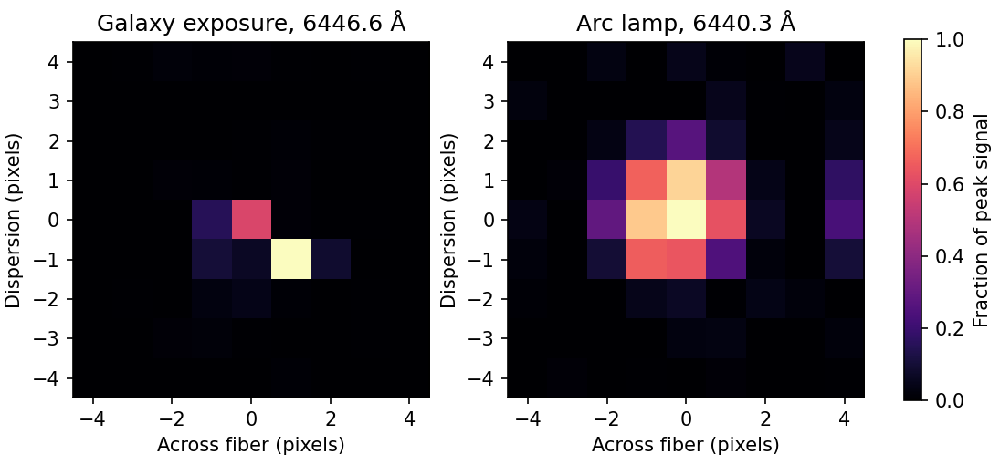

# Proposed catalogue correction: likely detector hit in SDSS J151158.42+344735.8

The Coronal Line Activity Spectroscopic Survey (CLASS) lists an [Fe VII] 5720 Å line with log luminosity 40.373 (erg/s) in SDSS J151158.42+344735.8. At the location of that line on the original CCD, **two pixels contain 72.7% of the local positive signal**. Across 16 unsaturated comparison lines from the arc lamp in the same fiber, the largest two-pixel fraction is **26.8%**. The excess is substantially sharper than the measured instrumental response. A localized detector hit, potentially a cosmic ray, is the best-supported explanation for this apparent line. This is a **proposed correction to an individual catalogue [Fe VII] identification**, not a confirmed astrophysical line disappearance or a measurement of the survey-wide false-positive rate. A weaker underlying emission line cannot be excluded. The public catalogue still lists its original measurement. [CLASS paper](https://arxiv.org/abs/2211.11882) · [Published catalog](https://vizier.cds.unistra.fr/viz-bin/VizieR?-source=J/ApJS/265/21)

The single physical SDSS exposure was taken on 2004 March 27, plate 1385, MJD 53091, fiber 565, camera r2, exposure 25898. The spectrum identifier is 1559526728852858880 and the J2000 position is (227.99342°, +34.79329°). The red and blue camera entries for this fiber share the same exposure number. The coadded, flux-calibrated spectrum contains a fitted line at 6445.53 Å vacuum, with Gaussian sigma 1.54 Å and integrated flux **68.03 ± 7.67** in units of 10⁻¹⁷ erg s⁻¹ cm⁻². DESI DR1 target 39632976543220284, 0.125 arcsec from the SDSS position, gives **4.42 ± 2.73** at the same center and width. These formal errors are conditional on the local linear continuum. Changing fiber aperture or true variability could affect the cross-survey comparison. The more discriminating detector-morphology test uses only the original camera and its own calibration. [SDSS spectrum](https://data.sdss.org/sas/dr17/sdss/spectro/redux/26/spectra/lite/1385/spec-1385-53091-0565.fits) · [DESI spectrum](https://www.legacysurvey.org/viewer/desi-spectrum/dr1/targetid39632976543220284)

## Detector test

The released spCFrame wavelength solution and spFlat Legendre fiber trace predict raw detector pixel (1612, 455), zero based. The maximum is at (1613, 454). We subtract each column’s local median from six flanking rows, find the peak within a 5×5 search area, and calculate the brightest one- and two-pixel fractions in a 5×5 area about that peak after clipping negative residuals to zero. One pixel contains 45.8% of the positive residual, versus at most 14.0% in the arc controls. The neighboring bright pixels run diagonally across the fiber trace. The lamp comparison uses the adjacent calibration exposure 25900, unsaturated separated peaks within 250 detector rows, and the same extraction geometry. Peak shape and centroid are measured directly on raw counts. A detector defect or another charge deposition mechanism is possible. A weaker astrophysical line under the hit remains unconstrained by the 2004 spectrum. [Each lamp peak](lamp-controls.csv) · [Raw stamp, pixel coordinates and SHA-256 hashes](detector.json) · [SDSS camera configuration](https://github.com/sdss/idlspec2d/blob/2062a6d26692db7d4bf518f34a616eba2106c53a/examples/opConfig-50000.par)

## Selection and replay

We took the union of the CLASS rows with a positive catalog log luminosity for [Fe X] 6374, [Fe VII] 6087 or 5720, [Fe XI] 7892, or [Fe XIV] 5303. These five selections yield 174 SDSS spectra. Matching to DESI DR1 zpix within 2 arcsec, with ZWARN zero and |Δz| < 0.003(1+z), gave 61 SDSS–DESI spectrum comparisons with 57 distinct DESI target IDs. J151158.42+344735.8 stood out for its unnormalized decline in the isolated 5720-line measurement and lack of a counterpart at [Fe VII] 6087. The obvious multi-line variable J1342+0530 has already been studied in detail. The single audited detector hit gives no estimate of the overall CLASS contamination rate. [Frozen selection and coverage](selection.csv) · [Previously published J1342 behavior](https://doi.org/10.1093/mnras/stag1681)

Run `python check.py` with Astropy, NumPy, SciPy and Matplotlib to retrieve the original four SDSS products and regenerate the raw comparison, all 16 controls, and the figure. Run `python line.py` with NumPy and SciPy to refit the supplied SDSS and DESI spectral pixels. The raw SDSS format stores unsigned integers with SIMPLE=F. The decoder uses the SDSS detector geometry and verifies the FITS header terminator on a card boundary. [SDSS raw format](https://sdss2.org/dr3/dm/flatFiles/sdR.php) · [Spectral pixels](line-pixels.csv)

The 15 November 2026 prior-report search included this source’s SDSS spectrum ID and coordinate aliases, the CLASS catalog, and the terms “cosmic ray” and “coronal line.” We found the published detection and no earlier source-specific raw-CCD audit. CLASS's single-epoch detection and its neural-network confidence are derived from the same spectrum. The result here is a proposed correction to this individual line identification.
