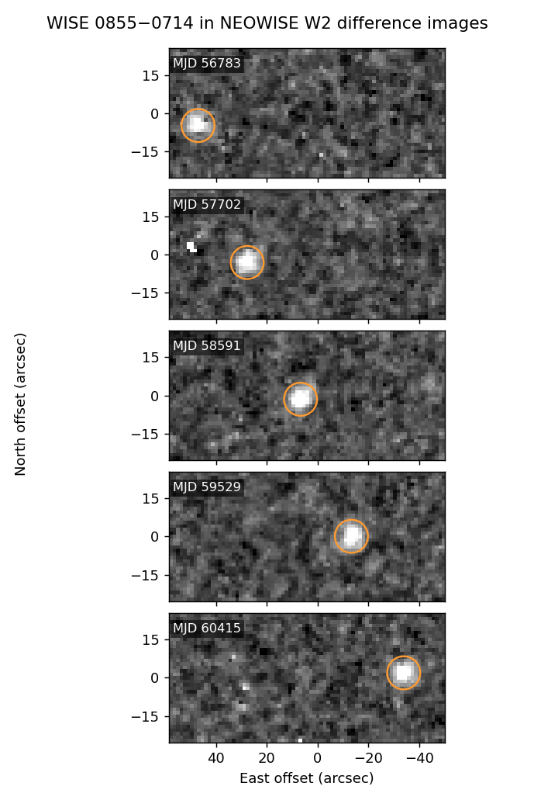

# WISE 0855−0714 recovered in ten years of NEOWISE data

**The known Y dwarf crosses approximately 81 arcsec and is independently visible in 30 native W2 frames stacked into five widely separated visits.** The targeted 68.4-arcsec-radius control cone contains a single repeatable, W2-detected and W1-weak cluster in each of 21 visits. The field selection used the known object's location. Neither its published proper motion nor its parallax entered the clustering or track fit. This control tests the NEOWISE validation procedure. Its W2 magnitude near 13.9 is brighter than the faint end of the blind sample.

| Parameter | Five-parameter fit |
|---|---:|
| Proper motion in RA × cos(dec) | −8.125 ± 0.014 arcsec/yr |
| Proper motion in Dec | +0.654 ± 0.018 arcsec/yr |
| Relative parallax | 0.434 ± 0.044 arcsec |
| Distance from conditional parallax | 2.31 pc, 68% inverse-parallax interval 2.09–2.56 pc |
| Duration | 9.95 yr, MJD 56782.67–60415.18 |
| Chi-square / degrees of freedom | 31.59 / 37 |

The independently published absolute parallax is 0.4389 ± 0.0030 arcsec with proper motion (−8.1189, +0.6793) arcsec/yr (Kirkpatrick et al. 2019, [DOI](https://doi.org/10.3847/1538-4365/aaf6af)). Our interval conditions on the NEOWISE catalog's scan-direction calibration. Allowing independent east/north shifts for opposite scan directions gives 1.36 ± 1.63 arcsec. Consequently the conditional parallax agreement supports recovery in this field, while the data alone do not calibrate scan systematics for another source.

**Astrometry.** The cone returned 3,908 final-release single-exposure catalog rows. Cuts are W2 S/N ≥5, W1 S/N <3, W2 reduced profile-fit chi-square <3, a clean W2 contamination flag, no Solar System association and frame quality ≥5. A gap >20 days separates visits. Single-linkage clustering uses a 2.5-arcsec cutoff and ≥3 detections per cluster. The medians supply each visit centroid. Each coordinate's median uncertainty uses its within-visit MAD, a Gaussian median standard error and a 0.12-arcsec floor added in quadrature. The five-parameter weighted fit uses Astropy's built-in Earth barycentric position and a tangent plane about (133.773°, −7.243°). The low-Earth-orbit satellite position relative to the geocentre is negligible at this precision. The fit treats visits and axes as independent. Its covariance and the opposite-scan nuisance fit appear in [fit.json](fit.json).

**Pixels.** We selected the six quality-10 W2 exposures nearest the frame centre in visits 0, 5, 10, 15 and 20. Selection uses frame metadata independently of whether a source was reported in that frame. The script reads calibrated FITS pixels, reprojects to one fixed sky grid, subtracts the field median in each exposure, normalizes zero points and takes the pixel median for each visit. Each panel subtracts the median of the other four visits. The stacked residual peaks are within 0.77–2.19 arcsec of the catalog centroids. Both disjoint three-frame splits place a positive peak within 2.39 arcsec in each visit. The weakest split peak is 6.84 off-target MAD scales. That descriptive contrast includes local peak selection and spatially correlated pixels, so it does not give a false-alarm probability. The five-visit displacement and independent exposures distinguish the control from stationary blends, transient asteroids and one-exposure defects. See [per-visit checks](image-checks.csv).

**Replay.** Install NumPy, pandas, SciPy, Astropy and Matplotlib. In this directory execute `python control.py`, then `python pixels.py --cache /path/to/your/cache`. The first script uses the frozen lossless [IRSA TAP reply](single-exposures.csv.gz) and writes the epochs and fit. The second reads the [image manifest](image-manifest.csv), retrieves bounded byte ranges from the archive's public native FITS and checks the science pixels, header and raw row-strip hashes. The compressed CSV SHA-256 in the fit record describes the uncompressed archive payload. The individual FITS cutouts can be regenerated from the named exposure and verified against the supplied hashes. [NEOWISE final release](https://irsa.ipac.caltech.edu/data/WISE/docs/release/NEOWISE/) · [NASA IRSA cloud archive](https://irsa.ipac.caltech.edu/cloud_access/).
