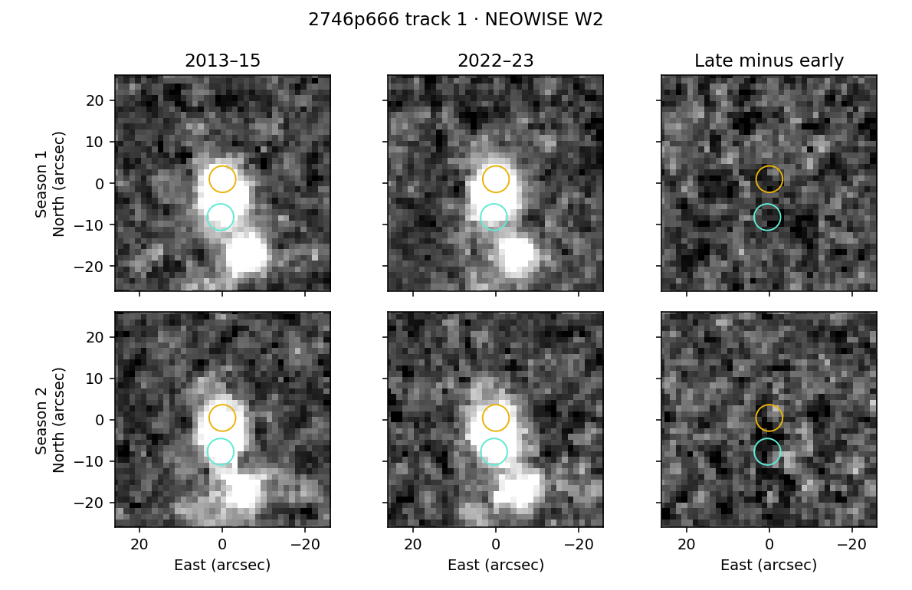

# The 14-epoch track links components of a stationary blend

The unWISE motion-first search linked a putative W2=14.45 object at (274.567665°, +66.420218°) at MJD 57170, moving (+0.056, −1.026)″/yr. The earliest coadds already resolve flux at the location the putative object later reaches. At MJD 56645 the linked centroid is 1.62″ north of the reference coordinate at W2=15.04. The same observation contains a brighter W2=14.27 component 3.7″ south. MJD 56835 and 57015 show both components again. The early 2010 W2 coadd at MJD 55368 also contains point-source detections at offsets +1.3″ and −3.0″ north. The linked component's fraction of total flux changes from 0.35 to 0.79 as the association passes through the brighter image. The nine matches already available to the stationary comparison in the blind linker were an additional indication of confusion.

**Held-out single exposures reject the putative motion at the reported flux.** NEOWISE produced 3,844 W2 S/N ≥5 source extractions within 13″ of the reference point in 21 visits, with frame quality ≥5. A fixed aperture of radius 2″ about (+0.15″, −2.95″) contains 3,806. The visit medians range from +0.079″ to +0.234″ east and −3.022″ to −2.898″ north, at W2=13.930–13.977 for the blended flux. During the final eight eligible visits there are 931 extractions within 13″ and zero within 1.5″ of the predicted track. Intermediate track matches occur as it crosses the fixed centroid. The WISE source-table positions can reflect contributions from both bands, so the pixel analysis below isolates W2.

The orange and cyan circles mark the predicted early and late positions. The images use 96 W2 exposures in eight visits. Each row combines two early and two late visits from the same scan season. Each stack uses 24 frames, all with frame quality 10. The late images cover 2022–2023, beyond the last unTimely epoch used to generate the track. The dominant peak stays fixed. The normalized dot product of the difference image with a late-minus-early Gaussian source profile has contrast −0.55 and −0.61 in the two seasons, measured relative to 52 off-position samples in units of 1.4826 × MAD.

Injecting a model W2=14.453 mover at the *actual blend location* in the 96 native images before reprojecting and median-combining them produces contrasts of **+27.4 and +28.8** in those units. At eight offset positions, median contrasts are +30.4 and +30.6. These tests assume a circular native W2 PSF of 6.4″ FWHM and constant flux. They directly test whether this scene and these exposures could reveal a second source following the reported path. They do not constrain substantially fainter blended sources.

## Replay and provenance

`get.py` retrieves the IRSA positional metadata and independent NEOWISE L1b source table in `frames.tbl` and `l1b.csv`. `centroids.py` writes `visits.csv`. `epoch.py` reproduces the local component list with the parent motion-first manifest and track table, using `UNTIMELY_CACHE` for the source FITS files. `stack.py` fetches the 96 native W2 FITS row strips, and `inject.py` replays the injections in the same `TRACK2746_CACHE`. NumPy, Astropy, SciPy and Matplotlib are required. `inputs.csv` records the native URLs and SHA-256 hashes of the input FITS headers and required row ranges. `test.csv` and `injections.csv` retain the numerical residual and injection measurements.

[NEOWISE archive](https://registry.opendata.aws/wise-neowiser/) · [unTimely reference](https://doi.org/10.3847/1538-3881/aca2ab)
