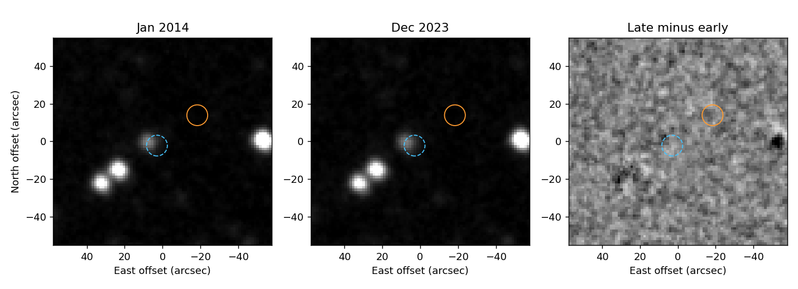

# The catalogued J182532.09+671906.2 track fails a ten-year image test

**The expected 26.7-arcsec displacement of a W2 = 16.477 source is absent in 128 independently retrieved NEOWISE W2 images.** Near the January 2014 prediction there is a bright, stationary AllWISE source that remains visible at the same position in December 2023. The proposed moving source would have appeared at the orange circle in the second epoch. A single moving point source of constant catalogued brightness on that track is disfavoured. We do not infer a distance, temperature or a unique cause of the CatWISE fit.

| Fixed-track check | Result |
|---|---:|
| Early and late stacks | 64 + 64 W2 exposures |
| Fit to the proposed positive / negative residual pair | −6.06 zero-point-20 DN |
| Fits in the two disjoint interleaved frame splits | −2.04, −8.31 DN |
| Local comparison for 40 translated tracks | Median +0.76, MAD scale 4.48 DN |
| Expected from nearby AllWISE photometric reference | +20.46 DN |
| Expected minus observed | 5.92 local MAD scales |

The early and late visits use the same observing season. They bracket the CatWISE2020 observations, with the 2023 epoch held out of CatWISE. For each visit we selected the 64 quality-10 W2 frames with boresights closest to the field, reprojected them to a common sky grid, subtracted the frame medians, normalized the photometric zero points and combined each pixel with a four-MAD-clipped average. The late-minus-early template fixes the source position at each visit to the propagated CatWISE trajectory; it does not move either position to maximize the fit. A circular 3.25-arcsec sigma Gaussian approximates the reprojected PSF. A common local sky plane is fitted simultaneously. Forty translated templates drawn from a grid within 24 arcsec of the target give the background comparison. These placements overlap; the scale is descriptive and gives no Gaussian false-alarm probability.

The reference AllWISE J182533.39+671905.7 has W2 = 13.871 mag. A stationary-template fit on the late stack returns 225.56 DN. Scaling the measured flux to W2 = 16.477 gives the expected +20.46 DN, allowing for throughput of the approximate PSF. The uncorrected magnitude zero point would give +25.66 DN. The reference lies about 4.8 arcsec from the early track position and accounts for much of the persistent light. This late-position test is sensitive to a source retaining its predicted flux and trajectory. Variability, trajectory errors, and an arbitrarily faint source require different tests.

**Replay.** `python epochs.py --cache /path/to/cache` downloads the header and required row strip of each original FITS image, checks the native-byte hashes in [manifest.csv](manifest.csv), and regenerates the [measurements](track-test.json), [translated controls](translations.csv) and figure. It uses NumPy, pandas, SciPy, Astropy and Matplotlib and the sibling [native FITS reader](../control0855/native.py). The reference [AllWISE archive reply](allwise.csv), [query URL](allwise-url.txt) and [checksum](allwise.sha256) are included. The NEOWISE calibrated image archive is described by [IRSA](https://irsa.ipac.caltech.edu/cloud_access/).
