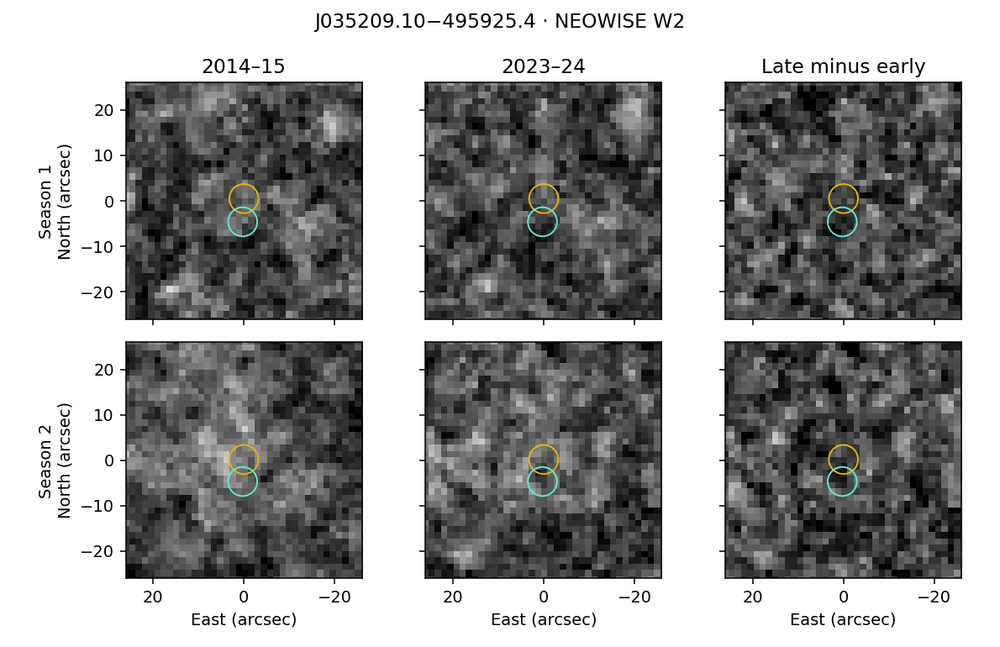

# J035209.10−495925.4 fails a held-out pixel test

A constant-flux source moving along the CatWISE trajectory should shift south by about 5″ between the early and late stacks. The NEOWISE W2 images give no reproducible positive moving-source contrast in either scan season. At the target the early-to-late contrast is −0.86 and +0.34 times the local median absolute deviation, after subtraction of the empirical off-source median. This disfavors the reported motion at the reported flux. The measurement supports neither a parallax nor a temperature for this row.

This diagnostic followed up an additional **fainter** catalogue row. CatWISE places it at (58.0379644°, −49.9902745°) at MJD 57170, with corrected motion (+0.030636, −0.570816)″/yr, W2=16.923 and W1−W2 >2.226. Of the selected unTimely catalogues three distinct epochs have eligible W2 centroids within 1.5″ of the predicted track. Five approach within 2.1″ at S/N ≥3.9, all in even-numbered epochs. The catalogue is near or below the local single-pass sensitivity.

The orange and cyan circles mark the predicted early and late positions, respectively. Each row shares a scan season. The right-hand panels show the late stack minus the early stack. NEOWISE frames were projected onto a common 1.375″ tangent-plane grid using each exposure’s WCS, normalized using MAGZP and median-combined in two early visits (2014–15) and two late visits (2023–24) per scan season. Within each visit the sixteen closest pointing centres were selected among W2 frames with frame quality 10, or all available frames if fewer. The four stacks contain 32, 32, 32 and 25 exposures respectively, for 121 total. The final visits are independent of the 2010–2018 CatWISE input.

The test measures the dot product of the difference image with a unit-peak, circular 6.4″ FWHM late-minus-early Gaussian PSF model, normalized by the sum of its squared values. Of 52 displaced comparison positions, 41 and 20 have contrasts at least as large as the target in the two seasons. These comparison positions can share pixels. Their 1.4826 × MAD quantifies observed background fluctuations and supplies no formal Gaussian significance.

Eight artificial W2=16.923 movers, offset from the source by 18″ in east, north or both, were injected into the original native science pixels of every frame. Their normalized Gaussian PSFs use the same CatWISE motion, native WCS pixel scales and native image photometric zero point. Reprojecting and restacking these pixels gives median contrasts of +3.23 and +2.80 local MAD, with 8/8 and 6/8 above +2, or 6/8 and 3/8 above +3. The eight locations and assumed constant flux, astrometric path and circular PSF delimit this local check.

To replay the cutouts and test, install Astropy, NumPy, SciPy and Matplotlib. Run `python check.py`, then `python inject.py`, with a shared optional `J0352_CACHE` directory. The frame-query URL and original IRSA IBE metadata are in `frames.url` and `frames.tbl`. All 121 native S3 frame URLs and SHA-256 hashes of their FITS headers and required raw row strips are in `inputs.csv`. The per-season measurements and individual injection results are in `test.csv` and `injections.csv`.

[NEOWISE single-exposure image documentation](https://irsa.ipac.caltech.edu/ibe/docs/wise/neowiser/p1bm_frm/) · [NEOWISE archive data](https://registry.opendata.aws/wise-neowiser/)
