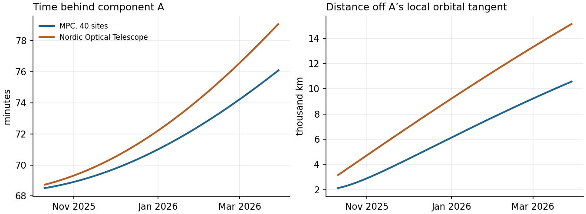

# The smaller fragment of comet 240P/NEAT trails its primary by about 71 minutes of orbital motion

On 1 January 2026, fragments A and B of comet 240P/NEAT lay about **105,000 km apart**. Their relative velocity was **6.25–6.54 m/s** in two fits to telescope measurements. Only **0.67–0.98 m/s** increased their distance. The rest changed the direction from one fragment to the other. A simple physical model explains most of that velocity. At the measured offset, B travels near the place A occupied about **71–72 minutes earlier**. Solar gravity changes A's velocity over those minutes. Subtracting that expected difference leaves **0.81–1.01 m/s** of relative motion.

Jewitt, Luu and Kim observed and modeled the previously identified pair with the Nordic Optical Telescope (NOT), published a distance growth rate of 0.98 ± 0.02 m/s, and discussed a possible connection with 240P’s 2018 outburst. We recover their distance growth and measure how much of the full velocity the near-common orbit explains. A breakup time or launch velocity cannot be read off the present velocity vector. The rotation of a direction over time can produce a large transverse velocity even at constant distance. [NOT observations and prior interpretation](https://arxiv.org/html/2606.21609v1) · [MPC release of the secondary](https://minorplanetcenter.net/mpec/K25/K25TC4.html)

## What the observations distinguish

| 1 January 2026, 00:00 TDB | 40-site MPC fit | NOT-only fit | JPL ephemerides |
| --- | ---: | ---: | ---: |
| Separation, km | 105,019 | 107,020 | 105,198 |
| Full relative speed, m/s | 6.25 | 6.54 | 6.23 |
| Growth of separation, m/s | 0.67 | 0.98 | 0.82 |
| Speed transverse to separation, m/s | 6.21 | 6.47 | 6.17 |
| Trailing time along A’s local orbital tangent, min | 71.00 | 72.21 | 71.08 |
| Distance from that tangent, km | 6,120 | 9,207 | 7,073 |
| Velocity difference left by a local time shift, m/s | 0.81 | 1.01 | 0.86 |

The lag **grew through the observing season**. On 11 October 2025 the fitted fragment trailed by 68.5 minutes in the MPC solution and 68.7 minutes in the NOT solution. On 28 March 2026 the lags reached 76.0 and 79.0 minutes. The two independent samples therefore resolve both an approximate shared path and slow drift away from it. Simply moving A backwards by one constant interval makes a falsifiable sky-position prediction. Fit that single lag on the MPC stations and predict the twelve NOT nights. The median two-coordinate miss is **1.86 arcsec**, compared with **0.79 arcsec** for the orbit fit using the same MPC observations. Reversing the samples gives **2.65 versus 0.86 arcsec**. In the NOT-only fit the constant-lag prediction lies south of B in October and November and north of it in January through March. The local time shift captures the dominant motion, while the observations resolve departures from an exactly identical, delayed orbit. The measurements do not isolate the physical origin of the residual. [Measurement file](measurements.json)



## Data and checks

The MPC extract contains 3,676 optical records from 2025–2026. We used the original numbered-comet and fragment flags in the 80-column observations. Some forms of the XML export lose that distinction. Match the two objects at the same observatory and timestamp, or interpolate A’s position between same-night exposures bracketing B. This gives 311 simultaneous pairs and 43 bracketed pairs, summarized by one median per site per UT night. The 93 resulting measurements span 30 August 2025 to 20 April 2026. The independent NOT reduction uses the 12 nights with a component-B detection in tables 1 and 2 of Jewitt et al. None of the 40 stations in the matched MPC sample is the Nordic Optical Telescope (dedicated MPC code Z23 or historical La Palma code 950). The two reductions share the sky geometry and the reference orbit for A. The JPL solutions can use measurements from these archives and provide an external reduction. [MPC observations](https://docs.minorplanetcenter.net/mpc-ops-docs/apis/get-obs/) · [Published observing times and east/north offsets](https://arxiv.org/html/2606.21609v1#S5.T2) · [JPL Horizons](https://ssd.jpl.nasa.gov/horizons/)

Fit B’s six-component displacement and velocity at JD 2461000.5 TDB in a heliocentric inertial frame. Integrate the first-order differential gravitational force of the Sun, Jupiter and Saturn along A’s Horizons orbit. Use the geometric ICRF position and velocity of A (JPL solution K252/47), Earth, Jupiter and Saturn with four-day cubic Hermite interpolation. Project the change in direction at light emission onto east and north. All observing nights carry equal per-coordinate weight and a soft-L1 loss with a 0.45 arcsec scale limits outlying centroids. The comparison with JPL uses its separate B solution 19. Heliocentric geometric coordinates, distances and velocities are in AU and AU/day. The direction prediction uses geocentric rather than individual observatory positions. Differential topocentric parallax is of order 0.01 arcsec or less near closest approach. The projection neglects differential light time and second-order terms in fragment separation, of order hundredths of an arcsecond over the observed arc.

For displacement **d**, velocity difference **w**, primary velocity **v** and acceleration **a**, the lag used in the table is the positive trailing time −(**d**·**v**)/|**v**|². The remaining velocity is |**w** + lag × **a**| with consistent time units. The growth rate is **d**·**w**/|**d**|. Both fits use these same definitions. The scalar lag and this residual are instantaneous local quantities. A smooth continuation backward to fragmentation would depend on unknown ejection and outgassing histories.

A 1,000-draw bootstrap of complete MPC stations gives a central 95% range of **4.20–7.35 m/s** for the full speed. Resampling twelve NOT nights gives **6.04–6.72 m/s**. These assess sampling sensitivity under the gravity-only model. Coma photocenters can differ by instrument, passband, aperture and observing geometry. The median cross-sample error exceeds the NOT-only fit residual of 0.19 arcsec. Adding differential outgassing proportional to the Marsden water law in the radial direction, or separately along all three orbital axes, gives 6.39–6.56 m/s in the MPC fit. The shorter NOT series also retains a largely transverse velocity. The sky positions alone do not establish an outgassing acceleration.

## Selection, priority and reproduction

An exploratory scan of 2019–2026 COBS photometry led us to the split comet. The largest brightness outbursts we checked had existing reports. This analysis uses separately released relative astrometry to answer a different question. The fragment identification, monitoring and scalar separation measurement were already public. Searches on 14 November 2026 for the object designations, relative velocity, transverse motion and orbital phase lag located the authors’ report and subsequent coverage. We did not locate an earlier measurement of this decomposition or the residual in an orbital-delay prediction. An attempt to recover the secondary on two DECam images from September 2023 encountered field-star confusion. [Image IDs, predicted coordinates and Gaia neighbors](precovery.md) [COBS](https://www.cobs.si/) · [Previous 240P outbursts](https://arxiv.org/abs/1911.02383) · [NOT investigation](https://arxiv.org/abs/2606.21609)

Run in this directory with Python, NumPy, SciPy and pandas. All inputs to the measurement are bundled. To compare the frozen inputs with a later archive release, run the optional last command with a new directory. Live release values may change.

```sh
sha256sum -c SHA256SUMS
python replay.py --output /tmp/240p-measurements.json
python figure.py  # optional, requires Matplotlib
python sources.py /tmp/240p-new-inputs
```
