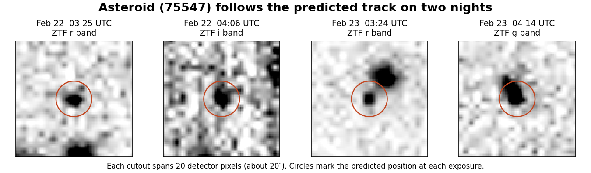

# A 31,000 km encounter between 407P/PANSTARRS–Fuls and (75547) 1999 XV257

On 22 February 2026, numbered main-belt asteroid (75547) 1999 XV257 passed within approximately 31,000 km of comet 407P/PANSTARRS–Fuls at 8.06 km/s, about five months before comet perihelion. The Sun–comet distance was 2.427 au. We identified this three-dimensional encounter by screening catalogues and independently evaluated the nominal geometry with two ephemeris services. An image search found the asteroid moving on the predicted track on the nights bracketing the encounter.

| Numerical ephemeris | Closest-approach time | Separation | Relative speed |
| --- | --- | ---: | ---: |
| JPL Horizons, geometric heliocentric vectors | 22 Feb 2026 19:55:35 TDB | 31,373 km | 8.05951 km/s |
| IMCCE Miriade, INPOP19A | 22 Feb 2026 19:54:07 TT | 31,688 km | 8.05947 km/s |

JPL's minimum corresponds to **19:54 UTC**, to the nearest minute. Independent service results differ by 315 km and 88 seconds. They can share underlying astrometry. The JPL separation grows to 34,325 km on either side at ±28.8 minutes and 176,890 km at ±6 hours. The encounters here describe the centers of two known objects. The heliocentric origin, common epochs and geometric coordinates remove the line-of-sight ambiguity of a projected alignment.

## How the pair was found

The JPL file contained 895,910 numbered asteroid records. We retained 894,699 with element epoch MJD >59000, semimajor axis <10 au, eccentricity <0.98 and inclination <180°. The retained records all have epoch MJD 61200 (9 June 2026). The MPC file contained 973 comet records. We selected nonparabolic entries with an element epoch of at least MJD 58800, perihelion distance ≤4.5 au and a parseable designation, excluding numbered fragments with a hyphen in the number field. We keyed records by designation, retaining 753 comet tracks. The 407P element epoch was MJD 61358 (14 November 2026). For 62 comet designations we used eight-day JPL Horizons vectors where available, producing 758 distinct track labels after combination. Some labels can refer to different designations of the same body.

We propagated these elements on 183 grid dates, from 1 January 2025 through 27 December 2028, spaced eight days apart. At each epoch we queried a spatial tree for asteroids within 0.19 au of each comet. For each neighbour we estimated the closest relative position on a straight-line trajectory. We saved the smallest encounter per designation pair with a minimum within ±4.05 days of the grid point and separation below 0.006 au. This yielded 2,623 coarse nominations. Of these, 49 had a predicted separation <110,000 km, relative speed >0.4 km/s and heliocentric comet distance <3.8 au at the grid point. The speed cut suppresses self-matches between numbered active asteroids and their comet designations. We checked a subset with independent calculations and archived imagery as described below. The result is not a complete ranking. Two-body propagation, finite grid spacing, linear encounter interpolation, evolving solutions and aliases can yield missed, duplicated or spurious nominations.

| Selected audit cases | Coarse miss distance (km) | JPL refinement (km) | Miriade cross-check (km) | Outcome |
| --- | ---: | ---: | ---: | --- |
| 407P and (75547) | 30,675 | 31,373 | 31,688 | Two close solutions and ZTF asteroid track |
| 428P and (32305) | 25,384 | 20,925 | 70,266 | Large service discrepancy excludes a precise closer-passage claim |
| 304P and (342140) | 30,707 | 51,743 | 27,639 | Large service discrepancy |
| P/2014 V1 and (504201) | 19,476 | — | — | Horizons puts the bodies 70.1 million km apart at the nominated epoch |

The default `screen.py` run uses the two unmodified fixed-width catalogue records in `ephemerides.json`. It recovers JD 2461094.30537030, 30,675.1 km and 8.0591 km/s without network access. For the complete screening procedure, `screen.py --population CACHE --output candidates.csv` reads the two named catalogue snapshots from CACHE (or downloads the current files), verifies their SHA-256 hashes and overlays the 62 saved Horizons query specifications. Use Python 3.11+, NumPy and SciPy. The full catalogue snapshots and bulk comet vectors are not bundled. Updated public catalogue files require the original snapshots for an exact historical full-population replay, and live Horizons queries can reflect new orbit solutions. These limitations do not apply to the bundled pair-specific numerical inputs.

For refinement we used each body's heliocentric position and velocity to solve for the zero of relative position dotted with relative velocity, then requested new Horizons states at the refined epoch. We independently repeated the local minimization with Miriade mean J2000 heliocentric rectangular states at the JPL minimum. The bundled evidence includes both sets of state vectors, the JPL time brackets, the exact service URLs and checksums of the screening catalogues. [JPL numbered-body elements](https://ssd.jpl.nasa.gov/dat/ELEMENTS.NUMBR.gz) · [MPC comet elements](https://minorplanetcenter.net/iau/Ephemerides/Comets/Soft00Cmt.txt) · [Horizons documentation](https://ssd.jpl.nasa.gov/horizons/manual.html) · [Miriade documentation](https://ssp.imcce.fr/webservices/miriade/api/ephemcc/)

## Archive images and limits on the interpretation

We measured all 12 public ZTF science exposures returned for 22–25 February in g, r and i. The predicted asteroid position was within the central usable portion of six cutouts on the first two nights. Four exposures have a matched-filter peak within 0.63 pixel of the predicted moving position, with point-source signal-to-noise ratios of **5.84, 10.51, 10.57 and 13.10**. Two other positive measurements have their peak on the edge of a two-pixel search box and were excluded from the four clean positional matches. The final six images only constrain the comet position. Positions use exposure midpoints and the Palomar topocenter. A median-filter sky estimate, seeing-matched Gaussian and robust local noise estimate are described by the code. These image statistics are diagnostics and do not provide calibrated comet photometry. [IRSA ZTF image data and cutout interface](https://irsa.ipac.caltech.edu/docs/program_interface/ztf_api.html)



At the **nominal** comet position the 12 point-source measurements range from −1.59 to +0.61 times the empirical noise. Diffuse emission and source locations displaced within the comet's orbit uncertainty require different tests. JPL solution 19 uses 734 observations from 2013-05-05 through 2020-06-12. At closest approach the reported formal three-sigma RA, Dec and range errors for the comet are 8.55 arcsec, 0.416 arcsec and 2,631 km. The larger angular error corresponds to approximately 10,350 km taking the full angular value at 1.669 au. The 315 km service difference does not measure the total orbit uncertainty. We have no direct measurement of the comet nucleus or of coma material at the asteroid's location. A dust crossing, impact or resulting physical change remains unestablished.

Paired catalogue-number, provisional-designation and comet-name searches found no published report of this encounter during preparation on 14 November 2026. An independent prior calculation or an unindexed report could exist. The literature already contains asteroid–comet trajectory screenings, including the 3I/ATLAS survey. The proposed new result is this specific passage. [3I/ATLAS encounter survey](https://doi.org/10.3847/1538-3881/ae2ea6)

## Search for a 2026 comet recovery

We also tested 32 additional public 30-second exposures on 20 nights from 19 January through 3 May 2026. They are disjoint from the 12 encounter frames. We removed a local background, smoothed each image with its reported seeing, aligned the images on the comet’s moving position, clipped the individual standardized pixels to ±3, and averaged them. The full stack was −0.63 times the empirical spatial noise at the nominal position. In a search box of ±11 arcsec east and ±2 arcsec north, the strongest peak was 2.09, compared with 2.99 at the strongest point in the surrounding control region. Selecting the best offset on the first 16 exposures gave −0.82 at that position in the last 16. Reversing the selection gave +0.11. Selecting the 23 deeper exposures also produced no repeatable peak. The images constrain compact emission near the predicted track. The high-pass filtering removes much of a diffuse coma, and a non-detection supplies no direct constraint on dust at the asteroid.

The [exposure manifest](recovery_frames.csv) records each image, checksum, ephemeris position and limiting magnitude. Run `python recovery.py` to replay [the stack and held-out measurements](recovery.json) offline from the six released full and split-sample maps. Each map covers ±26 arcsec at 0.5 arcsec spacing and stores the normalized values to 0.01 empirical standard deviations. Run `python recovery.py --cache /path/to/cutouts` to rebuild the maps from the FITS images. All 32 were measured and checksum-verified from the local cache. Some archive requests returned HTTP 503 on repeat download.

## Reproduction

Run from this directory. The geometry calculation uses the Python standard library and recorded inputs. The optional image calculation needs NumPy, SciPy and Astropy, and downloads the cutouts listed in the manifest.

```sh
python screen.py
python verify.py
python verify.py --frames /path/to/cutout-cache
```

- `ephemerides.json` contains the independent numerical inputs, source URLs, astrometric uncertainties and exposure-ephemeris queries.
- `ztf_frames.csv` lists exposure midpoints, passbands, both objects' predicted positions and the public FITS cutout URLs.
- `image_measurements.csv` contains the full forced-position results, including image-edge exclusions and crowded-field flags.
