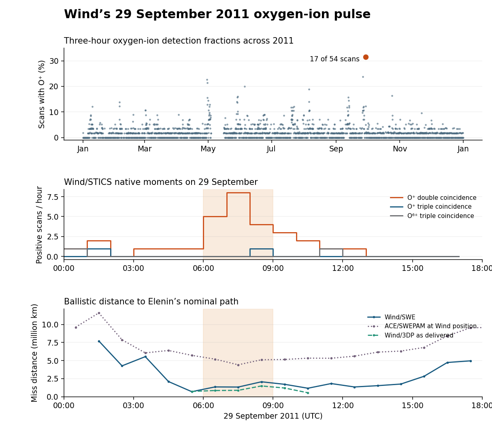

# Wind's strongest three-hour O⁺ occupancy of 2011 in a search for cometary pickup ions

On **2011 September 29, 06:00–09:00 UTC**, Wind/STICS recorded singly ionized oxygen in 17 of 54 solar-wind scans. That 31.48% double-coincidence occupancy ranks first among the 2,515 three-hour UTC bins in 2011 with at least 45 returned scans. The velocity-distribution product resolves 19 double-coincidence counts and one triple-coincidence count. The annual rank also survives shifting the three-hour bin origin by one or two hours. This is an extreme in the measured frequency of positive scans. Flux, production rate and source identity require additional information. [Wind data, annual comparison and geometry](wind/WIND.md)

This interval emerged during a comet-tail search. Trajectories reconstructed from local Wind/SWE velocities pass 0.70–2.07 million km from comet C/2010 X1 (Elenin)'s predicted position near the pulse. The co-located Wind/3DP instrument also sees a deflected flow. Substituting ACE winds gives 4.42–5.20 million km misses in the three event hours. Both calculations impose about a day of straight, constant propagation. The comet had already fragmented. Recent interplanetary coronal-mass-ejection activity, reaccelerated ambient ions and possible instrument spillover compete with any cometary attribution. The cataloged ejecta ended hours before the pulse. A CME wake need not end at its tabulated boundary. ACE/ULEIS independently recorded decaying energetic oxygen and iron intensities over September 26–30. The 40–90 keV/nucleon oxygen channel fell from 30.22 to 0.997 by September 29 and to 0.197 on September 30 in differential-intensity units. This higher-energy instrument does not resolve charge state. It demonstrates a heavy-ion background during the pulse without identifying the low-energy O⁺ measured at Wind. The evidence supports an archival oxygen pulse with an open origin. [ACE energy channels and daily measurements](ace/README.md) [Photometric history of Elenin](https://doi.org/10.1088/0004-6256/149/4/133)

The Wind analysis recovers enhanced oxygen-channel occupancy in a previously published 73P encounter as a positive control. Two additional comet–spacecraft geometries demonstrate why a speed-matched trajectory and a plasma change are insufficient for attribution. At STEREO-A, the February 2014 C/2014 C2 geometry lies inside an independently cataloged interplanetary coronal mass ejection and the tested helium channel was ordinary. At STEREO-B, the November 2009 169P geometry lies in a cataloged stream interaction region. [STEREO data and controls](stereo/README.md)

## Search denominator and limitations

The original screen retrieved 4,088 JPL SBDB comet records on 2026-11-15. Rounded osculating elements with 0.08 < q < 2.2 AU supplied a coarse, unperturbed orbital screen. It omits some SOHO objects without a reported absolute magnitude and limits modeled emission to within 2.8 AU of the Sun. It generated 3,282 modeled perihelion passages in its time interval and tested against 13 trajectory histories, including proxies at the centers of Venus, Mars and Earth. Histories include both mission operations and provisional future positions. A constant radial 400 km/s screen retained 125 coarse candidates below 0.048 AU. These are search records, and an extrapolated fragment orbit need not correspond to a surviving, active comet.

A selected 80 of those records entered a second screen with JPL Horizons perturbed orbits and nine trial speeds. Fifty-two returned at least one retained geometry (466 speed-specific records); 22 had no retained model and six queries were unavailable or ambiguous. The second screen prioritized close coarse misses and missions for which composition or flow data might be accessible. The per-query status is preserved. Event-level investigations focused on Wind and STEREO, selected after seeing the screening results; only those investigations have in situ evidentiary weight. Neither the candidate list nor the local time shifts yield a survey-wide probability for a comet identification. The per-event replay and heliophysics data have their own manifests. [Selection, ephemeris hashes and replay](selection/README.md)

The archive findings here are available for independent review. An independent O⁺ mass/charge or velocity-distribution reanalysis of the Wind pulse, and evidence for residual gas emission near the modeled injection time, could change the origin assessment.
