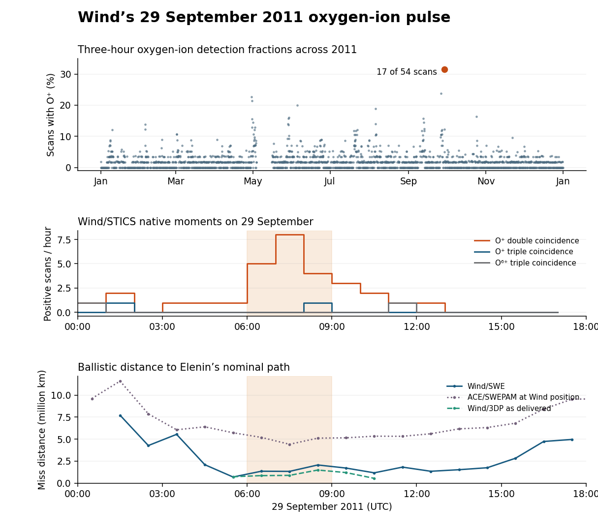

# A September 2011 oxygen-ion pulse at Wind

On 29 September 2011, 06:00–09:00 UTC, Wind/STICS recorded singly charged oxygen in 17 of 54 available three-minute double-coincidence scans. This was the highest fraction in the year's 2,515 disjoint UTC three-hour windows with at least 45 scans. The runner-up had 14 of 59 scans on 26 September. Elenin's nominal trajectory passes near straight-line backprojections of the plasma at Wind during the pulse. The oxygen measurements establish an annual extreme in this specific observable. They leave the ions' origin open.



## Measurements

- The level-2 velocity-distribution data resolve **19 double-coincidence counts** and **one triple-coincidence count** in the three-hour interval. The double-coincidence hits occupy 17 distinct scans, sectors 7–12, and 13.9–78.8 keV/e. Sixteen are in the central telescope, and 14 are in sectors 8–10 around the Sun direction. The triple-coincidence hit is at 08:28:18.925 UTC and 78.8 keV/e. STICS identifies double-coincidence species using energy-per-charge and time of flight. Triple coincidence also measures residual energy. Water-group molecular ions and isotope ratios are unresolved in this selection. [NASA data sources](https://wind.nasa.gov/data_sources.php) · [STICS release notes](https://spdf.gsfc.nasa.gov/pub/data/wind/sms/l2/wind_stics_lv2_release_notes_revD.pdf)
- With bin edges shifted forward by one hour, 07:00–10:00 UTC ranks first (15/53 of the scans in that window, 2,492 eligible windows). Shifting by two hours puts 05:00–08:00 first (14/55, 2,477 windows). With conventional UTC edges, the pulse also ranks first in absolute occupied scans and in occupied fraction if every nonempty bin is retained. These comparisons measure scan occupancy. The signal does not imply that the highest individual ion density of 2011 occurred here.
- The event bin has 24/54 proton triple-coincidence, 19/54 He⁺ double-coincidence and 0/54 O⁶⁺ triple-coincidence positive moments. The 26 September runner-up instead has H⁺ and He⁺ in all 59 scans and O⁶⁺ in five. The published 73P encounter provides a positive control. On 2 June 2006 the same pipeline recovers O⁺ in 148 double-coincidence and 50 triple-coincidence scans. [Gilbert et al.](https://doi.org/10.1088/0004-637X/815/1/12)

The pulse’s median double-coincidence energy was 49.6 keV/e, compared with 19.8 in the 26 September ICME interval and 17.5 in the third-ranked April bin. Two illustrative windows inside the known 73P encounter gave 78.8 and 46.9 keV/e. Solar-wind speeds and ion acceleration differ between these dates. The 26 September ICME itself placed 14 of its 16 double-coincidence counts in sectors 7–12, showing that directional concentration alone cannot distinguish cometary and other heliospheric ions. The energy and angle counts for all six windows appear in [wind_vdf_controls.csv](wind_vdf_controls.csv).

## Ballistic comparison

Using JPL Horizons states of Wind, Earth and Elenin, each hourly median Wind/SWE flow is rotated from GSE to ecliptic J2000. The projected GSE axes use the Earth–Sun direction and the J2000 ecliptic pole. For each receipt time the calculation minimizes the separation between the backprojected plasma and the moving comet over flight times of 0–3 days. The Wind project documents that its SWE level-2 flow already incorporates the mean Earth-orbit aberration correction. [Wind project data management plan, section 5.1.3](https://wind.nasa.gov/docs/Wind_PDMP.pdf) · [JPL Horizons](https://ssd.jpl.nasa.gov/horizons/)

| Receipt time UTC | SWE GSE vector (km/s) | Closest approach (million km) | Flight (days) |
|---|---|---:|---:|
| 05:30 | −555, +13, −21 | 0.70 | 1.10 |
| 06:30 | −578, +19, −37 | 1.36 | 1.05 |
| 07:30 | −586, +26, −38 | 1.34 | 1.03 |
| 08:30 | −575, +25, −46 | 2.07 | 1.05 |

The co-located Wind/3DP detector yields similar positive-Y, negative-Z deflections. Its as-delivered vectors at 06:30, 07:30 and 08:30 give misses of 0.86, 0.89 and 1.49 million km. Explicitly subtracting 29.78 km/s in Y as a sensitivity check gives 3.00, 2.50 and 2.86 million km. Substituting the unshifted vectors from nearby ACE/SWEPAM at the Wind coordinates gives 5.20, 4.42 and 5.12 million km. Instrument and spatial differences limit how far one point's measured flow can be extrapolated. All trajectories assume a constant velocity for about one day.

Of 160 circular shifts of the full 20-day three-hour ion series relative to fixed Wind/SWE geometry, five place a peak at least as high inside bins with median miss below 2 million km. Missing intervals shift with the particle record. The width, time window and geometry cut were examined during follow-up. The 5/160 comparison describes local rarity and cannot count the trials across mission, comet, observable and historical apparition choices. Some hourly Wind/SWE geometries are comparably close with few ions, and the smallest miss precedes the pulse.

## Competing physical explanations

Elenin's nucleus had already broken apart. Optical observations date the sequence to 18–30 August, with no surviving fragment above the roughly 40-m radius detection limit in the subsequent deep observations. An OH non-detection on 7 September also limited water production to 3 × 10²⁷ molecules/s near perihelion. Any proposed cometary oxygen near 28 September would need a post-breakup source whose gas production at that time has not been measured here. A directional O⁺ pulse can arise from other heliospheric pickup populations or energetic-particle transport; Sun-facing sectors alone cannot chemically tag the source. The Richardson–Cane catalog places the end of a September ICME at 15:00 UTC on the 28th. The Regnault et al. revision places it at 21:06, approximately nine hours before the pulse. Disturbed flow behind the ICME remains a physical alternative. The known August 2011 STEREO-B encounter with Elenin is a separate event. A repeatable source-specific composition test or multi-spacecraft detection would distinguish these explanations. [Li & Jewitt](https://faculty.epss.ucla.edu/~jewitt/papers/2015/LJ15.pdf) · [Richardson–Cane catalog](https://izw1.caltech.edu/ACE/ASC/DATA/level3/icmetable2.html) · [Regnault et al. catalog](https://idoc.osups.universite-paris-saclay.fr/CME_catalog/html/ACE-ICMEs-list-dates-quality-nosheath-forweb.html) · [STEREO-B identification](https://baas.aas.org/pub/2021n7i108p07/release/1)

## Replay

Run the following from this directory with Python, NumPy, pandas, SciPy and Matplotlib installed.

```sh
python replay_wind.py --output . --cache /tmp/elenin-wind-public-data
python plot_wind.py
```

The source manifest records every URL and the SHA-256 of its response. A different API export can format the same underlying measurements differently. The archived annual and local tables retain the number of returned records, species occupancy and all calendar gaps. The VDF table includes each nonzero cell in both oxygen modes for 05:00–11:00 UTC. No missing species value is interpreted as a physical density. The rank uses positive moments per returned native record.
