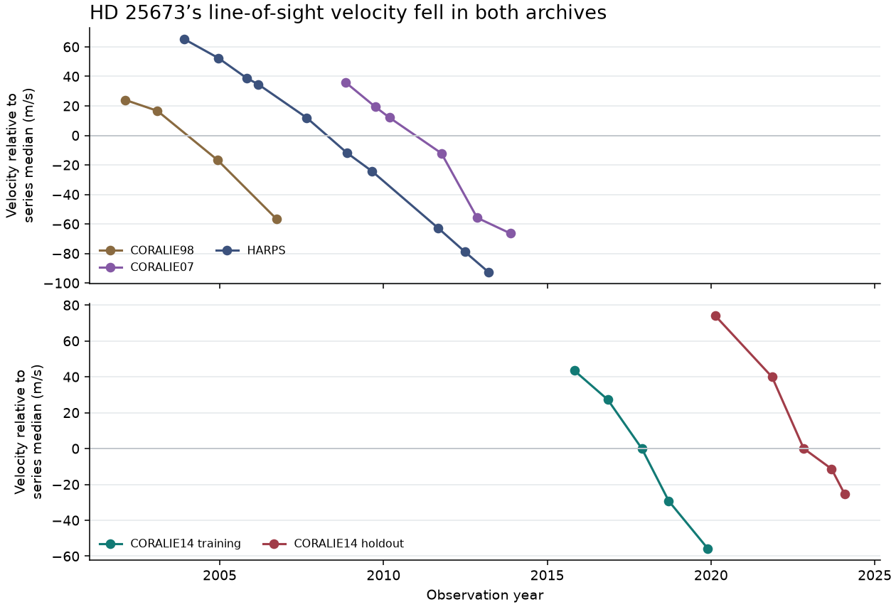

# CORALIE extends HD 25673's radial-velocity decline through 2024

**Noteworthy measurement · Measured.** New public CORALIE velocities extend a previously reported HARPS trend in HD 25673. The median annual line-of-sight velocity falls by **216.1 m/s** between the first and last years of the 2015–2024 Fabry–Perot series. Independently fitted portions of the modern record both yield a slope near −25 m/s per year. Earlier CORALIE configurations and separate HARPS spectra recover the same sign. Hipparcos–Gaia astrometry shows a large proper-motion discrepancy for the same star. The origin is unresolved and no companion orbit or mass is measured.

## A time-split test of the new archive

The November 2026 ESO Phase 3 release deposits calibrated CORALIE spectra from the Geneva Observatory planet-search program. The frozen archive query returned 19,322 spectra after 15 November 2014. Coverage in the two prescribed windows selected 84 target labels and 2,908 target-night spectra. The exact FITS header was recovered for each selected file. Eighty-three targets remained testable after quality, cross-correlation mask and annual coverage cuts. One target, HD 207467, had only three holdout years after cuts. [ESO release and citation](https://doi.org/10.18727/archive/106) · [Release description](https://www.eso.org/rm/api/v1/public/releaseDescriptions/259) · [Frozen protocol](PROTOCOL.md) · [Exposure receipts and values](headers.csv)

Seven stars passed both the 2015–2019 prediction and 2020–2024 holdout. All seven also had nominal Benjamini–Hochberg adjusted values below 0.10 for the combined permutation scores. The tests permute each phase's yearly medians and require that deleting any one year preserve the predicted direction. Their calibration depends on exchangeability within phase. A common instrumental drift or long-lived stellar variability can violate that assumption. The fitted sample median was positive in both phases, about +0.2 and +1.7 m/s per year. This sample statistic does not calibrate the instrument. [Full screen, controls and quality exclusions](screen-results.json)

| Name | Training slope (m/s/yr) | Holdout slope (m/s/yr) | Previously reported interpretation |
| --- | ---: | ---: | --- |
| HD 20010 | −11.65 | −1300.89 | Visual binary α Fornacis |
| HD 219077 | +15.83 | +21.72 | Long-period planet |
| HD 7449 | +32.13 | +35.00 | Planet and imaged M dwarf |
| **HD 25673** | **−24.16** | **−25.88** | Significant HARPS drift reported in 2022. Cause unresolved |
| HD 13724 | +39.15 | +23.74 | Includes a directly imaged brown dwarf |
| HD 80883 | +16.31 | +11.23 | Published planet and HARPS activity correlations |
| HD 157338 | −106.86 | −293.97 | Directly imaged stellar companion |

Known companions provide context for the trends. Identifying which body produces a slope requires an orbit and measurement model. The two quiet benchmarks, HD 10700 and HD 20794, stayed below 4 m/s per year in both phases. The known-companion benchmarks had mixed outcomes. HD 219077 passed. HD 211847's training window was nearly flat despite substantial later motion. Synthetic controls recovered a persistent injected slope and rejected a sign reversal. [Literature checks](literature-receipt.json) · [NASA planet queries](nasa-receipts.json) · [Gaia non-single-star queries](gaia-query.json)

## What the new CORALIE record adds for HD 25673

HD 25673 is HIP 19007 and Gaia DR3 source 3245657582441858688. Boulkaboul et al. already list its significant HARPS trend in 2022 under the Hipparcos identifier. Replaying the published HARPS RVBank observations gives an annual-median slope of **−17.28 m/s/yr** from 23 spectra obtained in 2003–2013. The second HARPS reduction of the same spectra gives −17.20 m/s/yr. The source and comparison establish an earlier drift in a different spectrograph. [Boulkaboul et al., Table 6](https://doi.org/10.1093/mnras/stac2674) · [HARPS RVBank v2](https://doi.org/10.1051/0004-6361/202348263) · [Exact HARPS measurements](harps-rvbank.csv)

In an exploratory follow-up we included every eligible archive night for the star in the listed windows, rather than the evenly spread subsample. The two earlier hardware configurations were fitted separately. The setup-change years 2007 and 2014 were left out. All four CORALIE slopes stayed negative when deleting any one year of their respective series.

| Configuration and interval | Usable nights | Annual slope (m/s/yr) |
| --- | ---: | ---: |
| CORALIE98, 2002–2006 | 32 | −17.88 |
| CORALIE07, 2008–2013 | 15 | −21.20 |
| CORALIE14, July 2015–2019 | 42 | −25.40 |
| CORALIE14, 2020–14 October 2024 | 19 | −25.50 |



The modern result is insensitive to dropping the one ThAr-referenced training night. The Fabry–Perot-only slopes were −25.39 and −25.50 m/s/yr for the two phases. A single line over all ten modern Fabry–Perot annual medians gives −27.01 m/s/yr. Even in five calendar years shared by HARPS and CORALIE07, their independently sampled slopes differed by about 2.3 m/s/yr. The measurements establish persistence across eras. Quantifying a physical change in the acceleration would require modeling cadence, instrumental effects, stellar variability and orbital curvature. The plot removes a separate velocity median from each series so that the vertical offsets cannot constrain an orbit. [Expanded exposure receipts](hd25673-headers.csv) · [All slopes and overlap checks](hd25673-results.json)

The published Hipparcos–Gaia Catalog of Accelerations gives a constant-proper-motion chi-square of **4593.05** on two degrees of freedom at the matched source. The numbers test the catalog's two most precise proper motions, usually Gaia versus the position-difference baseline. The expected line-of-sight perspective acceleration is only 0.044 m/s/yr from the Gaia proper motion and parallax. The selected Gaia DR3 orbit and acceleration-table queries returned no solution for this star. The 100-arcsecond Gaia source query found no obvious comparably distant resolved star. APOGEE adds seven visits spanning only 244 days and has about 54 m/s visit scatter, so it has little power on the multi-year drift. The spectroscopic line-shape and activity proxies leave stellar activity and blends incompletely tested. The separate astrometry supports dynamical follow-up, with no direct companion measurement in this analysis. [Published HGCA data identity](hgca-receipt.json) · [Gaia source and neighborhood](source.csv) · [APOGEE visit response](apogee-visits.csv)

## Reproduce

Use Python 3.14 with Astropy, NumPy and SciPy. The header fetch additionally uses requests. Plotting uses Matplotlib. The deposited [night selection](selection.csv) uses the exact [ESO metadata receipt](tap-receipt.json) and [coverage table](coverage.csv). The [HD 25673 query](hd25673-tap.json) and [frozen follow-up nights](hd25673-selection.csv) preserve the post-screen expansion. The archive receipts record the complete returned range and SHA-256 for each header sample.

Run from this directory with the published HGCA FITS identified in its receipt. The analysis reads the deposited CSVs. To verify the values against the originating bytes, use the staging command with a data directory on D or a different data drive and compare the replayed CSV with the committed bytes. The range endpoints may include a portion of the subsequent FITS extension.

```text
python screen.py headers.csv HGCA_vEDR3.fits replay-screen.json
python check_hd25673.py replay-hd25673.json --plot replay-hd25673.png
python stage.py stage selection.csv DATA_ROOT replay-headers.csv
python stage.py stage hd25673-selection.csv DATA_ROOT replay-hd25673-headers.csv
```

ESO should be credited as the source of the Phase 3 data, with the Geneva Observatory CORALIE programme credited under its release terms. The matching catalogs and each archival measurement are cited above. [ESO archive acknowledgment and citation](https://www.eso.org/sci/observing/phase3/policies.html)
