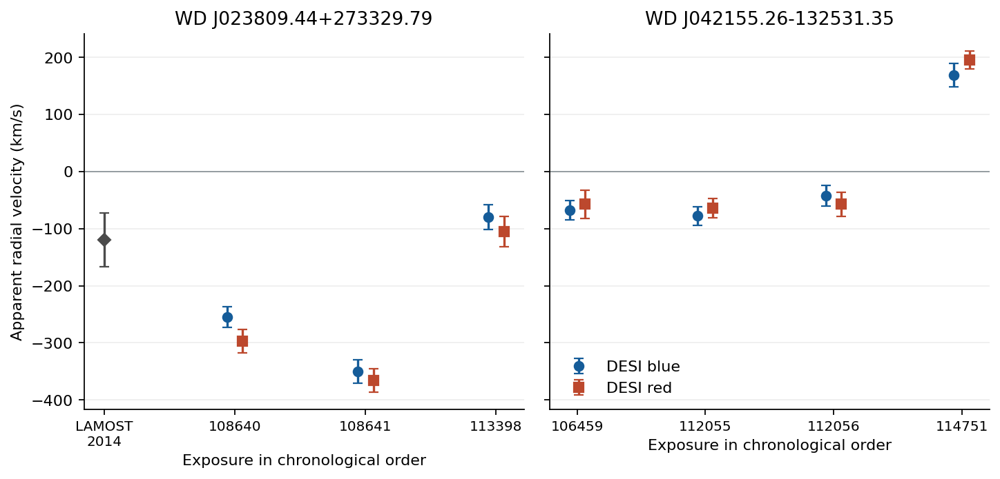

# Two hydrogen-atmosphere white dwarfs with large radial-velocity excursions

The visible white dwarfs **WD J023809.44+273329.79** (Gaia DR3 127800157802418304) and **WD J042155.26−132531.35** (Gaia DR3 3176896324264567552) exhibit shifts of about 250 km/s between DESI exposures. Hα, Hβ, Hγ and Hδ shift in the same direction in both stars. Orbital motion is a plausible explanation. The companion types, masses and periods remain open. Both stars were previously catalogued, including as photometric candidates for low-mass white dwarfs. The result here is their measured velocity variability.

## Measured excursions

The entries below are **later minus earlier** in km/s. Errors in the DESI columns include an 8 km/s per-epoch systematic allowance in quadrature. Dates use the DESI NIGHT identifier. The raw spectrum fits have formal errors conditional on the adopted profiles.

| Star | Earlier → later exposure | Days between BMJD values | DESI blue | DESI red | Hα line fit | Hβ line fit |
|---|---|---:|---:|---:|---:|---:|
| J0238+2733 | 108641 (2021-11-13) → 113398 (2021-12-11) | 27.812 | +270 ± 32 | +261 ± 35 | +248 ± 17 | +270 ± 27 |
| J0421−1325 | 112055 (2021-12-03) → 114751 (2021-12-19) | 15.987 | +246 ± 28 | +260 ± 26 | +264 ± 14 | +223 ± 16 |

J0238+2733 also accelerates within one night. Its two barycentric exposure midpoints on 2021 November 13 are 24.9 minutes apart. DESI finds blue/red changes of −95/−68 km/s. Individual Hα, Hβ, Hγ and Hδ fits change by −55, −96, −66 and −86 km/s. Integration times are 1,267 and 1,580 seconds, respectively. These are exposure averages. A third DESI exposure recovers a much less negative velocity. In J0421−1325 three exposures on two nights cluster in the lower-velocity state and the fourth reaches the higher state.

## A second telescope and a test for an orbital period

LAMOST observed J0238+2733 on 2014 November 2, seven years before DESI. Its DR12 spectrum (ObsID 257903093) yields −119 ± 47 km/s from the heliocentric redshift. That agrees within one formal standard error with the less-negative DESI state and differs by more than four from the most-negative state. LAMOST coadded three integrations, and its absolute estimate depends on the pipeline release. This is independent support for the higher-velocity state. LAMOST did not sample a full orbit.

The Gaia/ZTF checks yield no secure orbital period for either star. An apparent 0.94-mag i-band brightening of J0238+2733 coincides with an image trail that passes 0.22 pixel from the source centroid. The figure is derived directly from DESI measurements. Input checksums, the LAMOST FITS product, ZTF cutout and light-curve checks are in the [independent-survey evidence](independent/README.md).



## Selection and falsification

Swan et al. provide the public DA classifications and individual-exposure velocities. We used the hydrogen-model joint-fit velocities for a uniform template across the DA sample. The selection was exploratory. Of 63,968 catalogue entries, 11,285 have type DA, at least two nominal exposures and estimated DESI flux contamination below 5%. We excluded ambiguous exposure keys, then required both camera errors to fall between 0.5 and 70 km/s, |RV| below 1,500 km/s, masked fractions below 0.05 and continuum S/N above 6 (blue) and 4 (red). This leaves 15,152 exposures and 3,630 objects with at least two eligible exposures. We examined 36,761 within-star exposure pairs.

For a pair to pass, the red and blue changes must agree in sign and differ by less than three times their combined uncertainty. The score is the smaller of their two absolute change/error ratios. The search recovered the published 10.48-hour binary WD 1013−010 as rank 1 (12.75). J0421−1325 and J0238+2733 rank second (8.72) and third (7.42). These are ranking statistics across a selected sample. Neither is a calibrated survey false-alarm probability. Under the restricted null of Gaussian standardized errors with the adopted floor, even a union bound using just one arm gives 36,761 × erfc(7.42/√2) < 5 × 10⁻⁹. Non-Gaussian fitting failures and instrument behavior require empirical checks.

* **Profile check.** We fitted individual masked, inverse-variance-weighted spectra with a linear continuum and two Lorentzians sharing one centre. Hα at 6564.61 Å uses the red camera. Hβ, Hγ and Hδ at 4862.68, 4341.68 and 4102.89 Å use blue. All four lines keep the sign of the excursion at window half-widths of 35, 50 and 65 Å. The higher Balmer-line velocities for J0421−1325 scatter substantially (Hγ +180 and Hδ +334 km/s in the 50 Å fit). The formal errors do not fully capture line-profile uncertainty. The catalogue and our line fits share the same photons.
* **Field check.** Other repeat-observed DA targets on the same exposures have median epoch-minus-coadd velocities from −11 to +45 km/s over the two candidates' selected exposures and cameras. Counts are small (1–9 comparisons per camera), and coadds include the tested observation. These results disfavor a gross exposure-wide offset but leave fiber-specific effects possible.
* **Identity.** The exposures for each candidate carry the same DESI target ID. Both have catalogued flux contamination well below 1%. Line velocities reflect apparent photospheric Doppler shifts including the gravitational redshift. Constant gravitational redshift cancels in the differences. A blended moving spectrum or time-dependent asymmetry remains an alternative to one visible star orbiting a dark companion.
* **Prior reports.** Munday's 2026-11-09 catalogue has 314 valid sky positions. The nearest catalogued compact double white dwarf is 5.78° from J0238+2733 and 3.00° from J0421−1325. The positive control matches within 0.04″. Neither candidate's exact Gaia ID occurs among the 5,817 objects in HDU 1 of the SDSS-V DR19 DA-binary value-added catalogue v1.0.1. Their SIMBAD object bibliographies returned the Gaia WD, extremely-low-mass candidate and XP classification catalogues. Searches on 2026-11-15 used the full J names, Gaia IDs, GALEX J042155.2−132530, coordinate short forms and “binary” / “radial velocity”. This establishes a bounded prior-art check. Further spectroscopy with known individual exposure times can determine an orbit and test the companion interpretation.

## Reproduce

From this directory, the following command downloads versioned archive files, verifies their SHA-256 digests and writes the tables to a separate directory.

```sh
python replay.py --cache /tmp/desi-wd-input --output /tmp/desi-wd-results
```

Dependencies are Python 3.10+, NumPy, pandas, SciPy and Astropy. The exposure table preserves the archive MJD, barycentric midpoint BMJD, integration time (s), DESI identifiers and arm errors. Wavelengths are vacuum Å. The ranking table retains the calculation's first-minus-second sign convention, opposite the chronological differences above for these two candidates. Raw archive coordinates and timing conventions are those of the providers. See the versioned [input manifest](sources.json), [full exposure measurements](selected-exposures.csv), [line fits](balmer-lines.csv), [field comparisons](field-controls.csv), [coverage](coverage.json) and [catalogue matches](prior-catalogues.csv).

Data and credit: [Swan et al., DESI DR1 WD catalogue](https://doi.org/10.1093/mnras/stag1701), [Zenodo release](https://zenodo.org/records/23453342), [Warwick DESI spectra and column definitions](https://cygnus.astro.warwick.ac.uk/phsdaj/WhiteDwarfs/), [Munday compact DWD compilation](https://github.com/JamesMunday98/CloseDWDbinaries/tree/62e40b06c0aefae00d797803aa2b86b9b42c0a06), [SDSS-V DR19 value-added catalogue](https://www.sdss.org/dr19/data_access/value-added-catalogs/?vac_id=10029), [Adamane Pallathadka et al.](https://doi.org/10.3847/1538-4357/ae593f).
