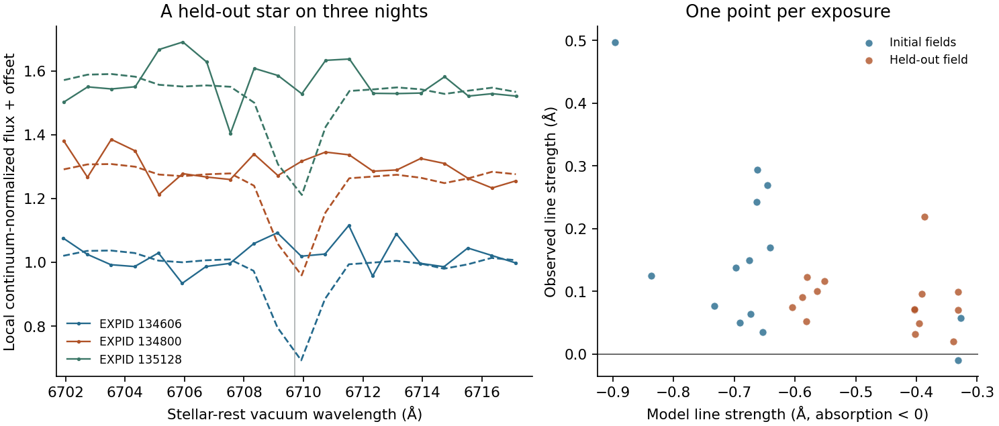

# A lithium template residual reproduces across independent DESI DR1 fields

**The blind three-camera search found 12 persistent, instrument-width positive residuals in 231 repeatedly observed stars. Every one coincides with the Li I resonance doublet near 6709.7 Å in vacuum.** Five such stars appeared in an independently selected field after the original seven prompted a written prediction. The fitted stellar models have deeper absorption than the calibrated data. Across all 29 triggering star-exposures, a fixed-centre fit gives residuals of 7.09–16.43σ; the same profile fitted directly to the data gives −0.26 to +4.48σ. This quantifies a repeatable false positive in a search for monochromatic light. Identification of the absorbing blend or stellar lithium abundance would require a different measurement. [Prediction](lithium_followup.md) · [Laboratory Li I wavelengths](https://physics.nist.gov/PhysRefData/Handbook/Tables/lithiumtable3.htm)

Left, solid curves show observed spectra and dashed curves show the release's fitted stellar models for TARGETID 39627699362209329. The three nights are vertically offset for display. Right, positive line strength means emission relative to a locally fitted straight continuum. Every matching template has a negative line strength. Both measurements use the same exposure-specific instrumental profile. [Measurements](measurements/) · [Figure code](plot_lithium.py)

## Search and independent checks

| Subset | Stars | Star-exposure observations | Single-arm exposure triggers at ≥7σ | Persistent features | At lithium |
|---|---:|---:|---:|---:|---:|
| Four initial groups and one held-out group, complete within each file | 231 | 633 | 295 | 12 | 12 |
| Same search, complete against all DR1 assigned exposures | 190 | 539 | 146 | 10 | 10 |

The strict sample matches every assigned EXPID from the independent tile assignment and exposure tables, including aliases known through the MWS Gaia crossmatch. The other 41 stars remain in the observational ledger only. Of the strict sample, 183 have a Gaia-based geometric distance. Counts refer to unique stars or star-exposure pairs as labeled. Cameras sharing an EXPID supply one observation. All five independent-field triggers repeated on three separate nights. [Per-target and per-exposure records](scans/) · [Selection funnel](field_summary.json) · [DESI catalogue](https://data.desi.lbl.gov/doc/releases/dr1/vac/mws/)

A fixed-centre follow-up used every one of the 137 held-out stars. Inverse-variance combining the available per-exposure integrated residual fluxes gives ≥3σ at 6709.7 Å for **89/137**, including **47/137** at ≥7σ. Neither prespecified comparison at 6697.7 or 6721.7 Å gives a single ≥3σ positive residual. At lithium, 132 stars have all three usable fixed-centre measurements. The median per-star difference in observed and model pseudo-equivalent width is +0.339 Å. These nominal significances use the extraction IVAR. Similar local model errors between nights can repeat. The three-wavelength test characterizes this template discrepancy separately from blind laser detection. [Analysis](field_summary.py) · [Fixed-centre fluxes](measurements/)

The 12 preliminary events have per-exposure dispositions. In 23 independently checksummed camera frames, 75 usable nearby sky controls had maximum absolute S/N 2.05 and 44 usable physical slit neighbours had maximum absolute S/N 2.58. On nine held-out target visits, only one or two sky controls were usable. Each event already fails the natural-transition criterion. [Control measurements and dispositions](measurements/) · [False-positive catalogue and literature](VETTING.md)

A separate all-release query counted 4,589,410 unique primary DESI TARGETID records with a clean Redrock STAR classification. Of these, 1,491,879 include at least two exposures in the primary coadd and 1,228,831 include two or more nights. Other programs can add visits. These counts measure available observations. [Exact query, response hash and counts](catalog/release_census.json)

## Search materials

The native B, R and Z spectra, masks, inverse variances and per-fibre line-spread matrices come from DESI DR1 Iron. Models and radial velocities come from the single-exposure RVSpecFit MWS VAC production 240521. Product checksums, exact query responses, exposure inventories, searched rest-frame intervals and all threshold crossings are archived. Stellar wavelengths are vacuum and DESI's supplied wavelength axis is barycentric. The method searches for an integrated line in every exposure. An isolated pulse or intermittent source can fail by design. [Input provenance](inputs/) · [Search and units](DETECTOR.md) · [Distance source](https://bailer-jones.www3.mpia.de/gedr3_distances.html)

## Injection recovery and power sensitivity

We injected 456,000 target/wavelength/flux combinations into the 190 strictly audited stars, using 160 independently drawn wavelengths per star and arm at five fixed fluxes. Each injection appears in every assigned exposure at the native fibre-specific resolution. The stellar fit is held fixed while local continuum, detection, width, centroid and persistence are re-evaluated. The post-extraction experiment includes real masked bins, existing noise and model mismatch. It excludes upstream extraction, refitting the stellar atmosphere, photon noise from a bright transmitter and candidate-specific manual review. The release fits its exposure-specific stellar model using a nominal Gaussian instrumental blur of 1.55 Å in B/R and 1.8 Å in Z. The measurements and injected lines use the released fibre-specific response. [Trial ledger and per-star power tables](sensitivity/) · [RVSpecFit model construction](https://arxiv.org/html/2505.14787v1)

In at least one arm, 168 stars reach a conservative 80% recovery bound conditional on joint coverage and clean reference wavelengths. Of these, 162 have Gaia distance estimates. The tightest such bound is 6.45 × 10²⁰ W apparent isotropic-equivalent line power in the B arm for TARGETID 39633332832571503 at 291.9 pc. Six stars reach a conditional 95% threshold. No star reaches 95% across an entire unmasked-and-masked arm. Blank cells preserve insufficient recovery or missing distances. Bounds require the one-sided exact confidence bound to meet the requested fraction at the reported and every brighter tested flux, with a five-level multiplicity adjustment. These powers assume isotropic-equivalent emission and zero extinction correction. An actual transmitter power depends on beam geometry. [Flux and distance quantiles in watts](sensitivity/power_limits.csv) · [Full recovery grid](sensitivity/recovery_grid.csv)
