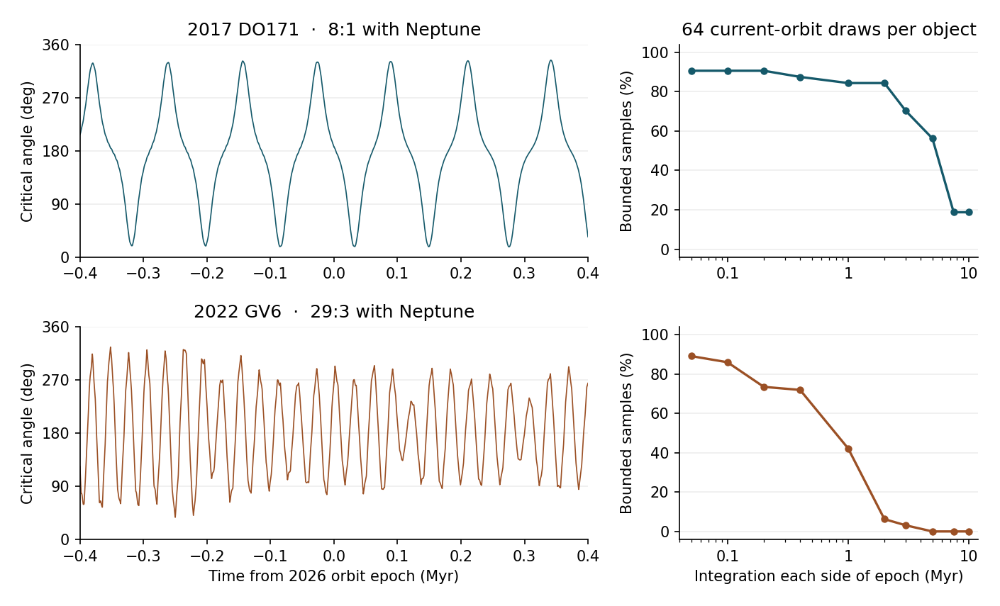

# Two distant candidates for orbital resonance with Neptune

**2017 DO171 is a candidate member of Neptune’s exterior 8:1 resonance.** The October 2026 best-fit orbit keeps its resonant angle oscillating around 180° throughout an integration spanning ten million years on either side of the present. The angle covers 346.0° across that 20-million-year trajectory, repeatedly reversing direction. The oscillation period near the present is about 124,000 years. In an 8:1 resonance the object completes one orbit during eight of Neptune’s.

**2022 GV6 shows evidence for temporary trapping in Neptune’s 29:3 resonance.** Its best-fit angle oscillates with a period near 29,000 years. It stays bounded throughout the interval from 400,000 years before the orbit epoch to 400,000 years after it. Extending the integration backward, the angle first spans 360° after about 443,000 years. Going forward it first spans 360° after about 5.29 million years. Those transition times depend on the orbit solution.

| Object | Updated orbit samples bounded over ±0.4 Myr | Over ±2 Myr | Over ±10 Myr |
|---|---:|---:|---:|
| 2017 DO171 | 104/128 | 54/64 | 12/64 |
| 2022 GV6 | 93/128 | 4/64 | 0/64 |

Each draw uses all six fitted orbital coordinates and their correlations. The counts measure sensitivity to the current orbit fit and gravitational model. They give no survey-wide false-positive probability. For 2017 DO171, most plausible trajectories support the present association across four million years, while only a minority preserve it across twenty million. [Matched sample at ten baselines](work/duration.csv) · [Full sample summary](work/current-summary.csv)

## What Rubin changed

The JPL fits used in the first screen end in 2019 for DO171 and 2022 for GV6. The Minor Planet Center subsequently incorporated **42 Rubin positions**, more than doubling each observation count. We propagated the newer MPC covariances and independently tested the older JPL sky predictions at Rubin's observing site and exact exposure times.

| Object | JPL → MPC observations | Rubin nights | Median new-position offset from old prediction | Old JPL draws bounded across ±0.4 Myr | Updated MPC draws bounded across ±0.4 Myr |
|---|---:|---:|---:|---:|---:|
| 2017 DO171 | 14 → 30 | 4 | 1.116″ | 66/128 | 104/128 |
| 2022 GV6 | 18 → 44 | 8 | 0.161″ | 61/128 | 93/128 |

The offsets lie within the older fits’ formal uncertainties. All 42 positions enter the newer MPC fits. The old-to-new comparison therefore includes a longer arc, different fitting software and different force models. Additional oppositions can move a fitted orbit across the boundary between libration and circulation. [Exposure IDs, source digests and held-out residuals](rubin-astrometry/README.md) · [MPC coordinate and covariance conventions](https://docs.minorplanetcenter.net/tutorials/notebooks/mpc_tutorial_orbit_to_assist/)

## Search and falsification

The frozen JPL query returned **81 objects** with heliocentric semimajor axis 113–400 au, perihelion distance 29–60 au and an observed arc longer than 720 days. All JPL catalog rows have epoch JD 2461200.5 TDB. Selection on heliocentric osculating elements makes the sample incomplete for a specified barycentric resonance. We tested **708 object–angle pairs**. For each denominator 1, 2 and 3, we tested integer numerators from one below the floor to one above the ceiling of the estimated numerator, reducing to coprime pairs. The estimate uses the median barycentric semimajor axis during the nominal integration and 30.07 au for Neptune. [Pre-integration protocol](PROTOCOL.md) · [Frozen catalog](work/catalog.json) · [Every trial](work/screen.csv)

For an exterior p:q eccentricity-type resonance the critical angle is φ = pλ − qλₙ − (p−q)ϖ, where λ and λₙ are the object's and Neptune's mean longitudes, and ϖ is the object's longitude of perihelion. A near-integer period ratio alone cannot establish a resonance. We tested whether the angle repeatedly reversed within a restricted range. The principal model treats the four giant-planet systems as massive perturbers. The Sun and terrestrial masses form a common central body at their barycenter. Coordinates and velocities initially come from DE440s with the J2000 mean ecliptic. JPL’s heliocentric elements were converted with a solar-mass primary at the Sun. REBOUND outputs Jacobi elements, so the massless particle orbits refer to the massive-system barycenter and Neptune to bodies interior to its Jacobi index. The MPC epoch is MJD 61200 TT. The millisecond-scale TT–TDB difference is neglected in the initial dynamical epoch. [JPL gravitational parameters](https://ssd.jpl.nasa.gov/astro_par.html) · [DE440 and DE441](https://doi.org/10.3847/1538-3881/abd414)

The 400,000-year nominal screen sampled every 100 years. A circular arc under 340° selected 20 trials. Each received a one-million-year forward integration from its JPL covariance epoch with eight random draws and a nominal orbit. The tighter two-object analysis uses the same draw in both directions and measures the joint unwrapped range from the most negative to the most positive angle. The recorded acceptance cut is a range below 355°. Changing it to 360° gives identical MPC summary counts. A slowly winding angle can pass a finite-duration range cut. We therefore checked successive turning points, extended the time range, and repeated integrations with different steps and force models. Numerical cuts and the sizes of later samples were chosen during analysis. Other resonant angles involving nodes or different perihelia were outside the screen.

| Independent calculation | 2017 DO171 | 2022 GV6 |
|---|---:|---:|
| Four giants, nominal joint angle range across ±0.4 Myr | 316.3° | 288.5° |
| Eight planets, nominal past / future range across 0.4 Myr per direction | 314.2° / 316.3° | 287.1° / 217.6° |
| Largest WHFast vs adaptive IAS15 angle difference in first 100,000 yr | 0.007° | 0.022° |

The eight-planet calculation resolves Mercury with a 7.305-day step. Halving the four-giant WHFast step from 0.5 to 0.25 year gives a DO171 best-fit span of 322.4° across ±2 Myr, compared with 323.1° at the original step. Both step sizes give backward circulation for GV6. Long-term trajectories diverge chaotically. The integrations omit passing stars, Galactic tides and any hypothetical distant planet. [Eight-planet outputs](work/eight-planet.csv) · [Current clone runs](work/mpc-clones.csv)

## Controls and earlier reports

The screen recovers 2020 VN40 at 10:1 and 2007 TC434 at 9:1. The nearby 7:1 angle for DO171 spans 359.3° in the nominal screen. The apparent 36:1 for Alicanto and 79:2 for 2010 GB174 are already in the Volk and Van Laerhoven catalog. Their *figure* for (445473) 2010 VZ98 explicitly shows the 23:2 critical angle we recover, even though its table entry says scattering. We count VZ98 as a positive control for temporary trapping. Our best-fit VZ98 angle oscillates with a roughly 36,000-year period near the present and eventually circulates. [Original VZ98 figure](https://github.com/katvolk/TNO-classifications/blob/4b1b081fa0b847034a94c1b154e971506629b36b/10Myr-classification-integration-plots/445473_10Myr.png) · [Classification catalog](https://github.com/katvolk/TNO-classifications) · [2020 VN40 discovery paper](https://doi.org/10.3847/PSJ/addd22)

Prior-art checks on 2026-11-15 used the provisional and packed designations, both orders of resonance ratios, “resonant” and “libration”. We checked the discovery reports, DES dynamical classifications, and Volk and Van Laerhoven's December 2023 table. KMTNet described GV6 as detached using an early orbit. DO171's July 2024 discovery circular postdates that catalog. Bernardinelli et al. report a different 8:1 member, 2014 RV86. Smirnov's 2025 survey stops at 100 au. We found no earlier identification of these two object-specific associations in the sources checked. A catalog that uses internal survey names could contain earlier work. [KMTNet report](https://meetingorganizer.copernicus.org/EPSC2022/EPSC2022-338.html) · [Dark Energy Survey paper](https://www.osti.gov/servlets/purl/1833281) · [Smirnov 2025](https://doi.org/10.1016/j.icarus.2025.116584)

## Reproduce

Use Python 3.12, REBOUND 4.6.0, jplephem 2.24, NumPy, SciPy and Matplotlib. The bundled inputs include the full-precision JPL query, every shortlisted covariance, the current MPC fits and the Rubin exposure comparisons. Run the commands below from this directory. The first downloads and checksums the 32.7 MB DE440s kernel and the pinned prior-classification catalog. The primary model and the eight-planet cross-check use JPL's adopted 1976 ecliptic obliquity. Long-time chaotic divergence can vary across software builds. Only the summary and the astrometry replay need to be run for an offline review of the committed tables.

    python fetch_new.py
    python dynamics.py
    python clones.py
    python targets.py
    python deep.py
    python episode.py
    python current.py
    python duration.py
    python model_check.py
    python replay_tables.py
    python summary.py
    python figure.py
    python prior.py
    python rubin-astrometry/check_astrometry.py

The numerical times describe integrated orbits. The directly observed quantities are sky positions. A new multi-opposition orbit solution that circulates without repeated angle reversals would falsify the proposed present association on the tested interval.
