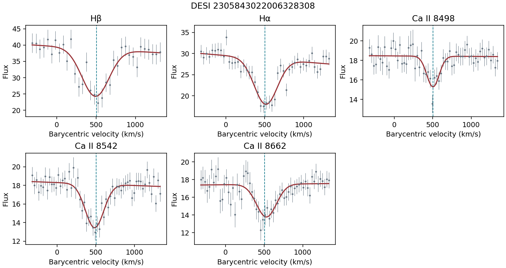
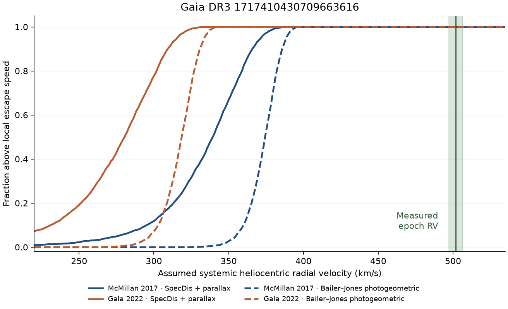

# A candidate unbound star with a 657 km/s Galactic-rest-frame line-of-sight velocity

**Gaia DR3 1717410430709663616 is a candidate for ejection from the Milky Way disk.** Five absorption lines support a heliocentric radial velocity near +502 km/s in one DESI exposure. Its inferred Galactocentric speed is **697 km/s** (691–703 km/s, central 68% interval) on the Bailer–Jones photogeometric distance scale. All 4,096 draws escape in each of two reference Milky Way potentials. An older, substantially more massive halo binds all 4,096 draws on that same distance scale. A second independent radial-velocity epoch is needed to test whether the measured speed describes the star's centre of mass.

The star has no match in our 21-source literature index. Discovery priority remains open. The traceback favours a crossing of the ordinary Galactic disk. The search established no ejection from Sgr A* or the LMC centre above 1,000 km/s and provides no LMC black-hole mass constraint. [Literature cross-match](literature/README.md) · [Survey selections and methods](METHODS.md)

## The spectrum and six-dimensional state

DESI target **2305843022006328308** lies at ICRS **180.196178°, +78.794712°**. Observation 134274 on 2022-05-11 has clear fibre status, RVSpecFit warning mask zero, and a Redrock stellar classification. RVSpecFit measured +503.49 ± 4.20 km/s. The published backup-program calibration subtracts 1.75 km/s. We use **+501.74 ± 4.65 km/s**, including a 2 km/s systematic floor. The five line centroids span +483 to +529 km/s. The DESI spectra share a single epoch, and Gaia DR3 supplies no RV. The archive searches for independent spectroscopy, and their footprints, are recorded in the [DESI audit](desi/README.md).

| Quantity | Estimate | 16th–84th percentiles |
|---|---:|---:|
| Heliocentric distance (kpc) | 4.45 | 3.75–5.20 |
| Galactocentric X, Y, Z (kpc) | −10.18, +2.83, +2.77 | [−10.53, −9.86], [+2.39, +3.32], [+2.34, +3.23] |
| Galactocentric VX, VY, VZ (km/s) | −307.5, +577.6, +238.6 | [−322.9, −293.5], [+573.8, +581.5], [+224.6, +250.9] |
| Local escape speed, McMillan 2017 (km/s) | 577.7 | 572.9–582.2 |
| Local escape speed, Gala 2022 (km/s) | 527.0 | 522.1–531.6 |
| Local escape speed, Irrgang 2013 Model III (km/s) | 790.3 | 786.5–793.8 |

The Galactocentric frame places the Sun at negative X. Gaia gives RUWE 1.046, parallax 0.1733 ± 0.0689 mas and a −0.0254 mas zero point. Nine distance treatments give median speeds of **694–714 km/s**. The line-of-sight component alone is +657.0 km/s in the adopted frame. On the reference distance scale, a systemic heliocentric RV around +374 km/s would put the star at the larger of the two reference escape speeds. A binary could produce that difference. Sparse ZTF photometry supplies 12 g-band and 24 r-band measurements, with 5th–95th percentile ranges of 0.089 and 0.067 mag. The light curve cannot establish a systemic RV. [Binary-motion sensitivity](systemic_rv.csv) · [Photometry](ztf_summary.json) · [High-mass halo calculation](heavy_halo.csv)

## Origin

With the photogeometric distance, the first backward plane crossing falls **7.40 kpc from the Galactic centre** (7.32–7.56 kpc), **10.9 Myr ago** (8.7–13.3 Myr). Its median speed relative to the rotating disk there is 519 km/s. The SpecDis-plus-parallax model gives 7.70 kpc and 18.5 Myr. In each of those two ensembles, **0/256** orbits passed within 1 kpc of Sgr A* or within 5 kpc of the moving LMC centre during 300 Myr. A plane crossing identifies a possible ejection site. Its geometry cannot distinguish a supernova-disrupted binary, dynamical ejection, or an unrelated passage through the disk. [Orbit ensembles](candidate_origins.csv) · [Integration step test](convergence.csv)

## Other candidates and distance tests

All speeds below are Galactocentric km/s. The two probabilities use the same Bailer–Jones photogeometric distance posterior and the McMillan/Gala potentials, in that order. The linked tables give coordinates, survey IDs, velocity uncertainties, all six Cartesian components with intervals, escape probabilities and model-specific traceback results for every displayed object. [Candidate states](candidates.csv) · [Distance-model comparison](candidate_models.csv) · [Origins](candidate_origins.csv)

| Gaia DR3 source | Speed (central 68%) | Unbound fraction | Evidence that changes the interpretation |
|---|---:|---:|---|
| 1717410430709663616 | 697 (691–703) | 1.000 / 1.000 | Five lines, one epoch. Systemic velocity and halo mass remain decisive. |
| 4444095982221534720 | 623 (615–632) | 0.740 / 1.000 | Heliocentric RV +473.5 ± 5.9 km/s, one exposure. A geometric distance lowers McMillan's fraction to 0.119. Typical orbits cross the inner disk several kpc from the centre. |
| 2752545725694798336 | 652 (496–831) | 0.672 / 0.776 | Eleven exposures over four DESI nights and an SDSS spectrum support the RV. Single-dwarf photometry gives 335 km/s. Gaia GSP-Phot gives about 183 km/s. |
| 6340918677332110720 | 810 (663–984) | 0.912 / 0.955 | Two DESI nights agree. SPDist fails two quality checks. A dwarf distance gives 433 km/s. The long-distance orbit crosses the plane well outside the main stellar disk. |
| 4435527217525195264 | 1,103 (777–1,309) | 0.947 / 0.964 | Two exposures on one night. SDSS dwarf photometry gives about 0.86 kpc and 321 km/s. |
| 4550108286326235520 | 1,181 (907–1,388) | 0.992 / 0.996 | One exposure. Pan-STARRS dwarf photometry gives about 0.98 kpc and 351 km/s. |
| 2294414169958935296 | 504 (452–558) | 0.049 / 0.210 | The only survivor of the nearby two-distance speed screen with a clean agreeing RV fit. SPDist favours bound motion. |
| 4406622293782568192 | 685 (460–830) | 0.584 / 0.651 | The public DR19 MINESweeper catalogue already gives positive orbital energy. A different BOSS surface-gravity estimate permits a much shorter distance. |

## Search depth and false positives

| Search or control | Measured outcome |
|---|---|
| DESI DR1 SpecDis v2.1, full file | 4,140,838 rows read. 2,451,161 pass the astrometric and distance quality cuts. 2,209 catalogue rows have nominal speed ≥550 km/s. |
| DESI corrected parallax S/N ≥5 | 1,486,185 rows in the quality sample. 13 exceed 550 km/s on both the inverse-parallax and SpecDis scales. Twelve fail the follow-up RV test. |
| Independent DESI radial-velocity screen | 4,640,216 eligible stellar coadds. Of 57 with absolute Galactic-rest-frame line-of-sight speed >580 km/s, 50 have two pipeline velocities differing by >60 km/s. All 20 above 1,000 do. |
| DESI control | The same discrepancy occurs in 1/4,641 random control rows and 0/57 controls matched on observing program and signal-to-noise. The pipelines share photons. |
| SDSS-V DR19 MWM | 708,309 distinct eligible stars across BOSS and APOGEE, 501 high-speed screening leads. Of 361 APOGEE coadds with absolute RV ≥650 km/s, 89 have a Gaia RV with uncertainty ≤15 km/s. All 89 disagree by >100 km/s. The same discrepancy occurs in 0/1,315 all-speed APOGEE controls with a precise Gaia RV. |
| Positive orbit control | For S5-HVS1 the same machinery recovers a first plane crossing 4.73 Myr ago, with 250/256 draws passing within 1 kpc of the Galactic centre. The input distance was inferred independently of a Galactic-centre origin. |

The RV controls measure discordance within specified comparison sets. They do not estimate the fraction of genuine unbound stars among all sources. The catalogues overlap, and the table counts represent different observing units. [DESI flags, visits, spectra and controls](desi/README.md) · [SDSS visits, spectra and controls](sdss/README.md) · [Positive control](positive/orbit.csv) · [Replay, input hashes and limits](METHODS.md)
