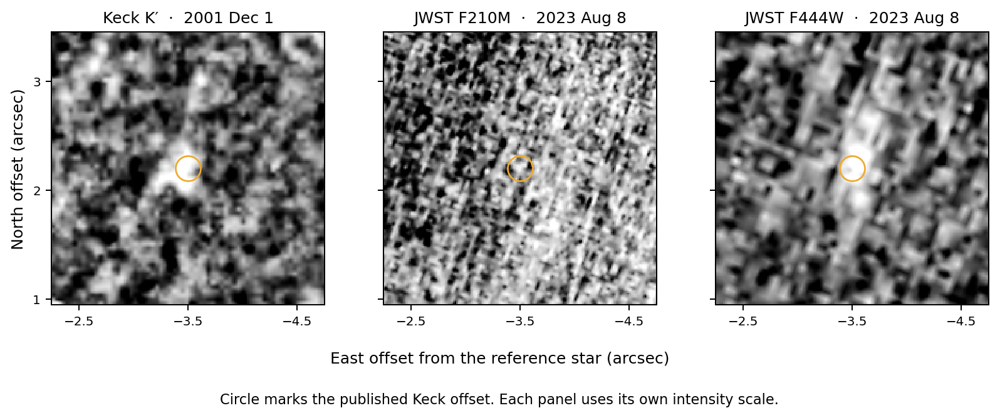

# A possible 2001 Keck counterpart to JWST source S2 near ε Eridani

The elongated JWST source S2, described in 2025 as previously undetected, overlaps the position of **Macintosh et al. (2003) source 7**. Five original 2001 Keck frames and the 2023 JWST F444W mosaic reproduce the association to **0.183 arcsec** relative to a bright field object. The evidence supports a historical positional identification. The Keck and JWST measurements can also arise from different components within an extended object or a chance projection. The large discrepancy near 2.1 μm merits a check with matched extended-source photometry.

## What was measured

The observing unit is one image of the source pair. The local reference is Keck source 1, identified here with JWST HST 1. East is positive in right ascension multiplied by cos(declination), and north is positive in declination. Subtracting each catalog's reference removes the primary's proper motion, parallax, and translation errors.

| Measurement | East of reference (arcsec) | North of reference (arcsec) |
|---|---:|---:|
| Keck source 7, published 2001 offsets | −3.500 | +2.200 |
| JWST S2, published Table 4 offsets | −3.550 | +2.380 |
| Keck, remeasured in the five 2001 December 1 west-field frames | −3.433 | +2.166 |
| JWST F444W, remeasured in the 2023 August 8 mosaic | −3.568 | +2.290 |

The catalog vectors differ by 0.187 arcsec. The original Keck paper quotes typical 0.2 arcsec errors for individual positions relative to the primary. The independent image measurement compares two wavelengths and different source morphologies. A Gaussian fit gives S2 widths of 0.72 × 0.23 arcsec and the reference widths of 0.19 × 0.14 arcsec in the same JWST mosaic. These are image-plane widths, including the PSF. The Keck/JWST centroid difference falls within the elongated source's footprint. The centroids alone cannot establish a motion or a common physical emitter.

The Keck source/reference count ratio is 0.060 in a 3.5-pixel (0.139 arcsec) aperture. Omitting each of the five frames in turn gives 0.056–0.068. Keck's published difference of 3.0 mag corresponds to a ratio of 0.063. The omissions share a five-frame sky estimate and help diagnose single-frame artifacts.

## Independent position test in the JWST pixels

We placed a 0.22 arcsec aperture at the **Keck catalog offset** from the JWST reference before fitting S2. The control apertures rotate the same offset about the reference in six-degree steps. They probe image residuals near the pair. They do not estimate the probability of a chance astrophysical alignment or correct for selecting this pair after inspecting catalogs.

| 2023 band | Target aperture (μJy) | 59 control apertures, median (μJy) | Scaled MAD (μJy) | Controls at least as bright |
|---|---:|---:|---:|---:|
| F444W | 0.956 | +0.016 | 0.192 | 0/59 |
| F210M | 1.117 | −0.036 | 0.952 | 6/59 |

These are local-background-subtracted aperture sums with no aperture, mask-throughput or coronagraphic self-subtraction corrections. In F444W the excess is 4.9 times the local control scatter. The two August rolls contribute to one archive mosaic. In the individually calibrated images the bright reference is readily identifiable in observation 061. Its expected position is dominated by residual structure in 063, which cannot serve as an independent clean confirmation.

Llop-Sayson et al. report 8.8 ± 1.4 μJy at F444W, a 5σ upper limit of 0.17 μJy at F210M, and a MIRI detection. Their F210M reference-source flux is 31.79 μJy, implying an S2/reference ratio below 0.0054. The ratio from the Keck K′ image is eleven times that upper bound. Different filters, spatial extent, structured noise and reduction throughput limit a variability interpretation. The independent F210M mosaic extraction above is too noisy to reproduce the published limit. Resolving the photometric discrepancy requires measurements with a common extended template, throughput calibration, and a new epoch or an independent near-infrared image. Neither a stellar companion nor a transient follows from these measurements.

## Provenance and previous work

- Macintosh et al. detected #7 in K′ and classified it with the relatively stationary field population. Their Table 3 gives offsets and magnitudes. [ApJ 594, 538, Table 3](https://doi.org/10.1086/376827)
- Marengo et al. propagated the Keck positions to Spitzer. Source 7 fell below their PSF-subtraction residuals. Their Table 4 lists a Keck position, with no measured IRAC position for this target. [ApJ 647, 1437](https://arxiv.org/abs/astro-ph/0605187)
- Proffitt et al. linked Keck sources 4 and 6 to optical galaxies. Source 7 was outside their useful field. [ApJ 612, 481](https://arxiv.org/abs/astro-ph/0405319)
- The JWST discovery paper reports an elongated S2 and interprets it as a likely galaxy. Its Table 4 credits HST and ALMA detections for several other sources. The Keck identification is absent from this discussion. [NIRCam paper, Fig. 1 and Table 4](https://arxiv.org/html/2508.08463v1) · [JWST dataset](https://doi.org/10.17909/6dgc-5086)

## Reproduction

Use Python 3.11+ with NumPy, SciPy and Astropy. The tested versions are NumPy 2.3.5, SciPy 1.17.0 and Astropy 8.0.2. From this directory run `python reproduce.py --cache /path/to/fits-cache --output /path/to/results`. The script retrieves approximately 430 MB of public FITS files, verifies their SHA-256 digests and writes the Keck and JWST CSVs. The MAST mosaics used JWST calibration pipeline 3.0.0 and context jwst_1584.pmap. A later archive reprocessing can change the product bytes.

The Keck reduction uses a per-frame median subtraction, a five-frame median sky, a bad-pixel filter and an unsharp mask. It registers each frame to source 1 and fits Moffat profiles to the two sources. The detector orientation comes from the FITS CD matrix, with both off-diagonal terms negative, and scale 0.039686 arcsec/pixel. The JWST reduction uses the FITS science-plane WCS, identifies the reference in a small search box and applies the published Keck vector. It fits an elliptical Gaussian to the F444W peak for the independent position comparison. Gaussian widths and rotated-aperture ranks are descriptive. All seven product IDs, original download URLs and digests are in manifest.csv.

To regenerate the registered cutouts, install Matplotlib and run `python plot_cutouts.py --cache /path/to/fits-cache --output source-cutouts.png`.
