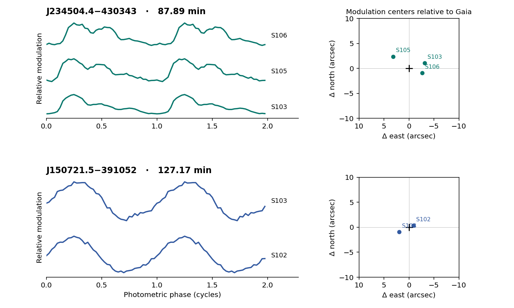

# Two optical clocks in eROSITA cataclysmic-variable candidates

The optical counterpart of **1eRASS J234504.4−430343** (Gaia DR3 6532165251671628416, TIC 2055659613) varies every **87.89 minutes**. The modulation is the highest peak in three TESS sectors, explains 23–42% of the detrended flux variance, and includes strong harmonics. The Gaia DR3 cone centered on the target contains no other catalogued source within 40 arcseconds. **1eRASS J150721.5−391052** (Gaia DR3 6197581939197319168, TIC 122051630) has a **127.17-minute** clock in two TESS sectors. Both stars are known eROSITA CV candidates. Schwope et al. classified them as a candidate dwarf nova and a candidate magnetic CV respectively. Their Table 5 provides neither period. The authors stopped their TESS analysis at sector 96. [eROSITA identification paper and table](https://arxiv.org/html/2607.28066v1)

| eROSITA source | Sector | Good 2-minute samples | Photometric period (min) | First / second half power at the sector peak | Modulation-center offset |
|---|---:|---:|---:|---:|---:|
| J234504.4−430343 | 103 | 14,779 | 87.8884 ± 0.0008 | 0.46 / 0.39 | 0.16 pixel |
| | 105 | 15,182 | 87.8810 ± 0.0024 | 0.18 / 0.27 | 0.20 pixel |
| | 106 | 12,099 | 87.8912 ± 0.0043 | 0.31 / 0.29 | 0.14 pixel |
| J150721.5−391052 | 102 | 15,724 | 127.1817 ± 0.0120 | 0.23 / 0.27 | 0.05 pixel |
| | 103 | 15,320 | 127.1609 ± 0.0036 | 0.30 / 0.37 | 0.11 pixel |

Uncertainties are eight-block delete-one jackknife standard errors within each sector. The sector-to-sector range is more appropriate when predicting a future phase. A photometric period may trace an orbit, superhump, rotation, or a harmonic. These data do not select a physical interpretation. The doubled periods have little sinusoidal power at half frequency (under 0.0003 for the two main sources), though a symmetric double wave can still hide a longer orbit. For J234504.4 the repeating non-sinusoidal waveform has measurable second and third harmonics in all three sectors. No spectroscopic ephemeris or independent observatory confirmation is claimed.



Each curve shows 40 median phase bins over two cycles, independently scaled to its largest absolute bin, shifted to a common maximum phase and vertically offset. The right panels give the fitted sky offsets from the Gaia optical counterpart (cross).

## Two earlier epochs recover the 87.89-minute clock

A separately extracted 5 × 5 pixel full-frame light curve of J234504.4−430343 ranked the same peak first in sector 2 (2018) and sector 29 (2020). These add 1,196 and 3,572 independent cadences to the 2026 SPOC light curves. The earlier epochs span different exposure times, 30 and 10 minutes. This gives five sector recoveries over almost eight years. They do not determine an unambiguous orbital cycle count across that interval.

For J150721.5−391052, the 127-minute peak also ranks first in sector 38 (2021, 3,464 cadences). The longer-cadence sector 11 aperture (2019, 942 cadences) has its strongest peak at 2.653 cycles/day, and fails to recover the predicted frequency as its highest peak. These are same-instrument measurements at separate epochs, with a distinct reduction.

The aperture uses pixels whose centers are within 1.6 pixels of the Gaia position, and subtracts the median of pixels outside a 2.2-pixel radius. We subtract a 0.6-day running median, clip at four robust standard deviations and search from 2 cycles/day to 0.49 divided by the median cadence in days. The observation dates, SHA-256 values, original cutout URLs, frequency grid maxima and power at the fixed later-sector frequency are in [early-sectors.json](early-sectors.json). Reproduce with `python replay_ffi.py --id 156 --cache /tmp/erass-cv-data` and ID 110 for the magnetic CV candidate.

## How these sources were found

The starting set comprised the 116 Table 5 rows with a blank primary period among 156 objects. Their Gaia DR3 identifiers were resolved to coordinates. A two-arcsecond VizieR TIC 8.2 cone supplied candidate TIC identifiers. These were matched against TESS 2-minute light-curve manifests requested for sectors 90–111. The screen had 111 accessible star-sector products for 66 distinct Table 5 rows. The target selection, covered product names and each sector's highest peak are in [search-coverage.csv](search-coverage.csv). Empty entries denote no matched light curve in this screen. The per-sector rankings were exploratory. This is not a significance-calibrated catalogue of every detection.

For each SPOC light curve, we use all finite PDCSAP measurements with QUALITY zero, subtract a running 251-cadence median and clip at five robust standard deviations. The discovery periodogram fits one sinusoid on a 2–200 cycles/day frequency grid sampled six times per Rayleigh width. Each sector is searched independently. Refinement fits two Fourier harmonics in a local frequency window. For J234504.4, 42,060 measurements enter the three independent sector fits. Fractional amplitudes of the counterpart depend on blending and the pipeline aperture correction. The sector table records the amplitudes in electrons/s and CROWDSAP.

For localization we fit sine/cosine coefficients at the **sector's blind peak** to every finite target pixel, projecting out a separate intercept and slope per half day. The signed modulation map is projected onto the phase of the strongest pixel, then fitted with a rotated elliptical Gaussian and a constant. We compare its center with the Gaia position projected using the aperture extension's WCS. One TESS pixel spans approximately 21 arcseconds. Model centroids have systematics and cannot resolve arbitrary subpixel companions. For J150721.5, the nearest Gaia source is 6.24 arcseconds away and a brighter 24.977-day VSX variable is 9.06 arcseconds away. Both sectors place the short-period modulation within 2.4 arcseconds of the CV. For J234504.4, crowding factors of 0.03–0.06 warrant caution even with the isolated Gaia cone and repeatable centroids. [TESS data product documentation](https://heasarc.gsfc.nasa.gov/docs/tess/data-products.html)

## Prior identifications and rejected signals

We checked exact eROSITA and Gaia names, TIC identifiers, catalogued aliases, 10-arcsecond VSX and SIMBAD cones, and 40-arcsecond Gaia cones. For J150721.5 the SIMBAD cone returned the X-ray alias 1RXS J150721.5−391056. The VSX entry for this Gaia source lists CV and has an empty period. J234504.4 returned no entries in these VSX and SIMBAD cones. The search located no earlier period measurement for these two targets. This is a bounded literature check. The catalogued starting objects, including the suspected nature of their accretion, belong to the identification paper. Catalog extracts appear in [catalog-checks.json](catalog-checks.json). [VSX through VizieR](https://vizier.cfa.harvard.edu/viz-bin/VizieR?-source=B/vsx) · [SIMBAD](https://simbad.cfa.harvard.edu/simbad/) · [Gaia archive](https://gea.esac.esa.int/archive/)

Neither TIC identifier appears in the [Dağ et al. 2026 TESS CV period catalogue](https://doi.org/10.1093/mnras/stag514). The nearest of its 910 published entries is 6.16 degrees from J234504.4 and 3.08 degrees from J150721.5. Gaia DR3 has no published epoch photometry for J234504.4. It classifies J150721.5 as a CV, but the 25 selected G-band epochs give Lomb–Scargle power 0.00026 at the fixed mean TESS frequency. Neither Gaia source appears in the four source-specific period tables tested. The ASAS-SN period catalogue returns only the neighboring 24.977-day rotator at J150721.5 and no entry at J234504.4. Query scopes and catalogue identifiers are in [survey-checks.json](survey-checks.json).

- **J050740.8−091335** returned a source-centered 70.16-minute peak in sector 98 and a matching resolved ZTF peak. A prior Chandra-source analysis measured a 2.34-hour period from XMM-Newton and optical data. The short peak is its first harmonic. It is a positive control. [Galiullin et al. 2026](https://arxiv.org/abs/2605.04179)
- **J144858.2−480518** repeated at 89.08 minutes in two aperture light curves. Fitted modulation centers miss the target by 5.67 and 7.33 pixels. One center reaches the fit boundary, so its numerical offset is approximate. Both amplitude maps reject the target association.
- **J152721.5−634742** shows a weaker 100.36–100.38-minute modulation in three sectors. Nearby Gaia sources at 4.27 and 4.70 arcseconds are comparably bright. Sectors 101 and 102 have offsets of 0.21 and 0.19 pixel, comparable to those separations. In sector 99 the strongest coherent pixel modulation lies 6.83 pixels away. The aperture period recurs, but the three sectors fail the common source-localization test. This source is excluded from the two lead measurements.

## Reproduce

Python 3.12, NumPy 2.3.5, SciPy 1.17.0 and Astropy 8.0.2 were used. From this folder, run the following for the two lead targets. A cache avoids downloading the same files twice. The script verifies each original FITS SHA-256 from [products.csv](products.csv), performs the blind search and period refinement, and fits the available target-pixel images. The output is printed as JSON, one record per sector. Full precision results, half-sector tests, amplitudes and measured pixel centers are in [sector-measurements.json](sector-measurements.json).

```sh
python replay.py --id 156 --cache /tmp/erass-cv-data
python replay.py --id 110 --cache /tmp/erass-cv-data
```

Use IDs 116, 106 and 21 for the ambiguous source, displaced modulation and prior-period control. Input FITS are available by appending each product name to the [MAST download endpoint](https://mast.stsci.edu/api/v0.1/Download/file/?uri=mast:TESS/product/). The underlying observations are from the NASA TESS mission, operated for NASA by MIT with data processing by the NASA Ames Science Processing Operations Center and archive distribution by MAST. The release manifest includes exact products, sizes and hashes.
