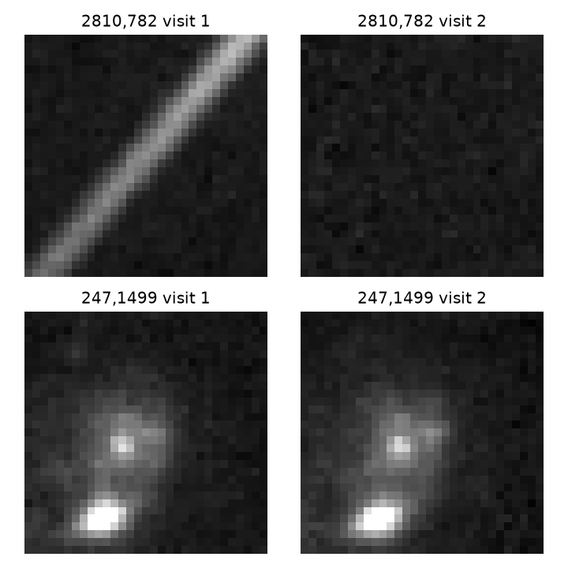

# Euclid development screen: no validated isolated candidate

A bounded two-visit screen of a five-arcminute region in Euclid Deep Field North found **two raw threshold crossings among 41 eligible compact-source tests**. Inspection of the development images showed one crossing lies on a straight streak and the other is blended with a brighter neighbor. Neither is a validated isolated variable. The origin of the streak is unassigned. The third, later visit remains unopened. This result does not establish a variability rate, a survey sensitivity, or the absence of variables in the field.

The source selection began with 269 first-visit centers. Of these, 218 met the first-visit flux and exploratory compactness rules; 165 of those were unusable under the second-visit aperture mask. The remaining 53 had valid paired measurements, including three with nonpositive second-visit flux; 41 had the required ten matched controls. The images use a strict flag rule, and missing measurements are distinct from nondetections. The compactness threshold was tuned after earlier development images revealed streak contamination, and the test thresholds were not calibrated for all searches or for multiple comparisons.



*The same display stretch is used within each row. Left and right are the first and second development visits; coordinates are zero-based pixels in the frozen five-arcminute cutout. These images show why the two raw crossings are not classified as isolated variables.*

A grid of 677 control-aperture differences has robust scatter 0.04481 in the mosaic flux units, compared with a median formal aperture error of 0.03725. These are **control apertures**, not confirmed blank sky: the mask allows the source-detection bit. This diagnostic uses a scale estimated from development data and does not calibrate the final experiment's false-alarm rate. The second raw crossing has a bright neighbor; differences in PSF, aperture losses, blends or backgrounds remain plausible alternatives to variability. No physical attribution is claimed.

## Observations and limits

The Euclid DR1-Foundation reference coordinate is ICRS (273.1670°, 64.3687°), selected from an [IRSA tutorial](https://caltech-ipac.github.io/irsa-tutorials/euclid-intro-mer-images/). The two development mosaics and later reserved mosaic are `102158276_013663548_VIS`, `102158276_028106832_VIS` and `102158276_343226670_VIS`. At the original field center their detector-layering tables identify 5, 4 and 6 covering calibrated images respectively, with disjoint IDs and approximate MJD ranges 60544.949–60544.984, 60673.297–60673.332 and 60708.195–60708.230. Float32 MJD storage limits the time precision. For the blended crossing, the same counts apply at its center; for the streak crossing the counts are 6, 5 and 6. These are point-footprint checks, not proof that every annulus pixel is covered by the same exposures. Full exposure IDs and acquisition receipts are in [layering evidence](followup/layers-summary.json).

The development science, RMS and flag images share matching pixel coordinates to within 0.05 pixel at the cutout center and corners. The five-arcminute parent-image rectangle is x=[0,3000), y=[floor(y_center)-1500,floor(y_center)+1500); source coordinates above refer to that rectangle. The frozen reduction permits VIS flag bits 18 and 24 and excludes every other flagged bit. The meaning and propagation of flags are documented in the [VIS flags reference](https://euclid.esac.esa.int/msp/dpdd/v1.1/_downloads/853cef7b4793c838c2ade9538bd55392/VIS_Flags.pdf) and [MER mosaic documentation](https://euclid.esac.esa.int/dr/dr1/dpdd/merdpd/dpcards/mer_bksmosaic.html); the cited VIS bit definitions are Q1-era documentation and their applicability to these DR1 products warrants further validation. Mosaic OR flags can conservatively reject pixels. The selected mosaics have mixed DR1_R1/R2 processing, leaving shared calibration and reduction differences as alternatives. Point-source isolation, PSF matching, photometric injection recovery and an independent held-out false-alarm calibration were not established.

The exact development and comparison rules were frozen at `37cb9b1`; the five-arcminute acquisition and initial screen were frozen at `85260d1`. The conditional holdout proposal in `followup/HOLDOUT_FREEZE.json` was not executed after independent inspection found the target blended. The full parent image URLs are in [requests](followup/inputs/cutout-requests.json), cutout hashes are in [receipts](followup/pilot-v5/cutout-receipts.json), and the full cutouts remain in `D:\Open-Space\campaigns\euclid-vis-pilot-v5-85260d1-terra61\cutouts`. The source and control stamps are deposited in [stamps.npz](followup/pilot-v6/stamps.npz), with [source measurements](followup/pilot-v6/objects.csv), [control centers](followup/pilot-v5/blank-centers.csv), and [first-visit center list](followup/pilot-v5/selected-centers.csv). The full-frame source-selection denominator requires the retained cutouts or a re-download; stamps alone reproduce the subsequent measurements.

With NumPy, SciPy and Astropy installed, this single command recomputes and checks the deposited per-source values, counts and control-aperture noise offline:

```sh
python results/euclid-foundation-eligibility/followup/check.py --check
```

The WCS test was performed during the full-cutout run; stamps do not independently reconstruct the WCS or original selection. `SHA256SUMS` records deposited evidence hashes. The [Euclid DR1-Foundation supplement](https://euclid.esac.esa.int/dr/dr1/expsup/) describes the release and its deep-field observations.

## Development history

The [initial SIA inventory](inventory.csv) contained 21 science mosaics with missing time fields; a later [layering-table analysis](followup/README.md) established disjoint exposure sets. A first all-zero mask left no comparison sources. The 60-arcsecond signed-flux-predecessor trial had three paired apertures and no adequate control population. The [2.5-arcminute trial](followup/pilot-v4/README.md) similarly lacked enough controls. The first five-arcminute script selected positive flux in both visits and found four crossings, all on linear structures; those exploratory rankings and images are preserved in [v5 evidence](followup/pilot-v5/). The final development script retains signed second-visit measurements and excludes each target from its own calibration. These successive method changes preclude treating this development screen as a blind survey.
