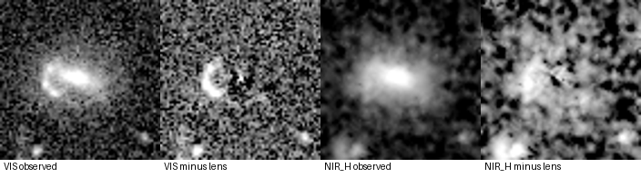

# Euclid Q1 dark strong lenses

**No validated dark deflector emerged. One published grade B candidate has a high mass-to-light ratio under low-redshift interpretations and detectable central light.** Its identification as a strong lens and the source and deflector redshifts remain unconfirmed. The result adds a mass-to-light measurement and an independent search of the Q1 pixels.

## The high-ratio system

**102158888_2659753895653871052** is at RA 265.975390°, Dec +65.387105° (ICRS, catalogue centre). Its published model has effective Einstein radius 0.936″. After subtracting the lensed-source model, the 0.3″-radius core is detected at 49.0σ in VIS and 22.2σ in H. The H-band light inside the Einstein aperture is 21.91 AB. Assigning all observed H flux within that aperture to the foreground lowers the inferred ratio by 11%. The independently released MGE and Sérsic total H magnitudes agree to 0.013 mag.

| Foreground redshift model | Source redshift | Projected H-band M/L within the Einstein radius, median (16th–84th percentile) |
|---|---:|---:|
| Euclid merged PHZ, median 0.17 | 2, assumed | 105.2 (89.0–123.1) |
| Legacy Surveys DR9, median 0.32 | 2, assumed | 54.4 (35.1–76.3) |

Units are solar mass per solar luminosity in the correspondingly blueshifted H passband. This convention compares the galaxy to the Sun through the same rest-frame filter. The two rows are separate conditional analyses. A second Euclid photometric fit to the same blended detection gives a physical-parameter redshift median of 2.457 (central 68% interval 0.208–2.595). If this median is the deflector redshift, H M/L is 10.7 for a source at z=3 and 5.0 for a source at z=4. The high redshift could instead describe the source. Spectroscopy has not identified which component dominates either estimate. For the Legacy redshift model, all 25 redshift-nearest comparison lenses have lower ratios at the same assumed source redshift. Their median is 2.64 and their maximum is 18.32. Redshift, source identification, foreground extinction, PSF and lens-model uncertainties limit the interpretation. The system was selected from the tail of this sample. The comparison is descriptive.

Only one distinct bright residual knot is available for a colour test. With the published centre and radius, a circular isothermal model predicts a VIS counterimage at 11.46σ; its measured flux is −1.19σ. A free-centre isothermal-plus-shear fit shifts the mass centre 0.766″ from the galaxy light and reduces the radius to 0.480″ (shear 0.254). This materially changes the implied mass distribution. A curved light feature plus an independent knot gives nearly the same fit to the same 1,396 VIS pixels (diagonal χ² 920.1 with 21 parameters versus 915.9 with 19 for the lens). At fixed lens z=0.17 the high ratio persists when both mass and light are remeasured in the new aperture. The putative inner component in this flexible fit changes from 11.8σ to 3.5σ in VIS and from 4.6σ to 2.0σ in H when the foreground-light model is changed. [Counterimage test](imaging/secondary_counterimage.csv) · [Recomputed aperture](imaging/secondary_reaperture.csv)

The published mass and light centroids differ by 0.214″. The Q1 spectroscopy pipeline's nominal solution for the blended object has low probability and fails the published Hα quality cuts. The 3.5″ DESI DR1 cone contains no spectrum. A dust attenuation of about 3.29 mag in observed H would reconcile the Legacy-based ratio with the comparison median at the stipulated redshifts; the photometry does not measure that attenuation. The anomaly warrants follow-up spectroscopy of both the crescent and the central galaxy. [Posterior samples summarized by band and redshift](inference/conditional_ML_posterior.csv) · [Matched comparison population](inference/redshift_matched_peers.csv) · [Spectroscopy and mass-to-light inference](inference/README.md)

## What the Q1 data constrain

| Search | Observed result |
|---|---|
| Published SLDE Q1 | The main sample has 497 grade A/B candidates. Three additional grade A/B serendipitous systems bring the in-footprint total to 500. All 312 systems with a usable positive fitted Einstein radius have source-subtracted VIS core S/N ≥19.74. These are detections of central flux given the published decomposition. |
| Remaining 188 A/B systems | Every parent received a search for a bright ring with a faint centre using release cutouts or native IRSA fallback imaging. One configuration passed both VIS filters. Its trial centre is detected at 6.4σ in H and 5.4σ in J. Failed or missing catalogue mass models cannot give measured Einstein masses. |
| Secondary catalogues | The comparison includes 367 AgileLens entries, 36 AstroVink positions, and the 72-object bright/low-redshift extension in the spectroscopic and geometry audit. Catalogue entries overlap. The faint-H AgileLens grade B ring has a fitted radius of 0.566″. Its fitted centre is displaced about 2.2″ from the catalogue position and contains 18.3σ VIS and 23.4σ H light. |
| Independent sky search | Thirty-two preselected native VIS strips across the three deep fields yield 0.08337 deg² of eligible search centres. Of 1,258 first-stage morphology triggers, six passed the radial-profile test. Each received four-band imaging, local photometry and common-source tests. No configuration met the discovery standard. |

The published parent selection required a bright extended VIS detection. A dark deflector with bright arcs can enter through those arcs, but many dark deflectors would be absent. The sky search did not require any catalogue detection. Its fixed ring scales, coverage masks and preference for azimuthally extended emission restrict sensitivity. The 63.1 deg² Q1 footprint supplies the survey context; the smaller measured area is the denominator for this independent search.

Of the 312 positive-radius A/B systems, 298 have a foreground redshift usable for conditional geometry, and 266 have a positive H Einstein-aperture luminosity and M/L estimate. Most redshifts come from blended photometry; the inference tables separate mass floors, source-redshift scenarios, and the three spectroscopic pairs.

A separate grade A object at (265.530607°, +65.463319°) illustrates how redshift can manufacture an extreme ratio. The Euclid merged photo-z is 0.02 and the Legacy photo-z is 0.721. At their nominal medians the source-redshift-independent H mass-to-light floor changes from about 131 to 1.92. The grade A luminous control at (270.085761°, +65.267680°) has a four-image position fit with effective radius 1.339″ versus the published 1.356″. Its 16 image-band measurements all exceed 3σ and are consistent with a common four-band spectrum in the stated aperture test. [Independent fit and cutout](catalog/README.md)

The independent search recovered 213/249 bright simulated lenses with a nearly aligned source and 0/249 equally bright simulations with an offset of 0.45 Einstein radii. The tests do not support a population limit on dark lenses. One sky configuration at (63.900793°, −49.705064°) is ambiguous in VIS; its two principal knots have disjoint 95% catalogue photo-z intervals, and the fitted lens centre is unstable. Full coordinates, images and conditional luminosity limits are recorded for all seven configurations tested in detail.

## Measurements and reproduction

- [Catalogue reconciliation, photometry and independent four-image fit](catalog/README.md)
- [Calibrated image measurements, deflector subtraction and mass-centre registration](imaging/README.md)
- [Mass, light, redshift priors, spectroscopy and conditional posteriors](inference/README.md)
- [Independent sky search, all shortlisted configurations, limits and injections](arc_search/README.md)

Run `python verify.py` from this directory to verify the deposited file hashes, sample accounting, model comparisons, posterior values and injection recoveries without downloading survey data.

This work has made use of the Quick Release (Q1) data from the Euclid mission of the European Space Agency (ESA). The [Q1 release](https://doi.org/10.57780/esa-2853f3b), [Strong Lensing Discovery Engine models and images](https://doi.org/10.5281/zenodo.15025832), and [IRSA MER mosaics](https://doi.org/10.26131/IRSA601) are the primary inputs. The result tables and scripts identify exact products and hashes.
