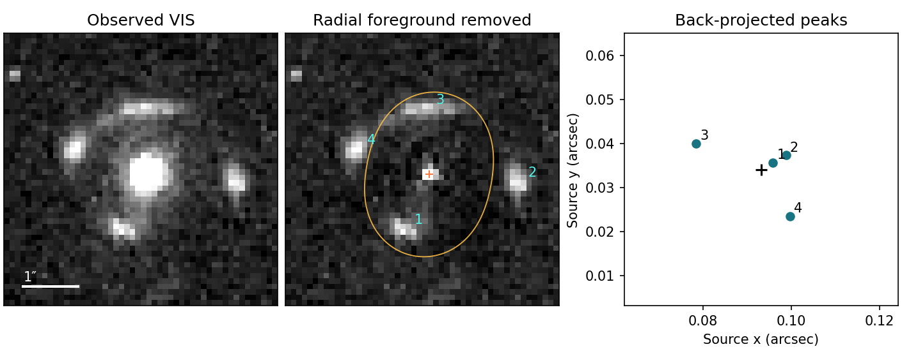

# Catalogue screen and independent lens fit

**The strongest angular H-band outlier is a luminous four-image lens.** At (270.08576118°, +65.26768038°), four peaks in the observed VIS image trace a common source under an independent isothermal mass fit. The effective Einstein radius is 1.339″. The Euclid SIE + shear model gives 1.356″. Euclid assigns separate foreground magnitudes of VIS 22.459, Y 21.113, J 20.815 and H 20.461 AB. The Q1 merged object's photometric redshift is 0.90 (95% interval 0.81–1.08). Attributing that redshift to the galaxy is conditional on the deblending.



## Measurements and selection

The Discovery Engine release has 2,584 rows of mixed grade and footprint. The 500 audit rows in [slde_screen.csv](slde_screen.csv) comprise the published 250 A and 247 B cases in the main search and three additional A cases explicitly marked serendipitous in Q1. The code uses the subset spelling in the file. Off-footprint Galaxy Zoo rows, lower grades and unassigned subset rows are outside this denominator. One unassigned B is tracked in [summary.json](summary.json). The main search started at extended VIS-detected objects brighter than 22.5 AB. The observed magnitude cut applies to detection-system photometry, so a blended arc and galaxy can enter even if their separated light components are fainter. Discovery completeness for galaxies without central light is unknown.

* Each released modelling CSV contains **335 physical rows**, including 326 exact IDs in the 497 main A/B sample, eight grade C and one absent catalogue identifier. Of the 500 audit positions, 174 lack a model row, 12 have no fitted effective-radius median, and two have a zero median. The remaining 312 can be ranked in VIS. The radius is the circularized area of the tangential critical curve. The separate internal mass normalization has another definition.
* The publisher fits multi-Gaussian foreground light and an extended source together. Its model-magnitude medians are finite in VIS for 314 systems (faintest 23.397 AB), in Y for 305 (21.380), in J for 294 (21.070), and in H for 287 (20.787). Missing values stay blank. Flux positivity in a fit that admits a foreground component does not establish a detection or a completeness limit.
* For each band we rank apparent flux per critical-curve area using descending `m_AB + 5 log10(theta_eff / 1 arcsec)`. This is proportional to the logarithm of θ²/F. The solar luminosity, distance ratio, transformed passband, aperture correction and mass-sheet degeneracy do not enter this ranking. At matched *total* magnitude and geometry a larger radius raises this score. Four score columns, their rank, and scaled-MAD distance from the band median appear in the CSV. These distances describe the distribution and have no Gaussian-tail probability interpretation.
* The leading H score is 21.122, versus median 18.658 and scaled MAD 0.760 (285 eligible). The Sérsic alternative brightens H by 0.340 mag. The leading VIS and Y object at (63.79286609°, −48.27152550°) has θ = 1.325″, H = 20.064, a 0.59″ mass/light centre offset and a merged-object photo-z of 1.25 (95% interval 1.18–1.44). Changing from multi-Gaussian to Sérsic light brightens H to 19.441. Unknown source distances preclude classification from these apparent scores alone.

The [AgileLens table](agilelens_screen.csv) contains 367 distinct processed MER detections, of which 130 carry the authors' new flag (9 A and 121 B). VIS uses detection total flux. Y, J and H use two-FWHM aperture fluxes. The values include any arcs, foregrounds and neighbours admitted by the photometry. Joining by identical MER ID links 193 entries to the 500 Discovery Engine A/B positions. A sky match links 205 within 2″ and 222 within 10″. Nearest neighbours at 10″ are provided to inspect offset detections, without imposing a physical association. The counts refer to the released table; the paper's 441 graded cutouts precede its final catalogue processing. The H-faintest new B is EUCLJ035520.57−490933.17, H=23.415 and VIS=23.281. Its merged photo-z is 2.95, 95% interval 0.15–4.37, PHZ flags 10. Its pixel follow-up is in the [imaging directory](../imaging/).

The [AstroVink position crossmatch](astrovink_screen.csv) contains the full 36 A/B positions in Vincken et al. Table 5. None falls within 10″ of the 500 Discovery Engine entries. Two fall within 2″ of an AgileLens entry. The AstroVink Zenodo release contains 33 A/B rows. Thirty-one match paper names exactly, and two more use centres displaced by 2.00″ and 7.33″. The nearest-entry columns retain the discrepancy. Three paper coordinates have no archive A/B centre within 10″. Table 5 supplies the coordinate for each record. The [inspection sheet](astrovink_gallery.jpg) shows all 33 released A/B VIS+Y+J cutouts with the authors’ original display stretch, in catalogue order. Visible objects occupy the arc centres of the clear rings and quads. Several systems are edge-on or crowded. EUCLJ040738.02−495158.5 is off-centred in its release stamp, with a luminous pair beside the arc. The displayed pixel values cannot supply photometric limits. Credit for the stamp images is Saamie Vincken and the Euclid Collaboration, CC BY 4.0, [Zenodo record 17425610](https://doi.org/10.5281/zenodo.17425610).

The [ESA PHZ table](phz_merged.csv) contains exact ID matches for 668 of the 671 unique MER identifiers in the Discovery Engine/AgileLens union, including 495 of 497 in the former main sample and 366 of 367 in the latter. We retain the reported mode areas, quality flags, medians and 70%/95% intervals. These are matched merged-object redshifts. Multiple-image source redshifts require independent identification.

The [one-FWHM MER aperture screen](mer_apertures.csv) covers 706 distinct entries. For the 497 Discovery Engine targets the number of >5 flux/error measurements in VIS/Y/J/H is 494/470/464/469, respectively. For AgileLens it is 363/353/348/351 of 367. Of the 36 AstroVink published lens positions, 35 have a [MER centre](astrovink_mer_links.csv) within 0.5″, and all 35 have VIS aperture flux/error >5 and a [merged-object PHZ record](astrovink_phz.csv). The [additional PHZ query](astrovink_phz_query.json) retains the exact inputs. In the complete 706-entry union, two lack a quoted ≥5 measurement in any band. One is the separately imaged AgileLens IR-faint B. The other is 102158896_2759717332653541075, with MER detection-quality flag 512, VIS uncertainty 117.50 µJy, and missing NISP apertures. Its deblended lens models give VIS 22.50 and H 20.09 AB with θ = 0.475″. The CSV retains the original quality flags, units (µJy), error values and missing bands. One-FWHM photometry reports light at the MER position, including overlapping images. Neither its presence nor a missing NISP aperture certifies the mass centre. The [TAP queries and input hashes](mer_queries.json) also record the close-position searches for AstroVink paper records absent by exact name from its release.

## Four-image control

[refit_control.py](refit_control.py) uses the published calibrated 0.1″ pixels, without a lens-mass prior from the catalogue. A core-flux centroid fixes the model centre. A radial 30th-percentile profile, smoothed between radial bins, subtracts the foreground against which we pick the four brightest separated peaks in the 0.55–2.15″ annulus. A local quadratic refines each peak. The published multi-Gaussian lens-light subtraction is an alternate reduction. The fit treats the four peaks as images of one point in the source. At fixed centre the source-plane lens equations are linear in the SIS scale, two external shear components and two source coordinates.

The fitted SIS scale is 1.307″, shear components (+0.129, −0.051) in cutout coordinates, and source-plane scatter 0.0107″ RMS. The local inverse lens Jacobians give a linearized image-plane scatter of 0.0397″ RMS and predict alternating parity. Six foreground-subtraction and smoothing settings give scales of 1.302–1.315″. Perturbing peak positions by 0.10″ and the common centre by 0.05″ (Gaussian one-coordinate standard deviations) gives a 16th–84th percentile SIS scale of 1.257–1.362″. This is a centroid and source-morphology sensitivity test. It does not marginalize over different lens density profiles or the mass sheet.

After removal of the released foreground model, each band is convolved with the other three normalized PSFs to place all bands at the same effective resolution. Fluxes use identical 0.35″-radius apertures around the four peaks, FITS AB zero points and local blank-aperture median subtraction. All 16 measurements exceed three times their band-specific empirical sky scatter. VIS−H ranges from 0.880 to 1.216 mag. A shared four-band SED with free image amplitudes gives χ²=2.91 for nine nominal degrees of freedom using diagonal sky errors. Foreground-model errors, source Poisson noise, overlap of the PSF wings and common background covariances are outside that statistic. This colour agreement and lens fit strengthen the interpretation of a luminous control. The fit alone does not establish observed image parity, a spectroscopic source redshift or a dark component. Numerical peak positions, photometry and input hashes appear in [refit_control.json](refit_control.json).

## Reproduction and provenance

Run from this directory with writable scratch storage for raw data. The screen, catalogue reconciliation, PHZ and MER queries use the Python standard library; the gallery uses Pillow, and the fit uses NumPy, SciPy and Matplotlib and imports the adjacent archive reader.

```bash
python screen.py /tmp/euclid-dark-inputs
python fetch_phz.py /tmp/euclid-dark-inputs
python astrovink.py /tmp/euclid-dark-inputs
python astrovink_gallery.py /tmp/euclid-dark-inputs
python mer_apertures.py /tmp/euclid-dark-inputs
python astrovink_phz.py /tmp/euclid-dark-inputs
python refit_control.py /tmp/euclid-dark-inputs
```

The screen verifies all six Zenodo CSVs against SHA-256 digests pinned in its source. For the VizieR result, it hashes uncommented, nonblank response lines including header and units, since the server adds the current retrieval date to generated comments. The original VizieR response SHA-256 for this run was `78a7e2b9ed4e65f880c0c8b720ec0fc931f4530dd873d14f363a63e836622639`. [PHZ query snapshots](phz_queries.json) and [AstroVink input digests](astrovink_summary.json) preserve the queries and hashes. The calibrated cutout is a member of the original CC BY 4.0 lens archive, credited to the Euclid Consortium, Walmsley et al. Numeric results in this directory are derived from the attributed authors' data.

* Walmsley et al., discovery search, grade conventions, selection and lens fitting. [Paper](https://arxiv.org/abs/2503.15324) · [Data and model definitions, version 0.0.3](https://doi.org/10.5281/zenodo.15025832)
* Xu et al., *AgileLens*, processed table E.1, per-band photometry and new flags. [VizieR](https://vizier.cfa.harvard.edu/viz-bin/VizieR?-source=J/A%2bA/712/A207)
* Vincken et al., *AstroVink*, Table 5 and candidate release. [Paper](https://arxiv.org/abs/2604.21977) · [Zenodo](https://doi.org/10.5281/zenodo.17425610)
* Euclid Q1 science archive and PHZ catalog. [ESA TAP](https://eas.esac.esa.int/tap-server/tap) · [IRSA Q1 overview](https://irsa.ipac.caltech.edu/data/Euclid/docs/overview_q1.html)
