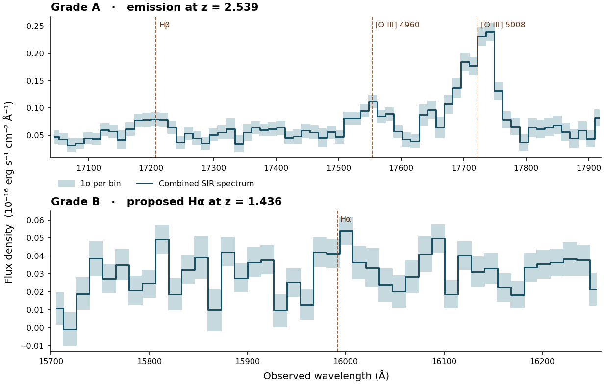

# Redshift ambiguity prevents a high mass-to-light claim for two apparent M/L outliers

At (265.97538953°, +65.38710524°), a grade-B lens candidate has detectable central light and a high Einstein-aperture M/L **only under its lower foreground-redshift interpretations**. With a source fixed at z = 2, the median is 54.4 (16th–84th percentiles 35.1–76.3) using the Legacy Surveys DR9 photo-z distribution, or 105.2 (89.0–123.1) using Euclid's principal PHZ estimate. A separate Euclid physical-parameter fit to the same merged detection gives median z = **2.457**, mode 2.526 and a broad 68% interval 0.208–2.595, despite zero published flags. At that median the H-band geometric floor falls to **0.97**. For a source behind that deflector at z = 3, 4 or 6, the conditional median M/L is **10.7, 5.02 or 3.26**, respectively. The combined NISP spectrum gives no secure component redshift here. The catalogue returns no attenuation estimate for either lead. Strong lensing, the source identity and an exceptional mass-to-light ratio all remain unconfirmed. [Physical-parameter query](lead_physical_query.json) · [Conditional models](conditional_ML_posterior.csv)

For a separate grade-A lens candidate, the two redshift estimates that make the foreground mass-to-light ratio extreme or ordinary also disagree. Three independently fitted emission features in its observed red-grism spectrum support **z = 2.53878 ± 0.00038** for an emitting component. The spectrum integrates over the foreground and arcs, so it cannot locate that emitter by itself.

| System | Redshift evidence | H-band evidence |
|---|---|---|
| 102158888_2659753895653871052, grade B | Euclid merged z = 0.17 (95% 0.11–0.24). Independent DR9 extended-source match 0.102″ away gives 0.320 (0.161–0.739). DESI DR1 has no match within 3.5″. | Source-subtracted H AB = 21.91 inside the Einstein aperture. At the Legacy median redshift the conditional median projected mass and emergent shifted-band luminosity are approximately 1.40 × 10¹¹ M☉ and 2.52 × 10⁹ L☉ under zₛ = 2. |
| 102158887_2655306065654633189, grade A, (265.53060656°, +65.46331893°) | The Euclid and DR9 95% ranges are disjoint. Euclid gives 0.02 (0.01–0.05), whereas an extended DR9 source 0.242″ away has 0.721 (0.290–0.930). No DESI redshift within 3.5″. | H AB = 20.79 inside 0.607″. At zₛ = 2 the conditional median M/L changes from 133 to 3.80 using DR9. The apparent extreme breaks under independent photometry. |

For grade B, none of 25 other A/B deflectors closest to the Legacy median redshift exceeds its median ratio under the same zₛ = 2 assumption. Their z range is 0.27–0.38, median M/L is 2.64 and maximum is 18.3. Reducing 54.4 to 2.64 by dust alone would require 3.29 magnitudes of attenuation in observed H (rest near 1.35 μm for z ≃ 0.32). This calculation measures the size of the required correction. There is no independent extinction measurement here. Diffuse or missed extended light, an incorrect source reconstruction, and external convergence remain unquantified. The released lens model has external shear 0.110 and a mass–light centroid separation of 0.214″. Euclid MER has one object within 3.5″, coincident with the catalogue centre. This tests for resolved companions at that distance. The two comparison photo-zs can both blend the deflector and arcs. Local ranks after selecting the largest ratios do not constitute a false-alarm probability. See [pixel measurements and cutouts](../imaging/) and [posterior quantiles](conditional_ML_posterior.csv).

## Spectroscopic and same-position checks



The official ESA SPE rank-0 galaxy table returns entries for **427 of 497** primary A/B objects. The full query covered 554 distinct MER IDs including all model keys and 51 MER sources from the seven morphology triggers, two re-centred Agile targets and two M/L leads. Three primary objects pass the published Q1 criteria (rank zero, 0.9 < z < 1.8, probability ≥0.99, Gaussian-fit Hα flux ≥2 × 10⁻¹⁶ erg s⁻¹ cm⁻² and S/N ≥5). No object from the 11 follow-up cones passes. The three passing IDs and redshifts are −584961967491933103 (1.0343), −624049517477067447 (1.4479) and 2755778332656876880 (1.7942). These are integrated-object spectra; the line origin can be in the background. [Q1 thresholds](https://euclid.caltech.edu/page/euclid-q1-data-faq) · [Official rank-zero matches](spe_rank0.csv) · [Official fitted lines](spe_lines.csv) · [Query hashes](spe_manifest.json)

For the **grade-B** system, the official best galaxy solution gives z = 1.436 and probability 0.524. Its Hα Gaussian-fit flux is negative (−4.93 × 10⁻¹⁷ erg s⁻¹ cm⁻²). We inspected the calibrated combined 1D SIR spectrum for this exact MER ID and fit local linear continua plus Gaussian line profiles. At that redshift the candidate Hα feature reaches 2.73σ or 1.58σ for assumed FWHM of 50 or 85 Å. At the alternative merged physical-parameter z = 2.457, Hβ and the [O III] doublet are below 2σ in the 50 Å fits. The failure to detect an emission line does not exclude a quiescent high-redshift deflector. Only one bright arc-like knot is measurable in the images. See [image evidence and competing fits](../imaging/) and [spectral window tests](sir_line_checks.csv).

For the **grade-A** system, the Q1 pipeline reports z = 2.540 and Hβ S/N = 5.34 outside its recommended Hα redshift range. A new fit to the combined calibrated SIR spectrum gives free line amplitudes with S/N 4.22, 4.79 and 12.03 for Hβ, [O III] 4960 and [O III] 5008. The [O III] flux ratio is 3.59 ± 0.67. The shared-redshift fit gives χ² = 60.95 over 50 degrees of freedom and FWHM = 64.3 Å. Statistical errors include residual scatter and omit wavelength calibration and slitless contamination systematics. This corroborates the published high-redshift solution for the unresolved emitter. The inclusion of this redshift in the grade-A M/L table explicitly assumes that the arcs produce the emission. There is no separate foreground spectrum. [Observed-spectrum fit](sir_gradeA_features.json) · [1D source IDs and FITS extensions](lead_spectra_query.json)

In the spectrum fits, each retained bin has a valid calibrated flux (MASK even and <64), at least two contributing dithers and a positive error. The 50/85 Å diagnostics use a local linear continuum within 260 Å, an additional fixed-ratio [O III] 4960 component for the doublet test, and no photometric-redshift prior. The separate grade-A fit frees both [O III] amplitudes and fits a common redshift and width. A single SIR aperture cannot establish matching spectra for multiple images.

We separately matched both M/L leads on the sky against all 15,072 entries of the released ECLIPSE-D v1 table. The closest entries are 2.4800° away for A and 2.4782° for B. Neither has a deblended-redshift counterpart in that release. [Nearest neighbours and file fingerprints](eclipse_nearest.csv)

## Sample and mass conventions

The released mass table has 335 rows. Exactly 334 IDs occur in the discovery catalogue. The joined table contains 322 finite radii and 314 adopted foreground redshifts. Both exist for 300 systems. Of these, the source-subtracted Einstein-aperture flux clears the 5σ criterion in 283 VIS, 280 Y, 274 J and 267 H measurements. Three joined systems have grade-A Palomar background redshifts and finite radii and aperture flux. Their H-band M/L values are 1.71, 2.82 and 3.29. The astrophysical inference is tied to the selection and source-light model of the original Q1 catalogues.

- [redshift_geometry.csv](redshift_geometry.csv) records every joined system, the adopted z and its provenance. The Q1 photo-z intervals are for the merged detection. Only unambiguous PHZ galaxy classification (= 2) enters as the sole foreground-redshift estimate. A PHZ quality flag can still be nonzero. Inspect [catalogue quality flags](../catalog/phz_merged.csv).
- [desi_matches.csv](desi_matches.csv) records all spectral matches within 2″ at the DESI mean fibre position, including secondary spectra and failures. Among 41 returned rows for 31 modelled positions, 30 pass the spatial and quality preselection. A single galaxy within 1″ with primary spectrum, ZWARN = 0, Δχ² ≥ 25, positive z and agreement with the merged Euclid estimate to 0.1(1+zₚ) can supply the foreground redshift. A fibre match alone cannot assign a second redshift to a lensed image. Rojas et al. spectroscopy has priority. Their tables supply the adopted foreground redshift for 11 systems, DESI supplies 19 more and 284 use merged PHZ.
- [mass_light.csv](mass_light.csv) gives measured band luminosity in units of **the Sun in the same rest-frame shifted observed filter**. For example, at z = 0.32 the H filter samples rest wavelengths around J. The subscript E denotes a circular aperture at the published effective Einstein radius and mass centre. Total MGE light is reported separately. Foreground light at observed wavelengths includes internal and Galactic extinction. No conversion to stellar mass or halo dark-matter fraction is made.
- For flat ΛCDM (H₀ = 70 km s⁻¹ Mpc⁻¹, Ωₘ = 0.3), the circular-equivalent projected lensing mass scale is M = c²θ²Dₗ/(4Gβ), β = Dₗₛ/Dₛ. This approximation uses an effective radius from an SIE plus external shear. The value M_beta1 assumes β = 1, a conservative source-geometry lower scale at the adopted zₗ. Any finite background source has β < 1. This bound depends on foreground redshift and lens interpretation. It neither provides a posterior for an unmeasured zₛ nor accounts for a mass sheet. Three spectroscopically paired systems have explicit β.
- The shifted-filter absolute AB magnitude is m − 5 log₁₀(Dᴸ/10 pc) + 2.5 log₁₀(1+z). The Sun's absolute AB magnitude is integrated separately through each shifted photon-counting passband using CALSPEC at 1 au scaled to 10 pc. This computes emergent in-band M/L without extrapolating a galaxy SED. It changes rest band with redshift. Common-redshift peers reduce this effect.
- The net light equals observed counts minus the published image-plane source model and local sky. Missing aperture entries stay blank. At low significance we conservatively use max(0, net flux) + 5σ to obtain L_E_upper5; σ reflects the pixel/noise procedure in imaging/. ML_E_conservative5_beta1 divides the geometric floor by this upper flux at fixed z and θ. This convention includes neither extrapolated completeness nor foreground–source model systematics. A light detection can still contain other objects.
- [ecker_bright_geometry.csv](ecker_bright_geometry.csv) treats the independently published 72 bright Q1 systems as a separate control sample. The released CSV has 40 populated Einstein radii; three of these have only explicitly uncertain parenthesised photo-zs. The 37 retained rows combine published redshifts, radii and catalogue VIS magnitudes into a mass-to-catalogue-light scale. These magnitudes and the modelled Einstein aperture are different apertures. [Paper F](https://arxiv.org/abs/2603.28580)

## Conditional posterior and selection effects

[posterior.py](posterior.py) makes 48,000 draws per scenario (seed 16032025). It treats the published radius median and nominal one-sigma limits as a two-sided Gaussian scale and propagates independent Gaussian aperture-flux noise with a positive-flux prior. The aperture is fixed at the nominal model radius; radius–flux, source–deflector and redshift–photometry covariances, PSF/deblending errors, profile choice, extinction and lens-identification probabilities are outside these conditional intervals. The radius fits for the two leads are narrow. The quoted intervals quantify measurement precision under the chosen model.

For photometric leads, percentile knots are interpolated and samples restricted to the published 95% lens-redshift interval. The Euclid 70% and 95% interval endpoints are treated as approximate equal-tailed quantiles (the tabulated intervals come from the merged detection). DR9 supplies the median and 68%/95% endpoints. These are separate conditional approximations; multiplying the likelihoods would artificially sharpen the result. Three fixed source-redshift scenarios (1.5, 2, 3) expose the geometry dependence for the two low-redshift models. The grade-A table also tests the redshift measured from its unresolved line emission as a possible source plane. For grade B, an additional fixed foreground-redshift branch uses the alternative PHZ physical-parameter median and background sources at 3, 4 and 6. Its posterior omits the unmeasured probability of that branch and its enormous redshift uncertainty. Spectroscopic controls fix the two available spectroscopic redshifts. [Per-band conditional posteriors](conditional_ML_posterior.csv) · [H-band comparison populations](redshift_matched_peers.csv)

The comparison chooses the closest 25 other grade A/B systems in adopted z with ≥5σ H-aperture light, omitting both leads, requiring zₗ < zₛ, and accepting spectroscopic deflectors or unflagged merged photo-zs with 95% width ≤0.3(1+z). The grade-A Euclid z = 0.02 interpretation has **no close redshift-matched population**. Its nearest 25 span 0.14–0.37; the 25-object statistic there is extrapolative. Under DR9 its nearest 25 span 0.69–0.75 and five exceed its median. The foreground light requirement, unknown source redshifts and human lens grades limit population interpretation.

## Reproduction and provenance

Run these commands with Python 3, NumPy, SciPy, Matplotlib and lxml from this directory. DATA denotes the directory containing the hash-verified Zenodo SLDE CSVs used by catalog/screen.py. Products in this directory include the input solar calibration, extracted catalogue controls and exact-match query snapshots.

```sh
python prepare_reference.py /tmp/euclid_ref .
python desi.py "$DATA" /tmp/euclid_desi .
python legacy_check.py
python eclipse_check.py
python trigger_cones.py ../arc_search/profiles
python spe_check.py "$DATA" /tmp/euclid_spe
python sir_check.py /tmp/euclid_sir
python sir_features.py /tmp/euclid_sir
python sir_plot.py /tmp/euclid_sir
python infer.py "$DATA" ../catalog/phz_merged.csv ../imaging/apertures.csv
python posterior.py "$DATA" ../catalog/phz_merged.csv
```

The 17 ordered DESI queries and their responses are SHA-256 fingerprinted in [desi_manifest.csv](desi_manifest.csv). Batch IDs and exact SQL are deterministically reconstructed by the script. [cone_responses.json](cone_responses.json) and [legacy_responses.json](legacy_responses.json) preserve exact query strings, response CSV and checksums. Positional matches on the new arc-search triggers include components within 3.5″, with actual radial offsets; independent lens/source assignments and spectral matches between observed images are unavailable. Spectra from the withdrawn Tata analysis were excluded. The newer ECLIPSE-D article describes deblending tests on Q1, but the version-1 public redshift file inspected contains the 15,072 DR1 table rows. The Q1 PHZ catalogue used here is the merged-source product.

Sources include [SLDE-A models and photometry](https://zenodo.org/records/15025832), [Rojas et al. optical spectroscopy](https://arxiv.org/abs/2503.15325), [Ecker et al. bright control catalogue](https://zenodo.org/records/19260200), [ESA Q1 PHZ data model](https://euclid.esac.esa.int/dr/q1/dpdd/phzdpd/dpcards/phz_phzpfoutputcatalog.html), [DESI DR1](https://data.desi.lbl.gov/doc/access/database/), [Legacy Surveys](https://datalab.noirlab.edu/data/legacy-surveys), [CALSPEC](https://www.stsci.edu/hst/instrumentation/reference-data-for-calibration-and-tools/astronomical-catalogs/calspec), [SVO Filter Profile Service](https://svo2.cab.inta-csic.es/theory/fps/), [ECLIPSE-D release](https://zenodo.org/records/19654904), and [Tata withdrawal record](https://arxiv.org/abs/2604.02726). This work has made use of the Quick Release (Q1) data from the Euclid mission of the European Space Agency (ESA).
