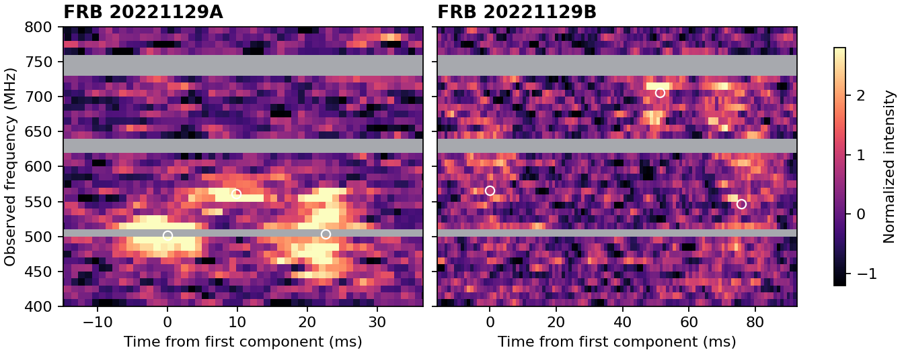

# Two successive radio bursts put their middle pulse at higher frequency

On 2022 November 29, the repeating source FRB 20220912A produced two consecutive CHIME/FRB catalog detections 215.517 seconds apart. Each comprises three time-resolved components. The observing frequency of the brightest part rises and then falls within each triplet. The middle component exceeds its higher-frequency neighbor by 57.28 MHz in FRB 20221129A and 140.31 MHz in FRB 20221129B. Later bursts C and D that transit have one catalog component each. CHIME had already detected and fitted all four bursts. This analysis identifies the paired ordering, measures its rarity among comparably resolved catalog pairs, and tests it against the released Stokes-I measurements. [Catalog 2](https://chime-frb.ca/catalogs/catalog2) · [Event A](https://chime-frb.ca/catalogs/catalog2/FRB20221129A) · [Event B](https://chime-frb.ca/catalogs/catalog2/FRB20221129B)

| Measurement | FRB 20221129A | FRB 20221129B |
| --- | --- | --- |
| Event ID / formed beam | 252938572 / 3126 | 252939989 / 1126 |
| Component times from first arrival (ms) | 0, 9.90, 22.31 | 0, 50.84, 75.62 |
| Published fitburst peak frequencies (MHz) | 501.35, 560.95, 503.67 | 565.91, 706.21, 546.30 |
| Centroids measured from the intensity array (MHz) | 508.9, 542.4, 507.3 | 574.7, 652.7, 585.6 |
| Fraction of normalized intensity above dividing frequency | 0.193, **0.701**, 0.294 (>530 MHz) | 0.203, **0.839**, 0.339 (>650 MHz) |



White rings mark catalog peak frequencies at pulse-gate midpoints. Each panel uses its own time scale. The plot averages 10 MHz bands, smooths over three 0.983 ms samples, and uses the off-pulse scatter in each band for normalization. Gray bands lack 40 usable frequency channels. All quantitative results use unsmoothed samples.

## How often does this happen in the catalog?

The release contains 5,045 component rows. After excluding flagged events and sidelobes, 4,147 events remain, including 101 with at least three fitted components. A qualifying triplet comprises three successive components with all peaks inside 410–790 MHz. Each gap must exceed twice the larger fitted width of its neighboring components. For each burst we calculate the largest middle peak minus the higher of its two neighbors across eligible triplets. This yields 61 events. These cuts followed inspection of the data. The initial exploration also tested long-term frequency evolution in repeaters. None of the trends in frequency survived correction across sources. [All 61 events](resolved-events.csv) · [Catalog paper](https://arxiv.org/abs/2601.09399)

Across repeaters there are six pairs of consecutive qualifying catalog detections for which both events have a resolved triplet. Three occurred within 30 minutes. The 2019 May 19 and 2022 December 3 pairs both have negative middle excursions in both events. The November 29 pair is the only one with two positive excursions. FRB 20220912A alone supplies 11 eligible events, and November 29 contains its two largest excursions. Holding its times fixed, two of the 55 possible placements of those two largest values fall on consecutive, qualifying detections within 30 minutes. That fraction is a descriptive check conditional on the selected source and cuts. The tiny number of pairs, shared observing conditions, and exploratory selection preclude a calibrated population significance or an inferred recurrence rate. [All eligible neighboring pairs, including long intervals](adjacent-events.csv)

## Check against observed intensities and dispersion

The replay reads the released HDF5 intensity arrays. Each uses 16,384 frequency channels, with 9,965 passing all masks in event A and 9,870 in event B. We retain channels passing the calibration, frequency and all-time pixel masks, subtract their off-pulse means, and divide by their off-pulse standard deviations. The baseline excludes the catalog emission gates plus ten time samples on each side. We sum all surviving channels in each gate. The high-band fraction divides the baseline-subtracted sum above a fixed threshold by the sum across the band. Both thresholds were chosen between the published low and high peaks. The centroid uses all channels without a frequency threshold. Frequency-response weighting and noise affect both measurements. [Raw observations, DOI 10.11570/25.0066](https://doi.org/10.11570/25.0066) · [Full pulse measurements](pulse-colors.csv)

To gauge noise sensitivity we subtracted each available equal-duration blank gate from its on-pulse measurement, centering the blank-gate sums first. The 2.5–97.5% noise envelopes for the three fractions are 0.087–0.312, 0.537–0.835, and 0.211–0.382 in A. In B they are 0.028–0.319, 0.707–1.026, and 0.257–0.407. Overlapping blank gates and the original selection limit their use as inferential intervals. Baseline subtraction permits estimated fractions outside zero to one.

The fitted dispersion measures differ by 3.05 pc cm⁻³ (219.893 and 222.938). We shifted each channel's integration window according to trial dispersion, retaining the pulse arrival time at its catalog peak. Both events retain a greater middle high-band fraction at common trial measures of 219.46, 219.893, and 220.5. At 221.5 the second and third fractions in A nearly meet (0.381 and 0.356). At B's fitted 222.938 the middle of A falls below its last pulse (0.393 versus 0.491). A's frequency centroid also loses its ordering in some trials. Thus the clean recurrence is a measurement at each event's fitted dispersion, with a real sensitivity to adopting the highest common value. The events share a telescope and transit, and a chromatic response can weight their spectra, although the formed beams differ. Frequency ordering refers to three component peaks. Its physical origin and any preferred repetition interval remain unresolved.

## Prior work and replay

Sheikh et al. observed downward-drifting sub-bursts from this source with the Allen Telescope Array. FAST measured complex polarization structure, and Abbott et al. traced this source's activity, dispersion and waiting times with CHIME/Pulsar. Upward and mixed drifting morphologies exist in other sources. The event pages and catalog publish the individual November 29 measurements. Searches by both event names, source name and morphology, and the source-specific papers reviewed here yielded no earlier discussion of these two consecutive triplets together. [ATA study](https://doi.org/10.1093/mnras/stad3630) · [FAST study](https://doi.org/10.3847/1538-4357/aced0b) · [CHIME/Pulsar monitoring](https://arxiv.org/abs/2604.09098) · [Earlier drift measurements](https://academic.oup.com/mnras/article/507/1/246/6324574)

From this directory run the following commands using Python with NumPy, h5py and Matplotlib installed. Only the last two scripts need scientific packages. The scripts verify SHA-256 hashes of the original catalog CSV and the two HDF5 files. The CSV tables and image in this directory are the replay outputs.

```sh
mkdir -p /tmp/chime-triplets
python screen.py --catalog /tmp/chime-triplets/catalog.csv
python waterfalls.py --cache /tmp/chime-triplets
python figure.py --cache /tmp/chime-triplets
```
