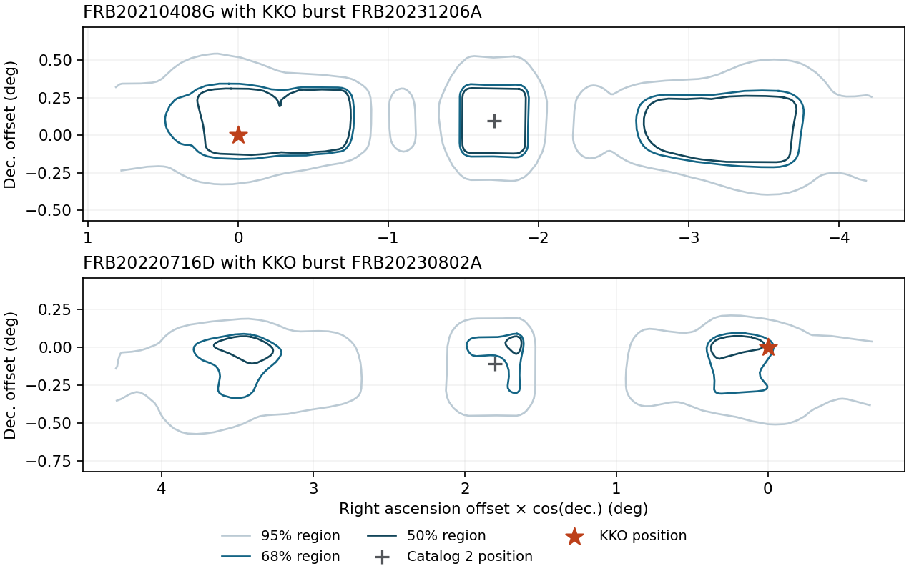

# Two earlier radio bursts fall on alternate beam positions of CHIME/KKO bursts

FRB 20210408G is a candidate earlier burst from the source of FRB 20231206A. The detections occurred 972 calendar days apart. CHIME measured the April burst at fitted signal-to-noise 14.9. The later burst was localized with the 66 km baseline from CHIME to its KKO Outrigger. Its position falls inside one of the earlier burst’s 50% sky-localization contours, 1.70° from the catalog’s preferred position. Their dispersion measures (DMs) differ by 1.20 pc cm⁻³. The later burst has a published host galaxy at spectroscopic redshift 0.0659, in the direction of a galaxy cluster. The earlier burst would share that host if the association holds. [KKO host-galaxy paper](https://arxiv.org/abs/2502.11217) · [Catalog 2](https://doi.org/10.11570/25.0066)

A second pair, FRB 20220716D and FRB 20230802A, has an even closer DM match and a nearby competing source. The later burst’s KKO position falls inside the earlier burst’s 68% contour. The two uniform CHIME spectral fits differ by 0.0430 pc cm⁻³ across 382 calendar days. Both real-time detections landed in the same, coarser DM search bin. The July localization also admits the position of a previously published repeater candidate. This pair therefore needs a more precise localization of the July event. [CHIME repeater study, Table A](https://arxiv.org/html/2605.08410v1#A0.T3) · [August spectral fit and operating flags](https://chime-frb.ca/catalogs/catalog2/FRB20230802A)

| Earlier event / CHIME ID | KKO event / CHIME ID | DMs, earlier → later (pc cm⁻³) | KKO right ascension, declination (ICRS degrees) | Smallest archived contour containing KKO |
| --- | --- | --- | --- | --- |
| FRB 20210408G / 167322672 | FRB 20231206A / 342760050 | 456.4748 → 457.6700 | 112.442845, +56.256274 | 50% |
| FRB 20220716D / 236190864 | FRB 20230802A / 307424887 | 305.5908 → 305.5478 | 339.284500, +30.788721 | 68% |



The crosses mark the earlier events’ catalog positions. Each star marks a later KKO observation. The disconnected contours trace sky positions compatible with the relative intensities measured across CHIME beams. The quoted confidence describes the union of all islands for one burst, rather than the probability of a common source. The orientations are conventional, with east to the left, and the axes use the later position as their origin.

## Search and controls

Starting with all 4,539 distinct events (5,045 component rows) in CHIME/FRB Catalog 2, the screen retained 3,187 events having a fitted DM and position, a blank repeater label, and both sidelobe and parameter-exclusion flags clear. In Outrigger Catalog 1 we used all 81 of 83 events with a blank repeater label. Thus a known repeater documented elsewhere can still enter through an older catalog label. The code excludes self-pairs by event ID and name. The dates can overlap across the two releases. All screening and control operations use the same population. [CHIME/FRB Catalog 2 paper](https://arxiv.org/abs/2601.09399) · [Outrigger Catalog 1](https://chime-frb.ca/catalogs/outriggers1)

For an Outrigger event also in Catalog 2, the code takes its Catalog 2 fitted DM when present. Otherwise it uses the Outrigger catalog DM. Both come from CHIME. We matched at fixed declination difference ≤0.5° and absolute DM difference ≤5 pc cm⁻³, leaving 22 distinct event pairs before examining right ascension. For each we used the complete archived localization contours, including disconnected islands. The declination cut limits coverage, especially near the pole. A 0.5° radius around the catalog positions misses both pairs. All 22 pairs, including misses, appear in [results.json](results.json).

The initial exploration compared trial sky distances and DMs, then checked promising fields in the archived maps. The following cut sensitivity and control counts describe that exploratory search. Each control rotates the entire Outrigger sample by the same offset in right ascension, preserving declinations, dispersion measures, sky-pattern geometry and the earlier burst maps. For 35,999 nonzero offsets at 0.01° spacing, we measured how often at least two pairs passed. Adjacent rotations are highly correlated, so these fractions are fractions of sky rotations, with the effective independent sample size substantially smaller. Individual association probabilities require a population model.

| Maximum DM difference | Contour | Observed pairs | Mean pairs per rotated sky | Rotations with ≥2 pairs |
| --- | --- | ---: | ---: | ---: |
| 2 pc cm⁻³ | 50% | 1 | 0.0335 | 36 / 35,999 |
| 2 pc cm⁻³ | 68% | 2 | 0.0461 | 50 / 35,999 |
| 2 pc cm⁻³ | 95% | 2 | 0.1340 | 270 / 35,999 |
| 5 pc cm⁻³ | 68% | 2 | 0.1416 | 93 / 35,999 |
| 5 pc cm⁻³ | 95% | 2 | 0.3376 | 850 / 35,999 |

With the narrower 0.05 pc cm⁻³ DM cut and 68% contour, 159 of 35,999 offsets produce at least one match, compared with one on the real sky. Over only ±6° to ±30° of rotation, 75 of 4,802 offsets produce one or more matches and none produce two under the 2 pc cm⁻³ / 68% cuts. A rigid rotation can change Galactic foreground contributions and observing sensitivity with right ascension. The controls also destroy real local groupings, including the competing position in the July field. They cannot distinguish an individual repeater from two different nearby sources.

## Prior work and the competing position

The 2026 CHIME repeater study searched through 15 September 2023, before FRB 20231206A. Searches on 14 November 2026 for both exact event-name pairs, their individual names and the earlier CHIME event IDs, plus inspection of the study’s source tables, did not identify a paper assigning the April 2021 burst to the December 2023 source. The Outrigger paper already established the latter event’s host and discussed the galaxy cluster. The proposed earlier emission episode is the contribution here. [Repeater survey](https://arxiv.org/abs/2605.08410) · [Outrigger paper](https://arxiv.org/abs/2502.11217)

For the July field, the repeater survey’s Table A gives FRB 20230629A, a two-event candidate, at (339.332°, +30.781°), with DM 303.835 pc cm⁻³. This is 2.49 arcmin from the August KKO position, whose quoted one-sigma major and minor axes are 0.229 and 0.033 arcmin. Both positions are inside the July burst’s 68% island. The published table reports source names and aggregate properties. We could not verify its component membership from that table. The June event’s Catalog 2 fit gives 296.6512 pc cm⁻³, illustrating how the DM estimator matters in this field. The August Outrigger DM is 305.303, the same coarse detection bin as July; the closer 0.0430 difference comes from comparing fitted DMs. The August event also carries a population-inference flag because CHIME’s real-time grouping was offline. Its independent KKO localization still exists. These complications prevent a unique source assignment. [Repeater candidate table](https://arxiv.org/html/2605.08410v1#A0.T3) · [KKO measurements](https://chime-frb.ca/catalogs/outriggers1) · [August event](https://chime-frb.ca/catalogs/catalog2/FRB20230802A)

The most direct discriminator is a voltage-data localization for **event 167322672** relative to the KKO ellipse of FRB 20231206A. For **event 236190864**, it must distinguish the KKO position from the published candidate 2.49 arcmin away. Another burst localized to KKO would establish repetition there while the identity of the earlier event could still be open. A November 2026 paper uses a second CHIME baseband sample and describes the source catalog as in preparation. We did not obtain any individual voltage localization for either earlier event from that study. [Baseband sample](https://arxiv.org/abs/2611.12860)

## Reproduction

From this directory, run the following with Python 3.10 or later and NumPy and Matplotlib installed. The first command uses the retained contours and runs offline. The comparison should succeed without output.

```sh
python analyze.py > replay.json
cmp replay.json results.json
```

The release tables and the 22 original HDF5 maps are identified by SHA-256 in [sha256.json](sha256.json). With h5py installed, the second mode downloads those files to the supplied cache, verifies each hash, re-extracts the full screening population and contours, and checks equality with the retained input. To regenerate the figure, add `--plot localizations.png`.

```sh
python analyze.py --from-archives /tmp/open-space-frb-archive > replay.json
cmp replay.json results.json
```

Measurements and localization products are by the CHIME/FRB Collaboration and the CHIME/FRB Outriggers collaboration. The frozen inputs are Catalog 2 version 20251231, Outrigger Catalog 1 version 2502.11217v2, and the Catalog 2 localization HDF5 products. [Catalog 2 release](https://doi.org/10.11570/25.0066) · [Outrigger release](https://chime-frb.ca/catalogs/outriggers1)
